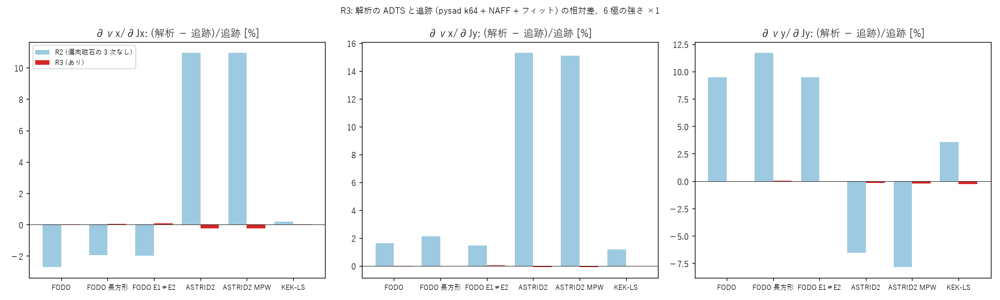

# 偏向磁石の 3 次の項を入れた解析の ADTS と追跡の比較

**この文書で分かること**: 偏向磁石の 3 次の項 (曲率・硬い端・複合機能の本体の K1・E1/E2 ≠ 0 の端) を入れた解析の ADTS が、追跡 + NAFF の直接のフィットと何 % まで一致するか (入れない場合は FODO・ASTRID2 で 3〜15% ずれ、入れると 0.3% 以内)。
**前提**: `adts_direct.md` (直接のフィットの手順と、偏向磁石の 3 次なしの解析との差)。
**読む順**: 結果の要約の表 → 残った差の原因。解説は `docs/25_resonance_terms_adts.md` (§8)。実装は `pysad/bendnl.py` と `resdrive.adts(bend_cubic=True)` (既定 ON)。
ラティス: FODO (`example/00_lattice/FODO_ring.sad`、SF・SD の K2L = 4, −6、3 GeV、105.6 m、24 セル、偏向磁石 E1=E2=0.0343 rad)、FODO 長方形 (E1=E2=ANGLE/2)、FODO 非対称 (E1=0.8·ANGLE、E2=−0.3·ANGLE)、ASTRID2 (`example/astrid/lattice/ASTRID2_v01_01.sad`、0.58 GeV、45.7 m、30° の複合機能偏向磁石 K1=−1.68)、ASTRID2 MPW (`ASTRID2_v01_02_id.sad` の `RINGMPW`)、大きなリング A (`pysad/tests/kek-ls_v03_12.lat`、3 GeV、603 m)。
条件 (すべて): pysad k64 (gs と同じ式) の追跡 (RF 空洞止め `rfsw=False`、放射なし、結合なし、δ=0、閉軌道 0)、gs は `NORFSW;`、1024 周、NAFF は Laskar の Hann 窓 (p=1) で線形のチューン ± 0.02 を探す、J の格子 Jx, Jy ∈ {0, 1/5, …, 1}·Jmax の 35 点 × (φ, φ+π) の対 = 70 粒子 (Jmax = FODO 1e-7、ASTRID2 2e-8、大きなリング A 2e-10、単位 m rad、リング先頭の J)、全次数 ≤ 2 の多項式のフィット、偏向磁石の分割 nslice=16。6 極の強さは K2 を λ 倍 (8 極は変えない)。

| ファイル | 内容 |
|---|---|
| `adts_bend.py` | 本体。`scan リング [--lams 0,0.5,1,2]` (6 極の強さの走査: 解析 (偏向磁石の 3 次なし・あり) と追跡)、`conv リング` (nslice への収束)、`gs リング --lam λ` (WSL の gs、timeout 1800 s、1 本ずつ)、`plot` |
| `adts_bend_scan_{fodo,fodo_rect,fodo_asym,astrid,astrid_mpw,kekls}.pysad.txt`・`.json` | 6 極の強さ ×λ ごとの内訳 (6 極 2 次・8 極 1 次・運動学・K1 の端・偏向磁石 3 次どうし・交差項)、解析の合計 (偏向磁石の 3 次なし・あり)、追跡、相対差 |
| `adts_bend_conv_{fodo,astrid,astrid_mpw,kekls}.pysad.txt` | nslice = 1〜64 への収束 (2 倍ごとに 1/4) |
| `adts_bend_gs_{astrid_lam0.5,fodo_lam2,kekls_lam2}.gs.txt` | 検証用: gs (SAD 本家) の追跡のフィット |
| `adts_bend.png` | 6 極 ×1 の解析と追跡の相対差 (偏向磁石の 3 次なし・あり、xx・xy・yy、6 リング) |
| `adts_bend_scan.png` | 6 極の強さ λ に対する相対差 (偏向磁石の 3 次なし・あり) |

6 リング (FODO、長方形、E1≠E2、ASTRID2、ASTRID2 MPW、KEK-LS) の、6 極の強さ ×1 での ∂νx/∂Jx、∂νx/∂Jy、∂νy/∂Jy の「(解析 − 追跡)/追跡」[%]。水色は偏向磁石の 3 次の項なし、赤は入れた場合。偏向磁石の 3 次の項を入れると、ASTRID2 で 15% に達していた差がほぼ 0 になる。

結果の要約 (6 極 ×1、[1/(m rad)]、(xx, xy, yy)。(解析 − 追跡)/追跡):

| リング | 解析 (偏向磁石の 3 次あり) | 追跡 (pysad k64) | 偏向磁石の 3 次なしの差 | **偏向磁石の 3 次ありの差** |
|---|---|---|---|---|
| FODO | 408.84, −412.90, 519.77 | 408.99, −412.74, 519.95 | −2.7%, +1.6%, +9.5% | −0.04%, −0.04%, −0.03% |
| ASTRID2 | 469.82, 1303.74, 1482.98 | 470.96, 1304.81, 1485.80 | +10.9%, +15.3%, −6.5% | −0.24%, −0.08%, −0.19% |
| ASTRID2 MPW | 469.80, 1508.15, 1708.53 | 470.96, 1509.42, 1712.28 | +10.9%, +15.1%, −7.8% | −0.25%, −0.08%, −0.22% |
| 大きなリング A | 50702.5, −41049.4, −6545.0 | 50709.5, −41042.5, −6527.8 | +0.19%, +1.2%, +3.6% | −0.014%, −0.017%, −0.26% |

残った差は 6 極の強さに依らない定数 (FODO 0.1〜0.2、ASTRID2 1.1・1.1・2.6、大きなリング A 7.0・6.9・17 [1/(m rad)]): 四極・K1 つき偏向磁石の本体の 4 次の項 (この解析 (`fourth='r3'`) では未解決。精密版 `fourth='r6'` は `rdt4_normal_form.md`・`adts_exact_terms.md`)。
検証: gs の追跡のフィットは pysad k64 と 1e-9 以内で一致する (上の `adts_bend_gs_*.gs.txt`)。
再現: `py -3.12 example/14_nonlinear_dynamics/adts_rdt/adts_bend.py scan fodo` (数分以内。大きなリング A は 1 λ あたり約 40 s)、`... conv astrid`、`... gs astrid --lam 0.5` (約 2 分)、`... plot`。
