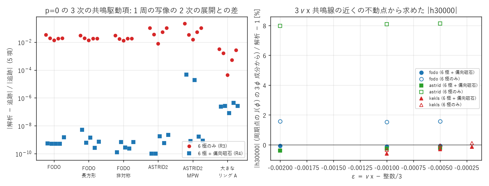

# 共鳴駆動項 (RDT) の追跡による検証と、偏向磁石の 3 次の項

**この文書で分かること**: 共鳴駆動項 (RDT) h_jklmp の解析式が、追跡の 1 周の写像から取り出した値と何桁で一致するか。偏向磁石の 3 次の項を入れる前後 (6 極のみ / 6 極 + 偏向磁石) の比較、自然クロマティシティ、共鳴線の近くの周期点から求めた |h30000|。
**前提**: `rdt_adts_basic.md` (RDT の用語)。
**読む順**: 結果の要約の表 → 限界。解説は `docs/25_resonance_terms_adts.md` (§9)。実装は `pysad/rdttrack.py` (追跡から RDT を取り出す)、`pysad/bendnl.py` (`harmonic_amplitudes_shift`・`bend_atoms_rdt`)、`pysad/resdrive.py` (`resonance_terms(bend_cubic=True)` が既定、`chromaticity_natural`・`chromaticity_bend`)。
ラティス: FODO (`example/00_lattice/FODO_ring.sad`、SF・SD の K2L = 4, −6、3 GeV、105.6 m、24 セル、偏向磁石 E1=E2=0.0343 rad)、FODO 長方形 (E1=E2=ANGLE/2)、FODO 非対称 (E1=0.8·ANGLE、E2=−0.3·ANGLE)、ASTRID2 (`example/astrid/lattice/ASTRID2_v01_01.sad`、0.58 GeV、45.7 m、30° の複合機能偏向磁石)、ASTRID2 MPW (`ASTRID2_v01_02_id.sad` の `RINGMPW`)、大きなリング A (`pysad/tests/kek-ls_v03_12.lat`、3 GeV、603 m)。
条件 (すべて): pysad k64 (gs と同じ式) の追跡 (RF 空洞止め `rfsw=False`、放射なし、結合なし)、閉軌道のまわり、リング先頭が位相の基準 (μ = 0)、ring_map の振幅は正規化座標で 1e-5 √m (J = 5e-11 m rad、Richardson の振幅 1e-5 と 2e-5)、δ の項は δ = ±1e-4・±2e-4 の Richardson、偏向磁石の分割 16。6 極の強さは K2 を λ 倍 (λ = 1 と 0 の差が 6 極の 1 次、λ = 0 が偏向磁石など 6 極以外)。gs は `NORFSW;`、timeout 1800 s、1 本ずつ。

| ファイル | 内容 |
|---|---|
| `rdt_tracking.py` | 本体。`table リング` ((a) 1 周の写像の 2 次のテイラー展開から取り出した h と解析 (6 極のみ・偏向磁石つき) の比較、δ の項)、`chrom リング` (δ の 1 次の項: 自然クロマティシティの式 + 偏向磁石の分 + 6 極の分と CALC)、`res リング` ((b) 3νx = 整数の近くの 3 周写像の不動点から |h30000|)、`thin` (薄い 6 極の δ の項の閉じた式との照合)、`plot` |
| `rdt_gs_map.py` | 検証用: gs の 1 周の追跡 (72 点、`NORFSW;`) から同じ取り出しをして pysad k64・解析と比べる (`fodo|astrid|kekls`) |
| `rdt_table_{fodo,fodo_rect,fodo_asym,astrid,astrid_mpw,kekls}.pysad.txt`・`.json` | 追跡 (6 極 ×1、×0) と解析 (6 極のみ・+偏向磁石) の h (5 項)、偏向磁石の分、6 極だけの分、δ の項 |
| `rdt_chrom_{fodo,astrid,astrid_mpw,kekls}.pysad.txt`・`.json` | CALC の ξ と解析 (自然 + 偏向磁石 + 6 極)、λ = 0・1 |
| `rdt_res_{fodo,astrid,astrid_mpw,kekls}.pysad.txt`・`.json` | 3νx の近くの不動点: |h30000| の推定 (J(φ) の 3φ 成分) と解析 (6 極のみ・偏向磁石つき) |
| `rdt_thin_fodo.pysad.txt` | 薄い 6 極の δ の項の閉じた式と resonance_terms の差 (1e-14) |
| `rdt_gs_map_{fodo,astrid,kekls}.gs.txt` | gs の 1 周の写像から取り出した h と pysad k64・解析の差 |
| `rdt_table.png` | 左: 5 項の |解析 − 追跡|/|追跡| (6 極のみ、6 極 + 偏向磁石、6 リング)。右: 3νx の近くの不動点から求めた |h30000| の解析との差 |

左は 3 次の共鳴駆動項 5 項の |解析 − 追跡|/|追跡| (縦軸は対数、6 リング)。赤い丸が 6 極のみ、青い四角が 6 極 + 偏向磁石の 3 次の項で、後者は FODO で 1e-9 前後、大きなリング A で 1e-7 前後まで下がる。右は 3νx の共鳴線の近くの不動点から求めた |h30000| の解析との差 [%] で、6 極 + 偏向磁石 (塗り) はほぼ 0、6 極のみ (白抜き) の ASTRID2 は約 8% 外れる。

結果の要約 (|解析 − 追跡 (6 極 ×1)|/|追跡|、h21000・h30000・h10110・h10020・h10200 の最大):

| リング | 偏向磁石なし (6 極のみ) | 6 極 + 偏向磁石の 3 次の項 |
|---|---|---|
| FODO | 1.4〜3.4% | 1.5e-9 |
| FODO 長方形・非対称 | 1.3〜3.1% | 5e-9 |
| ASTRID2 | 0.8〜10.7% | 2e-9 |
| ASTRID2 MPW | 1.5〜22.4% | 4.6e-5 (K0≠0 の偏向磁石の内部) |
| 大きなリング A | 0.0045〜0.31% | 4e-7 |

6 極だけの分 (×1 − ×0 の追跡と解析) は全 6 リングで 2.3e-7 以内、δ の項 (h11001・h00111・h20001・h00201・h10002) の 6 極の分も 9e-8 以内 (FODO 5e-9)。自然クロマティシティの式 + 偏向磁石の分 = CALC の ξ (6 極なし) は FODO 3e-3、ASTRID2 6e-4・3e-4、大きなリング A 1.4e-5・5.7e-5 以内。3νx の近くの不動点から求めた |h30000| は解析 (6 極 + 偏向磁石) と FODO −0.07〜−0.10%、ASTRID2 −0.2〜−0.4%、大きなリング A −0.1〜−0.6% (6 極のみは FODO +1.6%、ASTRID2 +8%)。
検証: gs の 1 周の写像から取り出した h は pysad k64 と 6e-10 以内で一致する (`rdt_gs_map_*.gs.txt`)。
**限界**: K0≠0 の偏向磁石 (挿入光源) の内部、δ≠0 の h の偏向磁石の項、p=2 と h20001・h00201 の偏向磁石の分の追跡との直接の確認、4 次以上の h、結合・垂直分散・誤差、非対称なリングの共鳴の不動点からの |h|、スペクトルの線からの h は未確認・未対応 (docs/25 §9)。
再現: `py -3.12 example/14_nonlinear_dynamics/adts_rdt/rdt_tracking.py table fodo` (1 s)、`... table kekls` (約 15 s)、`... chrom astrid`、`... res fodo` (約 15 s、大きなリング A は約 3 分)、`... thin`、`... plot`、`py -3.12 example/14_nonlinear_dynamics/adts_rdt/rdt_gs_map.py fodo` (gs、約 1 分)。**スクリプトは出力ファイルを `example/14_nonlinear_dynamics/adts_rdt/` に上書きする** (保存済みの出力を残すなら、複製したフォルダで走らせる)。
