# 周波数マップの例のまとめ: 台本ごとの「コマンド・式・結果・追跡の数値・比較・未確認」

`example/14_nonlinear_dynamics/frequency_map/` の周波数マップ (frequency map、FMA) の台本・スクリプトを、台本ごとに同じ 7 つの節で並べたものです (目的、使うファイルとコマンド、式、結果、追跡 + NAFF の数値、比較、出力と図、未確認・限界)。
局所運動量アクセプタンス (LMA) は主題ではないので、最後の §11 に簡潔にまとめました (LMA の例は `../../15_lma_touschek/lma/`)。ADTS・共鳴駆動項 (RDT) の同じ形のまとめは [`ADTS_summary.md`](../adts_rdt/ADTS_summary.md)。
解説は [`docs/26_frequency_map_lma.md`](../../../docs/26_frequency_map_lma.md)、
索引は [`fmap_basic.md`](fmap_basic.md)。**数値はこのフォルダの出力ファイルから転記したもの。** §0.4 に、この文書を書くときに実際に走らせたコマンドと所要時間を書いた。

## 0. 全体

### 0.1 対応表 (台本 → 何を比べるか → 主な結果 → 節)

(D = log10 √(Δνx² + Δνy²)、前半・後半の 512 周のチューンの差。D > −5 は「拡散が大きい」、−6 より小さいと規則的。)

| 台本・スクリプト | 何を比べるか | 主な結果の 1 行 | 節 |
|---|---|---|---|
| `fmap_ring.py` | ASTRID2 と KEK-LS (kek-ls_v03_12.lat) の x–y の周波数マップ (41 × 31、1024 周)。D の大きい点が載る共鳴線 | ASTRID2: 失われた点 0、D の範囲 −11.37〜−1.44、D > −4 の 16 点の 8 点が νx − νy = 3。KEK-LS: 失われた点 465、D −11.00〜−1.18、D > −4 の 60 点の 33 点が νx − νy = 30 | [§1](#1-fmap_ringpy-xy-の周波数マップ) |
| `fn_FrequencyMap_MomentumAcceptance.sad` | SAD の台本から `FrequencyMap[]` (pysad のみ)。Python の API と同じ値か | 88 点、失われた点 0、最小振幅の D = −8.8863。再走で出力が一致 | [§2](#2-fn_frequencymap_momentumacceptancesad-sad-の台本から-frequencymap) |
| `gs_fmap_compare_astrid2.py`・`gs_fmap_astrid2.sad` | ASTRID2 の追跡 (512 周) を gs の `TrackParticles` と比べ、gs の座標に NAFF をかけた D と比べる | `PYSAD_COMPAT=k64` (四極 2 次の積分器) で、座標の最大の差 2.80e-7 m (D = −2.9 のカオス的な点)、D は最大 5.2e-7 の差。v2 の既定 (四極 4 次) では座標の最大の差 3.3e-2 m、D の差 0.67 | [§3](#3-gs_fmap_compare_astrid2pygs_fmap_astrid2sad-gs-との比較-astrid2) |
| `fmap_rdt.py` | (a) D の大きい領域を、RDT・ADTS から予想した共鳴の領域と比べる (FODO、ASTRID2、KEK-LS) | FODO: D > −5 の 44 点がすべて 3νx の予想の領域 (面積 26%、対照 27% ± 34%、p = 0.01)、共鳴の中心の予想が D の尾根の x と 0.5 mm 以内。ASTRID2: 1 次の RDT の共鳴は格子に入らず、予想できない。KEK-LS: 追跡のチューンを使うと cov 0.70 (面積 0.43、対照 0.28、p = 0.003) | [§4](#4-fmap_rdtpy-a-共鳴線と-rdtadts-の定量的な接続) |
| `fmap_variants.py lambda` | (a の原因) 6 極の強さ λ 倍の ASTRID2 | D > −5 の点: λ = 0、0.5 で 0 点、λ = 1 で 10 点、λ = 1.5 で 37 点 (νx − νy が主) | [§4.7](#47-astrid2-で予想できない原因-fmap_variantspy-lambda) |
| `fmap_variants.py delta` | (b) x–δ・y–δ の周波数マップ (δ の閉軌道の上)。作動点の動きとの比較 | 動く。ASTRID2 x–δ・y–δ、KEK-LS x–δ。線形のチューン + ADTS の予想が 0.001〜0.002 以内 (最小振幅) | [§5](#5-fmap_variantspy-delta-b-xδyδ-の周波数マップ) |
| `fmap_variants.py k64` | (c) `PYSAD_COMPAT=k64` の周波数マップと v2 | 走る。ASTRID2 (1271 点)・KEK-LS (336 点) の v2 との差: チューンの差の中央値 9e-5・3e-5、最大 0.04・0.08 (カオス的な点)、失われた点の食い違い 0・2 (四極の積分器の次数の違い。§6.6) | [§6](#6-fmap_variantspy-k64-c-互換モード-k64) |
| `fmap_variants.py errors` | (d) 四極・6 極・偏向磁石の位置のずれ・ロールの誤差つき (全周の追跡) | 走る。誤差 ×1: 閉軌道が位置 2 で x = −0.94 mm、D > −5 の割合が 0.038 → 0.50 | [§7](#7-fmap_variantspy-errors-d-誤差つき) |
| `fmap_variants.py mpw` | (e) 挿入光源 (MPW) つきの ASTRID2 (`RINGMPW`) | 走る。νy = 2.2492 が 4νy = 9 の 0.0008 以内に動き、1271 点のうち 950 点が失われる | [§8](#8-fmap_variantspy-mpw-e-挿入光源つき) |
| `fmap_variants.py naff`・`grid`、`fmap_grid_summary.py` | (f) NAFF の窓・周回数・格子の細かさへの依存 | 周回数を 2 倍にすると D が約 1 下がる (D > −5 の割合 0.065 → 0.030 → 0.021)。順位相関 0.80〜0.88。窓なしは悪い。格子は 11 × 8 から 81 × 61 で D > −5 の割合 0.023〜0.038 | [§9](#9-fmap_variantspy-naffgrid-f-naff-の窓周回数格子の細かさ) |
| `gs_fmap_compare_kekls.py` | (g) KEK-LS の追跡を gs と比べる (512 周、8 点) | `PYSAD_COMPAT=k64` で、規則的な点 (D < −3.5): 座標の最大の差 1.2e-11 m、D の差 2.9e-7。カオス的な点は 1e-13 m の摂動と同程度の食い違い。v2 の既定 (四極 4 次) では規則的な点でも座標の差 6.1e-3 m | [§10](#10-gs_fmap_compare_keklspy-g-kek-ls-の追跡を-gs-と比べる) |
| `fmap_check_errors_scan.py` ほか (§14.1) | 誤差つき (複数の種・強さ・要素の種類、結合・フィードダウンの切り分け、KEK-LS) | ASTRID2: D > −5 が ×0.3・×1・×3 で 0.29・0.47・0.64 (種 8 つ)、1 種類でも 0.22〜0.40。主因は差の共鳴を駆動する結合 | [§14.1](#141-誤差つき-fmap_check_errors_scanpyfmap_check_errors_summarypyfmap_check_couplingpyfmap_check_nturnpy---errorsfmap_check_kekls_orbitpy) |
| `fmap_check_mpw.py` (§14.2) | MPW で点が失われる原因 | 4νy = 9 ではない (νy ±0.05 で変わらない)。MPW の内部の非線形による y の口径 | [§14.2](#142-mpw-fmap_check_mpwpy) |
| `fmap_check_rfsw.py`・`fmap_check_gs_rfsw.py`・`fmap_check_k1opts.py`・`fmap_check_nturn.py`・`fmap_check_gs_errors.py` (§14.3〜14.7) | RFSW・RAD・FLUC ON、K1 の設定、周回数の換算、警告、gs の誤差つき | RF ON で D が拡散の指標でなくなる (0.03 → 0.57)。D_norm で周回数に依らない。gs と誤差つきで一致 | [§14](#14-fmap_check_-周波数マップを信頼して使えるようにする-誤差mpwrfswk1周回数警告gs) |
| `lma_ring.py`・`gs_loss_*` | LMA と gs の損失判定 (主題ではない) | gs と生き残りの旗が 30 / 30 一致 | [§11](#11-lma-lma_ringpygs_loss_comparepy-簡潔に) |

### 0.2 使った条件の共通部分

| 項目 | 内容 |
|---|---|
| ラティス | `example/astrid/lattice/ASTRID2_v01_01.sad` (ASTRID2、0.58 GeV、周長 45.7044 m、νx = 5.179990、νy = 2.140178、6 セル)。`pysad/tests/kek-ls_v03_12.lat` (KEK-LS、3 GeV、周長 603.12 m、3563 要素、νx = 47.580034、νy = 17.620044、20 セル)。`example/00_lattice/FODO_ring.sad` (FODO、24 セル、3 GeV、周長 105.6 m。SF・SD の K2 = 4, −6、QF の K1 = 0.697 に文字列で書き換え、νx = 6.657805、νy = 4.916330)。`example/astrid/lattice/ASTRID2_v01_02_id.sad` の `RINGMPW` (MPW つき、νx = 5.180010、νy = 2.249201)。誤差の節以外は誤差なし |
| 追跡 | pysad の `TrackSetup.track` (numba、SAD の `TrackParticles` と同じ損失判定)。**RFSW OFF、RAD OFF**、FLUC なし。損失の限界 LOSSAMPL = 0.1 m (実質なし。失われるのは力学的な不安定)。位置 loc (要素の入口) の閉軌道に、x・y (px = py = 0、z = 0) の格子を足して出発。1 周ずつ loc から回して (x, px, y, py) を記録 |
| 位置 | ASTRID2: 位置 2 (長直線部の入口、s = 0、βx = 3.8916 m、βy = 1.6225 m、α ≈ 0)。KEK-LS: 位置 3 (長直線部の入口、s = 0、βx = 4.6432 m、βy = 6.2316 m)。FODO: 位置 1 (リングの先頭、βx = 5.025 m、αx = −2.166) |
| 格子・周回数 | 既定 x–y の 41 × 31 = 1271 点 (x が速く変わる)、1024 周 (前半・後半 512 周)。ASTRID2: x = 0.5〜18 mm、y = 0.5〜14 mm。KEK-LS: x = 0.2〜6 mm、y = 0.2〜8 mm。FODO: x = 0.5〜14 mm、y = 0.5〜8 mm |
| NAFF | `pysad/naff.py`。Laskar の Hann 窓 (次数 p = 1)、信号は z = x̂ − i p̂ (x̂ = x/√β、p̂ = (αx + β px)/√β)。規格化の (α, β) は**半分の追跡の標本の 2 次のモーメントから** (`norm='data'`)。チューンは端数 (0〜1)、差は −0.5〜0.5 に畳む |
| 共鳴線 | `freqmap.resonance_lines`・`resonance_check`・`line_distance`。距離はチューン平面の距離 |
| 互換モード | v2 (k64 は §6 だけ) |
| 使った制約条件 | エネルギー・周長は上のとおり。磁場上限の制約はなし (既存ラティスをそのまま使用。6 極の強さは各リングの設計値、FODO は玩具の強さ) |
| 時間 | 1271 点 × 1024 周は 1 プロセスで 305〜395 s (他の計算 3 本と同時、CPU を使い切らない状態)。1 粒子 1 周あたり ASTRID2 (200 要素) で約 0.25 ms |

### 0.3 未確認・限界のまとめ

- **D の絶対値の閾値は周回数・窓に依存する** (§9): 周回数を 2 倍にすると D が約 1 下がる。「D > −5」は条件つきの目安で、別の周回数の結果とは比べられない (順位は残る: 順位相関 0.80〜0.88)。
- **RDT・ADTS の予想 (§4) は、1 次の RDT が駆動する共鳴 (3νx、νx、νx ± 2νy) だけ**。ASTRID2 では D の大きい点が νx − νy = 3 (2 次の共鳴) と 5νy、4 次などにあり、予想の領域に 1 点も入らない。**これらの共鳴の強さ (6 極の 2 次の項、4 次の h) は §4 の予想には入っていない** (4 次の h を入れた予想は §12・§13)。
- **線形の ADTS ν0 + A·J は大振幅で外れる**: ASTRID2 の全点の中央値で 0.009 (νx)、KEK-LS で 0.068。KEK-LS のように ADTS が大きい (xx = 5.1 万) と、予想の共鳴の領域は格子の大部分 (43%) を覆い、判別力が小さい。振り子の式は、島が作用 J より十分小さいことを仮定している。
- **積分器**: §1 (`fmap_ring.py`)・§2・§3・§4・§10・§12・§13 の ASTRID2・KEK-LS の x–y の数値は、四極の積分器が 4 次の現行の表のもの。§4.7 (λ)・§5 (δ)・§6 の k64 の表・§7 (誤差)・§8 (MPW)・§9 (窓・周回数・格子)・§14 の数値は、四極の積分器が 2 次の追跡で作った保存済みの表の値で、4 次では取り直していない (傾向は同じと見込まれるが、数値の差は未確認)。
- 誤差つき: §7 は ASTRID2 の 1 つの種だけ。**§14.1 で複数の種・強さ・要素の種類、KEK-LS (補正なし) を統計**した (D > −5 が誤差なしの 7〜12 倍、主因は差の共鳴を駆動する結合)。補正つき・PF リング・MPW の RDT の予想は未確認。
- k64 の確認 (§6) は、v2 と k64 で結果が違うことが分かっている要素 (K1 の端面など) を使わない 2 つのリングだけ。
- gs の比較 (§3、§10) は NORFSW・NORAD の追跡座標だけで、pysad は `PYSAD_COMPAT=k64` (四極 2 次の積分器。gs と同じ) で追跡したときに一致する。v2 の既定 (四極 4 次) は gs と積分器が違うので、同じ点の座標・D が一致しない (§3.6、§10.6)。NAFF は K64 に無いので、gs の座標に pysad の NAFF をかけた。カオス的な点 (D > −3 など) では、gs と pysad の座標の差が 1e-13 m の初期値の摂動の増幅と同じ大きさになりうるが、誤りではない。
- 周期性 (1 セルだけの追跡) は周波数マップでは使わない (全周を追跡)。誤差のない周期的なリングでも、位置 loc の 1 点から出発する。
- RFSW ON・RAD ON・FLUC ON の周波数マップは §14.3 で確かめた: 走るが D は拡散の指標でなくなる (D > −5 が 0.03 → 0.57〜1.0)。警告が出る。

### 0.4 確認の状況 (この文書を書いたときに実際に走らせたコマンド)

Windows、`py -3.12`、リポジトリ直下から。標準出力をファイルに落とすときは `PYTHONUTF8=1` (日本語)。保存済みの出力 (`fmap_astrid2.*` など) を上書きしないよう、複製したフォルダで走らせて保存済みと比べた (スクリプトは出力をこのフォルダへ書く)。

| コマンド | 所要 | 結果 |
|---|---|---|
| `py -3.12 example/14_nonlinear_dynamics/frequency_map/fmap_ring.py astrid2 1` | 335 s (1 プロセス、他の計算と同時) | 表は条件の `seconds`・`workers` の行以外が保存済みと一致、標準出力 (追跡時間の行を除く) も一致 |
| `py -3.12 example/14_nonlinear_dynamics/frequency_map/fmap_ring.py kekls 1` | 347 s | 同上 |
| `py -3.12 run_sad.py example/astrid/lattice/ASTRID2_v01_01.sad example/14_nonlinear_dynamics/frequency_map/fn_FrequencyMap_MomentumAcceptance.sad` (cwd は `example/14_nonlinear_dynamics/frequency_map`) | 128 s (`FrequencyMap[]` 12.5 s、`MomentumAcceptance[]` 111 s) | 出力が `fn_FrequencyMap_MomentumAcceptance.pysad.txt` と一致。表は `seconds` の行以外が一致 |
| `py -3.12 example/14_nonlinear_dynamics/frequency_map/gs_fmap_compare_astrid2.py` (gs は WSL、timeout 1700 s) | 8 s (gs の部分は数 s) | 座標の最大の差 2.80e-7、D の差 5.22e-7 が一致。終了後に sad1.exe の残りなし |
| `py -3.12 example/15_lma_touschek/lma/gs_loss_compare.py` | 170 s (gs 1312 周 × 30 粒子 + pysad) | 不一致 0 / 30、二分法の区間の不一致 0 が保存済みと一致。終了後に sad1.exe の残りなし |
| `py -3.12 example/14_nonlinear_dynamics/frequency_map/fmap_rdt.py astrid2 / kekls / fodo` | 各 3 s (表は読み込み。`fodo` の追跡は `--recompute` で約 130 s・2 並列) | 本文の数値 |
| `py -3.12 example/14_nonlinear_dynamics/frequency_map/fmap_variants.py k64 astrid2` | 391 s | §6 |
| `py -3.12 example/14_nonlinear_dynamics/frequency_map/fmap_variants.py k64 kekls` | 115 s (coarse 336 点) | §6 |
| `py -3.12 example/14_nonlinear_dynamics/frequency_map/fmap_variants.py errors astrid2 1` / `errors astrid2 3` | 393 s / 97 s | §7 |
| `py -3.12 example/14_nonlinear_dynamics/frequency_map/fmap_variants.py mpw` | 149 s | §8 |
| `py -3.12 example/14_nonlinear_dynamics/frequency_map/fmap_variants.py delta astrid2 xdp` / `delta astrid2 ydp` / `delta kekls xdp` | 396 s / 396 s / 604 s | §5 (`--reuse` で保存済みの表を読む) |
| `py -3.12 example/14_nonlinear_dynamics/frequency_map/fmap_variants.py naff astrid2` | 452 s (4096 周を 1 回追跡) | §9 |
| `py -3.12 example/14_nonlinear_dynamics/frequency_map/fmap_variants.py grid astrid2 81 61 --workers 2` | 937 s | §9 |
| `py -3.12 example/14_nonlinear_dynamics/frequency_map/fmap_variants.py lambda astrid2` | 500 s | §4.7 |
| `py -3.12 example/14_nonlinear_dynamics/frequency_map/gs_fmap_compare_kekls.py kekls` (gs は timeout 1800 s) | pysad 10 s + gs 2 s | §10。終了後に sad1.exe の残りなし |

---

## 1. `fmap_ring.py`: x–y の周波数マップ

### 1.1 目的

1 つの位置 (長直線部の入口) の (x, y) の格子を追跡し、NAFF で前半・後半のチューンを出し、チューンの拡散 D の地図 (周波数マップ) を作る。D の大きい領域が、作動点の近くの共鳴線 (次数 4 以下、整数・半整数を含む) の上にあるかを見る。

### 1.2 使うファイルとコマンド

- スクリプト: [`fmap_ring.py`](fmap_ring.py)。実装は `pysad/freqmap.py` (`frequency_map`、`FMapResult`、`resonance_check`)、`pysad/trksetup.py` (`TrackSetup`)、`pysad/naff.py`。
- 出力: [`fmap_astrid2.out.txt`](fmap_astrid2.out.txt)・[`.table.txt`](fmap_astrid2.table.txt)・[`.png`](fmap_astrid2.png)、[`fmap_kekls.out.txt`](fmap_kekls.out.txt)・[`.table.txt`](fmap_kekls.table.txt)・[`.png`](fmap_kekls.png)。

```
py -3.12 example/14_nonlinear_dynamics/frequency_map/fmap_ring.py astrid2 [workers]
py -3.12 example/14_nonlinear_dynamics/frequency_map/fmap_ring.py kekls [workers]
```

所要 335 s・347 s (1 プロセス)。Python から: `st = TrackSetup.from_source(src, 'RING', rad=False, rfsw=False, alost=0.1)[0]; r = frequency_map(st, 2, x=np.linspace(5e-4, 18e-3, 41), y=np.linspace(5e-4, 14e-3, 31), nturn=1024)`。

### 1.3 式

1. **初期条件**: 位置 loc の閉軌道に (x, y) を足す (px = py = z = δ = 0)。
2. **NAFF のチューン**: 周ごとの (x, px) から、Courant–Snyder で規格化した複素信号

$$z_n=\hat x_n-i\hat p_n,\qquad \hat x=\frac{x}{\sqrt\beta},\quad \hat p=\frac{\alpha x+\beta p_x}{\sqrt\beta}$$

に、Hann 窓 $w_n=\tfrac{2^p(p!)^2}{(2p)!}(1+\cos\pi t_n)^p$ ($p=1$、$t\in[-1,1]$、平均 1 に規格化) をかけ、窓つきの内積の絶対値が最大になる周波数を、ゼロ詰めの FFT のピークから Brent 法で精密化して求める:

$$\nu=\arg\max_{\nu'}\left|\frac1N\sum_{n=0}^{N-1}w_n\,z_n\,e^{-2\pi i\nu' n}\right|.$$

(p = 1 の窓つきでは周波数の誤差は N⁻⁴ の程度。)
3. **規格化 (α, β) は標本から**: 前半 (または後半) の追跡の標本 (平均を引いた x, px) の 2 次のモーメント $\sigma_{xx},\sigma_{pp},\sigma_{xp}$ から

$$\varepsilon=\sqrt{\sigma_{xx}\sigma_{pp}-\sigma_{xp}^2},\qquad \alpha=-\frac{\sigma_{xp}}{\varepsilon},\qquad \beta=\frac{\sigma_{xx}}{\varepsilon}.$$

位置 loc の Twiss (δ = 0) を使うと、δ ≠ 0 の運動や非線形のひずみで規格化がずれて、NAFF の周波数に 1e-6 程度の系統誤差が入る (δ = 0.5% の線形の運動で D の下限が −5.8 から −9.6 に下がった。`norm='twiss'` で Twiss の値に切り替えられる)。
4. **拡散の指標**: 前半 (nturn/2 周) のチューン $\nu_1$、後半を $\nu_2$ として

$$D=\log_{10}\sqrt{(\nu_{x2}-\nu_{x1})^2+(\nu_{y2}-\nu_{y1})^2}$$

(差は −0.5〜0.5 に畳む)。失われた点は D = nan、`lost_turn` > 0。
5. **共鳴線**: $m\nu_x+n\nu_y=p$ ($m, n, p$ は整数、次数 $|m|+|n|$)。点 $(\nu_x,\nu_y)$ から線までのチューン平面の距離は

$$d=\frac{|m\nu_x+n\nu_y-p|}{\sqrt{m^2+n^2}}.$$

`resonance_check` は作動点から近い順に表にし、整数 $\nu_x=p$、$\nu_y=p$、半整数 $2\nu_x=p$、$2\nu_y=p$ を順位に関わらず必ず入れる。

### 1.4 結果

作動点に近い共鳴線 (次数 4 以下、距離はチューン平面):

| 例 | νx − νy = 整数 | 最も近い 3 次 | 整数 νx | 整数 νy | 半整数 2νx | 半整数 2νy |
|---|---|---|---|---|---|---|
| ASTRID2 (νx = 5.17999、νy = 2.140178) | 3: 0.0282 (2νx − 2νy = 6 も 0.0282) | νx − 2νy = 1: 0.0449 | 0.180 | 0.140 | 0.180 | 0.140 |
| KEK-LS (νx = 47.580034、νy = 17.620044) | 30: 0.0283 | 3νy = 53: 0.0466 (次数 4 の 3νx − νy = 125 が 0.0380) | 0.420 | 0.380 | 0.0800 | 0.1200 |

周波数マップの結果 (41 × 31、1024 周、RFSW・RAD OFF):

| 量 | ASTRID2 | KEK-LS |
|---|---|---|
| 点、失われた点 | 1271、0 | 1271、465 (落ちた周の中央値 3、最大 889) |
| D の範囲 | −11.37〜−1.44 | −11.00〜−1.18 |
| D の分布 (< −8、−8〜−6、−6〜−4、−4〜−2、≥ −2) | 580、582、93、14、2 | 215、356、175、46、14 (残った 806 点) |
| D > −5 の点、D > −4 の点 | 49、16 | 112、60 |
| D > −4 の点の最も近い共鳴線 (次数 5 以下) | νx − νy = 3: 8、5νy = 11: 6、4νy = 9: 1、4νx = 21: 1 | νx − νy = 30: 33、νx + 2νy = 83: 12、3νy = 53: 4、3νx = 143: 3、2νx + νy: 2、νx − 4νy: 2、4νx − νy: 1、4νx: 1、3νx + νy: 1、3νx + 2νy: 1 |
| 次数 4 以下の線から 0.003 以内の点 (近い) / それより遠い | 379 / 892 | 501 / 305 (残った点) |
| D > −5 の割合 (近い / 遠い) | 0.069 / 0.026 (2.7 倍) | 0.170 / 0.089 (1.9 倍) |
| 格子のチューン (端数) | νx = 0.18〜0.25、νy = 0.14〜0.23 | 大部分 νx = 0.56〜0.79、νy = 0.60〜0.76 |

νx − νy = 3 の線の上 (ASTRID2) では x の信号に y のチューンの成分が現れ、νx = νy にロックされた点が 377 点ある (D の中央値は −7.8 の規則的な運動、島に捕らえられている)。作動点の整数・半整数の共鳴線は、どちらの例でも格子のチューンの外にある。

### 1.5 追跡 + NAFF の数値

上の表がそのまま追跡 + NAFF の数値 (この台本は追跡だけ。解析の比較は §4)。D の下限は線形の小振幅 (1 μm) で −11 の程度 (FODO)、ASTRID2 の最小振幅 (x = y = 0.5 mm) で −10.72。

### 1.6 比較

- 共鳴線の近く / 遠くの D > −5 の割合の比は 1.9〜2.7 倍で、図の印象より弱い。格子のチューンの広がり (0.2〜0.3) のなかに次数 4 以下の線が密に通り、点の 3〜6 割が「近い」側に入るため。結論は「D の大きい領域がラティスの対称性が許す共鳴線の上に載る」まで。
- 個々の線の強さ (RDT) との定量的な比較は §4。

### 1.7 出力ファイルと図

表の列は `x y dp nux1 nuy1 nux2 nuy2 D lost_turn`。図は左 = チューン平面 (前半のチューンを D で色づけ、次数 4 以下の共鳴線を重ねる)、右 = 初期条件の平面 (失われた点は黒い ×)。


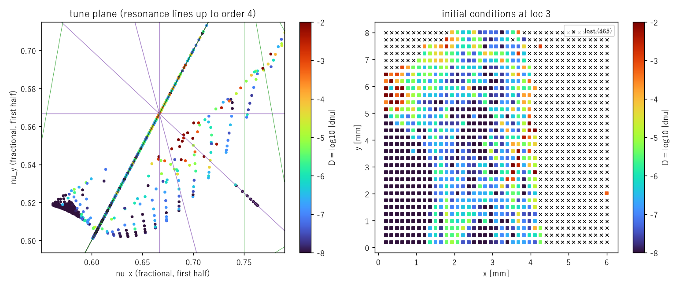

### 1.8 未確認・限界

§0.3 のとおり。この台本は 1 つの位置・RFSW OFF・誤差なし。

---

## 2. `fn_FrequencyMap_MomentumAcceptance.sad`: SAD の台本から `FrequencyMap[]`

### 2.1 目的

pysad の FFS の関数 `FrequencyMap[]` (K64 の gs には無い) を SAD の台本から呼ぶ最小の例。ASTRID2 の 11 × 8 の格子、512 周。同じ台本は `MomentumAcceptance[]`・`TouschekLifetimeLMA[]` も呼ぶ (§11)。

### 2.2 使うファイルとコマンド

- 台本: [`fn_FrequencyMap_MomentumAcceptance.sad`](fn_FrequencyMap_MomentumAcceptance.sad)。出力: [`fn_FrequencyMap_MomentumAcceptance.pysad.txt`](fn_FrequencyMap_MomentumAcceptance.pysad.txt)、[`fn_FrequencyMap_MomentumAcceptance_fmap.table.txt`](fn_FrequencyMap_MomentumAcceptance_fmap.table.txt)・[`.png`](fn_FrequencyMap_MomentumAcceptance_fmap.png)。

```
cd example/14_nonlinear_dynamics/frequency_map
py -3.12 ../../../run_sad.py ../../astrid/lattice/ASTRID2_v01_01.sad fn_FrequencyMap_MomentumAcceptance.sad
```

所要 128 s (周波数マップの部分は 12.5 s、LMA の部分が 111 s)。gs では動かない (K64 にない関数)。関数の形:
`FrequencyMap[位置, nturn, X->{min, max, n}, Y->…, DP->…, Window->1, Workers->1, Output->"file", Plot->"file.png", Order->4]`。X・Y・DP は数 (固定)、`{min, max, n}`、または値のリスト。
戻りは `{X->…, Y->…, DP->…, NuX->…, NuY->…, NuX2->…, NuY2->…, Diffusion->…, LostTurn->…}` (点ごとのリスト、失われた点の Diffusion は −99)。条件は現在のフラグ (RFSW・RAD) と LOSSAMPL・LOSSDZ。

### 2.3 式

§1.3 と同じ (`q1cmd.py` は `frequency_map` の入口)。

### 2.4 結果

台本の条件: `NORFSW; NORAD; LOSSAMPL = 0.1;`、位置 2、X = {0.0005, 0.018, 11}、Y = {0.0005, 0.014, 8}、512 周 (前半・後半 256 周)。出力:

```
FrequencyMap: loc=2 (s=0.0000 m) 88 points, 0 lost, nturn=512, RFSW=OFF RAD=OFF
points 88, lost 0
D(smallest amplitude) = -8.886317266632517, nux = .18010487175239917, nuy = .14033400750879865
```

### 2.5 追跡 + NAFF の数値

上の値が追跡 + NAFF の数値。同じ 6 点の `frequency_map` (API) の値は §3 の表 (D = −8.9066 (k64。v2 の既定では −8.9058) は 512 周の x = 1 mm・y = 1 mm の点で、最小振幅 0.5 mm の −8.8863 とは別の点)。

### 2.6 比較

Python の API と同じ値 (試験 `test_script_commands`)。再走 (§0.4) で標準出力と表が保存済みと一致。

### 2.7 出力ファイルと図

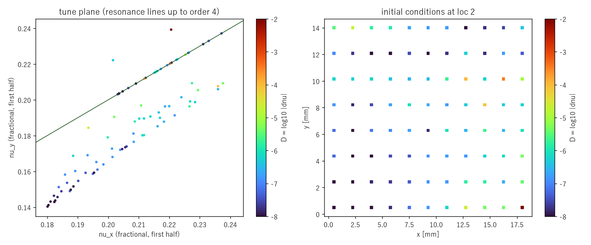

### 2.8 未確認・限界

gs には無い関数なので gs との比較はない。X・Y の 1 軸が数のときは固定 (1 次元の走査にもなる)。

---

## 3. `gs_fmap_compare_astrid2.py`・`gs_fmap_astrid2.sad`: gs との比較 (ASTRID2)

### 3.1 目的

周波数マップの追跡の部分が、gs (SAD K64) の `TrackParticles` と同じ座標列になるかを確かめる。K64 には NAFF が無いので、gs には 1 周ずつ `TrackParticles` を回して (x, px, y, py, 生存の旗) を印刷させ、その座標列に pysad の NAFF をかけた D を、pysad の `frequency_map` の D と比べる。

### 3.2 使うファイルとコマンド

- スクリプト: [`gs_fmap_compare_astrid2.py`](gs_fmap_compare_astrid2.py)。gs に渡した台本 [`gs_fmap_astrid2.sad`](gs_fmap_astrid2.sad) (ラティス + 下の台本)。出力: [`gs_fmap_astrid2.gs.txt`](gs_fmap_astrid2.gs.txt) (gs の画面)、[`.pysad.txt`](gs_fmap_astrid2.pysad.txt) (pysad の台本の画面)、[`.out.txt`](gs_fmap_astrid2.out.txt) (比較)。

```
py -3.12 example/14_nonlinear_dynamics/frequency_map/gs_fmap_compare_astrid2.py [--nogs]
```

gs の台本 (抜粋、`beam` は 6 点の (x, 0, y, 0, 0, 0, 1) の 7 列):

```
FFS;
USE RING; CELL; CALC; NORFSW; NORAD;
LOSSAMPL = 0.1;
b = beam;
Do[r = TrackParticles[{2, b}, 2]; b = r[[2]]; Print["T ", i, " ", b[[1]], " ", b[[2]], " ", b[[3]], " ", b[[4]], " ", b[[7]]], {i, 1, 512}];
```

所要 8 s (gs は WSL、timeout 付き。終了後に `ps -eo pid,etime,pcpu,cmd | grep sad1.exe` で残りがないことを確認)。**`NORFSW;` が要る** (gs は FFS に入ると RFSW ON になり、RF 空洞が z に応じて δ を与えて偽の ADTS を作る)。

### 3.3 式

§1.3 の D。gs の座標列 $(x_n, p_{x,n}, y_n, p_{y,n})_{n=1}^{512}$ に、pysad と同じ NAFF (前半 256 周・後半 256 周、位置 2 の Twiss の α・β で規格化) をかける。

### 3.4 結果

ASTRID2、位置 2、NORFSW・NORAD、512 周 (前半・後半 256 周)、Hann 窓、pysad は `PYSAD_COMPAT=k64` (gs と同じ四極 2 次の積分器)。6 点 (小振幅から大振幅、共鳴の近く):

| i | x [mm] | y [mm] | D (API) | D (pysad 台本の座標) | D (gs の座標) | νx (API) | νx (gs) | 差 |
|---|---|---|---|---|---|---|---|---|
| 0 | 1.000 | 1.000 | −8.9066 | −8.9066 | −8.9066 | 0.1804479447 | 0.1804479447 | 3.9e-16 |
| 1 | 6.000 | 3.000 | −7.7413 | −7.7413 | −7.7413 | 0.1862087931 | 0.1862087931 | 1.3e-15 |
| 2 | 10.000 | 6.000 | −6.9958 | −6.9958 | −6.9958 | 0.2062897911 | 0.2062897911 | 4.4e-15 |
| 3 | 14.000 | 9.000 | −5.7131 | −5.7131 | −5.7131 | 0.2363084717 | 0.2363084717 | 1.9e-14 |
| 4 | 16.250 | 0.500 | −4.6831 | −4.6831 | −4.6831 | 0.2108318223 | 0.2108318223 | 7.7e-14 |
| 5 | 18.000 | 0.950 | −2.8672 | −2.8672 | −2.8672 | 0.2232980573 | 0.2232980573 | 5.9e-14 |

### 3.5 追跡 + NAFF の数値

上の表。座標列 (全周・全粒子・x px y py) の最大の差 **2.80e-7 m** (点 5、D = −2.9 のカオス的な点)。|D(gs の座標) − D(frequency_map)| の最大 5.22e-7。

### 3.6 比較

k64 モードでは D は 6 桁一致 (5.2e-7 以内)、νx は 1e-13 の桁。座標の差 2.8e-7 は、カオス的な点での丸め誤差の増幅 (§10 に 1e-13 m の摂動での増幅を測った)。v2 の既定 (四極 4 次) の追跡では gs と一致しない: 点 0〜5 の D (v2) = −8.9058、−7.7318、−6.9722、−5.8208、−5.3562、−2.6582 (gs は上の表)、νx の差 4.8e-7〜5.3e-4、座標の最大の差 3.3e-2 m、|D(gs の座標) − D(frequency_map)| の最大 0.67 (点 4)。積分器の次数の違いによる (docs/28)。

### 3.7 出力ファイルと図

図なし (表のみ)。

### 3.8 未確認・限界

ASTRID2 の 6 点だけ。失われる点・大きなリングの比較は §10。

---

## 4. `fmap_rdt.py`: (a) 共鳴線と RDT・ADTS の定量的な接続

### 4.1 目的

周波数マップの D の大きい領域が、RDT (`resdrive.resonance_terms`) の大きさと ADTS (`resdrive.adts`) から**予想される共鳴の位置と太さ**に入るかを、数で調べる。

### 4.2 使うファイルとコマンド

- スクリプト: [`fmap_rdt.py`](fmap_rdt.py)。実装: `pysad/fmapres.py` (`ResonancePredictor`、`first_order_terms`、`coverage_stats`、`lines_distance`、`plot_with_prediction`)。試験 `pysad/tests/script_tests/test_v23_S1_fmapres.py`。
- 出力: [`fmap_rdt_fodo.out.txt`](fmap_rdt_fodo.out.txt)・[`.table.txt`](fmap_rdt_fodo.table.txt)・[`.png`](fmap_rdt_fodo.png)、[`fmap_rdt_astrid2.out.txt`](fmap_rdt_astrid2.out.txt)・[`.png`](fmap_rdt_astrid2.png)、[`fmap_rdt_kekls.out.txt`](fmap_rdt_kekls.out.txt)・[`.png`](fmap_rdt_kekls.png)。

```
py -3.12 example/14_nonlinear_dynamics/frequency_map/fmap_rdt.py fodo [--recompute] [--workers 2]
py -3.12 example/14_nonlinear_dynamics/frequency_map/fmap_rdt.py astrid2        # 保存済みの表 (1024 周) を読む
py -3.12 example/14_nonlinear_dynamics/frequency_map/fmap_rdt.py kekls          # 保存済みの表 (1024 周) を読む
```

`fodo` は保存済みの `fmap_rdt_fodo.table.txt` を読む (無ければ追跡、2 並列で 130 s)。ASTRID2・KEK-LS は保存済みの表 (`fmap_<ring>.table.txt`、1024 周) を読む (`--recompute` で追跡し直す)。読み込みの場合 3 s。

### 4.3 式

1 周ごとの写像を作用 J・角度 φ で書く。$H=2\pi\left[\mathbf Q\cdot\mathbf J+\tfrac12\mathbf J\cdot A\cdot\mathbf J\right]+V(\mathbf J,\boldsymbol\phi)$、$A$ は ADTS の行列 ($A_{xx}=\partial\nu_x/\partial J_x$ など、`adts().total`、1/(m rad))。
$J_x=(1+\alpha_x^2)x^2/(2\beta_x)$ ($p_x=0$ の初期条件)、$\nu_i(\mathbf J)=\nu_{i0}+\sum_jA_{ij}J_j$。

1. **1 次の RDT**: 6 極 (と偏向磁石の 3 次) の 1 次の項は、調和 $\mathbf a=(j-k,\,l-m)$ ごとに

$$V=2\,\mathrm{Re}\!\left[F(\mathbf J)\,e^{i\,\mathbf a\cdot\boldsymbol\phi}\right],\quad F=\sum_q h_q\,(2J_x)^{(j+k)/2}(2J_y)^{(l+m)/2}$$

($h_q$ は `resonance_terms` の $h_{jklm0}$)。normal 6 極では調和は (3, 0) (3νx)、(1, 0) (νx)、(1, 2) (νx + 2νy)、(1, −2) (νx − 2νy) の 4 つだけ。
2. **共鳴の方向への還元**: 調和 $\mathbf a=g(m_0,n_0)$ ($g=\gcd$)。保存量 K と、共鳴の方向の作用 I (ユニモジュラー変換 $J_x=m_0I+uK$、$J_y=n_0I+vK$、$m_0v-n_0u=1$)、角度 $\psi=m_0\phi_x+n_0\phi_y$ を取ると

$$H=2\pi\!\int\!\Delta_0(I)\,dI+|V|\cos(g\psi+\arg F),\qquad \Delta_0=m_0\nu_x(\mathbf J)+n_0\nu_y(\mathbf J)-p/g$$

$\Delta_0$ は I の一次式で、傾き $G_0=(m_0,n_0)\,A\,(m_0,n_0)^{\mathsf T}$。
3. **振り子の式**: 共鳴の位置は $I_r=I-\Delta_0/G_0$ ($\mathbf J_r=\mathbf J+(I_r-I)(m_0,n_0)$ の成分が負なら島はない)。島の半幅 $\Delta I=2\sqrt{V/(2\pi|G_0|)}$ ($V=2|F|$)、チューン平面の幅

$$W=\sqrt{\frac{2|G_0|\,V}{\pi}}.$$

捕らえられる条件 (位相つき): $\pi\Delta_0^2/|G_0|<V\,(1-\mathrm{sgn}(G_0)\cos\theta)$、$\theta=\mathbf a\cdot\boldsymbol\phi_0+\arg F$。包絡 (位相を問わない) は $|\Delta_0|<W$。
V は初期条件の J で評価する (島が J に比べて小さいときの近似)。初期条件の角度は、$p_x=p_y=0$、x, y > 0 で $\tan\theta=-\alpha$、基準 (リングの先頭) の角度は $\phi=\theta-\mu(\mathrm{loc})$。
4. **領域と対照**: 領域 = いずれかの調和で「捕らえられる」点。D > thr の点が領域に入る割合 cov、領域の面積の割合 area、cov/area。**対照**は、領域の真偽の配列を格子の上で巡回ずらし (400 回、同じ形・同じ面積) して得た cov の分布 (平均 ± 標準偏差)、p 値 = ずらしの cov ≥ 実際の cov の割合。ν(J) は (1) 線形の ADTS ν0 + A·J と (2) 追跡のチューン (NAFF の前半) の 2 通り。

### 4.4 結果 (解析の数値)

RDT の大きさ |h| (単項式ごと、`resonance_terms`、偏向磁石の 3 次を含む)、ADTS (`adts().total`)、線形の作動点から共鳴線までの距離:

| 例 | |h| (調和 → 値) | ADTS xx, xy, yy [1/(m rad)] | 共鳴線までの距離 (チューン平面) |
|---|---|---|---|
| FODO (νx = 6.657805) | (3,0): h30000 0.211。(1,0): h10110 6.929、h21000 3.641。(1,2): h10200 5.309。(1,−2): h10020 2.727 | 389.2、−409.7、508.9 | 3νx = 20: 0.0089。νx − 2νy = −3: 0.0782。νx + 2νy = 16: 0.2193。νx = 7: 0.3422 |
| ASTRID2 | (3,0): 1.105。(1,0): 10.738、2.787。(1,2): 3.262。(1,−2): 2.912 | 469.8、1303.7、1483.0 | 3νx = 16: 0.1533。νx − 2νy = 1: 0.0449。νx + 2νy = 9: 0.2059。νx = 5: 0.1800 |
| KEK-LS | (3,0): 17.811。(1,0): 36.297、10.187。(1,2): 44.656。(1,−2): 22.683 | 50702.5、−41049.4、−6545.0 | 3νx = 143: 0.0866。νx + 2νy = 83: 0.0804。νx − 2νy = 12: 0.1520。νx = 48: 0.4200 |

### 4.5 追跡 + NAFF の数値と、予想との比較

(A) 線形の ADTS ν0 + A·J と、追跡 (NAFF) のチューンの差:

| 例 | 全点の中央値 |Δνx|、|Δνy| | 0.003 以内の点 | 小振幅の 1/3 の中央値 | 小振幅の 1/3 で 0.003 以内 |
|---|---|---|---|---|
| FODO | 0.0016、0.0011 | 845 / 1271 | 0.0003、0.0001 | 1.00 |
| ASTRID2 | 0.0091、0.0025 | 391 / 1271 | 0.0006、0.0004 | 0.78 |
| KEK-LS | 0.0675、0.0374 | 56 / 806 | 0.0091、0.0036 | 0.21 |

(B) 共鳴の予想の領域に D > −5 の点が入る割合 (「位相つきで捕らえられる」領域):

| 例 | ν(J) | D > −5 の点 | area | cov | cov/area | 対照 cov (平均 ± 標準偏差) | p | 領域の中 / 外の D > −5 の割合 |
|---|---|---|---|---|---|---|---|---|
| FODO | 線形の ADTS | 44 | 0.308 | 1.000 | 3.24 | 0.319 ± 0.345 | 0.020 | 0.112 / 0.000 |
| FODO | 追跡のチューン | 44 | 0.260 | 1.000 | 3.85 | 0.272 ± 0.336 | 0.010 | 0.133 / 0.000 |
| ASTRID2 | 線形の ADTS | 49 | 0.002 | 0.000 | 0.00 | 0.002 ± 0.008 | 1.000 | 0.000 / 0.039 |
| ASTRID2 | 追跡のチューン | 49 | 0.000 | 0.000 | — | 0 | 1.000 | — / 0.039 |
| KEK-LS | 線形の ADTS | 112 | 0.159 | 0.295 | 1.86 | 0.379 ± 0.126 | 0.752 | 0.258 / 0.117 |
| KEK-LS | 追跡のチューン | 112 | 0.432 | 0.696 | 1.61 | 0.275 ± 0.133 | 0.003 | 0.224 / 0.074 |

(D > −4 の点でも同じ傾向: FODO は 1 点だけで cov = 1、KEK-LS の追跡のチューン cov 0.683 対 対照 0.276 ± 0.159 (p = 0.003)。値は出力ファイル。)

(C) D > −5 の点の最も近い共鳴線 (チューン平面の距離 < 0.003):

| 例 | D > −5 の点 | 1 次の RDT の調和 (3νx・νx・νx ± 2νy) | それ以外の 4 次以下 (νx − νy など) | どちらにも近くない |
|---|---|---|---|---|
| FODO | 44 | 44 (1.00) | 0 | 0 |
| ASTRID2 | 49 | 0 (0.00) | 26 (0.53) | 23 (0.47) |
| KEK-LS | 112 | 9 (0.08) | 76 (0.68) | 27 (0.24) |

(D) 共鳴の「太さ」と位置: **FODO の 3νx の共鳴** (G0 = 389、W の中央値 0.0069)。y の列ごとに D の最大の x (尾根) を求め、予想の共鳴の中心 x(Δ0 = 0) と比べる (D > −5 の点がある 27 列):

| 予想の中心 | 中心 − 尾根の平均 ± 標準偏差 [mm] |
|---|---|
| 線形の ADTS (追跡を使わない) | 0.52 ± 0.28 |
| 追跡のチューン | 0.02 ± 0.19 |

(格子の間隔 0.34 mm。尾根は y = 0.5 mm で x = 6.24 mm、y = 8 mm で 8.94 mm と動き、予想も 6.38 → 9.90 (線形の ADTS) と同じ向きに動く。)
D > −5 の x の範囲は、y = 0.5 mm で 6.24 mm の 1 点、y = 3 mm で 6.58〜6.91 mm。予想の「捕らえられる」領域の x の範囲は 4.89〜8.26 mm (y = 0.5 mm)、5.56〜8.60 mm (y = 3 mm)。**予想の領域は D の大きい点の範囲より約 2 倍広い**: 島の中 (規則的、D 小) と、島の縁のカオス的な層 (D 大) の違いで、D の尾根は予想の領域の下側の縁 (小振幅側) にある。

### 4.6 比較 (結論)

- **FODO (摂動論が使えるリング)**: D > −5 の 44 点がすべて 3νx の予想の領域に入る (領域外の D > −5 は 0)。cov/area = 3.2〜3.9、対照 (ずらし) は 0.27〜0.32 ± 0.34 で p = 0.01〜0.02 (領域が 1 つの連結した帯なので、ずらしの分布が広く p は 0.01 止まり)。共鳴の中心は ADTS だけで尾根の x と 0.5 mm 以内 (振幅 6〜9 mm の約 8%)。
- **ASTRID2**: **予想できない**。1 次の RDT の共鳴は格子のチューンの動く範囲 (0.18〜0.25) に入らない (3νx = 16 まで 0.15、νx − 2νy = 1 まで 0.045)。D > −5 の点は νx − νy = 3 (2 次の共鳴)、5νy = 11 などの 1 次の RDT が駆動しない線の上にある (49 点のうち 26 点)。原因は §4.7。
- **KEK-LS**: 追跡のチューンを使うと領域は D > −5 の 70% を覆う (cov 0.696、面積 0.432、対照 0.28、p = 0.003) が、cov/area は 1.6 で判別力は弱い。ADTS が大きい (xx = 5.1 万、振幅 6 mm で νx が 0.2 動く) ため、線形の ADTS の ν(J) は全点の中央値で 0.07 外れ (小振幅の 1/3 でも 0.009)、線形の ADTS を使う予想は対照より悪い (cov 0.295 対 0.379、p = 0.75)。D の尾根と予想の中心の差は、線形 +1.15 ± 1.00 mm、追跡のチューン −1.45 ± 1.82 mm (29 列、x の格子の間隔 0.14 mm) で、尾根が一意でなく (複数の共鳴線が重なる) 比較にならない。**このリングの大振幅の運動は摂動論の範囲を超えている。**
- つまり「D の大きい領域が RDT・ADTS から予想した共鳴線に入る」のは、**1 次の RDT が主役で、ADTS が線形に近い範囲 (FODO 全域、ASTRID2・KEK-LS の小振幅側)** に限られる。ASTRID2・KEK-LS の大振幅側は、2 次の共鳴 (νx − νy など) と非線形のチューンの動きが主。

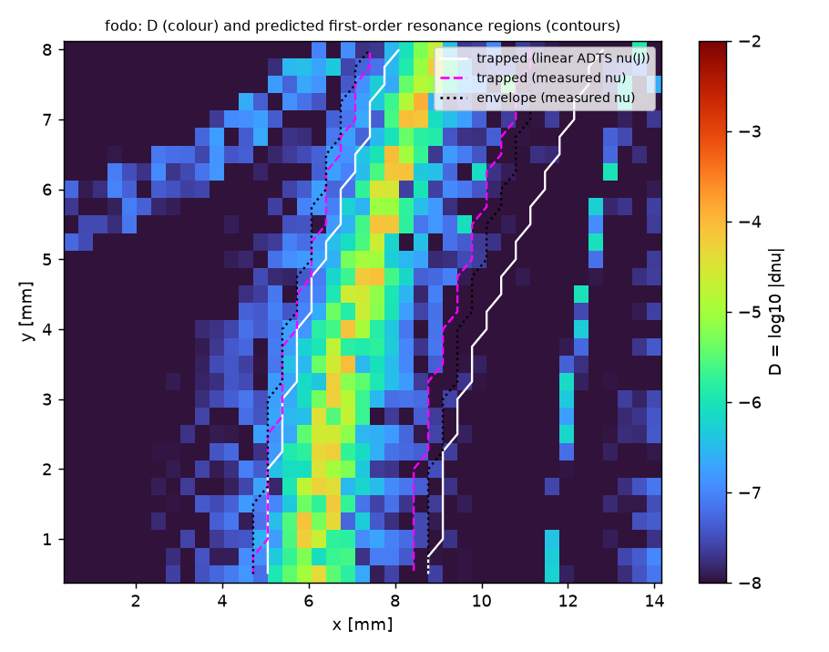

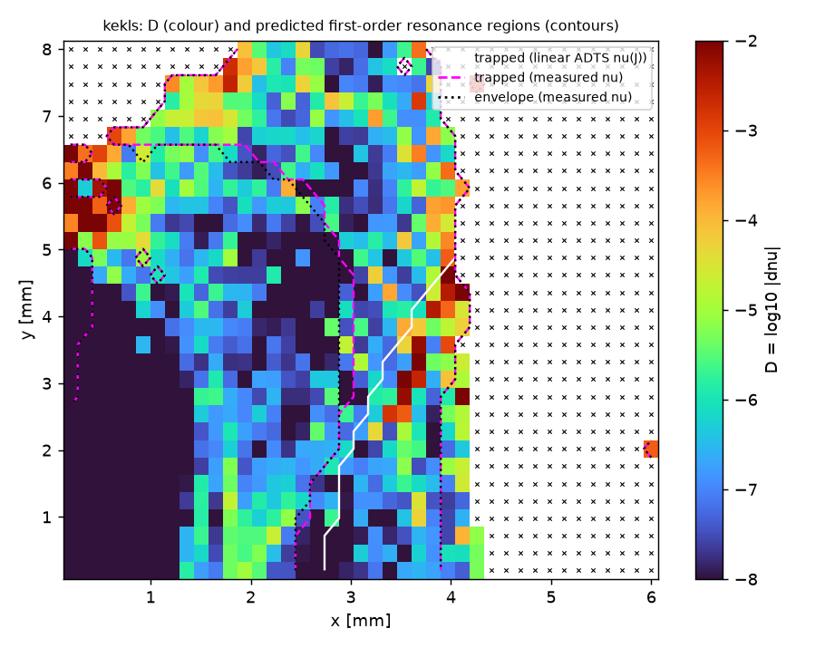

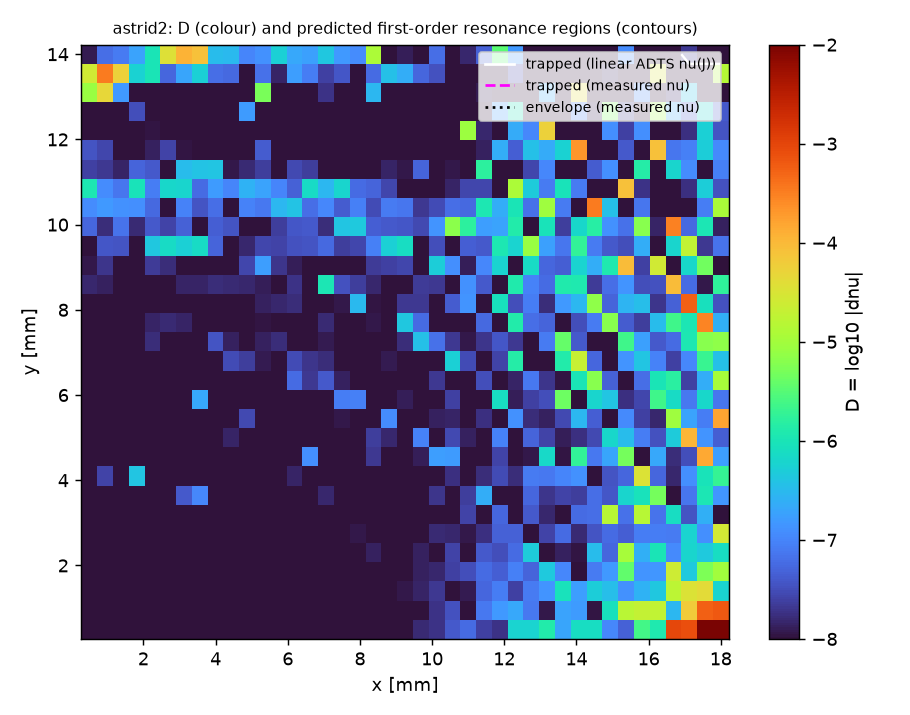

(図: 色 = D、等高線 = 予想の領域。白 = 線形の ADTS の ν(J) で捕らえられる、マゼンタ破線 = 追跡のチューンで捕らえられる、黒点線 = 包絡。ASTRID2 は領域が格子に入らず輪郭なし。)

### 4.7 ASTRID2 で予想できない原因: `fmap_variants.py lambda`

(a) の外れの原因を、6 極の強さを λ 倍 (K2 に λ をかける。ASTRID2、coarse の 21 × 16、位置 2、1024 周) で調べた。出力: [`fmap_variants_lambda_astrid2.out.txt`](fmap_variants_lambda_astrid2.out.txt)。

```
py -3.12 example/14_nonlinear_dynamics/frequency_map/fmap_variants.py lambda astrid2
```

所要 500 s (4 つの λ)。

| λ | 失われた点 | D の範囲 | D > −5 の点 | D > −3 の点 | D > −5 の点の最も近い共鳴線 |
|---|---|---|---|---|---|
| 0 | 0 | −13.27〜−7.31 | 0 | 0 | — |
| 0.5 | 0 | −11.16〜−7.04 | 0 | 0 | — |
| 1 | 0 | −10.72〜−2.98 | 10 | 1 | νx − νy: 7、5νy: 2、2νx + 3νy: 1 |
| 1.5 | 67 | −10.91〜−1.16 | 37 | 12 | νx − νy: 26、4νx: 5、5νy: 4、4νy: 1、5νx: 1 |

6 極を切る (λ = 0) と D の最大が −7.3 まで下がり、D の大きい領域が消える。λ = 0.5 でも −7.0 までで、1 → 1.5 で D > −5 の点が 10 → 37 に増える。強さの 1 次では説明できず (λ = 0.5 で 0 点)、
2 次以上の共鳴 (νx − νy など) が λ の高次で立ち上がる様子。**予想するには 6 極の 2 次の共鳴駆動項が要るが、この節の予想 (`resdrive.py` の 1 次の RDT) には入っていない (§0.3。4 次の h を入れた予想は §12)。**

---

## 5. `fmap_variants.py delta`: (b) x–δ・y–δ の周波数マップ

### 5.1 目的

δ を含む格子 (x–δ、y–δ) の周波数マップが動くか確かめる (結果は動く)。作動点がクロマティシティで動く様子と、共鳴線 (δ ごとの線形のチューン + ADTS の予想) を比べる。**既存の `frequency_map` が既に x・y・dp の格子を扱う** (RFSW OFF は δ の閉軌道を 4 次元の Newton 法で求め、x・y は δ の軌道からのずれ)。δ のための別の実装は要らない (予想の部分は `fmapres.ResonancePredictor` を δ ごとに作る)。

### 5.2 使うファイルとコマンド

- スクリプト: [`fmap_variants.py`](fmap_variants.py) の `delta` モード。出力: [`fmap_variants_delta_astrid2_xdp.out.txt`](fmap_variants_delta_astrid2_xdp.out.txt)・[`_ydp.out.txt`](fmap_variants_delta_astrid2_ydp.out.txt)・[`fmap_variants_delta_kekls_xdp.out.txt`](fmap_variants_delta_kekls_xdp.out.txt)、表 `fmap_delta_<ring>_<plane>.table.txt`、図 `.png`。

```
py -3.12 example/14_nonlinear_dynamics/frequency_map/fmap_variants.py delta astrid2 xdp [--reuse]
py -3.12 example/14_nonlinear_dynamics/frequency_map/fmap_variants.py delta astrid2 ydp
py -3.12 example/14_nonlinear_dynamics/frequency_map/fmap_variants.py delta kekls xdp
```

所要 396 s・396 s・604 s (1 プロセス、δ ごとの RDT・ADTS は ASTRID2 で 3 s、KEK-LS で 85 s)。

### 5.3 式

1. 追跡は §1.3 と同じ。初期条件は δ の閉軌道 $\mathbf c_\delta$ (4 次元の周期解、Newton 法) に (x, y) を足したもの。
2. **線形のチューン**: `lat.twiss_table(delta=δ)` の位相の進み/2π = $\nu_{i0}(\delta)$ (クロマティシティで動く作動点)。
3. **予想した作動点**: $\nu_i^{\rm pred}(x,y,\delta)=\nu_{i0}(\delta)+\sum_jA_{ij}(\delta)J_j$ ($A(\delta)$ は δ の光学の `adts(delta=δ)`、6 極 2 次 + 8 極 + 運動学・フリンジ。**偏向磁石の 3 次の項は δ ≠ 0 では入らない**)。
4. 共鳴線の近く: 予想した (または追跡の) チューンが次数 4 以下の線 $m\nu_x+n\nu_y=p$ の 0.003 以内。D > thr の点が入る割合を、領域の巡回ずらしの対照と比べる (§4.3)。

### 5.4 結果

x–δ・y–δ: 41 × 31、δ = ±2% (31 点)、1024 周、RFSW・RAD OFF。ASTRID2 x–δ は x = 0.5〜18 mm・y = 2 mm、y–δ は y = 0.5〜14 mm・x = 2 mm。KEK-LS x–δ は x = 0.2〜6 mm・y = 1 mm。

| 項目 | ASTRID2 x–δ | ASTRID2 y–δ | KEK-LS x–δ |
|---|---|---|---|
| 失われた点 | 0 | 0 | 344 |
| D の範囲 | −11.63〜−2.52 | −12.43〜−3.46 | −10.89〜−1.25 |
| D > −5、D > −4 の点 | 42、10 | 11、4 | 60、21 |
| D > −4 の点の最も近い共鳴線 | 5νy: 8、νx − νy: 1、4νx: 1 | νx − νy: 4 | νx − νy: 4、3νx: 4、νx + 2νy: 3、2νx + 3νy: 2、5νx: 2 |
| 線形のチューン (δ = ±2%、最小振幅) と追跡の差 (最大) | νx 0.0027、νy 0.0036 | 0.0012、0.0024 | 0.0041、0.0007 |
| ADTS (固定した軸の振幅分) を足した予想との差の最大 | 0.0007、0.0019 | 0.0008、0.0016 | 0.0018、0.0008 |

追跡で測ったチューン (x–δ の最小振幅の点): ASTRID2 は δ = 0 で νx = 0.1816、νy = 0.1421、δ = −2% で 0.1954・0.1592、+2% で 0.1996・0.1624。KEK-LS は δ = 0 で νx = 0.5772、δ = −2% で 0.6560、+2% で 0.6404 (νy は 0.6194 → 0.6631 / 0.6560)。

### 5.5 追跡 + NAFF の数値と予想との比較

| 比較 | ASTRID2 x–δ | ASTRID2 y–δ | KEK-LS x–δ |
|---|---|---|---|
| 予想したチューンと追跡のチューンの差の中央値、0.003 以内の割合 | 0.0021、0.54 | 0.0056、0.38 | 0.0127、0.28 |
| 予想した作動点が次数 4 以下の線の 0.003 以内 (D > −5): area、cov、対照 ± σ、p | 0.065、0.405、0.065 ± 0.117、0.028 | 0.103、0.545、0.106 ± 0.183、0.055 | 0.157、0.217、0.116 ± 0.048、0.033 |
| 同 (D > −4) | 0.065、0.700、0.061 ± 0.149、0.022 | 0.103、0.750、0.107 ± 0.211、0.033 | 0.157、0.143、0.114 ± 0.072、0.427 |
| 1 次の RDT の共鳴の予想 (δ ごと、追跡のチューン) の領域に D > −5 が入る割合 | 領域なし (area 0) | 領域なし | area 0.228、cov 0.367、対照 0.170 ± 0.104、p = 0.070 |

ASTRID2 x–δ は、D > −4 の 10 点のうち 7 点 (cov 0.70) が、予想した作動点が次数 4 以下の線の 0.003 以内にある領域 (面積 6.5%) に入る (対照 0.061 ± 0.149、p = 0.022)。図の白い線 (x ≈ 15〜18 mm、δ が負側で x が小さくなる) が D の大きい帯に沿う。
y–δ も同様 (cov 0.75、面積 0.10)。KEK-LS x–δ は予想した作動点を使うと D > −4 で判別できない (cov 0.143 対 対照 0.114)、追跡のチューンを使うと D > −5 の 65% が領域に入る (面積 0.257、対照 0.188 ± 0.091、p = 0.003) が、追跡のチューンは共鳴線の近くの点を選んだ結果で循環的。

### 5.6 比較

δ を含む周波数マップは動く。線形の ADTS までの予想は、作動点の δ 依存 (クロマティシティ) と小振幅の ADTS を ASTRID2 で 0.001〜0.002 以内で再現し、D の大きい帯の位置を ASTRID2 で予想した (D > −4 の 70〜75%)。KEK-LS は振幅依存が大きく (§4.6)、予想の精度が足りない。

### 5.7 出力ファイルと図

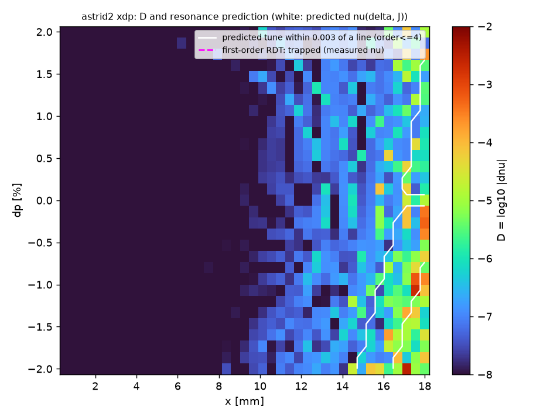

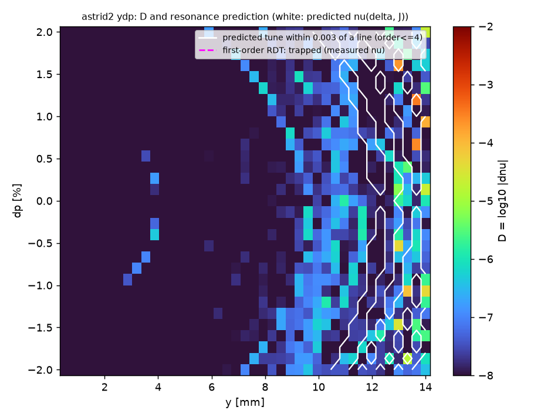

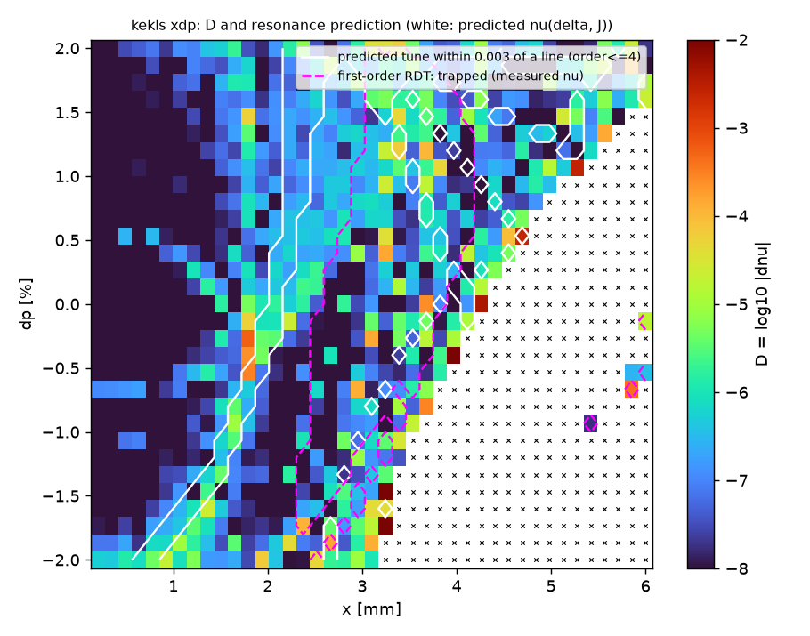

### 5.8 未確認・限界

RFSW OFF (RF なしの δ の閉軌道) だけ。RFSW ON の x–δ (シンクロトロン振動つき) は確かめていない。δ ≠ 0 では偏向磁石の 3 次の項を ADTS・RDT に入れていない (docs/25)。y–δ・x–δ の格子では、もう 1 つの横方向の振幅を固定している (その ADTS 分を予想に入れた)。

---

## 6. `fmap_variants.py k64`: (c) 互換モード k64

### 6.1 目的

`PYSAD_COMPAT=k64` (`compat.set_mode('k64')`) で同じ周波数マップが走るか、v2 との差を確かめる。K64 にない機能なので、周波数マップの処理そのものに互換モードの分岐は無い。差が出るのは追跡の中の要素 (四極の本体の積分器は v2 が 4 次、k64 が 2 次) だけ。

### 6.2 使うファイルとコマンド

```
py -3.12 example/14_nonlinear_dynamics/frequency_map/fmap_variants.py k64 astrid2      # 41 × 31
py -3.12 example/14_nonlinear_dynamics/frequency_map/fmap_variants.py k64 kekls        # coarse 21 × 16 (41 × 31 の格子の 1 つおき)
```

出力: [`fmap_variants_k64_astrid2.out.txt`](fmap_variants_k64_astrid2.out.txt)・[`fmap_variants_k64_kekls.out.txt`](fmap_variants_k64_kekls.out.txt)、表・図 `fmap_k64_<ring>.*`。所要 391 s・115 s。

### 6.3 式

§1.3 と同じ。v2 と k64 の違いは、追跡の中の要素 (K64 の誤りを v2 が直した箇所、docs/28) に限られる。

### 6.4 結果

| 比較 (k64 対 v2 = 保存済みの表) | ASTRID2 (1271 点) | KEK-LS (336 点) |
|---|---|---|
| 失われた点 (k64 / v2) | 0 / 0 | 125 / 125 (食い違い 2) |
| チューンの差 √(Δνx1² + Δνy1²) の中央値・90% 点・最大 | 9e-5・2e-4・0.036 | 3e-5・1e-4・0.081 |
| |ΔD| の中央値・90% 点・最大 | 0.20・0.97・3.4 | 0.17・0.86・2.3 |
| D > −5 の点 | 48 / 49 | 30 / 31 |

### 6.5 追跡 + NAFF の数値

上の表 (k64 の追跡 + NAFF の結果がそのまま)。

### 6.6 比較

**差はあるが小さい**: 小振幅の 1/3 の点ではチューンの差が 8e-5 (ASTRID2)・5e-5 (KEK-LS) 以下で、差が大きいのは大振幅・カオス的な点 (チューンの差 0.01 以上は ASTRID2 で 0.2%、KEK-LS で 1%)。D > −5 の点数・割合は近い (ASTRID2 48 / 49 点、0.038 / 0.039。KEK-LS 30 / 31 点)。原因は、四極の本体の積分器の次数が v2 は 4 次、k64 は 2 次であること (docs/28、B226・B243)。ASTRID2 の複合機能偏向磁石 BH (K1 ≠ 0)、KEK-LS の BPI6・BPI7 (K1 ≠ 0) は含む。k64 の表は 2 次の積分器で追跡した結果で、K64 (gs) の追跡と同じ積分器になる。

### 6.7 出力ファイルと図

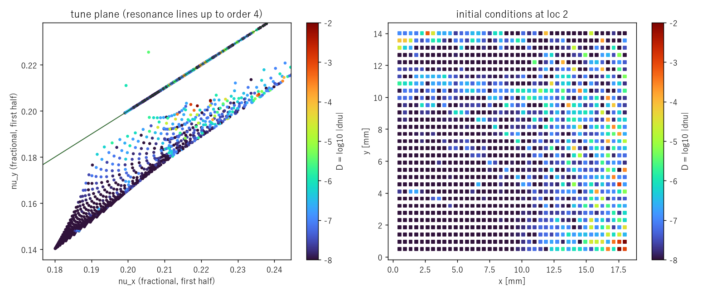

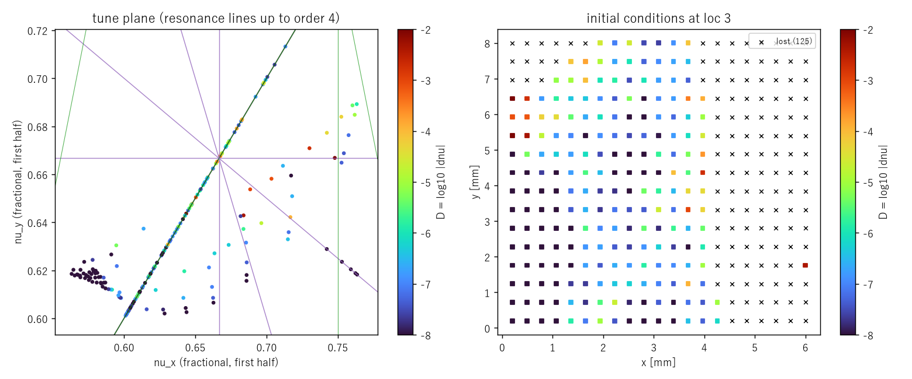

KEK-LS (3 GeV) を `PYSAD_COMPAT=k64` で走らせた周波数マップ。左はチューン面 (νx、νy の小数部。細い線は 4 次までの共鳴線)、右は初期条件の格子 (x [mm]、y [mm]) で、色は D、×は失われた 125 点。v2 の結果との差は §6.6 のとおり (小振幅で 1e-4 以下、大振幅・カオス的な点で大きい)。

### 6.8 未確認・限界

v2 と k64 で結果が変わることが分かっている設定 (`compat.set_bend_k1_edge('face')` など) を使う周波数マップ、RFSW ON・放射つきの追跡は確かめていない。

---

## 7. `fmap_variants.py errors`: (d) 誤差つき

### 7.1 目的

四極・6 極・偏向磁石の位置のずれ・ロールの小さな誤差つきで周波数マップが走るか確かめる。**周期性を使わない全周の追跡** (要素ごとに別々の乱数の誤差、`fmapres.apply_alignment_errors`)。

### 7.2 使うファイルとコマンド

```
py -3.12 example/14_nonlinear_dynamics/frequency_map/fmap_variants.py errors astrid2 1     # 誤差 ×1、41 × 31
py -3.12 example/14_nonlinear_dynamics/frequency_map/fmap_variants.py errors astrid2 3     # 誤差 ×3、coarse 21 × 16
```

出力: [`fmap_variants_errors_astrid2_1.out.txt`](fmap_variants_errors_astrid2_1.out.txt)・[`fmap_variants_errors_astrid2_3.out.txt`](fmap_variants_errors_astrid2_3.out.txt)、表・図 `fmap_errors_astrid2_L1.*`・`_L3.*`。所要 393 s・97 s。
誤差 ×1 の標準偏差 (正規分布、乱数の種 1): 四極と 6 極と偏向磁石の DX・DY 50 μm、四極のロール (ROTATION) 0.2 mrad、偏向磁石のロール (DROTATE) 0.1 mrad。×3 はその 3 倍。誤差を与えた要素: 四極 24、6 極 24、偏向磁石 12。

### 7.3 式

§1.3 と同じ。閉軌道は RFSW OFF の 4 次元の Newton 法 (`closed_orbit_dp(loc, 0)`) で求め、x・y は閉軌道からのずれ。規格化 (α, β) は標本から (誤差で Twiss が変わるため)。NAFF は x・y を別々に解析するので、結合が強いと νx・νy の対応が崩れる。

### 7.4 結果

| 項目 | 誤差なし (2 次の積分器の保存済みの表) | 誤差 ×1 (41 × 31) | 誤差なし (coarse) | 誤差 ×3 (coarse) |
|---|---|---|---|---|
| 位置 2 の閉軌道 (x, px, y, py) [mm, mrad] | 0 | (−0.935, 0.068, 0.060, −0.155) | 0 | (−2.845, 0.199, 0.259, −0.406) |
| Newton 法の残差 | — | 3.1e-16 | — | 3.1e-14 |
| 失われた点 | 0 | 7 | 0 | 79 |
| D の範囲 | −11.45〜−1.70 | −9.27〜−1.31 | −10.72〜−2.98 | −9.21〜−0.90 |
| D の百分位 (5, 25, 50, 75, 95%) | −9.62、−8.56、−7.87、−7.07、−5.64 | −7.61、−6.53、−4.99、−3.84、−2.76 | −9.63、−8.55、−7.86、−6.99、−5.78 | −7.87、−6.21、−4.25、−2.92、−1.16 |
| D > −5 の割合、D > −4 の割合 | 0.038、0.017 | 0.502、0.279 | 0.030、0.012 | 0.619、0.455 |
| 最小振幅 (0.5, 0.5 mm) のチューン (νx, νy)、D | 0.180105、0.140334、−10.72 | 0.183858、0.142774、−7.92 | 同左 | 0.203594、0.138923、−8.22 |
| D > −4 の点の最も近い線 | νx − νy: 10、5νy: 8 | νx − νy: 200、5νy: 67、2νx + 3νy: 23 | νx − νy: 7、5νy: 2 | νx − νy: 69、4νy: 22 |

### 7.5 追跡 + NAFF の数値

上の表。誤差なしとの比較 (誤差 ×1): 両方で残った 1264 点で |ΔD| の最大 7.17、中央値 2.58、|Δνx1| の最大 0.0426、|Δνy1| の最大 0.0373。

### 7.6 比較

周波数マップは誤差つきで走る。誤差 ×1 (50 μm・0.2 mrad) で閉軌道が 0.9 mm ずれ、D の中央値が −7.87 → −4.99、D > −5 の割合が 0.038 → 0.50 になる。原因は、6 極を通る閉軌道のずれによるフィードダウン (6 極 → 4 極・チューンの変化、結合による νx − νy の駆動) と考えられる (**未検証**。誤差の要素を個別に切って確かめていない)。誤差 ×3 (150 μm) では 79 点 (24%) が失われる。D の下限も上がる (最小振幅 −10.7 → −7.9。結合で x の信号に 2 つのモードが混ざるため)。
**誤差のレベルは例であって実機の値ではない**。

### 7.7 出力ファイルと図

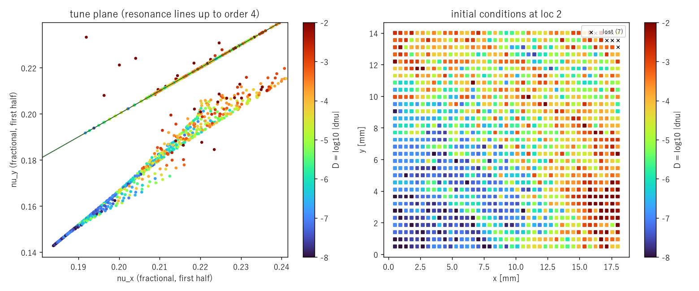

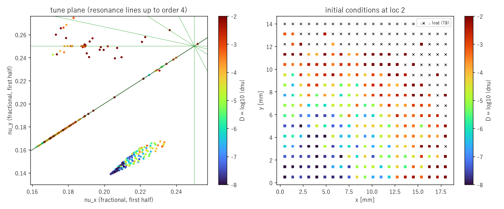

誤差を 3 倍にした場合 (位置 2、79 点が失われる)。左はチューン面で、チューンの足跡が νx − νy の線や 4 次の共鳴線にかかる点が増える。右は初期条件の格子 (x [mm]、y [mm]) で、大振幅側ほど D が大きくなり、×の失われた点が右上から広がる。

### 7.8 未確認・限界

1 つの乱数の種のみ。KEK-LS の誤差つき、補正 (閉軌道補正・結合補正) つきは確かめていない。結合の強さ (チューンのずれ) は測っていない。誤差は 3 つの種類・2 つのレベルだけ。

---

## 8. `fmap_variants.py mpw`: (e) 挿入光源つき

### 8.1 目的

`ASTRID2_v01_02_id.sad` の `RINGMPW` (多極ウィグラー MPW 入り、`D14837MPW` の長直線部、223 要素) で周波数マップが走るか確かめる。

### 8.2 使うファイルとコマンド

```
py -3.12 example/14_nonlinear_dynamics/frequency_map/fmap_variants.py mpw
```

出力: [`fmap_variants_mpw.out.txt`](fmap_variants_mpw.out.txt)、[`fmap_mpw.table.txt`](fmap_mpw.table.txt)、[`fmap_mpw.png`](fmap_mpw.png)。所要 149 s。条件は ASTRID2 と同じ格子 (位置 2、41 × 31、1024 周)。

### 8.3 式

§1.3 と同じ。

### 8.4 結果

| 項目 | MPW なし (2 次の積分器の保存済みの表) | MPW つき |
|---|---|---|
| 作動点 (νx, νy) | 5.179990、2.140178 | 5.180010、2.249201 |
| 最も近い共鳴線 | νx − νy = 3: 0.0282 | **4νy = 9: 0.0008**、νx + 3νy = 12: 0.0229 |
| 失われた点 | 0 | **950 (75%)**、落ちた周の最小 3・中央値 29 |
| 残った点の D の範囲 | −11.45〜−1.70 | −11.39〜−2.34 |
| D の百分位 (5, 25, 50, 75, 95%) | −9.62、−8.56、−7.87、−7.07、−5.64 | −9.06、−7.97、−6.24、−5.02、−3.33 |
| D > −5、D > −4 | 48、21 | 80、31 (残った 321 点のうち) |
| D > −4 の点の最も近い線 | νx − νy: 10、5νy: 8 | 5νx: 14、3νx − 2νy: 10、2νx + 2νy: 3 |

MPW つきの ADTS (全部入り) xx、xy、yy = 469.8、1508.2、1708.5。1 次の RDT の調和の大きさ: (1,−2) 5.594、(1,0) 5.710、(1,2) 13.132、(3,0) 1.106。1 次の RDT の予想の領域は面積 0.019、D > −5 の cov 0.025 (対照 0.005 ± 0.010、p = 0.115)。

### 8.5 追跡 + NAFF の数値

上の表。

### 8.6 比較

周波数マップは MPW つきで走る。**MPW (E1・E2 つきの偏向磁石の列) で線形のチューン νy が 2.1402 → 2.2492 に動き、4νy = 9 の 0.0008 以内に入る**。失われる点は y 方向が主: y = 0.5 mm の列で 24%、3.2 mm で 34%、5.9 mm で 83%、y ≥ 10 mm は全部 (x への依存は弱い、x の列ごとに 52〜97%)。落ちた周の中央値は 29。4νy = 9 が原因という確認 (νy を動かした比較) はしていない (**未検証**)。D の分布も MPW なしと大きく違う (中央値 −7.87 → −6.24)。1 次の RDT の予想は、`resdrive` が K0 ≠ 0 の偏向磁石 (MPW の内部) を含まないため、この例では信頼できない。

### 8.7 出力ファイルと図

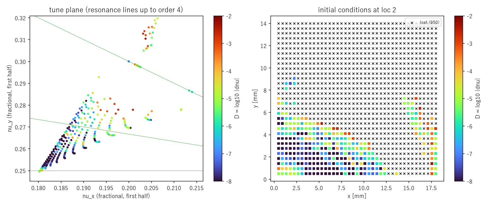

### 8.8 未確認・限界

MPW の RDT・ADTS (内部の K0 ≠ 0 の偏向磁石) は `resdrive` の対象外。RF・放射つきの MPW は確かめていない。MPW つきの作動点 (4νy = 9 に近い) は設計ファイルの値で、補正の有無で変わるかは未確認。

---

## 9. `fmap_variants.py naff`・`grid`: (f) NAFF の窓・周回数・格子の細かさ

### 9.1 目的

D の分布が NAFF の窓・周回数・格子の細かさに依存するかを確かめる。

### 9.2 使うファイルとコマンド

```
py -3.12 example/14_nonlinear_dynamics/frequency_map/fmap_variants.py naff astrid2                       # 4096 周を 1 回追跡し、周回数・窓を変えて NAFF をかけ直す
py -3.12 example/14_nonlinear_dynamics/frequency_map/fmap_variants.py grid astrid2 81 61 --workers 2     # 細かい格子
py -3.12 example/14_nonlinear_dynamics/frequency_map/fmap_grid_summary.py                                 # 部分格子の統計
```

出力: [`fmap_variants_naff_astrid2.out.txt`](fmap_variants_naff_astrid2.out.txt)、[`fmap_variants_grid_astrid2_81x61.out.txt`](fmap_variants_grid_astrid2_81x61.out.txt)、[`fmap_grid_summary.out.txt`](fmap_grid_summary.out.txt)。所要 452 s (336 点 × 4096 周)、937 s (4941 点 × 1024 周、2 並列)、数 s。
ASTRID2、位置 2、x = 0.5〜18 mm・y = 0.5〜14 mm。

### 9.3 式

§1.3 の D。周回数 N のとき前半・後半は N/2 周。窓は Hann の次数 p ($w\propto(1+\cos\pi t)^p$、p = 0 は窓なし = 矩形)。Laskar の評価では p = 1 で周波数の誤差が N⁻⁴ に比例するので、線形の運動の D の下限は N とともに下がる。

### 9.4 結果

(1) 周回数・窓 (coarse 21 × 16 = 336 点、4096 周を 1 回追跡して、先頭の N 周でかけ直した。基準 = 1024 周、Hann p = 1):

| 条件 | D の百分位 (5, 25, 50, 75, 95%) | D > −5 の割合 | D > −4 の割合 | 基準との D の差の中央値 | D > −5 の判定が基準と違う点 | 順位相関 | 上位 10% の一致 |
|---|---|---|---|---|---|---|---|
| 512 周 Hann p=1 | −8.35、−7.45、−6.79、−6.11、−4.67 | 0.065 | 0.021 | +0.96 | 12 | 0.861 | 0.70 |
| **1024 周 Hann p=1 (基準)** | −9.63、−8.55、−7.86、−6.99、−5.78 | 0.030 | 0.012 | 0 | 0 | 1 | 1 |
| 2048 周 Hann p=1 | −10.74、−9.72、−8.97、−8.15、−6.51 | 0.021 | 0.006 | −0.98 | 3 | 0.854 | 0.64 |
| 4096 周 Hann p=1 | −12.01、−11.00、−10.17、−9.25、−7.15 | 0.009 | 0.003 | −2.34 | 7 | 0.799 | 0.36 |
| 1024 周 窓なし p=0 | −6.86、−6.20、−5.65、−5.20、−4.65 | 0.149 | 0.009 | +2.29 | 42 | 0.685 | 0.52 |
| 1024 周 Hann p=2 | −11.66、−9.76、−8.25、−6.91、−5.43 | 0.033 | 0.018 | −0.31 | 1 | 0.883 | 0.79 |
| 1024 周 Hann p=3 | −12.52、−9.75、−8.12、−6.76、−5.13 | 0.045 | 0.018 | −0.07 | 5 | 0.834 | 0.79 |
| 2048 周 Hann p=2 | −13.31、−11.53、−9.68、−8.03、−6.25 | 0.024 | 0.006 | −1.86 | 2 | 0.816 | 0.67 |

最小振幅の 5 点の D (x = 0.5 mm、y = 0.5〜4.1 mm): 512 周 −8.89、−8.82、−8.11、−8.01、−6.93。1024 周 −10.72、−9.98、−9.20、−8.86、−7.69。2048 周 −12.46、−10.86、−10.16、−10.14、−9.16。4096 周 −13.41、−11.90、−11.47、−11.07、−10.17。窓なし 1024 周 −7.21、−7.06、−6.20、−5.79、−6.71。

(2) 格子の細かさ (81 × 61 = 4941 点の追跡から部分格子を取り出す。1024 周):

| 格子 | 点数 | D の中央値 | D の 95% | D > −5 の割合 | D > −4 の割合 | D > −5 の点数 × (4941/点数) | 近い / 遠い (D > −5 の割合) |
|---|---|---|---|---|---|---|---|
| 11 × 8 | 88 | −7.80 | −5.72 | 0.023 | 0.011 | 112 | 0.038 / 0.016 |
| 21 × 16 | 336 | −7.86 | −5.78 | 0.030 | 0.012 | 147 | 0.067 / 0.013 |
| 41 × 31 (81 × 61 の 1 つおき。2 次の積分器の表) | 1271 | −7.87 | −5.64 | 0.038 | 0.017 | 187 | 0.061 / 0.028 |
| 81 × 61 | 4941 | −7.87 | −5.78 | 0.031 | 0.014 | 151 | 0.047 / 0.024 |

x 方向の隣の点 (間隔 0.43 mm) の D の平均で間の点の D を予想した差 |ΔD|: 中央値 0.43、90% 点 1.44、|ΔD| > 1 の割合 0.199 (D の変化は格子の隣の点で既に大きい)。

### 9.5 追跡 + NAFF の数値と比較 (結論)

- **D の絶対値は周回数で大きく動く**: 周回数を 2 倍にすると D の中央値が約 1 下がる (512 → 1024 → 2048 → 4096 で −6.79、−7.86、−8.97、−10.17)。規則的な運動の NAFF の誤差が N とともに減るため。**D > −5 の割合は周回数で 0.065 → 0.030 → 0.021 → 0.009 と変わる**ので、閾値 −5 は周回数 1024 での目安。
- 規則的 (D 小) とカオス的 (D 大) の順序は残る: 順位相関 0.80〜0.88、上位 10% の一致 0.36 (4096 周)〜0.79 (窓の次数)。1024 周と 2048 周では D > −5 の判定が違う点は 3 点 (336 点のうち)。
- **窓なし (p = 0) は悪い**: D の下限が −5.7 までしか下がらず (スペクトルの漏れ)、D > −5 の割合が 0.149 になる (基準の 5 倍)。p = 2 と 3 は D が 0.1〜0.3 小さい (中央値) で、判定の違いは 1〜5 点。**Hann p = 1 (既定) は妥当**。
- **格子の細かさ**: D の分布 (中央値・95%)、D > −5 の割合 (0.023〜0.038)、D > −4 の割合 (0.011〜0.017) は 11 × 8 から 81 × 61 でほぼ変わらない。D > −5 の点の数は稀な事象なので標本の揺らぎ (111〜187 の換算) があり、細かさで一定の値に収束するというより ±25% の揺らぎ。共鳴線の近く / 遠くの比 (0.047/0.024) も 2 倍前後で一定。

### 9.6 出力ファイルと図

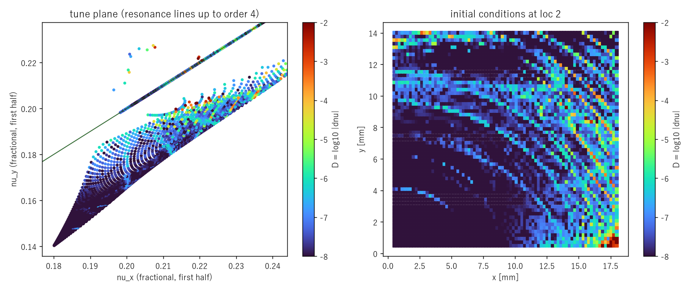

### 9.7 未確認・限界

ASTRID2 の 1 つの位置だけ。窓は Hann 系 (p = 0〜3) だけ (Laskar 以外の窓、周波数の精密化なしの FFT のピークは比べていない)。nturn が前半・後半で割れる偶数周に限る。

---

## 10. `gs_fmap_compare_kekls.py`: (g) KEK-LS の追跡を gs と比べる

### 10.1 目的

§3 を KEK-LS (kek-ls_v03_12.lat、3563 要素) でも行う。K64 に NAFF は無いので、gs の座標列に pysad の NAFF をかけて比べる。失われる点では落ちた周も比べる。

### 10.2 使うファイルとコマンド

- スクリプト: [`gs_fmap_compare_kekls.py`](gs_fmap_compare_kekls.py)。gs に渡した台本 [`gs_fmap_kekls.sad`](gs_fmap_kekls.sad) (ラティス + `MOMENTUM = 3e9; FFS; USE RING; CELL; CALC; NORFSW; NORAD; LOSSAMPL = 0.1;` + 1 周ずつの `TrackParticles[{3, b}, 3]` の 512 回)。出力: [`gs_fmap_kekls.gs.txt`](gs_fmap_kekls.gs.txt)・[`.pysad.txt`](gs_fmap_kekls.pysad.txt)・[`.out.txt`](gs_fmap_kekls.out.txt)。

```
py -3.12 example/14_nonlinear_dynamics/frequency_map/gs_fmap_compare_kekls.py kekls [--timeout 1800] [--nogs]
```

所要: pysad の台本 10 s、gs 2 s。gs は WSL、timeout 1800 s、1 本ずつ。終了後に `ps -eo pid,etime,pcpu,cmd | grep sad1.exe` で残りがないことを確かめた (残りがなければ kill は不要だった)。点は保存済みの表 (41 × 31、1024 周) から D の値で選ぶ (保存済みの `gs_fmap_kekls.*` の 8 点は、積分器を変える前の表から選んだ点で、現行の表から選び直すと別の点になる。生き残る 6 点: D = −9.5、−8、−6.5、−5、−4、−3 に最も近い点、失われる 2 点: 落ちた周が最も早い点と最も遅い点)。

### 10.3 式

§1.3 の D。落ちた周 = gs の生存の旗 (`TrackParticles` の戻りの 7 列目) が 0 になる最初の周。カオスの尺度: 初期の x を dx = 1e-13、1e-12、1e-11 m ずらした pysad の追跡との 512 周の座標の最大の差。

### 10.4 結果

KEK-LS、位置 3、NORFSW・NORAD、512 周 (前半・後半 256 周)、Hann 窓、pysad は `PYSAD_COMPAT=k64` (gs と同じ四極 2 次の積分器):

| i | x [mm] | y [mm] | D (API) | D (pysad 台本) | D (gs の座標) | νx (API) | νx (gs) | νx の差 | 座標の最大の差 [m] |
|---|---|---|---|---|---|---|---|---|---|
| 0 | 1.070 | 1.760 | −8.5105 | −8.5105 | −8.5105 | 0.5808394605 | 0.5808394605 | 2.2e-16 | 1.3e-14 |
| 1 | 2.375 | 4.100 | −7.0755 | −7.0755 | −7.0755 | 0.6045797171 | 0.6045797171 | 1.3e-14 | 3.5e-13 |
| 2 | 4.260 | 0.460 | −4.7261 | −4.7261 | −4.7261 | 0.8144545623 | 0.8144545623 | 1.1e-13 | 1.2e-11 |
| 3 | 0.635 | 5.140 | −3.9736 | −3.9736 | −3.9736 | 0.6780150094 | 0.6780150094 | 5.0e-15 | 1.5e-13 |
| 4 | 1.505 | 7.480 | −4.2466 | −4.2466 | −4.2466 | 0.6816540641 | 0.6816540641 | 7.8e-15 | 8.9e-12 |
| 5 | 3.680 | 3.320 | −2.3212 | −2.3212 | **−1.9962** | 0.6865833477 | 0.6865833160 | 3.2e-8 | **9.8e-3** |
| 6 | 4.695 | 8.000 | (失われる) 落ちた周: API 1、台本 1、gs 1 | | | | | | |
| 7 | 0.200 | 6.960 | (現行の表 (v2) の 1024 周では 66 周目で失われる) 落ちた周: API 0、台本 0、**gs 369** | | | | | | |

初期の x を dx ずらした pysad の追跡と元の追跡の 512 周の座標の最大の差 (点 0〜5、7) と落ちた周:

| dx | 点 0 | 点 1 | 点 2 | 点 3 | 点 4 | 点 5 | 点 7 | 点 7 の落ちた周 (元 0) |
|---|---|---|---|---|---|---|---|---|
| 1e-13 | 6.7e-12 | 4.8e-12 | 8.6e-10 | 2.1e-12 | 3.7e-11 | 1.0e-2 | 4.7e-2 | 187 |
| 1e-12 | 6.7e-11 | 4.8e-11 | 8.5e-9 | 2.0e-11 | 5.6e-10 | 7.3e-3 | 1.4e-2 | 114 |
| 1e-11 | 6.7e-10 | 4.8e-10 | 8.5e-8 | 1.9e-10 | 5.4e-9 | 7.1e-3 | 1.1e-2 | 128 |

### 10.5 追跡 + NAFF の数値

規則的な点 (D < −3.5、点 0〜4。k64): 座標列の最大の差 **1.16e-11 m**、D の差の最大 2.93e-7。カオス的な点 (点 5、D = −2.3) を含めると座標の最大の差 9.83e-3 m、D の差 0.325。落ちた周: 点 6 は 3 者とも 1 周目 (x = 4.7 mm、y = 8 mm)、点 7 は pysad 0 (512 周残る)、gs 369。

### 10.6 比較

- **規則的な 5 点は gs と 1e-11 m 以内** (規則的な点の座標の食い違いは dx = 1e-13 m の摂動の増幅 (最大 8.6e-10) と同じ桁かそれ以下)。D は 4 桁以上一致、νx は 2e-16〜1e-13。
- **カオス的な点 (点 5、7) の食い違いは、1e-13 m の初期値の摂動と同じ大きさ**: 点 5 は gs との差 9.8e-3 に対し、1e-13 の摂動で 1.0e-2。点 7 は 1e-13〜1e-11 の摂動で pysad の落ちた周が 0 → 114〜187 周に変わる (gs は 369)。つまり gs と pysad の差は丸め誤差の増幅で、**誤りではない**。この種の点 (D > −3 の限界の点) の落ちた周・D は、実装を比べる指標にしない。
- 落ちた周の一致: 失われる点 2 点のうち 1 点 (点 6、1 周目に失われる) が 3 者で一致。点 7 はカオス的で一致しない。
- **v2 の既定 (四極 4 次) の追跡では gs と一致しない**: 同じ 8 点で、規則的な点 (点 0〜4) の座標の最大の差 6.1e-3 m、νx の差 2.6e-6〜1.8e-4、|D(gs の座標) − D(frequency_map)| の最大 0.57 (点 4: D = −3.67 対 gs −4.25)。点 7 は pysad が 66 周目に失われる (gs は 369 周目)。積分器の次数の違いによる (docs/28)。gs との比較は k64 モードで行う。

### 10.7 出力ファイルと図

図なし (表のみ)。

### 10.8 未確認・限界

KEK-LS の 8 点だけ。NORFSW・NORAD の追跡座標のみ (RFSW ON・放射つきは §0.3)。gs の他のビルドは未確認 (2026-10-19 ビルド)。

---

## 11. LMA: `lma_ring.py`・`gs_loss_compare.py` (簡潔に)

局所運動量アクセプタンス (LMA) は位置 s ごとの δ+(s)・δ−(s) を、放射・RF つき (RFSW ON、RAD ON、FLUC なし) の追跡で、粗い走査 + 二分法で求める。周波数マップと同じ `TrackSetup` の上にある (`pysad/lma.py`)。式・手順は [docs/26 §4](../../../docs/26_frequency_map_lma.md)。

```
py -3.12 example/15_lma_touschek/lma/lma_ring.py astrid2     # 364 s (2 並列、25 位置、1075 粒子、1312 周)
py -3.12 example/15_lma_touschek/lma/lma_ring.py kekls       # 580 s (2 並列、43 位置、1849 粒子、491 周)
py -3.12 example/15_lma_touschek/lma/gs_loss_compare.py      # gs と pysad の損失判定の比較 (170 s)
```

| 項目 | ASTRID2 (LOSSAMPL = ±10 mm、check_every = 1) | KEK-LS (±10 mm、check_every = 5) |
|---|---|---|
| δ+ の範囲 | 0.829% (分散の大きい位置)〜1.598% | 3.01〜3.03% |
| RF バケットの高さ δ_rf、δ+ の最大 / δ_rf | 1.618%、0.988 | 2.994%、1.011 |
| 別のセルの同じ位置との差の最大 | 2.63e-5 | 4.87e-5 (tol = 1e-4) |
| 損失の判定の間隔: δ+ (check_every = 1 / 0) 位置 17 | 0.829% / 1.048% | (すべて RF で決まる) 0.03021 / 0.03021 |
| Touschek 寿命 (局所 / 一様 δ_rf / 一様 LMA の最小) | 9502 / 19850 / 2918 s | 26876 / 26045 / 26473 s |

gs との損失判定 (ASTRID2、RFSW・RAD ON、LOSSAMPL = ±10 mm、LOSSDZ = 1.5407 m、1312 周、位置 2・17 の δ = ±(0〜2%) の 30 粒子): 生き残りの旗が gs・pysad の台本・API の 3 者で **30 / 30 一致**、台本の中の二分法の区間 (位置 2・17、δ±) が gs と pysad で 4 / 4 完全に一致 (例: 位置 17、δ+: 0.010469〜0.010508)。最後の x の最大の差 1.55e-3 m (限界ぎりぎりの粒子は、gs の `Emittance[]` の閉軌道・同期位相の 1e-7 の違いで軌道が変わる)。
図: [`lma_astrid2.png`](../../15_lma_touschek/lma/lma_astrid2.png)、[`lma_kekls.png`](../../15_lma_touschek/lma/lma_kekls.png)。

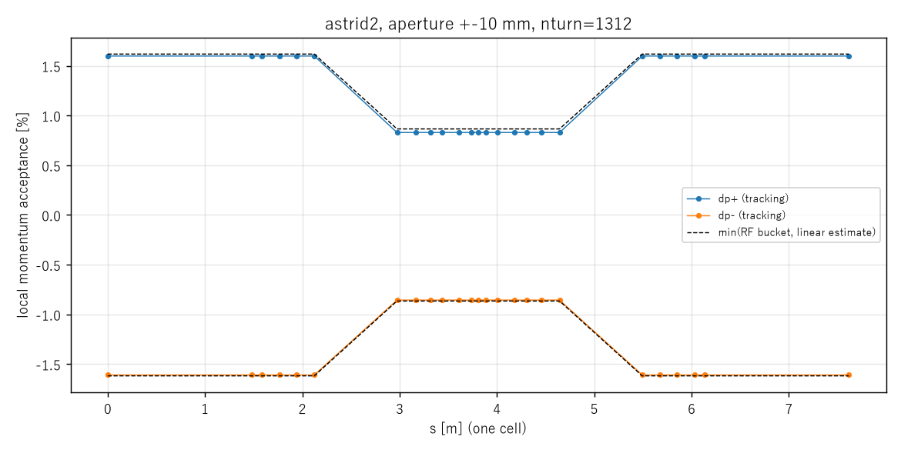

未確認: 誤差・結合のあるリング、FLUC つき、PF リング、MPW つき。バケット高さ付近の限界は周回数に依存する。


## 12. `fmap_rdt4.py`: 2 次の RDT (4 次の $h_{jklm}$) を入れた共鳴線の予想

### 12.1 目的

1 次の RDT (3 次の $h$) だけで島の領域を予想すると (§4)、ASTRID2 は領域が格子に入らず予想できない (D > −5 の 49 点の最寄りの共鳴線は νx−νy など 2 次以上が 26 点、1 次の線は 0 点)。4 次の $h$ (6 極の 2 次ほか、`rdt2nd.rdt4`) を同じ調和にまとめて振り子の式に入れ (`ResonancePredictor.from_lattice(order2=True)`)、§4 と同じ方法 (D > thr の点が予想の領域に入る割合を、領域を格子の上でずらした対照 400 回と比べる) で並べる。

### 12.2 使うファイルとコマンド

`py -3.12 example/14_nonlinear_dynamics/frequency_map/fmap_rdt4.py astrid2|kekls|fodo` (標準出力のリダイレクトには `PYTHONUTF8=1`、各 数秒)。周波数マップは保存済みの表 (astrid2・kekls: `fmap_<ring>.table.txt`、fodo: `fmap_rdt_fodo.table.txt`。1024 周、v2、RFSW・RAD OFF、LOSSAMPL 0.1 m、41×31) を読む。出力 `fmap_rdt4_<ring>.out.txt`・`.png`。
リング・位置: ASTRID2 (0.58 GeV、45.7 m、位置 2)、KEK-LS (`kek-ls_v03_12.lat`、3 GeV、603 m、位置 3)、FODO (3 GeV、105.6 m、QF の K1 = 0.697、位置 1)。

### 12.3 式

(a) 振り子の式 (docs/26 §3.5、§4.3): 調和 $a=(a_1,a_2)=g(m_0,n_0)$ について $F(J)=\sum h\,(2J_x)^{(j+k)/2}(2J_y)^{(l+m)/2}$、$V=2|F|$、$\Delta_0=m_0\nu_x(J)+n_0\nu_y(J)-p/g$、$G_0=(m_0,n_0)A(m_0,n_0)^T$、包絡 $|\Delta_0|<W=\sqrt{2|G_0|V/\pi}$、位相つきの捕捉条件 $\pi\Delta_0^2/|G_0|<V(1-\mathrm{sgn}G_0\cos\theta)$。4 次の h を入れた予想は $h$ に 4 次の $h_{jklm}$ ($J^2$ の項) を足す。4 次の $h$ は**写像の係数**で、非対角の調和の正規形の補正は入れていない (docs/25 §10.8)。

### 12.4 解析の結果 (駆動される調和)

ASTRID2 (線形の作動点 νx=5.17999、νy=2.14018): 1 次は $(1,-2),(1,0),(1,2),(3,0)$ (最寄りの共鳴線までの距離 0.045〜0.21)。4 次で $(0,2)$ ($2\nu_y=4$、距離 0.140、最大 $|h_{00310}|=74$)、$(0,4)$ (0.110、$|h_{00400}|=10$)、$(2,-2)$ ($2\nu_x-2\nu_y=6$ = $\nu_x-\nu_y=3$、距離 0.028、$|h_{20020}|=824$)、$(2,0)$ (0.180、22)、$(4,0)$ (0.070、4.2) が加わる。$\nu_x-\nu_y$ そのもの ($a=(1,-1)$) は上下対称な磁石では駆動されない (y の奇数べき)。

### 12.5 比較 (D > −5 の点が予想の領域に入る割合 cov、領域の面積 area、対照 = ずらした領域)

ASTRID2 (D > −5: 49 点、追跡のチューンを使う、包絡):

| 予想 | area | cov | cov/area | 対照 | p |
|---|---|---|---|---|---|
| 1 次の h だけ (3 次の h) | 0.000 | 0.000 | — | 0 | 1.0 |
| 4 次の h も入れた (写像の係数) | 0.312 | 0.551 | 1.76 | 0.317 ± 0.154 | 0.11 |

(線形の ADTS の ν(J) を使うと 1 次の h だけ: area 0.017・cov 0.041 (p = 0.22)、4 次の h も入れた予想: area 0.247・cov 0.408 (p = 0.24)。D > −4 の 16 点は 4 次の h も入れた予想で cov 0.500 / area 0.312、線形の ν で 0.375 / 0.247 (p = 0.34)。)
KEK-LS (D > −5: 112 点): 追跡のチューンで、1 次の h だけの予想は cov 0.714 (area 0.452、対照 0.287 ± 0.135、p = 0.003)、4 次の h も入れた予想は cov 0.902 (area 0.748、対照 0.474 ± 0.108、p = 0.003)。線形の ν(J) では 1 次の h だけ 0.321 (対照 0.392)、4 次の h も入れた予想 0.688 (対照 0.690): どちらも対照と同じか悪い (線形の ADTS が外れる)。FODO (44 点): どちらの予想も cov 1.0、area 0.296 で同じ (4 次の調和は D の大きい点の予想を変えない。3νx が支配的)。
**結論**: ASTRID2 では、2 次を入れると予想の領域が現れ (1 次の h だけ: 0 → 4 次の h も入れた予想: 2νx−2νy と 4νy)、D > −5 の点 49 の 27 点 (55%) が領域に入るが、領域は格子の 31% を占め、対照 (32 ± 15%) より有意には多くない (p = 0.11〜0.14、cov/area 1.8)。

### 12.6 改善が小さい原因 (調べたこと)

- **共鳴の幅の見積もり**: 幅の係数 c (領域 $|\Delta_0|<cW$) を 1 → 1/16 に絞っても ASTRID2 の面積は 0.31 → 0.30 でほぼ変わらない。測ったチューンで νx−νy = 3.04 (帯) の中に格子の 30% が入るので、νx−νy ≈ 3 の線の近くにいること自体が広い領域 (推定: ADTS の差 $G_0=-655$ [1/(m rad)] が小さく、νx−νy が振幅でほとんど動かない。振幅ごとの νx−νy の分布は確認していない)。D > −5 の点が νx−νy ≈ 3 にあるのは確か (26 点) だが、この帯にいる点はみな D が大きいわけではないので、線への近さは D の大きさを区別しにくい。FODO は c を 1 → 0.0625 に絞ると cov/area が 3.4 → 20、p = 0.003 と判別力が上がる (3νx の島が狭い)。
- **より高次の共鳴**: 測ったチューンが次数 N 以下のどれかの線の 0.003 以内にある点の割合は、D > −5 の点 / 全点で N = 4: 0.531 / 0.298 (比 1.8)、N = 5: 0.837 / 0.636 (1.32)、N = 6: 0.878 / 0.835 (1.05)、N = 8: 0.980 / 0.935 (1.05)。ASTRID2 の D > −5 の点の残り 23 点はどの 4 次以下の線にも近くなく、次数 5 以上の共鳴 (面積が大きい) には線への近さが D を区別しない。
- **チューンの振幅依存**: 線形の ADTS ν(J) では予想がずれる (ASTRID2 の中央値 |Δν| = 0.009、0.003 以内の点 31%)。追跡のチューンを使うと領域が大きく変わる。
- **非対角の調和の正規形の補正が無い**: $2\nu_x-2\nu_y$ の駆動項には 3 次の項どうしの非共鳴の対 ((1,0)+(1,−2) など) の補正が入る (入れていない)。大きさは見積もっておらず、原因の候補として挙げるだけ (未検証)。
- 1 次の共鳴 (3νx) がある FODO・KEK-LS (追跡のチューン) では 1 次の h だけの予想が既に有効で、4 次の h を入れると領域が広がり (KEK-LS 面積 0.45 → 0.75) cov は上がる (0.71 → 0.90) が cov/area は下がる (1.58 → 1.21)。

### 12.7 出力ファイルと図

`fmap_rdt4_{astrid2,kekls,fodo}.out.txt` (全数値)、`fmap_rdt4_{astrid2,kekls,fodo}.png` (D の図に 1 次の h だけの予想の領域 (白) と 4 次の h も入れた予想の領域 (マゼンタ、点線) の輪郭を重ねる)。

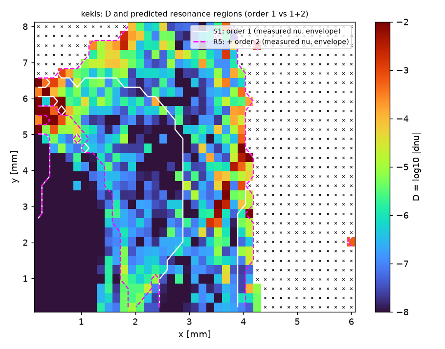

横軸は x [mm]、縦軸は y [mm]、色は D = log10 |Δν| (暗いほど安定、赤いほど大きく動く)、×は失われた点。白い実線は 1 次の RDT だけで予想した共鳴の領域の輪郭、マゼンタの破線は 4 次の h も入れた予想の領域の輪郭。D の大きい点 (赤〜橙) が、マゼンタの輪郭の内側に集まる範囲を見る。同じ形式の図が ASTRID2 (`fmap_rdt4_astrid2.png`)・FODO (`fmap_rdt4_fodo.png`) にもある。

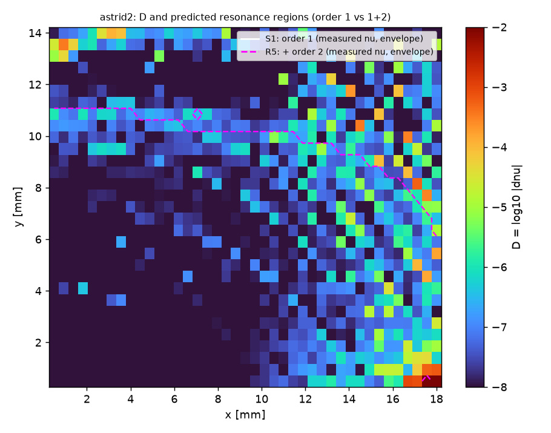

ASTRID2 の同じ図。1 次の h だけでは予想の領域が格子に入らず白い輪郭がなく、4 次の h を足したマゼンタの輪郭だけが図の中に現れる。

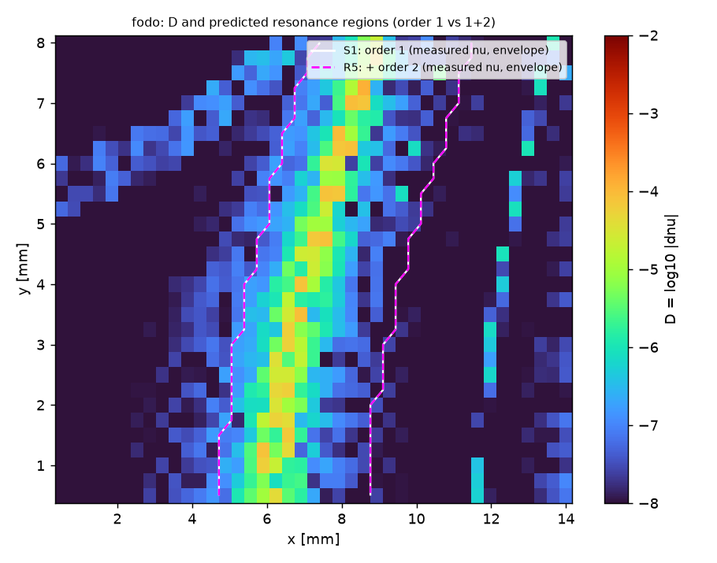

FODO の同じ図。白い輪郭とマゼンタの輪郭が重なっており、このリングでは 4 次の h を足しても予想の領域は変わらない。

### 12.8 未確認・限界

非対角の調和の正規形の補正、δ≠0 の周波数マップ (x–δ・y–δ) への 4 次の項、MPW・誤差つきへの適用は未確認。D の大きさ (カオス) の定量的な予想 (領域の重なりによるカオス) は未実施。

---

## 13. `fmap_predict.py`: 共鳴線の予想 (4 次の h + 非共鳴の補正) と判別力の評価

### 13.1 目的

非共鳴の 3 次の補正 (`rdt4_normal_form`) つきの 4 次の h で共鳴線を予想し (`pysad/fmappred.py`)、1 次の h だけ (3 次の h) の予想・4 次の h (写像の係数) の予想と並べて、D との判別力を cov・面積・対照だけでなく **スコア** (AUC・順位相関・上位 10%) で測る。
方針: 摂動論の定義された次数だけで予想し、**追跡に合わせた当てはめの項・補正は足さない**。

### 13.2 使うファイルとコマンド

- `PYTHONUTF8=1 py -3.12 example/14_nonlinear_dynamics/frequency_map/fmap_predict.py astrid2|kekls|fodo|mpw` (各 数秒〜10 秒。周波数マップは保存済みの表: astrid2・kekls は `fmap_*.table.txt`、fodo は `fmap_rdt_fodo.table.txt`、mpw は `fmap_mpw.table.txt`)。出力 `fmap_predict_<ring>.out.txt`・`.png`。**スクリプトは出力を上書きする**。
- 実装 `pysad/fmappred.py`、試験 `pysad/tests/script_tests/test_v23_S3_fmappred.py` (12 件)、式の導出は docs/25 §12。
- ラティス・位置: FODO (QF の K1 = 0.697、SF・SD の K2 = 4, −6、3 GeV、105.6 m、位置 1)、ASTRID2 (0.58 GeV、45.7 m、位置 2)、KEK-LS (`kek-ls_v03_12.lat`、大きなリング A、ESRF 型の HMBA、3 GeV、603 m、位置 3)、ASTRID2 MPW (`ASTRID2_v01_02_id.sad` の `RINGMPW`、位置 2)。条件: v2、RFSW・RAD OFF、1024 周、LOSSAMPL 0.1 m、41×31 の x–y。
- ν(J) は解析の線形の ADTS (`adts(fourth='r3', optics='calc')`)。表の「3 次の h のみ」「4 次の h」の行は `ResonancePredictor` (既定の `adts()`、差は 1e-4 程度) で、同じ点・同じ計算 (「4 次の h + 補正」は `fmappred.py`)。

### 13.3 式

docs/25 §12.2〜§12.5。$F_{\mathbf a}=\sum h\,(2J_x)^{(j+k)/2}(2J_y)^{(l+m)/2}$ (3 次: `resonance_terms`、4 次: `rdt4` + `nf_correction_h4`)、$V=2|F|$、$G_0=(m_0,n_0)A(m_0,n_0)^{\mathsf T}$、$W=\sqrt{2|G_0|V/\pi}$、スコア $s=\max_a\log_{10}(W_a/|\Delta_{0,a}|)$。

### 13.4 結果 (判別力、D > −5 を正例、包絡の領域、解析の ν(J))

| リング | D>−5 | 予想 | area | cov | 対照 (p) | AUC | ρ | 上位 10% の D>−5 率 (全体) | 振幅だけの AUC | 偏相関 |
|---|---|---|---|---|---|---|---|---|---|---|
| FODO | 44 | 3 次の h のみ | 0.349 | 1.00 | 0.37±0.36 (0.06) | 0.939 | 0.56 | 0.24 (0.03) | 0.42 | 0.56 |
| FODO | 44 | 4 次の h + 補正 | 0.349 | 1.00 | 0.37±0.36 (0.06) | 0.938 | 0.59 | 0.23 (0.03) | 0.42 | 0.62 |
| ASTRID2 | 49 | 3 次の h のみ | 0.017 | 0.04 | 0.02±0.03 (0.23) | 0.512 | −0.07 | 0.05 (0.04) | 0.79 | −0.21 |
| ASTRID2 | 49 | 4 次の h | 0.247 | 0.41 | 0.25±0.17 (0.24) | 0.600 | 0.15 | 0.12 (0.04) | 0.79 | −0.37 |
| ASTRID2 | 49 | 4 次の h + 補正 | 0.249 | 0.45 | 0.25±0.17 (0.20) | 0.682 | 0.41 | 0.09 (0.04) | 0.79 | −0.19 |
| KEK-LS | 112 | 3 次の h のみ | 0.171 | 0.32 | 0.40±0.13 (0.75) | 0.584 | 0.19 | 0.22 (0.14) | 0.77 | 0.20 |
| KEK-LS | 112 | 4 次の h | 0.563 | 0.69 | 0.69±0.11 (0.53) | 0.560 | 0.25 | 0.14 (0.14) | 0.77 | −0.08 |
| KEK-LS | 112 | 4 次の h + 補正 | 0.491 | 0.66 | 0.65±0.10 (0.44) | 0.599 | 0.38 | 0.19 (0.14) | 0.77 | 0.09 |
| ASTRID2 MPW | (生き残り 321 点) | 3 次の h のみ | 0.106 | 0.21 | 0.50±0.28 (0.81) | 0.570 | 0.32 | 0.47 (0.25) | 0.73 | 0.09 |
| ASTRID2 MPW | | 4 次の h | 0.162 | 0.40 | 0.71±0.19 (0.92) | 0.658 | 0.45 | 0.59 (0.25) | 0.73 | 0.29 |
| ASTRID2 MPW | | 4 次の h + 補正 | 0.137 | 0.33 | 0.68±0.20 (0.93) | 0.788 | 0.59 | 0.56 (0.25) | 0.73 | 0.46 |

- AUC 0.5 は判別なし。「振幅だけの AUC」は、D が振幅とともに増える効果 (予想の強さを使わない) で、**これを超えないと予想の判別力とは言えない**。FODO と MPW は超え、ASTRID2・KEK-LS は超えない (AUC が低い)。
- 振幅の 3 層 (小・中・大) の中の 4 次の h + 補正の AUC: FODO 0.96・0.95・0.89、MPW 0.77・0.80・0.69、KEK-LS 0.69・0.45・0.44、ASTRID2 (小は正例なし)・0.35・0.44。
- 予想の強さを使わない比較 (測ったチューンの次数 4 以下の線への近さ): AUC FODO 0.98、ASTRID2 0.69、KEK-LS 0.47、MPW 0.43。
- MPW の cov の対照は、失われた点 (950/1271 が nan) が格子に穴を開けるので、ずらしの対照は不適切 (p 値は意味がない)。AUC・順位相関を見る。§14.2 の MPW の損失の切り分けと整合: νy = 2.2492 が 4νy = 9 の近く (距離 0.0008) で、そこに損失が集中する。予想の (0,4) の島は 47 点で D > −5 の cov 0.05 (面積 0.012) と有意でなく、損失の原因の 4νy = 9 の共鳴そのものの強さを この予想は区別していない。
- **非共鳴の補正の効果** (補正なし → あり): AUC ASTRID2 0.679 → 0.682、KEK-LS 0.577 → 0.599、MPW 0.783 → 0.788、FODO 変化なし (3νx は 3 次の項)。(2,0) の幅は補正で 1.5 倍以上変わるが判別力は変わらない。

### 13.5 島の予想の検証 (D を使わない): チューンの固着

調和ごとに、予想の「捕らえられる」点と、その外側の輪 (W ≤ |Δ0| < 3W) で、測ったチューンが解析の Δ0 より十分小さく線に寄る (|Δ0meas| < 0.003 かつ < 0.25 |Δ0model|) 点の割合:

| リング | 調和 | 島の中 | 外側の輪 |
|---|---|---|---|
| ASTRID2 | 2νx−2νy (νx−νy = 3) | 0.93 (91 点) | 0.21 |
| ASTRID2 | 2νx+2νy | 0.00 | 0.00 |
| KEK-LS | 2νx−2νy | 1.00 (153 点) | 0.77 |
| ASTRID2 MPW | 2νx+2νy | 0.66 (38 点) | 0.00 |
| FODO | 3νx | 0.06 (392 点) | 0.00 |

**島 (νx−νy の 4 次の共鳴) の位置と幅は当たっている**。他の調和 (4νy・4νx・2νx+2νy) の島は固着が見えず、予想が大きすぎる (または島の中心が測ったチューンの精度 0.003 より細い。FODO の 3νx は島が W = 0.009 と細く、固着の判定が粗い)。
**島の中は規則的 (D が小さい)** なので、予想の領域の中に D > −5 の点が多いとは限らない (D の大きい点は島の縁のカオス的な層・重なりにある。§4.5 の FODO で、D の尾根が予想の領域の小振幅側の縁にある観察と同じ)。

### 13.6 改善しない原因 (調べたこと)

1. **次数別の最寄りの線 (測ったチューンから 0.003 以内の最小次数、D > −5 の点 / 全点)**:

| リング | 次数 ≤ 4 で駆動項あり | 駆動項なし (対称性) | 5 次 | 6 次 | 近くない |
|---|---|---|---|---|---|
| FODO | 1.00 / 0.12 | 0 / 0.07 | 0 / 0.20 | 0 / 0.26 | 0 / 0.35 |
| ASTRID2 | 0.53 / 0.30 | 0 / 0 | 0.31 / 0.34 | 0.04 / 0.20 | 0.12 / 0.17 |
| KEK-LS | 0.72 / 0.61 | 0.04 / 0.01 | 0.04 / 0.17 | 0.08 / 0.03 | 0.12 / 0.18 |
| ASTRID2 MPW | 0.23 / 0.21 | 0.09 / 0.14 | 0.23 / 0.32 | 0 / 0 | 0.46 / 0.33 |

   FODO は D > −5 の全点が 3νx (次数 3) の近く (全点の 0.12 に対し 1.00) で、予想が効く唯一の例。ASTRID2 は 53% が νx−νy = 3 (駆動項あり、全点の 0.30 に対し 1.8 倍)、31% が 5 次 (全点の 0.34 と同じ割合 = 区別なし)、12% はどの 6 次以下の線にも近くない。**ASTRID2 の D > −5 の過半は、駆動項を入れていない次数 5 以上・どの線にも近くない点**。KEK-LS は 4 次以下の線が全点の 61% に近く、区別が弱い (0.72 / 0.61)。MPW は 46% がどの線にも近くない。
2. **共鳴の重なり**: 包絡に入る調和の数 0・1・2・3 での D > −5 の割合は、KEK-LS 0.09・0.18・0.19・0.31、MPW 0.20・0.82・0.52、ASTRID2 0.03・0.08・0.06・0.06、FODO 0.00・0.10。**重なるほど D が大きい傾向 (KEK-LS)**。ASTRID2 の 2νx−2νy は W = 0.044 で線の間隔 (半整数 0.5) に比べ広くない が、νx−νy=3 の帯の中に格子の 30% が入り、帯の中で D は一様に大きいわけではない。
3. **振幅依存のチューン**: 解析の線形 ν(J) と追跡のチューンの差の中央値は FODO 0.002、MPW 0.001、ASTRID2 0.011、KEK-LS 0.089 (小振幅の 1/3 でも 0.027)。追跡のチューンを与える診断 (予想ではない) で AUC は FODO 0.94 → 0.99 と上がるが、ASTRID2 0.68 → 0.64、KEK-LS 0.60 → 0.46、MPW 0.79 → 0.77 で上がらない。**ν(J) の誤差 (J² の項) が主因なのは FODO だけ**で、他は ν(J) を直しても判別力は出ない (J² の項は解析式が未実装。追跡の当てはめは方針で足さない)。
4. **δ**: x–δ・y–δ の周波数マップへの適用は未対応 (4 次の h が δ = 0 だけ)。未確認。
5. **次数 5 以上の駆動項**: 解析式なし。数値の正規形 (`ring_map3`) は 4 次の生成関数まで。5 次の生成関数には 4 次のテイラー展開と Dragt–Finn の次の段が要り、未実装 (docs/25 §12.7)。1 の表の 5 次の列が示すとおり、5 次の線への近さは ASTRID2・KEK-LS の D を区別せず、効いているかどうかも今の道具では判定できない。

### 13.7 信頼度のフラグの検証 (解析 ν(J))

| リング | 信頼できる / 注意 / 信頼できない (点数) | D > −5 の割合 (同順) | 警告 |
|---|---|---|---|
| FODO | 0 / 1193 / 78 | — / 0.037 / 0.000 | 3νx が作動点の 0.0089 以内で補正の分母が小さい、線形の ν(J) だけ |
| ASTRID2 | 56 / 519 / 696 | 0.000 / 0.012 / 0.062 | 55% が信頼できない (重なり・大振幅) |
| KEK-LS | 50 / 255 / 501 | 0.000 / 0.012 / 0.218 | 76% が信頼できない |
| ASTRID2 MPW | 81 / 180 / 60 | 0.148 / 0.200 / 0.533 | 69% が信頼できない (線形の移動が大きい点は生き残りでは少ない) |

「信頼できない」の点の D > −5 の割合が高い (KEK-LS 0.22) のは、このクラスが大振幅・重なりの点で、カオスが起きる領域と重なるため (予想が当たるという意味ではない: クラス内の AUC は ASTRID2 0.51、KEK-LS 0.48 で判別なし)。**「信頼できる」は小振幅の点で、D > −5 の点は 0 (MPW を除く)**。フラグの目的は「その点の予想を信用してよいか」を示すことで、D の大小の予想ではない。基準の値 (0.02・0.05・0.003・0.01) は経験則で、D から決めていない。

### 13.8 未確認・限界

docs/25 §12.7 のとおり。δ ≠ 0、次数 5 以上の駆動項 (数値の正規形の拡張)、J² の項、PF・SP8 (大きなリング B) への適用、誤差つき・RFSW ON・放射つきの周波数マップへの適用、島の縁のカオス的な層の幅 (D の大きさの予想) は未確認・未実装。
評価に使った周波数マップは 4 つの表 (41×31) だけで、D > −5 の点が 44〜112 点。AUC などの誤差の見積もり (ブートストラップ) はしていない (対照のずらしだけ)。

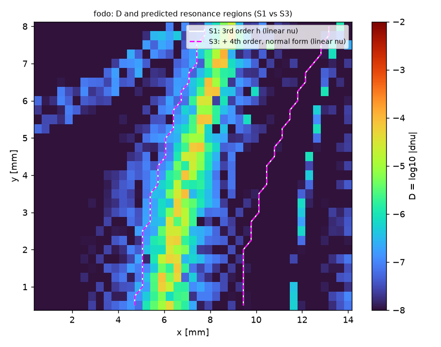

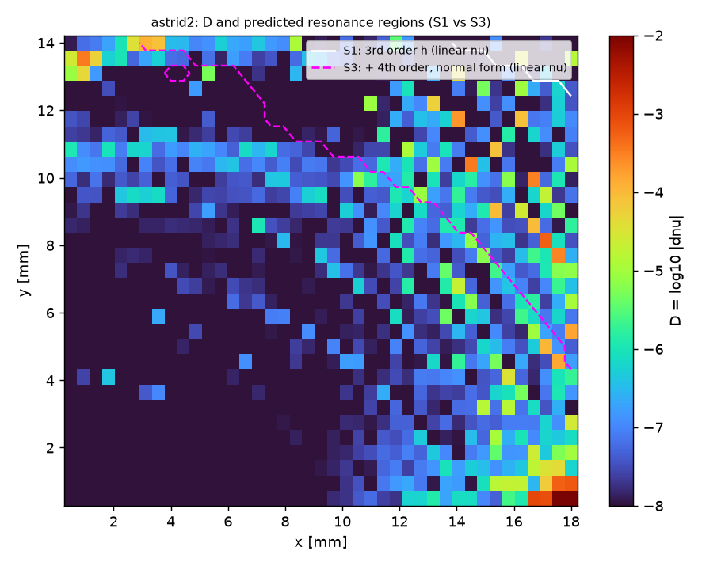


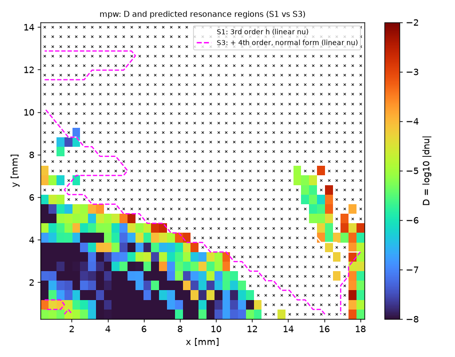

(図: 色 = D、白 = 3 次の h のみの予想の包絡、マゼンタ破線 = 4 次の h + 補正の予想の包絡。解析の ν(J)。)

## 14. `fmap_check_*`: 周波数マップを信頼して使えるようにする (誤差・MPW・RFSW・K1・周回数・警告・gs)

全数値は `example/14_nonlinear_dynamics/frequency_map/fmap_check_data/*.jsonl`・`fmap_check_*.out.txt`、解説は [`docs/26`](../../../docs/26_frequency_map_lma.md) §3.6・§10、索引は [`fmap_reliability.md`](fmap_reliability.md)。
共通の条件: v2、RFSW・RAD OFF、LOSSAMPL = 0.1 m、Hann 窓、規格化 = 標本の楕円、1024 周、**格子 21 × 16 = 336 点** (41 × 31 の格子の 1 つおき。ASTRID2: 位置 2、x = 0.5〜18 mm、y = 0.5〜14 mm。KEK-LS: 位置 3、x = 0.2〜6 mm、y = 0.2〜8 mm)。
誤差なしの D > −5 の割合: 現行の表 (四極 4 次) で ASTRID2 0.030 (41 × 31 で 0.039)、KEK-LS 0.147 (失われた点 125)。以降の §14 の統計は、四極の積分器が 2 次の追跡で作った出力の値 (誤差なしの基準は ASTRID2 0.030、KEK-LS 0.142) で、4 次では取り直していない (数値の差は未確認)。誤差の標準 (k = 1): 四極・6 極・偏向磁石 (KEK-LS は 8 極も) の DX・DY 50 μm、四極のロール 0.2 mrad、偏向磁石のロール 0.1 mrad (補正なし)。

### 14.1 誤差つき: `fmap_check_errors_scan.py`・`fmap_check_errors_summary.py`・`fmap_check_coupling.py`・`fmap_check_nturn.py --errors`・`fmap_check_kekls_orbit.py`

| 項目 | 内容 |
|---|---|
| 目的 | 複数の乱数の種 (≥ 5) と強さ (×0.3・×1・×3) の統計、要素の種類ごとの切り分け、フィードダウンの寄与、結合の寄与、KEK-LS |
| コマンド | `py -3.12 example/14_nonlinear_dynamics/frequency_map/fmap_check_errors_scan.py astrid2 --seeds 1-8 --levels 0.3,1,3 --kinds all --jobs 3`、`--seeds 1-5 --levels 1,3 --kinds quad_dxy,sext_dxy,bend_rot,quad_rot,bend_dxy`、`--kinds all_cs`、`kekls ...` (`fmap_reliability.md`)。集計 `fmap_check_errors_summary.py astrid2\|kekls` |
| 式 | 閉軌道の ΔK1L = K2L x_rel、ΔK1sL = K2L y_rel (x_rel・y_rel = 6 極の中心の閉軌道 − 6 極のずれ)、四極のロール 2K1Lθ。差の共鳴までの距離 √((νx − νy − p + ΔQ)² + \|c−\|²)、c− = (1/2π) Σ ΔK1sL √(βxβy) exp(i[μx − μy − (νx − νy − p)θ]) |
| 結果 (ASTRID2) | all: D > −5 が 0.288 ± 0.029 (×0.3)・0.470 ± 0.047 (×1)・0.644 ± 0.039 (×3) (種 8 つ)、失われた点 0.1・3.5 ± 3.4・113 ± 39。1 種類だけ (×1): 四極のずれ 0.367、6 極のずれ 0.256、偏向磁石のずれ 0.399、偏向磁石のロール 0.287、四極のロール 0.219 |
| 結合だけ | 1 台の QF3 のロール: \|c−\| 0.0003・0.001・0.003・0.01 で 0.134・0.193・0.304・0.424 |
| フィードダウン | 見積もりが差の共鳴までの距離を ×1 で 2〜8% (×3 で 20%) で再現。6 極を閉軌道に合わせると all ×1 が 0.470 → 0.330 (|c−| 0.0092 → 0.0011) |
| NAFF の見かけか | 種 1 ×1 の 4096 周: D_1024 ≥ −4 の 92 点 (27%) の D の傾きは +0.10 (周回数に依らない = カオス)、規則的な点は −3.7〜−4.0 |
| KEK-LS | ×0.03・×0.1・×0.3 (種 5 つ): D > −5 が 0.556・0.557・0.450 (誤差なし 0.142)、失われた点 171・227・285 (125)。×1 は線形に不安定、×3 は閉軌道なし。四極のロール 20 μrad だけで 0.427。6 極・8 極を閉軌道に合わせると 227 → 128 失われる |
| 限界 | 島・カオス層の幅の理論との比較なし。フィードダウンの見積もりは偏向磁石を含まない。KEK-LS の補正つきなし |

### 14.2 MPW: `fmap_check_mpw.py`

| 項目 | 内容 |
|---|---|
| 目的 | `RINGMPW` で点が失われる原因が 4νy = 9 か |
| コマンド | `py -3.12 example/14_nonlinear_dynamics/frequency_map/fmap_check_mpw.py --jobs 3` |
| 結果 | νy = 2.1992〜2.2992 (±0.05、四極 2 家族の Newton 法) で失われる点 207〜252 / 336 のまま (共鳴の上 245)。MPW の強さ s = 0.25・0.5・0.75・1 で 8・111・212・245。s = 1 で νx・νy を MPW なしに戻すと 216、s = 0.5 で 94 |
| 結論 | 4νy = 9 ではなく MPW の内部の非線形による y の力学口径 (50% 以上が失われる y: s = 0.5 で 10.4、0.75 で 6.8、1 で 5.0〜5.9 mm) |
| 限界 | 高次の項の大きさの解析式なし (ADTS の xy・yy は MPW なしより +16% のみ) |

### 14.3 RFSW ON・RAD ON・FLUC ON: `fmap_check_rfsw.py`・`fmap_check_gs_rfsw.py`

| 設定 | D > −5 | D の中央値 | 備考 |
|---|---|---|---|
| RFSW OFF・RAD OFF (既定) | 0.030 | −7.86 | |
| RFSW ON・RAD OFF | 0.565 | −4.81 | z 4 mm・δ 1.6e-4 (大振幅) |
| RFSW ON・RAD ON | 0.985 | −3.49 | |
| RF・RAD・FLUC ON (種 17・29) | 0.988・0.979 | −3.50・−3.51 | |
| RFSW OFF・RAD ON・FLUC ON | 1.000 | −2.67 | δ が 1024 周で −1% |

gs (RFSW ON・RAD OFF、6 点、512 周): `PYSAD_COMPAT=k64` の追跡で、座標 (x, px, y, py, z, δ) が gs と台本で 4e-16〜2e-11 m (D = −1.5 の点は 2e-2 m)、TrackSetup と台本は 0.0。v2 の既定 (四極 4 次) では gs と台本の座標の差が 3e-6〜4e-2 m (点 0〜5。TrackSetup と台本は v2 でも 0.0)。RAD OFF の同期位相は 0、台本 `FrequencyMap[]` の既定は RFSW・RAD OFF。

### 14.4 K1 の設定: `fmap_check_k1opts.py`

ASTRID2 の偏向磁石は K1 ≠ 0・端の角 0 なので `'face'` は効かず D が同じ。`'lin'` (B' 一様) は D の相関 0.47、チューンの差の中央値 4.8e-3。E1 = E2 = 0.02 の変形: face 0.924、lin 0.634、k64 0.983。作動点は 5 設定で同じ。

### 14.5 周回数・窓・格子: `fmap_check_nturn.py`・`fmap_check_grid.py`

規則的な点の D は周回数 2 倍で −1.00 ± 0.05 (256〜4096 周、ASTRID2・KEK-LS)。`D_norm = D + log2(nturn/1024)` で D > −5 の割合の周回数による変化が 7 倍 → 2 倍 (ASTRID2: 固定 0.065 → 0.009、換算 0.021 → 0.045)。512〜4096 周で使う。
窓なし D > −5 が 0.149 (Hann の 5 倍)、p = 1〜3 は 0.030〜0.045。格子は 88 点以上で分布が同じ。

### 14.6 警告: `fmapcheck.check_setup`・`check_result`

12 種のコードの表は docs/26 §3.6。既定の設定の ASTRID2 は警告なし。台本 `FrequencyMap[]` は ` FrequencyMap: WARNING [コード] …` を出力。

### 14.7 gs との比較 (誤差つき): `fmap_check_gs_errors.py`

ASTRID2 all ×1 種 1、6 点、512 周: 追跡 = 台本 (0.0)、gs と規則的な 4 点で 1.6e-15〜1.4e-12 m、D は 4 桁一致 (`PYSAD_COMPAT=k64` の追跡。v2 の既定 (四極 4 次) では gs との座標の差 1.9e-5〜3.9e-2 m、D の差は点 2・3・4 で 0.26・0.63・1.9)。gs の種は pysad に渡せない (SAD の乱数列)。`LINE["DX", n] = 値` は同じ名前の全実体に効くので、誤差のある 60 個の実体ごとに固有の要素定義を作って渡した。

### 14.8 未確認・限界

誤差による島・カオス層の幅の理論との比較、MPW の y の口径を決める高次の項、偏向磁石のフィードダウンの見積もり、誤差つき KEK-LS の補正つき、PF リング・SP8 (大きなリング B)、FLUC ON の gs との統計の比較。
