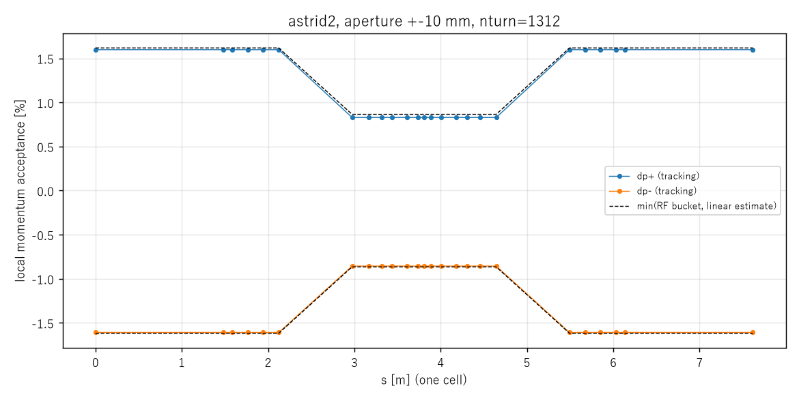
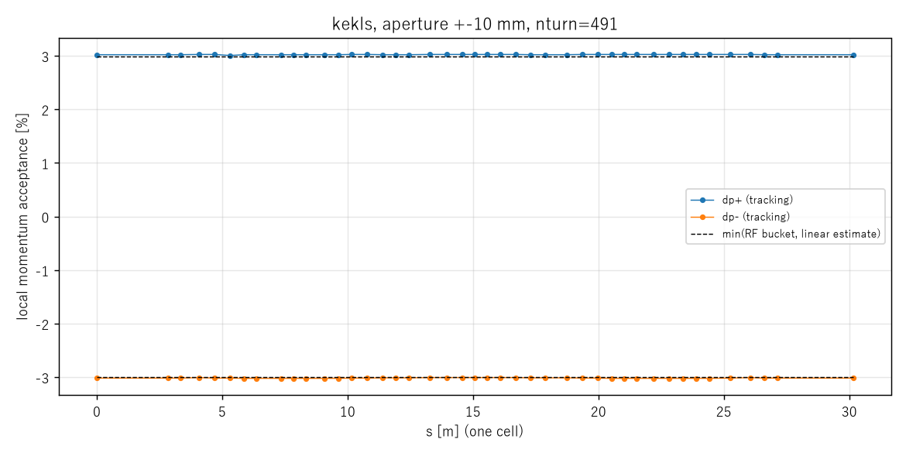
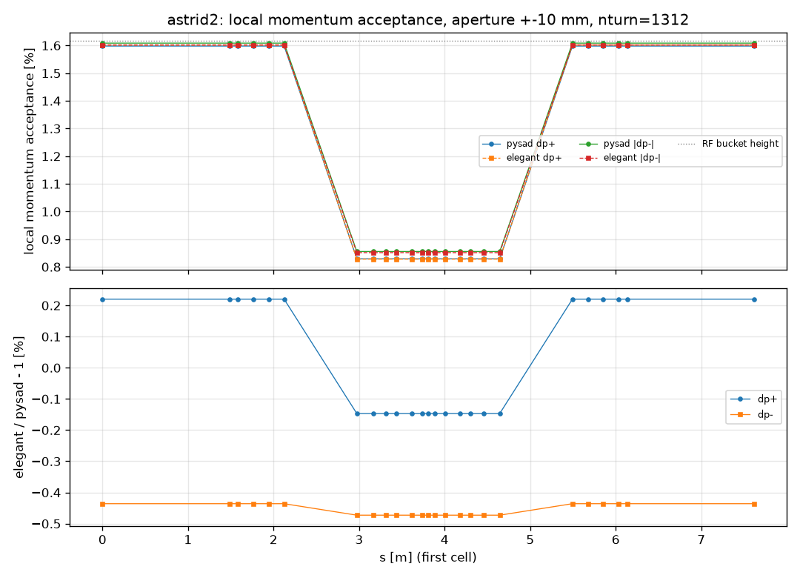

# 局所運動量アクセプタンス (LMA) と Touschek 寿命の例

局所運動量アクセプタンス (LMA、位置 s ごとの δ+(s)・δ−(s)) の計算、gs (SAD K64) との損失判定の比較、結果を信頼できる範囲の確認、誤差と補正のあとの LMA、elegant との比較、Touschek 寿命の式の比較の例です。
実行はリポジトリ直下から `PYTHONUTF8=1 py -3.12 example/15_lma_touschek/<lma|touschek_elegant>/<スクリプト> ...`。すべて既定の v2 モードで、RF・放射つき (RFSW・RAD ON)、損失の限界は LOSSAMPL = ±10 mm (例の値で実機の値ではない)。
elegant は WSL (`~/elegant/env.sh`)、gs は WSL (K64)。gs・誤差と補正のスクリプトは環境変数 `PYSAD_SAD_PACKAGES` が要る。

| サブフォルダ | 内容 | 説明の文書 |
|---|---|---|
| [`lma/`](lma/) | LMA の計算、gs との損失判定の比較、信頼性 (check_every・RF バケット・周回数・FLUC・誤差)、誤差を与えて補正したあとの LMA | [`lma/lma_reliability.md`](lma/lma_reliability.md) |
| [`touschek_elegant/`](touschek_elegant/) | elegant との比較 (LMA・Touschek 寿命)、Touschek 寿命の式の比較、バンチ内の δ、K1≠0 の BEND の K1 の定義 | [`elegant_comparison.md`](touschek_elegant/elegant_comparison.md)・[`touschek_formula.md`](touschek_elegant/touschek_formula.md)・[`bend_k1_definition.md`](touschek_elegant/bend_k1_definition.md) |

## lma/ の例

ラティスは ASTRID2 (0.58 GeV、周長 45.7 m、6 セル)、KEK-LS (`pysad/tests/kek-ls_v03_12.lat`、3 GeV、603 m、20 セル)、ASTRID2 の MPW 版 (`RINGMPW`)。

| 例 (台本) | 出力・図 | 何の例か・結果の要点 |
|---|---|---|
| `lma_ring.py` | `lma_{astrid2,kekls}.{out.txt,table.txt,png}` | 1 セルの位置の LMA を求め、全周の別のセルの数点と比べる。ASTRID2: δ+ = 0.83% (分散の大きい位置)〜1.60% (δ_rf = 1.618%)。KEK-LS: 全位置が RF バケット (δ_rf = 2.99%) で決まり δ+ = 3.01〜3.03%。別のセルとの差は tol (1e-4) 以下 |
| `gs_loss_compare.py`・`gs_loss_astrid2.sad` | `gs_loss_astrid2.{gs.txt,pysad.txt,out.txt}` | ASTRID2 の 30 粒子の損失判定を gs・pysad の台本・pysad の API で比較。生き残りの旗が 30 / 30 一致 |
| `lma_common.py` | - | 各例の共通部分 (ラティスの読み込み、位置の選び方) |
| `lma_check_every.py` | `lma_check_every_*` | 損失の判定の間隔 check_every = 0・1・5 の影響。SAD の tapert (0) はアパーチャが限界の位置で δ を最大 1.5 倍に見積もる |
| `lma_limit_types.py` | `lma_limit_types_*` | RF バケットの限界とアパーチャの限界の区別 |
| `lma_verify.py` | `lma_verify_*` | 二分法が最初の損失しか見ないことの影響 (狭い損失の窓: 0 個) |
| `lma_turns.py`・`lma_turns_short.py` | `lma_turns_*` | 周回数への依存。シンクロトロン振動 2 周期で tol 以内、1 周期以下は危険 |
| `lma_cell.py` | `lma_cell_*` | 1 セルの結果を全周に延ばす影響 (全セルの同じ位置の LMA) |
| `lma_fluc.py` | `lma_fluc_*` | FLUC (量子励起) つきの LMA (複数の種)。elegant の ISR つき (`../touschek_elegant/elegant_isr.py`) と比べる |
| `lma_errors.py` | `lma_errors_*` | 誤差つき・MPW つきの LMA。周期性の崩れを検出して警告し、全周で走る |
| `lma_support.py` | `lma_support_*` | FLUC・誤差・結合・k64 の対応範囲の確認 |
| `lma_corrected_run.py`・`lma_corrected_kekls_v03_{68,12}.template.sad` | `lma_corrected_kekls_v03_12_t982_summary.out.txt` (+ `lma_corrected_summary.py`) | KEK-LS に誤差を与え、COD を補正し、補正後の状態で LMA を求める (SAD の台本の経路)。種・補正の有無・周回数を変えた途中の出力は約 40 本あり、`example/_deletable/lma_corrected_kekls/` に分けた (削除してよい。サマリはこのフォルダに残した) |

ASTRID2 (0.58 GeV、アパーチャ ±10 mm、1312 周) の 1 セルの局所運動量アクセプタンス。横軸はセルに沿った s [m]、縦軸は δ [%]。青が δ+、橙が δ−、黒の破線が RF バケットと線形の見積りの小さい方。長直線部 (s = 0〜2.1 m と 5.5〜7.6 m) では RF バケットの 1.60% まで届き、分散の大きい 2 台の偏向磁石の間 (s = 3〜4.7 m) では 0.83% に下がる。

KEK-LS (3 GeV、アパーチャ ±10 mm、491 周) の 1 セル。全位置で δ は ±3.0% 付近 (RF バケット δ_rf = 2.99% で決まる) に張り付いていて、位置による差はほとんどない。ASTRID2 と違い、アパーチャ・分散の制限が RF バケットより先に効く位置がない。

## touschek_elegant/ の例

| 例 (台本) | 出力・図 | 何の例か・結果の要点 |
|---|---|---|
| `sad2ele.py` | `*.lte`・`*.map.json`・`*.ele` | SAD のラティスを elegant の lte に変換する (K1≠0 の BEND には K2 = −h K1 を足す) |
| `pysad_ref.py`・`elegant_lma.py`・`lma_compare.py` | `pysad_*`・`elegant_*.lma.txt`・`lma_compare_*` | LMA の比較。ASTRID2 は全周 199 位置の elegant と相対差 0.5% 以内。KEK-LS は 11 位置で 0.35% 以内 |
| `elegant_touschek.py`・`elegant_touschek_scan.py`・`elegant_summary.py` | `elegant_*.touschek.txt`・`elegant_summary.out.txt` | elegant の touschekLifetime との寿命の比較。式の差の切り分け |
| `elegant_isr.py` | `elegant_isr_*` | elegant の ISR つきの LMA (種ごと) |
| `gs_bend_k1.py`・`bend_k1_elegant.py` | `gs_bend_k1.*`・`bend_k1_elegant.out.txt` | K1≠0 の BEND のオフモメンタムの光学を gs・pysad・解析式・elegant で比較 |
| `bend_k1_def_*.py` | `bend_k1_def_*.out.txt` | K1 の定義のオプション ('log'|'lin') と CALC の dk の修正の検証 |
| `touschek_formula_*.py` | `touschek_formula_*` | Touschek 寿命の式の比較 (K64・elegant・Piwinski 型)。elegant・Piwinski 型が正確で、K64 は結合・受容により最大 ±20% ずれる |
| `touschek_bunch_*.py` | `touschek_bunch_*.out.txt` | バンチ内の δ の分布の検証 (実験室系の対のモンテカルロ)、相対運動量の縦成分 q_s の効果 |

ASTRID2 の同じ 1 セルで、pysad と elegant の LMA を重ねた図 (上: δ+ と |δ−| [%]、下: elegant/pysad − 1 [%])。形はよく重なり、差は δ+ で +0.22〜−0.15%、δ− で約 −0.44〜−0.47% 以内である。

## 限界・未確認

- 誤差・結合のないリングが中心。補正つきは KEK-LS だけ。PF リング・MPW つきは未確認。
- Touschek の式のどれが正確かは独立な式 (3 次元の積分・厳密な相対論の対のモンテカルロ) で確かめた範囲 (誤差なし・結合の小さいリング) に限る。
- 保存済みの出力の一部 (`*.out.txt`) の見出しには、作業中の旧い呼び名 (T1・Q1 など) が残っている。
- 保存済みの `.lma.txt`・`.table.txt`・`.out.txt` (長い計算) は v2 で取り直していない。`gs_loss_astrid2.pysad.txt` は、現行の v2 の出力と座標が相対 1e-6 程度で違い、損失の旗 (30 / 30) は同じ。
