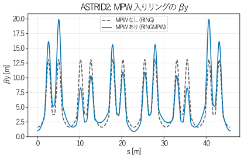

# MPW_v01_02_id_ASTRID2 (挿入光源 MPW の線形シミュレーション)
KEK の SAD チュートリアルの「挿入光源の線形シミュレーション」(ASTRID2 の "big" MPW) をもとにした例。加速器: ASTRID2 (0.58 GeV、周長 45.7044 m、6 セル)。ラティス: `lattice/ASTRID2_v01_02_id.sad` (MPW を片方の直線部に入れたリング `RINGMPW` と、入れないリング `RING`)。フラグ: `RFSW RADCOD RAD COD` (`FLUC` は OFF)。

## 何を見る例か
MPW を「N 極と S 極を交互に並べた偏向磁石 (BEND の K0 だけ、ANGLE 無し)」で表し、(1) 垂直チューンシフト、(2) 放射損失 U0、(3) エミッタンスの変化を、MPW 無し/有りの 2 つのリングで比べる。MPW 無しのリングとの差が、挿入光源の線形な影響である。

## スクリプト
```
USE RING;     cell calc emit;      (* MPW なし: Twiss["NX","$$$"]、Emittance[] の U0・エミッタンス *)
USE RINGMPW;  cell calc emit;      (* MPW あり *)
iS = LINE["POSITION","MMPWS"]; iE = LINE["POSITION","MMPWE"];   (* MPW の両端のマーカー *)
Do[... ds*(BY[i]+BY[i+1])/2 ..., {i,iS,iE-1}]                    (* MPW 内の平均 BY *)
```
MPW の要素 (全文は `.sad`、元はチュートリアルの台本と同じ):
```
BMPW1I = ( L = .175/4 K0 =  θ/2           E2 =1)     (* 入口の半極 *)
BMPW1  = ( L = .175/2 K0 =  θ  E1 =.5 E2 =.5)
BMPW2  = ( L = .175/2 K0 = -θ  E1 =.5 E2 =.5)
BMPW1F = ( L = .175/4 K0 =  θ/2  E1 =1)             (* 出口の半極 *)
MPW  = (MMPWS BMPW1I BMPW2 10*PMPW BMPW1F MMPWE)    (* PMPW = (BMPW1 BMPW2)、全長 1.925 m *)
```
θ = 0.0640435140143602 [rad] (1 極の曲がり角)。`RINGMPW` の MPW 入りセル `TCELL` では、MPW の両側の直線部 `D14837MPW` を 0.5212 m に短くして、リング全体の周長 (45.7044 m) を保っている。

## 結果の読み方
`.gs.txt` / `.pysad.txt` の `noMPW` と `MPW` で始まる行、`MMPWS #...` の行、`dNY` の行。

| 量 | MPW なし | MPW あり | 差 |
|---|---|---|---|
| NX (リング) | 5.179990 | 5.180010 | +0.00002 |
| NY (リング) | 2.140178 | 2.249201 | +0.109023 |
| U0 [eV] | 6166.704 | 7801.112 | +1634.408 |
| εx [nm] | 12.6804 | 10.5597 | (0.833 倍) |
| σδ | 4.3261e-4 | 4.3168e-4 | |
| 要素数 | 200 | 223 | |

MPW の端 (MMPWS・MMPWE) の BY は 1.4079 m、MPW 内の平均 BY は 1.0586 m (MPW を入れないリングでは直線部の中心で 1.6225 m)。水平チューンは変わらず、垂直だけが動くのが挿入光源の線形効果である (MPW は垂直方向に収束する)。



横軸はリングに沿った距離 s [m] (周長 45.7044 m)、縦軸は βy [m]。破線が MPW なし (`RING`)、実線が MPW あり (`RINGMPW`)。MPW は垂直方向にだけ収束する (線形のモデル) ので、MPW を置いたセル (図の中央付近) の βy が変わり、リング全体の βy も周期性が崩れて、最大は 13.09 m から 19.90 m になる。表の垂直チューンの増加 (+0.109) は、この βy の変化の結果である。

## 物理・解析式
MPW の一周期のピーク磁場 $B_0$ と K 値、1 極の曲げ角 (チュートリアルのパラメータ):
$$K=\frac{eB_0\lambda}{2\pi m c}=0.934\,B_0[{\rm T}]\,\lambda[{\rm cm}],\quad \rho_{\min}=\frac{B\rho}{B_0},\quad \theta=\frac{\lambda}{2\sqrt2\,\rho_{\min}}$$
$K=32.7$、$\lambda=0.175$ m から $B_0=2.00$ T、$B\rho=0.58/0.2998=1.935$ T m、$\rho_{\min}=0.96609$ m、$\theta=0.0640435$ rad (ラティスの値と一致)。

(1) **放射損失**。$I_2=\oint\rho^{-2}ds$ に MPW が足す分は、モデルの 22 極 (1 極の長さは $\lambda/2$) から $I_2^{\rm mpw}=22\theta^2/(\lambda/2)=44\theta^2/\lambda=1.03125\ {\rm m^{-1}}$ (これは $L_{\rm mpw}/(2\rho_{\min}^2)$ と同じ、$\langle B^2\rangle=B_0^2/2$ に当たる)。
$$\Delta U_0=\frac{C_\gamma E^4}{2\pi}I_2^{\rm mpw},\quad C_\gamma=8.846\times10^{-5}\ {\rm m/GeV^3}$$

(2) **垂直チューンシフト**。滑らかな近似の 1 次の式 (チュートリアルの式、$\langle\beta_y\rangle$ は MPW の中の平均):
$$\Delta\nu_y\simeq\frac{1}{4\pi}\oint\beta_y K_y ds=\frac{L_{\rm mpw}}{8\pi\rho_{\min}^2}\langle\beta_y\rangle=\frac{\pi L_{\rm mpw}K^2}{2\lambda^2\gamma^2}\langle\beta_y\rangle$$
MPW の収束 $\int K_yds=1.031\ {\rm m^{-1}}$ (焦点距離 約 1 m) は $\beta_y=1.6$ m に対して強い (弱い摂動ではない) ので、1 次の式は使えない。MPW 全体を中心の薄肉レンズ 1 枚として周期行列で厳密に解く:
$$\cos2\pi\nu_y'=\cos2\pi\nu_y-\tfrac12\beta_{y}\,(\textstyle\int K_yds)\sin2\pi\nu_y$$

| 式 | Δνy |
|---|---|
| 1 次の式、MPW 無しの β (直線部中心 1.6225 m、MPW 内平均 1.8128 m) | 0.1488 |
| 1 次の式、中心の β (1.6225 m) | 0.1332 |
| 1 次の式、MPW ありの内部の平均 β (1.0586 m、gs) | 0.0869 |
| 薄肉レンズ 1 枚の厳密式 (中心 β=1.6225 m、$\int K_yds$=1.03125) | 0.1112 |
| gs | 0.109023 |
| pysad | 0.109023 |

薄肉レンズの厳密式が gs と 2 % で合う。1 次の式の値は 20〜40 % ずれるので、チュートリアルの式 (0.1456) の値がそのまま合うわけではない (チュートリアルもリング側の計算値 0.10902 を「デザインレポートと一致」としている)。

| 量 | 式の値 | gs | pysad |
|---|---|---|---|
| $\Delta U_0$ [eV] ($C_\gamma E^4 I_2^{\rm mpw}/2\pi$) | 1643.0 | 1634.4 (0.5 % 低い) | 1634.4 |
| $U_0$ (MPW あり) [eV] (リング分 6166.50 + 上) | 7809.5 | 7801.1 | 7801.1 |

## gs と pysad の比較
○ 一致。表の全項目 (チューン、U0、エミッタンス、エネルギー分散、BY、平均 BY、要素数) が少なくとも 7 桁で一致 (表示の桁まで同じ)。

## 未確認・限界
- エミッタンスの減少 (0.833 倍) は、$I_5$ (MPW が作る分散のゆらぎ) と $I_2$ の増加の兼ね合いと思われるが、$I_5$ を別に計算して式で確かめてはいない。エネルギー分散の変化、減衰時間の変化も式との照合は未了。
- 磁場の端の取り扱い (入口・出口の半極 `E1=1`/`E2=1`、`D14837MPW` の短縮) は、チュートリアルの台本をそのまま使った。実機の MPW の 3 次元的な非線形性 (ダイナミックアパーチャへの影響) は入れていない (線形のみ)。
- ΔU0 が式より 0.5 % 低い原因は未調査 (放射損失が SAD の閉軌道上の曲率から出ることと、MPW の端の半極のモデル化の違いが考えられる)。
