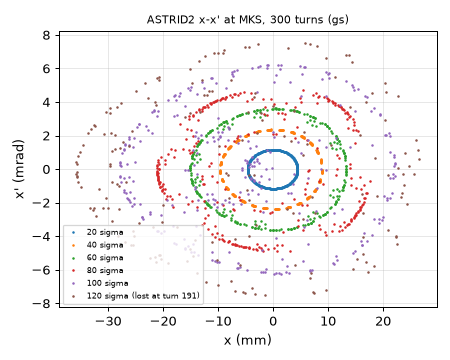

# phase_x_ASTRID2 (位相空間の軌跡: 水平 x-x')
KEK の SAD チュートリアルの「位相空間プロット phase_x.sad / phase_y / phase_dp」(水平方向の初期振幅に対するもの) をもとにした例。加速器: ASTRID2 (0.58 GeV、周長 45.7044 m、チューン 5.17999 / 2.14018)。ラティス: `lattice/ASTRID2_v01_01.sad` の `RING` (6 極は色収差補正値)。フラグ: `RFSW RADCOD COD` (`RAD FLUC` は OFF)。

## 何を見る例か
リング先頭 `MKS` から、水平の初期振幅が 20, 40, …, 120 σ ($\sigma_x=\sqrt{\epsilon/\gamma_x}=0.222$ mm、振幅 $=k\times20\sigma$) の 6 粒子を同時に、`TrackParticles[res,1]` を 1 周ずつ 300 回呼んで追跡し、毎周の $(x, x')$ を書き出す。小さい振幅では楕円、振幅が大きいと6 極の非線形で歪み、乱れて、最後は粒子が失われる様子が見える。元のスクリプトは粒子を 1 つずつ 1000 周追って Tk の `ListPlot` に描く。ここは 6 粒子を同時に 300 周に縮め、窓を使わず数値を出力して、図は gs の出力から matplotlib で描いた。

## スクリプト
```
res = {1,{x1,px1,y1,py1,z1,dp1,n1}};       (* 6 粒子の座標のリスト、n1 = 生き残りの印 *)
Do[ res = TrackParticles[res,1]; Print["PH ", t, " ", res[2,1]*1000, " ", res[2,2]*1000, " ", res[2,7]]; ,{t,1,300}];
```
`res[2,1]` が x のリスト、`res[2,2]` が x'、`res[2,7]` が生き残りの印 (1: 生存、0: 失われた)。`TrackParticles[res,1]` は、粒子が要素 1 (MKS) にいるときに 1 を指定すると、リングを 1 周して要素 1 に戻る (元のスクリプトと同じ使い方)。

## 結果の読み方
`PH 周回数 {x の 6 個} {x' の 6 個} {生存の 6 個}` の 300 行 (x は mm、x' は mrad)。



- 20 σ (青): 楕円。40 σ (橙)・60 σ (緑): 楕円がやや歪み、60 σ では 1 周ごとの軌跡の点の間隔が不均一になる。80 σ (赤)・100 σ (紫): 軌跡が楕円から外れて、点が不規則に散らばる (非線形共鳴またはカオス的な運動。原因の特定はしていない)。120 σ (茶): 191 周目に失われる (`res[2,7]` が 0)。
- 失われた粒子の座標は、gs が -3000 mm、pysad が +3000 mm (符号だけ違う。どちらも「失われた」の印で、生存の印は 0)。

## 物理・解析式
$\epsilon_x$ から振幅 $k\times20\sigma$ に対応する初期の $x=\sigma_x\times20k$ を与えた。線形近似では、位相 $\phi_n=2\pi\nu n$ で $\sqrt{\beta}$-正規化した座標が円を描く。トラッキングから 1 周あたりの位相進み (正規化した $(x/\sqrt\beta,\ \sqrt\beta x')$ の偏角の平均) を求め、振幅依存チューン (`amp_dep_ts_ASTRID2` との比較) とした:

| 振幅 | トラッキングの小数チューン | チューンのずれ (設計 0.17999 から) | `amp_dep_ts` の Δνx (ins calc) | 比 |
|---|---|---|---|---|
| 20 σ | 0.18124 | 0.00125 | 0.00281 | 2.25 |
| 40 σ | 0.18518 | 0.00518 | 0.01159 | 2.24 |
| 60 σ | 0.19388 | 0.01389 | 0.02760 | 1.99 |

比がほぼ 2 になるのは、`ins calc` のチューンが「1 周の Jacobian の位相進み」($\nu_0+2\alpha J$) で、トラッキングが与える周期運動のチューン ($\nu_0+\alpha J$) の 2 倍になるため (詳細は `amp_dep_ts_ASTRID2.md`)。80 σ 以上では運動が島に入って位相進みが一様でなくなるので、この方法では値が出ない。

## gs と pysad の比較
○ 一致 (300 行 × 18 個の数値が全部一致。失われた粒子の座標の符号 (gs: -3000、pysad: +3000) だけ違う)。

## 未確認・限界
- 周回数を 1000 → 300、粒子数を 1 つずつ → 6 同時に縮めた。120 σ の粒子の失われる周回数 (191) は、元のスクリプトの 1000 周なら他の振幅でも失われるかもしれない (未確認)。
- 垂直 (`phase_y`)・縦方向 (`phase_dp`、セパラトリクス) の位相空間は作っていない。放射 (`RAD FLUC`) を OFF にしているので、減衰と量子励起を含む軌跡ではない。
- 80 σ 以上の軌跡の乱れの原因 (共鳴の島かカオスか) は、周波数解析などで調べていない。
