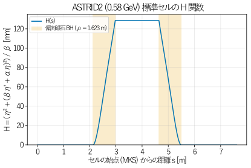

# calc_RadInt_ASTRID2 (放射積分 I1..I5 と、エミッタンスの式による検算)
KEK の SAD チュートリアルの「calc_RadInt.sad 放射積分の計算」をもとにした例。加速器: ASTRID2 (0.58 GeV、周長 45.7044 m、チューン 5.17999 / 2.14018)。ラティス: `lattice/ASTRID2_v01_01.sad` の `RING`。フラグ: `RAD COD RFSW RADCOD` (`FLUC` は OFF)。

## 何を見る例か
偏向磁石 (BH、12 台、複合機能: K1≠0、扇形: E1=E2=0) の中点の Twiss から、放射積分 $I_1\ldots I_5$ を解析積分で求める。それから、減衰分配数、エミッタンス、$U_0$、$\alpha_c$、エネルギー分散を式で出し、SAD の `Emittance[]` (放射励起の 6x6 計算) の値と比べる。

## スクリプト
要点 (全文は `.sad`。元のスクリプトの積分式 `GetIntegralCH`・`GetIntegralEX` をそのまま使った):
```
USE RING; cell calc emit;
bposi = LINE["POSITION","B*"];            (* 偏向磁石の要素番号 *)
GetIntegralCH[num_]    (* I5 の被積分関数 H = γη² + 2αηη' + βη'² を、ベンドの半分ずつ解析積分 *)
GetIntegralEX[num_]    (* ベンド内の分散の積分 ∫η ds・∫η(1/ρ^3 - 2k/ρ) ds *)
I1 = Σ IE/ρ,  I2 = Σ θ²/L,  I3 = Σ L/ρ³,  I4 = Σ IE (1/ρ³ - 2k1/ρ),  I5 = Σ IH
Jx = 1 - I4/I2,  Jy = 1,  Jz = 2 + I4/I2
εx = Cq γ² I5/(Jx I2),   σδ² = Cq γ² I3/(Jz I2)
```
元のスクリプトからの変更: (1) `Cq` を `3.832/10000` から `3.832e-13` m に直した (元の値のままだと εx が 1e9 倍になる)。(2) U0・αc・σδ の検算を足した。(3) データファイルへの書き出し (`OpenAppend`) と描画を外した。

## 結果の読み方
`I1 I2 I3 I4 I5 = ...` の行が積分、`Jx Jy Jz` が分配数、`emitx from integrals` が式の εx、`emitx from Emittance[]` が SAD の値。



横軸は標準セルの始点 (MKS) からの距離 s [m]、縦軸は分散関数 H = (η² + (βη' + αη)²)/β [mm]。橙の帯が 2 台の偏向磁石 BH (ρ = 1.623 m、長さ 0.85 m) で、放射積分 I5 は帯の内側の H/ρ³ だけを積分した量になる。H は磁石の入口で 0、出口で約 129 mm に達し、2 台の間の直線部では 129 mm で一定。この点列から台形則で求めたリング全体 (セル 6 個) の I5 は 0.136708 で、出力の `I5` = 0.1367071 と合う。

## 物理・解析式
ベンドは偏向角 $\theta=0.523599$、長さ 0.85 m、$\rho=L/\theta=1.62338$ m が 12 台 (合計 $2\pi$)。分散の無い量は閉じた式で出る:
$$I_2=\frac{2\pi}{\rho},\quad I_3=\frac{2\pi}{\rho^2},\quad U_0=\frac{C_\gamma E^4}{2\pi}I_2,\quad \alpha_c=\frac{I_1}{C},\quad \epsilon_x=\frac{C_q\gamma^2 I_5}{J_x I_2},\quad J_x=1-\frac{I_4}{I_2},\ J_z=2+\frac{I_4}{I_2}$$
($C_\gamma=8.846\times10^{-5}$ m/GeV³、$C_q=3.832\times10^{-13}$ m、$\gamma=E/m_ec^2=1135.0$)。

| 量 | 式 | gs | pysad |
|---|---|---|---|
| $I_2$ [1/m] | 3.870435 ($2\pi/\rho$) | 3.870436 | 3.870436 |
| $I_3$ [1/m²] | 2.384183 ($2\pi/\rho^2$) | 2.384184 | 2.384184 |
| $I_1$ [m] | (分散の積分) | 0.487674 | 0.487674 |
| $I_4$ [1/m] | (分散の積分) | -1.451778 | -1.451778 |
| $I_5$ [1/m] | (分散の積分) | 0.136707 | 0.136707 |
| $J_x$ / $J_z$ | 1.37509 / 1.62491 | 1.375094 / 1.624906 | 同じ |
| $J_x$ (SAD `Emittance[]` の分配数) | | 1.3751 | 1.3751 |
| $\epsilon_x$ [m]: 積分の式 | | 1.268060e-8 | 1.268060e-8 |
| $\epsilon_x$ [m]: `Emittance[]` | | 1.268037e-8 | 1.268037e-8 |
| $U_0$ [eV]: $C_\gamma E^4 I_2/2\pi$ | 6166.50 | | |
| $U_0$ [eV]: `Emittance[]` | | 6166.70 | 6166.70 |
| $\alpha_c$: $I_1/C$ | 0.0106702 | | |
| $\alpha_c$: `Emittance[]` | | 0.0106695 | 0.0106695 |
| $\sigma_\delta$: $\sqrt{C_q\gamma^2 I_3/(J_zI_2)}$ | 4.32610e-4 | 4.32610e-4 | 4.32610e-4 |
| $\sigma_\delta$: `Emittance[]` | | 4.32609e-4 | 4.32609e-4 |

$I_1$〜$I_5$ の積分は、被積分関数が分散を含むので解析式 1 行では書けない (スクリプトの解析積分が計算する)。SAD の独立な計算 (`Emittance[]`) と、εx は 2e-5、$U_0$ は 3e-5、$\alpha_c$ は 7e-5、$\sigma_\delta$ は 1e-5 の相対差で合う。$U_0$ の 3e-5 の差は $C_\gamma$ の桁 (8.846e-5) による。

## gs と pysad の比較
○ 一致 (画面に出た 26 個の数値が全部同じ桁まで一致)。

## 未確認・限界
- 偏向磁石の中点の Twiss を使う解析積分なので、ベンドの中で光学関数がほぼ放物線のときの近似 (中点の値 + 両側の対称な積分、元のスクリプトの方法)。上の εx の 2e-5 の差はその近似と SAD の数値積分の差とみられるが、原因は調べていない。
- 垂直ベンドが無い ($J_y=1$) リングにだけ使える (スクリプトの注意書き)。誤差入りのリングや結合では使えない。
- ベンドの辺 (E1・E2) の収束の効果は入れていない (BH は E1=E2=0 の扇形。`lattice` の BH)。
