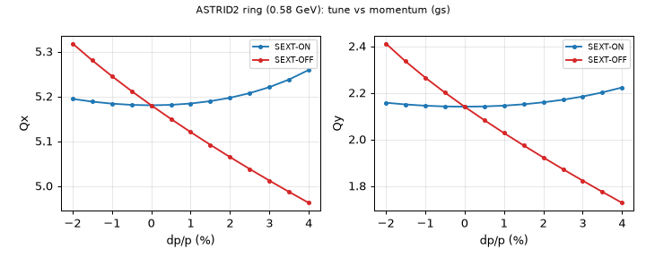

# mom_dep_ts_ASTRID2 (運動量依存チューンシフト: チューンと運動量ずれの関係)
KEK の SAD チュートリアルの「mom_dep_ts.sad 運動量依存チューンシフトの計算」(および色収差 `calc_chromaticity`) をもとにした例。加速器: ASTRID2 (0.58 GeV、周長 45.7044 m、チューン 5.17999 / 2.14018)。ラティス: `lattice/ASTRID2_v01_01.sad` の `RING` (6 極 SF K2=8.681、SD K2=-11.729: 色収差補正済みの値)。フラグ: `RFSW RADCOD RAD COD` (`FLUC` は OFF)。

## 何を見る例か
`DP0` (設計運動量からのずれ δ) を -2 % から +4 % まで 0.5 % 刻みで変えて `cell calc` し、リングのチューンを読む。6 極が入っている場合と、6 極を切った (`S* 0`) 場合の 2 本の曲線から、$\nu(\delta)=\nu_0+\xi_1\delta+\xi_2\delta^2+\dots$ の係数を `PolynomialFit` で求める。6 極が 1 次の色収差 $\xi_1$ をほぼ 0 にしていることと、2 次以上の項 (6 極の 2 次の効果) が残ることが見える。

## スクリプト
```
USE RING; cell calc;  DP = 0;
Do[ DP0 = dlist[i]; FFS["cell calc"]; nx = Twiss["NX","$$$"]/2/Pi; ... ,{i,...}];   (* 6 極 ON *)
cx = PolynomialFit[tx,3];                                    (* {c0,c1,c2,c3}、tx = {{δ,νx}...} *)
(* 6 極の寄与を式で数える *)  sp = LINE["POSITION","S*"];  ... K2*EX*BX/(4π) ...
S* 0;   (* 6 極を 0 に *)   同じ掃引と PolynomialFit
```
`LINE["POSITION","S*"]` は SF・SD の全 24 台の要素番号の並び (`LINE["POSITION","SF"]` のように名前だけを書くと 1 個の値しか返らず、`Join` が失敗した)。

## 結果の読み方
`SEXT-ON  δ Qx Qy` の 13 行 (掃引)、`SEXT-ON fit x/y` (係数 $\{c_0,c_1,c_2,c_3\}$ と残差)、`sextupole xi_x, xi_y from formula` (式)、`SEXT-OFF ...` (同じ)。


(gs の出力の数値を matplotlib で描いた。左が Qx、右が Qy、青が6 極 ON、赤が OFF。)

| | $\xi_x$ (δ=±0.5 % の中心差分) | $\xi_y$ | $\xi_x$ (3 次フィットの $c_1$) | $\xi_y$ ($c_1$) | $c_2$ (x, y) |
|---|---|---|---|---|---|
| 6 極 ON | +0.004 | +0.021 | -0.051 | -0.036 | 38.2、44.2 |
| 6 極 OFF | -6.225 | -11.829 | -6.254 | -11.941 | 27.9、66.2 |

(3 次フィットは δ が -2〜+4 % の広い範囲なので、$c_1$ は中心差分と 0.5〜1 % ずれる。)

## 物理・解析式
薄肉の6 極が与える色収差と、リングの自然色収差 (四極・偏向の寄与):
$$\xi_x^{\rm sext}=+\frac1{4\pi}\sum_i K_{2,i}\,\eta_i\,\beta_{x,i},\qquad \xi_y^{\rm sext}=-\frac1{4\pi}\sum_i K_{2,i}\,\eta_i\,\beta_{y,i}$$
($K_2$ は SAD の積分強度、$\eta$・$\beta$ は6 極 (中点) の値。符号は SAD の定義に合わせ、上の掃引の6 極 ON/OFF の差から確かめた。)

| 量 | 式 | gs (ON − OFF、中心差分) | pysad |
|---|---|---|---|
| $\xi_x$ の6 極の寄与 | 6.3122 | 6.229 | 6.229 |
| $\xi_y$ の6 極の寄与 | 11.9454 | 11.850 | 11.850 |
| 6 極の本数 | 24 (SF 12 + SD 12) | | |

差は 1.3 % (x)、0.8 % (y)。式は薄肉・中点の値・1 次の摂動で、掃引は有限の δ (±0.5 %) と 2 次の項を含む。6 極 OFF の自然色収差 -6.2 / -11.8 は、チューンが運動量に対して反対向きに動く (δ>0 で Qx・Qy が下がる、図の赤) こと、6 極 ON で 1 次がほぼ 0 になり 2 次の項で曲がること (青) と合う。

## gs と pysad の比較
○ 一致 (掃引の 26 行、フィット係数、式の値が全桁一致)。

## 未確認・限界
- `PolynomialFit` は SAD の癖で、データの中心が 0 に近い (|x の平均| × スケール < 0.1) と、返す係数が変換前の座標のもの (c0=204.6 のような値) になった (δ が -2〜+2 % の対称な点では gs・pysad とも同じ値で、`c0` がチューンにならなかった)。δ の範囲を -2〜+4 % の非対称にして、c0 がチューン (5.18001) になることを確かめた。
- 自然色収差 -6.2 / -11.8 を四極と偏向の積分の式 ($-\frac{1}{4\pi}\oint\beta K_1 ds$ に偏向の項を加えたもの) で確かめることはしていない。
- 高次 (2 次以上) の係数は 3 次の多項式でのフィットなので精度が低い。ここでは ±4 % までの傾向を見る目的で、共鳴との関係 (`Qx` が 5.25 付近まで) は見ていない。
- シンクロトロン運動 (RF) があるので `DP0` ≠ 0 の閉軌道は RF の位相にも依存するが、`cell calc` が出すチューンは設計軌道の周りで求められる。大きな δ での RF 周波数の扱いは確かめていない。
