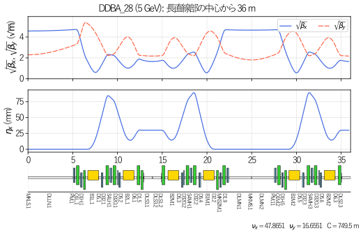

# FFS_cell_calc_emit_DDBA_28: DDBA_28 (5 GeV、周長 749.48 m) のリングの `cell calc emit`

`lattice/DDBA_28_v07_16_sx_rev9_5GeV.sad` (5 GeV、RF 6.5 MV、ハーモニクス 1250) を先頭に貼り、`FFS;` のあとで `USE RING; cell calc emit;` を `ON RAD FLUC COD RFSW RADCOD;` のもとで走らせる例。`FFS_cell_calc_emit_DDBA_28.sad` はそのまま走る。ラティスの説明・ほかの版との比較は [README.md](README.md)。

| ファイル | 内容 |
|---|---|
| `FFS_cell_calc_emit_DDBA_28.sad` | 台本 (ラティスの定義 + 計算) |
| `FFS_cell_calc_emit_DDBA_28.gs.txt` | gs (K64) の画面表示 |
| `FFS_cell_calc_emit_DDBA_28.pysad.txt` | pysad (既定の v2 モード) の画面表示 |

## 結果 (ラインは `RING`。リングは 1 周が 120 個の偏向磁石、鏡面対称)

| 量 | gs | pysad k64 | pysad v2 |
|---|---|---|---|
| エネルギー | 5 GeV | 5 GeV | 5 GeV |
| 周長 [m] | 749.4808883432 | 749.4808883432 | 749.4808883432 |
| チューン (νx, νy) | 47.8650597373, 16.6550903903 | 同じ (全桁) | 同じ (全桁) |
| εx [m rad] | 8.3219e-10 | 8.3219e-10 (全桁一致) | 8.3248e-10 (+0.03%) |
| エネルギー拡がり σE | 1.48402e-3 | 1.48402e-3 | 1.48340e-3 |
| バンチ長 σz [mm] | 2.1647 | 2.1647 | 2.1638 |
| U0 [MV] / 有効電圧 [MV] | 3.5573888 / 6.5 | 同じ | |
| αc | 3.2369e-5 | 3.2369e-5 | |
| ダンピング分配 (Jx, Jy, Jz) | 2.1677, 1.0001, 0.8322 | 2.1677 | |

- k64 モード (= gs と同じ式) では、gs と pysad は表示の全桁で一致する (`example/ddba/check/` に画面表示と、全量の比較 `gs_vs_pysad.json`)。v2 モードの差 (εx +0.03%、σE −0.04%) は、K64 の Jx (減衰分配) の端の項の扱い (B75、docs/28) による。
- `LINE["FREQ","RFC"]` は gs が 0 (未設定)、pysad は h と周回周波数から求めた 500.000171 MHz を返す。この例の結果には影響しない。
- 設計メモ (内部の設計メモ) の同じ版の記述 (DDBA_28 のページ) には、新しい6 極セットの誤差入りの DA の計算とあって、εx・チューンの値はない。関連する DDBA_25・27 (同じ 5 GeV のラティスで RF 6.5 MV) の設計メモの εx は 8.3189e-10 m rad で、この計算 (8.3219e-10、+0.04%) と近い。
- 動いたのは設計値のラティス (誤差なし) です。誤差・COD 補正の計算は含まない (最終の版の誤差の計算は `v07_14/` を参照)。

リング先頭の 36 m (長直線部の中心から、長いセルの半分と短いセル 1 個) の周期解。上段は √βx (実線)・√βy (破線) [√m]、中段は水平分散 ηx [mm]、下段は磁石の配置 (黄: 偏向磁石、緑: 四極、青: 6 極)。分散は偏向磁石の間で山を作る (最大 90 mm) が、直線部では 0 に戻る。βx は 0.30〜22.3 m、βy は 3.2〜29.4 m の範囲で、長直線部 (左端と s = 22〜30 m) で √βx が大きい。リング全体のチューンは (47.865, 16.655)。

## 未確認・限界
- 設計メモの 2.5 GeV 版の台本 (`v07_16_sx_rev9_2.5GeV`) は、設計メモの添付の大きさ (20.1 KB) と元の台本 (20.4 KB) が合わないので、この例は 5 GeV 版だけにした (要確認)。
- 6 極の設定は、pysad の作者とは別の研究者 (公開論文 K. Harada et al., "Conceptual design of the Hybrid Ring with superconducting linac", J. Synchrotron Rad. 29, 118–124 (2022), DOI 10.1107/S1600577521012753 の著者の一人) の手による最適化の結果を含む (設計メモの記述)。論文には6 極の K2 の値や最適化の手法の記述はなく、論文の暫定設計 (3 GeV、周長 350 m、16 セル) はこの版とは別の版。論文の設定と一致する、同じ最適化の結果である、という意味ではない。
