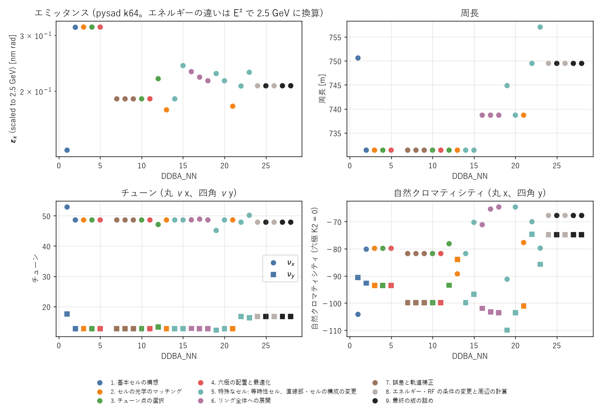

# ddba: 複雑なセルのラティスを設計する手順の例 (DDBA、二重 DBA セルのリング)

二重 DBA (DDBA、偏向磁石 2 個ずつのセルを 2 つ組み合わせた構成。5 m と 10 m の長さの 2 種類の直線部を持つ) を中心にした、複雑なセルを持つ 5 GeV・2.5 GeV の蓄積リングの設計手順の例集です。設計者の設計メモ (版の通し番号 `DDBA_01`〜`DDBA_28`、1 つの番号が 1 つの版に対応) の記述を、**時間順の履歴ではなく、設計の段階**に並べ直しました。各段階で「何を決めるか → どの変数を動かすか → 結果が数値でどう変わるか → うまくいかなかった点」を、その段階の例として `DDBA_NN` の台本 (`lattice/DDBA_NN_*.sad`) で追えます。時間順の対応 (DDBA_NN ← 元の台本のファイル名、日付、設計メモの説明) は [`ORIGINAL_MAP.md`](ORIGINAL_MAP.md) にだけ残しました。段階ごとの索引は [`STAGES.md`](STAGES.md)。

- 設計メモは設計者自身のメモで、設計の議論の経過がそのまま書いてある。ここに書いた設計の「理由・方針」はすべて設計メモの記述の範囲で、推測で足していない。設計メモに無い段階は作っていない。
- 数値は、このリポジトリの pysad (k64 モード = gs と同じ式) で、ラティスの先頭の `MOMENTUM`・RF の定義のまま `cell calc emit` を `ON RAD FLUC COD RFSW RADCOD;` のもとで走らせた結果 (設計値、誤差なし)。設計メモの数値とは別に書き、合わないものは「要確認」と書いた (理由は調べていない)。
- 「NanoTerasu ベース」: 設計メモの DDBA_01 に「もともとの NanoTerasu のラティスから始める」とある (短直線部を 2 m、長直線部を 7.6 m に変えた)。このリポジトリには元の NanoTerasu のラティスは入っていない。
- このリングは周長 731〜757 m、120 個の偏向磁石 (1 セル 4 個 × 30 セル。9.5 m 直線部の版は 112 個 = 28 セル)、ハーモニクス 1218〜1250 (RF 約 500 MHz)。どのラティスも特定の実機の運転値ではなく設計検討の途中の版である。使った条件 (エネルギー、RF 電圧、周長) は `DDBA_NN` ごとに下の表とラティスのヘッダに書いた。**エネルギーと RF が版で違う** (5 GeV: 3.6〜7 MV、2.5 GeV: 1.6〜5 MV) ので、εx の比較は E² で換算してから (図)。

## 目次

1. [使い方](#使い方)
2. [設計の段階と、段階ごとの例](#設計の段階と段階ごとの例) (段階 1〜9)
3. [一覧表と図](#一覧表と図)
4. [設計メモの数値との比較 (要確認)](#設計メモの数値との比較-要確認)
5. [gs と pysad の一致状況](#gs-と-pysad-の一致状況)
6. [未確認・限界](#未確認限界)
7. [関連する例・参考文献](#関連する例参考文献)

## 使い方

各 `lattice/DDBA_NN_*.sad` は SAD のラティスの定義 (`MOMENTUM`、`DRIFT`・`BEND`・`QUAD`・`SEXT`、`MARK`、`LINE`、`CAVI`) で、先頭のヘッダ (`!` のコメント) に、版の名前・設計の段階・元の台本の名前・日付・何の版か・計算値を書いた。ラティスの定義の中身は元のまま。計算の台本はこのファイルの後ろに足す (`FFS;` の前にラティスを置く)。

```
(ラティス: DDBA_NN_*.sad の中身)
ON LOG;
ON RAD FLUC COD RFSW RADCOD;
FFS;
USE RING;
cell calc emit;
```

- ラインは `RING` (定義が複数あるときは最後の定義が有効。ファイルによってはセル単独のリング `RINGN`・`RINGA`・`RINGL`・`RINGM` なども定義してあり、`USE RINGN;` で選べる)。
- 例 (`FFS_cell_calc_emit_DDBA_28.sad`・`.gs.txt`・`.pysad.txt`・`.md`): 最終の版のラティスで `cell calc emit`。[`FFS_cell_calc_emit_DDBA_28.md`](FFS_cell_calc_emit_DDBA_28.md)。
- 走らせ方: `py -3.12 example/tools/run_example.py example/ddba/FFS_cell_calc_emit_DDBA_28.sad` (gs は WSL)。全 28 本の pysad の実行は [`example/tools/ddba/run_all.py`](../tools/ddba/run_all.py) (元の台本のフォルダは環境変数 `DDBA_SRC`。ヘッダ付きの台本から走らせるには `lattice` を指定)。gs との比較は [`example/tools/ddba/gs_cmp.py`](../tools/ddba/gs_cmp.py)。
- 台本の記号: セルは `NCELL`・`MCELL` (5 m 直線部のセル)・`LCELL` (10 m 直線部のセル)・`TCELL` (= MCELL + LCELL)。名前の末尾の `A` は等時性セル (isochronous cell。`MCELLA`・`LCELLA`・`TCELLA`)、`H` は半セル、`QM`・`QAL` などは四極。偏向磁石 `B1`・`B2` (機能結合型で K1 を持つ)、逆曲げ `Q3`・`Q4` (等時セルでは BEND、`ANGLE` が負)。六極 `S1`〜`S5` (`H` つきは半セル)、MARK `MKMC` (2 m 短直線部の中央)・`MKMS` (5 m 直線部の中央)・`MKLS` (10 m 直線部の中央)。

## 設計の段階と、段階ごとの例

段階の分け方は、設計メモに書いてある作業の内容から決めた (下の 9 つ)。同じ段階に複数の版が入り、時間の前後が逆転しているものもある (例: 段階 2 の `DDBA_21` は 10 月、`DDBA_03` は 7 月)。

| 段階 | 内容 | 例 (DDBA_NN) |
|---|---|---|
| 1 | 基本セルの構想 (セル数・直線部・偏向磁石の構成) | 01、02 |
| 2 | セルの光学のマッチング | 03、06、13、21 |
| 3 | チューン点の選択 | 04、10、12 |
| 4 | 六極の配置と最適化 | 05、11 |
| 5 | 特殊なセル: 等時性セル、直線部・セルの構成の変更 | 14、15、19、20、22、23 |
| 6 | リング全体への展開 (周長・ハーモニクス・閉合・八極) | 16、17、18 |
| 7 | 誤差と軌道補正 | 07、08、09 |
| 8 | エネルギー・RF の条件の変更と周辺の計算 | 24、26 |
| 9 | 最終の版の詰め | 25、27、28 |

### 段階 1: 基本セルの構想 (DDBA_01、DDBA_02)

**何を決めるか**: 周長の枠 (750 m) の中に、セルの数・直線部の長さ・偏向磁石の構成をどう収めるか。
**設計メモの記述**:
- 出発点は、もとの NanoTerasu のラティス (偏向磁石に機能結合型の勾配 K1 を持たせた、DBA 型のセル)。短直線部を 2 m、長直線部を 7.6 m に変更し、Q1・Q5 を 30 cm、Q3 を 40 cm にしてマッチングすると、16 セルのセル長が 24.72 m になる。750 m をセル長で割って 30 セル (`DDBA_01`)。
- 30 セルだと 750 m ぎりぎりで調整のしろがないので 28 セルにして 58 セル相当 (直線部 7.5 m と 2 m が交互の、28 セルで対称な形) も検討 (`DDBA_02`)。最終的には 5 m と 10 m の交互にしたいので 2 セル減らしている、という記述。30 セルに戻して、5 つの六極 (S1〜S5) を「当てずっぽうで」入れて振幅依存チューンシフトを見た (`DDBA_02`)。
- 短直線部も色消し (ηx = η'x = 0) にするかを版で比べている。設計メモの感想は「チューンも β も気にしなければ線形オプティクスは簡単」「これを回るリングにするのは相当難しいだろう」。
**調整する変数**: 直線部の長さ (`DLL`・`DLS`)、四極の長さ・強さ、偏向磁石の K1。目標: セル長、短直線部中央の分散 (3 cm、または 0)。

| | E | 周長 | チューン | εx (k64) | 自然クロマティシティ | 備考 |
|---|---|---|---|---|---|---|
| DDBA_01 | 5 GeV | 750.6 m | (52.874, 17.535) | 0.521 nm rad | (-104.2, -90.6) | 六極 300 台。RF は 3.6 MV、h = 592 (台本のまま) |
| DDBA_02 | 2.5 GeV | 731.4 m | (48.600, 12.700) | 0.318 nm rad (2.5 GeV。5 GeV に換算すると 1.27) | (-80.2, -92.7) | ハーモニック六極 S1 = +8、S2 = -8 |

`DDBA_02` の台本は設計メモの添付と同名だが大きさが違い (設計メモ 3.3 KB、元の台本 1.4 KB)、設計メモの出力は 5 GeV・RF 3.6 MV で αc = 9.4746e-5 (この台本の pysad は 9.472e-5 で一致)。台本の内容の違いは確認していない (要確認)。

### 段階 2: セルの光学のマッチング (DDBA_03、06、13、21)

**何を決めるか**: 直線部を 5 m + 10 m の 2 種類にして、各直線部中央の β・η を目標に四極 (と偏向磁石の K1) をマッチングする。
**設計メモの記述**:
- `DDBA_03`: ノーマルセルをコピーして 5 m セル `MCELL`・10 m セル `LCELL`・その組 `TCELL` を作る。短直線部中央を始点にして、中央で βx = 2.7 m、βy = 3.7 m、ηx = η'x = 0 をマッチングの条件にする。5 m・10 m 直線部中央の β は最初はフリー。最初のマッチングは、偏向磁石の K1 の名前のミスでフリーになっておらず、K1 をフリーにしたらチューン保存でマッチングできた。MCELL・LCELL それぞれ 2 ファミリーの六極 (S3 = S5) で色収差補正。
- `DDBA_06` (DDBA から DQBA へ): 短直線部の分散を消さないことにして低エミッタンス化。条件は、短直線部中央の βx = 2.7・βy = 3.7、ηx = 0.03 (ηx = 0 でなく何かの値)、5 m・10 m 直線部の β < 20 m・α = 0・色消し、チューン (48.6/15, 12.7/15) 固定、四極と偏向磁石の K1 をフリー。短直線部の ηx を ±5 cm でサーベイして +3 cm を採用。ハーモニクス 1218、周長 731.4 m (適当)、RF は 7 MV (「バケットハイトを DA より十分大きくしたかった」)。
- `DDBA_13`: 5 m セルと 10 m セルでチューンが違っていたのを同じにした版 (`v05_17`)。
- `DDBA_21`: 9 m 直線部 × 28 セル版で、長直線部のマッチングが短直線部中央の β に依存することが分かったので、短直線部の β を最適化し直す (ex0 = 0.023 m、bx0 = 2.0 m、by0 = 3.7 m)。等時セルの方が数が多いので、等時セルを低エミッタンスにできればノーマルセルは大きくてよい、という方針。
**判断のポイント**: 条件を厳しくしすぎると解が発散する (設計メモ: 「無造作に色々足したり変えたりしながらやっても発散する」)。最初は条件を緩め、結果を見て条件を足す。

| | E | 周長 | チューン | εx | 自然クロマティシティ | αc |
|---|---|---|---|---|---|---|
| DDBA_03 | 5 GeV (RF 7 MV) | 731.4 | (48.600, 12.700) | 1.27 nm rad | (-79.8, -93.5) | 9.48e-5 |
| DDBA_06 | 2.5 GeV | 731.4 | (48.600, 12.700) | 0.1891 nm rad (= 5 GeV で 0.756) | (-81.8, -99.9) | 1.278e-4 |
| DDBA_13 | 5 GeV | 731.4 | (48.600, 12.700) | 0.698 | (-89.3, -83.9) | 1.24e-4 |
| DDBA_21 | 5 GeV | 738.69 | (48.610, 12.720) | 0.717 | (-77.7, -101.0) | 3.61e-5 |

`DDBA_03` から `DDBA_06` の εx は E² で換算すると 1.27 → 0.756 nm rad (5 GeV): 短直線部に分散を残すこと (DDBA → DQBA) などでエミッタンスが 40% 小さくなった。

### 段階 3: チューン点の選択 (DDBA_04、10、12)

**何を決めるか**: 動作点 (νx, νy) をどこに置くか。
**設計メモの記述**: ラティスは固定 (`DDBA_04` は `DDBA_03` と同じ v05_12、`DDBA_10` は v05_14) で、チューンを走査しながらマッチングし直し、K1・K2 の値、エミッタンス、線形色収差、振幅 5σ の振幅依存チューンシフトの絶対値、ダイナミックアパーチャ (DA) を書き出す (`DDBA_04`)。
- 水平のチューンを進めるとエミッタンスが下がる。振幅依存チューンシフトの方向は広い領域で 50〜90 度、真逆を向くことはない。
- 共鳴線 (構造共鳴) の近傍を除いて、とびぬけて良い・悪いところはなさそう。出たところの値 (48.6, 12.7) もそう悪くない、という結論 (`DDBA_04`)。
- `DDBA_10`: 垂直チューンを増やす (サーベイの区画を一つ上にずらす、ハーモニック六極なし、S1 = S2 = 0、対称六極 S3 = S5)。
- `DDBA_12`: ほかのチューン (48.6/12.1、48.1/12.7、47.1/13.2、46.7/13.2) を総当たり。
**判断のポイント**: 判断の指標を 1 つに絞らず、DA・色収差・振幅依存チューンシフトの大きさ・水平と垂直の向きの関係・エミッタンスを並べて決める。

| | チューン | εx (5 GeV) | 自然クロマティシティ | αc |
|---|---|---|---|---|
| DDBA_04 (v05_12) | (48.600, 12.700) | 1.27 nm rad (DDBA_03 と同じ) | (-79.8, -93.5) | 9.48e-5 |
| DDBA_10 (v05_14) | (48.600, 12.700) | 0.756 | (-81.8, -99.9) | 1.28e-4 |
| DDBA_12 | (47.100, 13.200) | 0.876 | (-78.1, -93.4) | 1.34e-4 |

チューンを (48.6, 12.7) → (47.1, 13.2) に変えると、v05_14 に対し εx が +16% (0.756 → 0.876)。

### 段階 4: 六極の配置と最適化 (DDBA_05、11)

**何を決めるか**: 色収差補正の六極 (S3・S4・S5 の対) と、ハーモニック六極 (S1・S2、色収差には効かず非線形項を打ち消すための六極) の強さ。
**設計メモの記述**:
- `DDBA_05` (総当たり): 5 m セル (添字 M)・10 m セル (添字 L) に同じ変更を入れる。S1M/L = -S2M/L とし、S3 と S5 の値に差を付ける (もとの S3 に offset を足し引きして固定し、S4・S5 で線形色収差を補正)。結果: ハーモニック六極は ±6 くらいが最善、S3 = S5 が最善。S3 の初期値を変えると S5 が S4 と同じ極性になることがある。S1・S2 のサーベイ (±10、-20〜0) で S1 = -S2 から少しずれたところが最善かもしれない。誤差入りの DA やチューンシフトを見て最適化するべきか、という課題を書いている。
- `DDBA_11`: ほかの研究者に依頼した六極の最適化の結果 (MH・LH 各 5 つ) を入れ、何も考えずに誤差の補正スクリプトを走らせて DA を 100 通り計算 (その 2 もある)。
**判断のポイント**: 線形光学が同じなら、六極を変えても `cell calc emit` の結果 (εx など) はほとんど変わらない。違いは非線形 (DA・振幅依存チューンシフト) にだけ出る。`DDBA_10` と `DDBA_11` は線形光学が同じで、六極だけ違う。

| | 六極 | εx (5 GeV) | 六極つきクロマティシティ (x, y) |
|---|---|---|---|
| DDBA_10 | S1〜S5 (v05_14 の値) | 0.756 | (-0.012, 0.038) |
| DDBA_11 | 別の研究者による最適化の結果 | 0.757 (+0.04%) | (-0.016, 0.042) |

六極の設定の注記 (`DDBA_11`・`14`・`24`〜`28`): 六極の設定は、pysad の作者とは別の研究者 (公開論文 K. Harada et al., "Conceptual design of the Hybrid Ring with superconducting linac", J. Synchrotron Rad. 29, 118–124 (2022), DOI 10.1107/S1600577521012753 の著者の一人) の手による最適化の結果を含む (設計メモの記述)。この論文には六極の K2 の値や最適化の手法の記述はない (六極の最適化で入射に必要な水平アパーチャを通常の 16 回対称 DDBA リングの約 80% まで回復した、という記述のみ)。論文の暫定設計は 3 GeV・周長 350 m・16 セルで、これらの版 (5 GeV・2.5 GeV、周長 731〜757 m、28〜30 セル) とは別の版。論文の設定と一致する、同じ最適化の結果である、という意味ではない。

### 段階 5: 特殊なセル (等時性セル、直線部・セルの構成の変更) (DDBA_14、15、19、20、22、23)

設計メモにあるのは、(a) 等時性セルを作る、(b) 等時セルとノーマルセルを混ぜたリングで DA がどこで失われるか、(c) 直線部の長さをそろえた案、(d) 10 m セルに磁石を追加して垂直色収差を減らす案。

**(a) 等時性セル (DDBA_14、15)**: 等時セル (R56 ≈ 0 のセル) は、セルの四極 Q3 を BEND にして逆曲げを入れて作る (ANGLE = 0 だと計算できないので ANGLE = 1E-10 を入れる)。マッチングは、逆曲げの角度 `dt` を動かして、最後の R56 が負から正に変わる直前の値を台本に保存し、桁を増やしながら減らしていく (設計メモ: この方法をとらないと発散する)。10 m セルは条件が厳しく、Q3・Q4 の両方でマッチングしたときが最もエミッタンスが小さい。10 m セルは -10〜-12 くらいで止め、5 m セルを +12 くらいにして TCELLA (5 m + 10 m の等時セルの組) でゼロにできるか、という検討。`DDBA_15` は等時セルの六極 (ハーモニック六極 -10、dsd +8 くらいが最善。モーメンタムコンパクションがほぼゼロなので on-momentum のアパーチャしかない)。
**(b) 部分等時化リング (DDBA_20)**: ノーマルセル 15 セル (TCELL) から 1 セルずつ等時セル (TCELLA) に置き換えて、DA を見る。1 セルでも DA が大幅に落ち、あとは徐々に落ちる。続けて、TCELLA の R56 をゼロに近づけて (Q3・Q4 を 0.001 ずつ増やす)、どの段階でアパーチャがなくなるかを調べる。
**(c) 直線部をそろえた案 (DDBA_19)**: すべての直線部の長さを 9.5 m に統一した 28 セル、744 m の案。チューンサーベイ (S1 = -S2 = -10) で、エミッタンス・アパーチャの観点から選んだチューン点など。
**(d) セルの磁石の追加 (DDBA_22、23)**: 10 m セルの短直線部側に QM を 1 台足して (20 cm の QM と 15 cm のドリフトで周長が 750 m)、垂直色収差を減らす。逆曲げのマッチング → 幾何学補正 → 周長補正を 2 回くらい繰り返すと収束する。`DDBA_23` は 9.5 m × 28 セルの垂直チューン (色収差) の最適化で、マッチングを 1 本の台本で最後まで行う。

| | リング | 周長 | チューン | εx | αc | 小角 BEND (逆曲げ) の数 | 自然クロマティシティ |
|---|---|---|---|---|---|---|---|
| DDBA_14 | ノーマルセルのリング (等時化の前の基準) | 731.4 | (48.600, 12.700) | 0.757 | 1.28e-4 | 0 | (-81.8, -99.9) |
| DDBA_15 | 等時セル + ノーマルセル | 731.4 | (48.600, 12.700) | 0.963 | 4.28e-5 | 80 | (-70.3, -96.7) |
| DDBA_19 | 9.5 m × 28 セル | 744.85 | (45.130, 12.210) | 0.909 | 3.92e-5 | 80 | (-91.2, -110.0) |
| DDBA_20 | `DDBA_18` と同じリング (部分等時化のリングの定義が別に入る) | 738.69 | (48.610, 12.720) | 0.863 | 4.21e-5 | 80 | (-64.6, -103.5) |
| DDBA_22 | 10 m セルに QM 追加 | 749.48 | (47.865, 16.665) | 0.830 | 4.06e-5 | 80 | (-70.0, -74.6) |
| DDBA_23 | 9.5 m × 28 セルの垂直色収差の最適化 | 757.04 | (50.135, 16.345) | 0.918 | 3.71e-5 | 80 | (-79.8, -85.7) |

等時セルを入れる (DDBA_14 → 15) と、αc が 1.28e-4 → 4.28e-5 に下がる代わりに、εx が +27%、U0 が 2.412 → 3.528 MV に増える。垂直の自然クロマティシティは `DDBA_14` の -99.9 に対し `DDBA_22` で -74.6 (QM 追加を含む複数の変更の結果で、QM 単独の効果ではない)。`DDBA_19` の 112 は偏向磁石の数 (28 セル × 4)。

### 段階 6: リング全体への展開 (周長・ハーモニクス・閉合・八極) (DDBA_16、17、18)

**何を決めるか**: 周長とハーモニクス (RF 500 MHz に合わせる)、リングを幾何学的に閉じること、チューンの端数 (共鳴線から外す)、八極。
**設計メモの記述**:
- `DDBA_16`: ハーモニクス 1232 (= 24 × 7 × 11)。500 MHz での周長は c/500 MHz × h = 738.689 m、現在の周長 731.4 m との差を 120 本の直線部に等分して足す (0.0607385 m ずつ)。チューンに端数を付けて共鳴線から外す (48.6345/12.7445、端数は別の研究者の案と同じにした)。MCELL・LCELL・MCELLA・LCELLA を同じチューンにし、等時セルの逆曲げの角度を決める (R56 が負から正になる直前の端数を維持しつつ桁を増やす。振動する場合は条件を足すか、直前の値をこまめに台本に反映する)。この後、等時セルは変えない。幾何学的に閉じるため、LCELL・MCELL の長直線部の長さを変える (逆曲げと幾何学調整で周長が変わるが、桁が小さければよいとする)。線形光学の完成版 (`v05_22`)。
- `DDBA_17`: TCELL 単位で色収差を最適化する。回っていたラティスと光学を比べると 10 m セルがだいぶ違い、意図的にその光学にもっていくことができないので、v05_14 の光学から条件なしで再マッチング (v05_23〜v05_26)。ハーモニック六極なしでは水平 10σ で 29 に到達、ハーモニック六極 ±10 が必要。さらに八極を適当な場所・長さで入れたものが v05_28 (60 個)。
- `DDBA_18`: チューンの端数を下げ、ほぼもとの点に戻した案 (48.61/12.72)。ノーマル・アイソクロナスセルをマッチングして、それぞれ単独で色収差補正。ハーモニクス 1232 (5 の倍数ではない)、リングは閉じている。

| | 周長 | チューン | εx | αc | 八極 | 六極つきクロマティシティ (x, y) |
|---|---|---|---|---|---|---|
| DDBA_16 | 738.690 m (500 MHz、h = 1232) | (48.6345, 12.7446) | 0.922 | 4.07e-5 | 0 | (0.07, 0.31) |
| DDBA_17 | 738.690 | (48.8651, 12.6552) | 0.886 | 4.17e-5 | 60 | (0.003, 0.009) |
| DDBA_18 | 738.690 | (48.6101, 12.7202) | 0.863 | 4.21e-5 | 60 | (-0.003, 0.013) |

`DDBA_16` の周長 738.68985 m は設計メモの c/500 MHz × 1232 = 738.689 m と合う。`DDBA_17` の台本 (v05_28) のチューン (48.865, 12.655) は設計メモに記載がなく、設計メモの前後の記述 (48.6345/12.7445 から 48.61/12.72 へ) とは別の値になっている (要確認)。

### 段階 7: 誤差と軌道補正 (DDBA_07、08、09)

**何を決めるか**: 据え付け誤差 (50 μm など)・強さの誤差・回転誤差を入れたときの COD の補正方法と、補正後の DA。
**設計メモの記述**:
- `DDBA_07`: 誤差を入れて COD を補正すると、解が無い (初期解無し) ケースが出る。発散するケースの誤差だけ取り出して調べる。誤差の入れ方: 乱数のタネ (`SeedRandom`)、位置誤差 ae (DELX・DELY)、強さの誤差 fe (DK)、回転誤差 te (DTHETA) を Q*・S*・B* に。
- `DDBA_08`: TCELL で補正、次にリング全体で。補正をモジュール化 (長直線部中央のマークを基準に、補正に使うステアリング・モニターの要素番号をリスト化)。
- `DDBA_09`: 長直線部中央だけの補正では足りないので、全 BPM に対して補正する。四極がすべて収束なので垂直の集束が偏向磁石だけで、垂直に収束がない距離が長すぎるかもしれない、という指摘。**補正しながら誤差を少しずつ大きくして最終的に RMS 50 μm にする**手法 (設計メモの検討: 10 μm なら解無しにならないが、50 μm で振って LINE の DX・DY を 1/5 にしても同じ結果になるはずなのに解無しのままになる)。誤差の入り方の検証 (DUMP の DELX/DELY と LINE の DX/DY は同じ、タネが同じなら振幅を変えても 5 倍すれば同じ)。DA を 100 通りの乱数のタネで計算。
**この例のラティス**: `DDBA_07`〜`09` は誤差なしの設計値 (`v05_14_spcod`、v05_14 に誤差の補正の手順をつけた台本) として `cell calc emit` だけを走らせた。誤差・補正の計算そのものは含まない (最終の版の誤差の計算は [`v07_14/`](#関連する例参考文献) を参照)。

| | E | チューン | εx | αc | 自然クロマティシティ |
|---|---|---|---|---|---|
| DDBA_07〜09 | 5 GeV (RF 7 MV) | (48.600, 12.700) | 0.756 nm rad | 1.28e-4 | (-81.8, -99.9) |

### 段階 8: エネルギー・RF の条件の変更と周辺の計算 (DDBA_24、26)

**何を決めるか**: 同じラティスで、エネルギー (5 GeV と 2.5 GeV)・RF 電圧を変えたときの特性と、周辺の計算 (SP ビームの輸送、Touschek 寿命、CSR)。
**設計メモの記述**:
- `DDBA_24`: SP ビーム (別のビームの輸送) の計算。ELEGANT による CSR を含むシミュレーションのために、SAD の台本から ELEGANT の台本を作る (`sad2ele`)。電荷 1 nC、50 fs、0.5% を仮定。ラティスは v07_14 (SP の輸送用にリングの定義が別に入る)。
- `DDBA_26`: SAD による簡易 Touschek 寿命。`PBUNCH`、`COUP` (カップリング)、`INTRA` フラグ ON で `EMIT` とすると出る。結果 (2.5 GeV、1250 バケット、500 mA): カップリング 1% で εx = 4.2153e-10 (INTRA の効果を含む)、εy = 4.2170e-12 m。LMA (局所運動量アクセプタンス) の計算も必要だが、まず簡易計算、という記述。
- エネルギー・RF (`DDBA_25` の設計メモ): ID 負荷が 5 GeV で 1.52 MeV/turn、2.5 GeV で 0.32 MeV/turn ありそうなので、RF 電圧を 5 GeV: 6.5 MV、2.5 GeV: 1.6 MV として進める。

| | E | RF | U0 | εx | σE | σz | αc |
|---|---|---|---|---|---|---|---|
| DDBA_24 | 5 GeV | 7 MV (台本) | 3.557 MV | 0.832 nm rad | 1.484e-3 | 2.06 mm | 3.24e-5 |
| DDBA_26 (= DDBA_25) | 2.5 GeV | 1.6 MV | 0.2223 MV | 0.2079 nm rad | 7.42e-4 | 1.42 mm | 3.23e-5 |

2.5 GeV の εx は 5 GeV の 1/4 (E² に比例)、σE は 1/2。5 GeV の U0 は 3.56 MV で、RF 電圧を 6.5〜7 MV にして Vc/U0 ≈ 1.8〜2。2.5 GeV の U0 は 0.22 MV に対して 1.6 MV。台本の `RFC` の電圧は 5 GeV 版 (`v07_14_SP_transport`) が 7 MV、設計メモの方針 (5 GeV: 6.5 MV) とは別 (要確認)。

### 段階 9: 最終の版の詰め (DDBA_25、27、28)

設計メモの最後の 3 つのページは、`v07_14` (CDR 用) を基準にして、六極の更新と誤差入りの DA を詰めている。
- `DDBA_25`: CDR 用の台本。チューンのミスタイプを修正して、六極を再調整したラティス。ラティスは鏡面対称 (六極の最適化のため。図のリングの一番上の MCELLA と一番下の LCELLA のそれぞれの直線部の中央を結ぶ線が対称軸)。入射点は暫定で、後で再考する (SP を SR と同じ入射点から入れる場合、MCELL と LCELL を入れ替えるなどして等時側にノーマルセルの 10 m 直線部を近づけ、チャープして R56 をバンチ圧縮に使う、という案が書いてある)。2.5 GeV: εx = 2.0797e-10 m rad、5 GeV: 8.3189e-10。
- 誤差入りの補正シミュレーション: 据え付け誤差 50 μm、強さの誤差 0.05%、回転誤差 0.1 mrad、±1σ カットで、乱数のタネ 100 通りの DA。**on-momentum アパーチャが最悪のケースで 30σ、平均 40σ** を確保 (β = 21 m、εx = 830 pm rad で 30σ = 4 mm、40σ = 5.3 mm。平均 5 mm はクリア、という記述)。
- `DDBA_27`: 六極を更新した (2023.12.05) 台本から ELEGANT 用のラティスを作り、ノーマルセルの 10 m 直線部中央の Twiss パラメータを求める (DDBA_25 の設計メモにある同じ場所の値: βx 20.9 m、βy 5.26 m)。
- `DDBA_28`: 新しい六極セット (rev9) での誤差入りの DA。平均 β の計算 (長さのある要素を 100 分割して Σ βx(s) L / 周長)、SP ビームのトラッキングも更新。

| | E | RF | 周長 | チューン | εx | σE | αc | 自然クロマティシティ |
|---|---|---|---|---|---|---|---|---|
| DDBA_25 | 2.5 GeV | 1.6 MV | 749.481 | (47.8651, 16.6551) | 0.2079 nm rad | 7.42e-4 | 3.23e-5 | (-67.7, -74.8) |
| DDBA_27 | 5 GeV | 6.5 MV | 749.481 | (47.8651, 16.6551) | 0.832 | 1.48e-3 | 3.24e-5 | (-67.7, -74.8) |
| DDBA_28 | 5 GeV | 6.5 MV | 749.481 | (47.8651, 16.6551) | 0.832 | 1.48e-3 | 3.24e-5 | (-67.7, -74.8) |

3 本とも線形光学は同じで、六極だけが違う (六極つきクロマティシティ: DDBA_27 (-0.070, 0.100)、DDBA_28 (1.93, 3.10)、DDBA_25 (-0.071, 0.100))。`DDBA_28` の六極セットは、六極つきのクロマティシティがゼロにならず (+1.9, +3.1)、設計メモには値の記載がない (要確認)。
**最終の版 (v07_14) のチューンのマッチング・チューンサーベイ・誤差の計算 (補正しながら誤差を大きくする手法) の一式のスクリプト**は別にまとめている: [`v07_14/README.md`](v07_14/README.md)。六極の最適化の検討 (試作。最適化は最終設定より DA の広い解を出せなかった) は [`v07_14/sextupole/README.md`](v07_14/sextupole/README.md)。

六極の設定の注記 (`DDBA_11`・`14`・`24`〜`28`): 別の研究者による最適化の結果を含む (設計メモの記述)。関連する公開論文: K. Harada et al., "Conceptual design of the Hybrid Ring with superconducting linac", J. Synchrotron Rad. 29, 118–124 (2022), DOI 10.1107/S1600577521012753。この論文には六極の K2 の値や最適化の手法の記述はなく、論文の暫定設計 (3 GeV、周長 350 m、16 セル) はこれらの版とは別の版である。論文の設定と一致する、同じ最適化の結果である、という意味ではない。

## 一覧表と図

pysad (k64 モード = gs と同じ) の `cell calc emit` (`RING`、設計値、ラティスの `MOMENTUM`・RF のまま)。εx の k64 と v2 の差は 0.1% 以内。「段階」は上の段階の番号。



| DDBA_NN | 設計メモの日付 | 段階 | 元の台本 | E [GeV] | 周長 [m] | チューン (νx, νy) | εx k64 [nm rad] | εx v2 [nm rad] | αc |
|---|---|---|---|---|---|---|---|---|---|
| [01](lattice/DDBA_01_v03_12_30cells_DDBA.sad) | 2023/07/13 | 1 | v03_12_30cells_DDBA | 5.0 | 750.600 | 52.8739, 17.5348 | 0.521 | 0.521 | 0.000109 |
| [02](lattice/DDBA_02_v05_08_30cell.sad) | 2023/07/24 | 1 | v05_08_30cell | 2.5 | 731.400 | 48.6001, 12.7002 | 0.318 | 0.319 | 9.47e-05 |
| [03](lattice/DDBA_03_v05_12.sad) | 2023/07/27 | 2 | v05_12 | 5.0 | 731.400 | 48.6001, 12.7002 | 1.27 | 1.28 | 9.48e-05 |
| [04](lattice/DDBA_04_v05_12.sad) | 2023/07/28 | 3 | v05_12 | 5.0 | 731.400 | 48.6001, 12.7002 | 1.27 | 1.28 | 9.48e-05 |
| [05](lattice/DDBA_05_v05_12.sad) | 2023/08/01 | 4 | v05_12 | 5.0 | 731.400 | 48.6001, 12.7002 | 1.27 | 1.28 | 9.48e-05 |
| [06](lattice/DDBA_06_v05_14_2.5GeV.sad) | 2023/08/02 | 2 | v05_14_2.5GeV | 2.5 | 731.400 | 48.6001, 12.7002 | 0.189 | 0.189 | 0.000128 |
| [07](lattice/DDBA_07_v05_14_spcod.sad) | 2023/08/03 | 7 | v05_14_spcod | 5.0 | 731.400 | 48.6001, 12.7002 | 0.756 | 0.757 | 0.000128 |
| [08](lattice/DDBA_08_v05_14_spcod.sad) | 2023/08/08 | 7 | v05_14_spcod | 5.0 | 731.400 | 48.6001, 12.7002 | 0.756 | 0.757 | 0.000128 |
| [09](lattice/DDBA_09_v05_14_spcod.sad) | 2023/08/11 | 7 | v05_14_spcod | 5.0 | 731.400 | 48.6001, 12.7002 | 0.756 | 0.757 | 0.000128 |
| [10](lattice/DDBA_10_v05_14.sad) | 2023/08/17 | 3 | v05_14 | 5.0 | 731.400 | 48.6001, 12.7002 | 0.756 | 0.757 | 0.000128 |
| [11](lattice/DDBA_11_v05_14_sx.sad) | 2023/08/13 | 4 | (氏名を含むため省略) | 5.0 | 731.400 | 48.6001, 12.7002 | 0.757 | 0.758 | 0.000128 |
| [12](lattice/DDBA_12_v05_14_47.1_13.2.sad) | 2023/08/25 | 3 | v05_14_47.1_13.2 | 5.0 | 731.400 | 47.1001, 13.2002 | 0.876 | 0.877 | 0.000134 |
| [13](lattice/DDBA_13_v05_17.sad) | 2023/08/18 | 2 | v05_17 | 5.0 | 731.400 | 48.6001, 12.7002 | 0.698 | 0.699 | 0.000124 |
| [14](lattice/DDBA_14_v05_20.sad) | 2023/09/14 | 5 | v05_20 | 5.0 | 731.400 | 48.6001, 12.7002 | 0.757 | 0.757 | 0.000128 |
| [15](lattice/DDBA_15_v05_21.sad) | 2023/09/12 | 5 | v05_21 | 5.0 | 731.400 | 48.6000, 12.7001 | 0.963 | 0.964 | 4.28e-05 |
| [16](lattice/DDBA_16_v05_22.sad) | 2023/09/14 | 6 | v05_22 | 5.0 | 738.690 | 48.6345, 12.7446 | 0.922 | 0.922 | 4.07e-05 |
| [17](lattice/DDBA_17_v05_28.sad) | 2023/10/13 | 6 | v05_28 | 5.0 | 738.690 | 48.8651, 12.6552 | 0.886 | 0.886 | 4.17e-05 |
| [18](lattice/DDBA_18_v05_29.sad) | 2023/10/13 | 6 | v05_29 | 5.0 | 738.690 | 48.6101, 12.7202 | 0.863 | 0.863 | 4.21e-05 |
| [19](lattice/DDBA_19_v06_14_45.13_12.21.sad) | 2023/10/05 | 5 | v06_14_45.13_12.21 | 5.0 | 744.847 | 45.1301, 12.2102 | 0.909 | 0.909 | 3.92e-05 |
| [20](lattice/DDBA_20_v05_29_manyrings.sad) | 2023/10/01 | 5 | v05_29_manyrings | 5.0 | 738.690 | 48.6101, 12.7202 | 0.863 | 0.863 | 4.21e-05 |
| [21](lattice/DDBA_21_v05_30.sad) | 2023/10/11 | 2 | v05_30 | 5.0 | 738.690 | 48.6101, 12.7202 | 0.717 | 0.717 | 3.61e-05 |
| [22](lattice/DDBA_22_v07_12.sad) | 2023/10/16 | 5 | v07_12 | 5.0 | 749.481 | 47.8651, 16.6651 | 0.83 | 0.831 | 4.06e-05 |
| [23](lattice/DDBA_23_v06_26.sad) | 2023/10/13 | 5 | v06_26 | 5.0 | 757.044 | 50.1351, 16.3451 | 0.918 | 0.918 | 3.71e-05 |
| [24](lattice/DDBA_24_v07_14_SP_transport.sad) | 2023/11/16 | 8 | v07_14_SP_transport | 5.0 | 749.481 | 47.8651, 16.6551 | 0.832 | 0.832 | 3.24e-05 |
| [25](lattice/DDBA_25_v07_14_2.5GeV.sad) | 2023/12/15 | 9 | v07_14_2.5GeV | 2.5 | 749.481 | 47.8651, 16.6551 | 0.208 | 0.208 | 3.23e-05 |
| [26](lattice/DDBA_26_v07_14_2.5GeV.sad) | 2023/10/18 | 8 | v07_14_2.5GeV | 2.5 | 749.481 | 47.8651, 16.6551 | 0.208 | 0.208 | 3.23e-05 |
| [27](lattice/DDBA_27_v07_14_sx_20231205.sad) | 2024/02/21 | 9 | (氏名を含むため省略) | 5.0 | 749.481 | 47.8651, 16.6551 | 0.832 | 0.832 | 3.24e-05 |
| [28](lattice/DDBA_28_v07_16_sx_rev9_5GeV.sad) | 2024/05/31 | 9 | v07_16_sx_rev9_5GeV | 5.0 | 749.481 | 47.8651, 16.6551 | 0.832 | 0.832 | 3.24e-05 |

### 詳細

| DDBA_NN | σE | σz [mm] | αc | U0 [MV] | τx [ms] | Jx | 自然クロマティシティ (x, y) | 偏向 / 小角 BEND / 四極 / 六極 / 八極 の数 | RF 総電圧 (有効電圧)・h・周波数 |
|---|---|---|---|---|---|---|---|---|---|
| 01 | 0.001019 | 5.824 | 0.0001091 | 2.562 | 7.17 | 1.36 | -104.2, -90.6 | 120 / 0 / 300 / 300 / 0 | 3.6 MV (3.6 MV)、h = 592、236.447 MHz |
| 02 | 0.0004951 | 0.998 | 9.472e-05 | 0.151 | 59.15 | 1.37 | -80.2, -92.7 | 120 / 0 / 300 / 300 / 0 | 5 MV (5 MV)、h = 992、406.609 MHz |
| 03 | 0.0009903 | 2.223 | 9.475e-05 | 2.412 | 7.394 | 1.37 | -79.8, -93.5 | 120 / 0 / 300 / 600 / 0 | 7 MV (7 MV)、h = 1218、499.244 MHz |
| 04 | 0.0009903 | 2.223 | 9.475e-05 | 2.412 | 7.394 | 1.37 | -79.8, -93.5 | 120 / 0 / 300 / 600 / 0 | 7 MV (7 MV)、h = 1218、499.244 MHz |
| 05 | 0.0009903 | 2.223 | 9.475e-05 | 2.412 | 7.394 | 1.37 | -79.8, -93.5 | 120 / 0 / 300 / 600 / 0 | 7 MV (7 MV)、h = 1218、499.244 MHz |
| 06 | 0.0005094 | 1.850 | 0.0001278 | 0.151 | 55.5 | 1.46 | -81.8, -99.9 | 120 / 0 / 300 / 600 / 0 | 1.7 MV (1.7 MV)、h = 1218、499.244 MHz |
| 07 | 0.001019 | 2.656 | 0.0001279 | 2.412 | 6.938 | 1.46 | -81.8, -99.9 | 120 / 0 / 300 / 600 / 0 | 7 MV (7 MV)、h = 1218、499.244 MHz |
| 08 | 0.001019 | 2.656 | 0.0001279 | 2.412 | 6.938 | 1.46 | -81.8, -99.9 | 120 / 0 / 300 / 600 / 0 | 7 MV (7 MV)、h = 1218、499.244 MHz |
| 09 | 0.001019 | 2.656 | 0.0001279 | 2.412 | 6.938 | 1.46 | -81.8, -99.9 | 120 / 0 / 300 / 600 / 0 | 7 MV (7 MV)、h = 1218、499.244 MHz |
| 10 | 0.001019 | 2.656 | 0.0001279 | 2.412 | 6.938 | 1.46 | -81.8, -99.9 | 120 / 0 / 300 / 600 / 0 | 7 MV (7 MV)、h = 1218、499.244 MHz |
| 11 | 0.001019 | 2.656 | 0.0001278 | 2.412 | 6.938 | 1.46 | -81.8, -99.9 | 120 / 0 / 300 / 600 / 0 | 7 MV (7 MV)、h = 1218、499.244 MHz |
| 12 | 0.001026 | 2.736 | 0.0001337 | 2.412 | 6.838 | 1.48 | -78.1, -93.4 | 120 / 0 / 300 / 360 / 0 | 7 MV (7 MV)、h = 1218、499.244 MHz |
| 13 | 0.001009 | 2.593 | 0.0001242 | 2.412 | 7.084 | 1.43 | -89.3, -83.9 | 120 / 0 / 300 / 360 / 0 | 7 MV (7 MV)、h = 1218、499.244 MHz |
| 14 | 0.001019 | 2.656 | 0.0001279 | 2.412 | 6.938 | 1.46 | -81.8, -99.9 | 120 / 0 / 300 / 600 / 0 | 7 MV (7 MV)、h = 1218、499.244 MHz |
| 15 | 0.001437 | 2.260 | 4.276e-05 | 3.528 | 3.271 | 2.11 | -70.3, -96.7 | 120 / 80 / 220 / 600 / 0 | 7 MV (7 MV)、h = 1218、499.244 MHz |
| 16 | 0.001383 | 2.144 | 4.068e-05 | 3.545 | 3.404 | 2.04 | -71.1, -102.0 | 120 / 80 / 220 / 600 / 0 | 7 MV (7 MV)、h = 1218、494.317 MHz |
| 17 | 0.00148 | 2.302 | 4.172e-05 | 3.480 | 3.269 | 2.17 | -65.4, -103.3 | 120 / 80 / 220 / 600 / 60 | 7 MV (7 MV)、h = 1232、499.999 MHz |
| 18 | 0.001473 | 2.301 | 4.208e-05 | 3.468 | 3.29 | 2.16 | -64.6, -103.5 | 120 / 80 / 220 / 600 / 60 | 7 MV (7 MV)、h = 1232、499.999 MHz |
| 19 | 0.001508 | 2.313 | 3.92e-05 | 3.663 | 3.154 | 2.15 | -91.2, -110.0 | 112 / 80 / 200 / 336 / 56 | 7 MV (7 MV)、h = 1232、495.866 MHz |
| 20 | 0.001473 | 2.301 | 4.208e-05 | 3.468 | 3.29 | 2.16 | -64.6, -103.5 | 120 / 80 / 220 / 600 / 60 | 7 MV (7 MV)、h = 1232、499.999 MHz |
| 21 | 0.001412 | 2.029 | 3.609e-05 | 3.320 | 3.526 | 2.11 | -77.7, -101.0 | 120 / 80 / 220 / 600 / 60 | 7 MV (7 MV)、h = 1232、499.999 MHz |
| 22 | 0.001437 | 2.218 | 4.058e-05 | 3.453 | 3.417 | 2.12 | -70.0, -74.6 | 120 / 80 / 250 / 360 / 60 | 7 MV (7 MV)、h = 1250、500 MHz |
| 23 | 0.001447 | 2.184 | 3.707e-05 | 3.568 | 3.394 | 2.09 | -79.8, -85.7 | 112 / 80 / 256 / 336 / 56 | 7 MV (7 MV)、h = 1232、487.877 MHz |
| 24 | 0.001484 | 2.056 | 3.237e-05 | 3.557 | 3.243 | 2.17 | -67.7, -74.8 | 120 / 88 / 242 / 600 / 60 | 7 MV (7 MV)、h = 1250、500 MHz |
| 25 | 0.000742 | 1.417 | 3.234e-05 | 0.222 | 25.94 | 2.17 | -67.7, -74.8 | 120 / 88 / 242 / 600 / 60 | 1.6 MV (1.6 MV)、h = 1250、500 MHz |
| 26 | 0.000742 | 1.417 | 3.234e-05 | 0.222 | 25.94 | 2.17 | -67.7, -74.8 | 120 / 88 / 242 / 600 / 60 | 1.6 MV (1.6 MV)、h = 1250、500 MHz |
| 27 | 0.001484 | 2.165 | 3.237e-05 | 3.557 | 3.243 | 2.17 | -67.7, -74.8 | 120 / 88 / 242 / 600 / 60 | 6.5 MV (6.5 MV)、h = 1250、500 MHz |
| 28 | 0.001484 | 2.165 | 3.237e-05 | 3.557 | 3.243 | 2.17 | -67.7, -74.8 | 120 / 88 / 242 / 600 / 60 | 6.5 MV (6.5 MV)、h = 1250、500 MHz |

「小角 BEND」は L > 0 で 0 < |ANGLE| ≤ 0.02 rad の BEND (等時セルの逆曲げ Q3・Q4 など)。「六極」は L > 0 で K2 ≠ 0 のもの。自然クロマティシティは、全六極の K2 を 0 にして ±0.1% の運動量差のチューンの差から求めた値 ([`example/tools/ddba/ddba_lib.py`](../tools/ddba/ddba_lib.py) の `CHROM`)。値は `results_k64.json`・`results_v2.json`・`chrom_k64.json`。

## 設計メモの数値との比較 (要確認)

設計メモのページに書いてある SAD の出力 (5 GeV または 2.5 GeV) と、pysad の k64 の値。合わないものは理由を調べていない。

| DDBA_NN (台本) | 量 | 設計メモ | pysad k64 (gs) | 差 | 判定 |
|---|---|---|---|---|---|
| 03 (v05_12) | εx [m rad] | 1.2761e-9 | 1.2748e-9 | -0.10% | 一致 (0.1%) |
| 03 | αc | 9.4751e-5 | 9.475e-5 | 0 | 一致 |
| 03 | RF | Vc 5 MV、h 992 | 台本は 7 MV、h 1218 | | 要確認 (台本ファイルの RF が設計メモの出力と違う。σE は 9.8997e-4 と 9.903e-4 で +0.03%) |
| 06 (v05_14_2.5GeV) | εx | 1.8928e-10 | 1.8910e-10 (gs 1.891e-10) | -0.10% | 一致 |
| 07 (v05_14_spcod、5 GeV) | εx | 7.5720e-10 | 7.5647e-10 | -0.10% | 一致 |
| 07 | αc | 1.2786e-4 | 1.279e-4 | | 一致 |
| 15 (v05_21) | εx | 9.6310e-10 | pysad 9.6319e-10 (+0.01%)、gs 9.6006e-10 (-0.32%) | | pysad は一致、gs と 0.3% 違う (要確認) |
| 15 | U0、αc | 3.5277237 MV、4.2783e-5 | 3.5278 MV、4.276e-5 | | 一致 |
| 16 (v05_22) | 周長 | 738.689 m (c/500 MHz × 1232) | 738.690 m | | 一致 |
| 22 (v07_12) | εx、αc、U0 | 8.2971e-10、4.0565e-5、3.4533037 MV | 8.3032e-10、4.058e-5、3.4534 MV | +0.07% | 一致 |
| 25 (v07_14_2.5GeV) | εx、U0 | 2.0797e-10、0.2223368 MV | 2.0794e-10、0.2223368 MV | -0.01% | 一致 |
| 25/27 (5 GeV、RF 6.5 MV) | εx | 8.3189e-10 | 8.3211e-10 (DDBA_27) | +0.03% | 一致 |
| 13 (v05_12 の自然クロマティシティ) | (x, y) | (-79.83, -93.48) | (-79.84, -93.49) (DDBA_03) | | 一致 |
| 02 (v05_08_30cell) | αc | 9.4746e-5 | 9.472e-5 | | 一致 (台本は 2.5 GeV・RF 5 MV で設計メモの出力と違う。εx は比べられない) |
| 17 (v05_28) | チューン | 記載なし | (48.865, 12.655) | | 要確認 |
| 19 (v06_14 の台本) | チューン | 台本名 (45.13, 12.21) | (45.1301, 12.2102) | | 一致 |

設計メモの数値と pysad の差は 0.1% 程度 (表示の桁と、設計メモの SAD のバージョンの違いかもしれないが未確認)。

## gs と pysad の一致状況

[`example/tools/ddba/gs_cmp.py`](../tools/ddba/gs_cmp.py) で、代表の 6 本 (最初 `DDBA_01`、`DDBA_06`、中間 `DDBA_15`・`DDBA_22`、最後 `DDBA_25`・`DDBA_28`) を gs と pysad (k64) で走らせて、[`example/ddba/check/`](check/) に画面表示 (`DDBA_NN.gs.txt`・`.pysad.txt`) と比較表 (`gs_vs_pysad.json`) を置いた。gs は 1 本ずつ。

| | 周長・チューン | εx | σE・αc・U0・ダンピング | 判定 |
|---|---|---|---|---|
| DDBA_01 | 全桁一致 | 5.2096e-10 で一致 | 一致 | ○ |
| DDBA_06 | 全桁一致 | 1.891e-10 で一致 | 一致 (σE 5.094e-4、αc 1.278e-4、U0 0.1508 MV) | ○ |
| DDBA_15 | 全桁一致 | gs 9.6006e-10、pysad 9.6319e-10 (+0.33%) | σE 1.43875e-3 / 1.43734e-3、αc 4.2706e-5 / 4.276e-5、U0 3.5268 / 3.5278 MV、Jx 2.1168 / 2.1149 | △ (逆曲げ BEND を含むラティス。理由は調べていない) |
| DDBA_22 | 全桁一致 | 8.3032e-10 で一致 | 一致 | ○ |
| DDBA_25 | 全桁一致 | 2.0794e-10 で一致 | 一致 | ○ |
| DDBA_28 | 全桁一致 | 8.3219e-10 で一致 | 一致 | ○ |

- `DDBA_15` の差は 0.33% (εx) と 0.1% 以内 (そのほか)。同じ逆曲げ BEND (小角 80 台) を含む `DDBA_22`・`25`・`28` は一致するので、`DDBA_15` に固有の何か (等時セルの逆曲げ `ANGLE = 1E-10` の BEND の扱いなど) かもしれないが、確認していない。
- `FFS_cell_calc_emit_DDBA_28`: gs と pysad k64 は全桁一致、pysad v2 は εx が +0.03%。

## 未確認・限界

- 全 28 本が pysad (k64・v2) と gs で走った。
- **DDBA_02**: 台本が設計メモの添付と同名・別サイズ (設計メモ 3.3 KB、元の台本 1.4 KB)。設計メモの添付そのものは取得しておらず、中身の違いは未確認。
- **DDBA_09、10**: 設計メモのページに新しい台本の添付がない。ラティスは DDBA_07・08 (`v05_14_spcod`)、DDBA_13 の添付 (`v05_14`) と同じ大きさの `v05_14` を割り当てた。
- **DDBA_04・05・26**: そのページ自体は新しいラティスを足さない (チューンサーベイ、六極のサーベイ、Touschek 寿命)。例のラティスは、そのページが使っているラティス (DDBA_03 の v05_12、DDBA_25 の v07_14_2.5GeV) の複製。
- 設計メモの添付のうち、名前と大きさの両方が合う元の台本が見つからなかったもの (この例には入れていない): DDBA_02 の v05_08_30cell (設計メモ 3.3 KB、元の台本は同名で 1.4 KB。例には元の台本の方を入れた)、DDBA_06 の v05_14 (5 GeV 版、9.2 KB。元の台本の `v05_14` は 7.8 KB で、DDBA_13 の添付と同じ。2.5 GeV 版は同名・同サイズで例に入れた)、DDBA_11 の六極再調整 (その 2) の台本 (8.5 KB、元の台本は 8.6 KB)、DDBA_14 の v05_21 (9.9 KB。元の台本の v05_21 は 12.2 KB で DDBA_15・16 の添付と同じ)、DDBA_19 の v06_05・v06_09・v06_10 (13.8・13.6・13.6 KB に対し元の台本は 9.5・8.1・13.4 KB)、DDBA_22 の v07_14 (20.8 KB)・v07_12_rev1 (18.3 KB)、DDBA_25 の v07_14 (18.3 KB。元の台本の `v07_14` は 19.4 KB で、六極の更新の 20 行を含み、これは 2.5 GeV 版との差 (momentum・RF・六極の更新) で説明できるが、設計メモの添付の中身とは未照合)、DDBA_28 の v07_16_sx_rev9_2.5GeV (20.1 KB に対し元の台本は 20.4 KB)。
- 設計メモのページの添付ファイルそのもの (台本の内容) との照合は、名前と大きさだけで行った (内容の突き合わせはしていない)。
- 設計メモの記述は設計者のメモで、結論の確認や論文の値ではない。「うまくいかなかった点」は設計メモに書いてある範囲。
- 計算は設計値 (誤差なし) の `cell calc emit` のみ。DA・LMA・Touschek 寿命・誤差入りの計算は、設計メモの記述だけで、ここでは再現していない。
- U0・RF の条件: 台本の RF は設計メモの出力と違うものがある (DDBA_03、DDBA_24)。RF の電圧は版ごとにラティスのヘッダに書いた。
- 磁場の上限・使った制約 (設計メモの記述にあるもの): 周長 750 m の枠 (DDBA_01)、RF 500 MHz に合わせたハーモニクス (DDBA_16、22)。磁場の上限の記述は設計メモに見つからなかった。

## 関連する例・参考文献

- 最終の版 (v07_14) のチューンのマッチング・チューンサーベイ・誤差の計算の一式: [`v07_14/README.md`](v07_14/README.md)。六極の最適化の検討: [`v07_14/sextupole/README.md`](v07_14/sextupole/README.md)。
- 元の台本との対応表: [`ORIGINAL_MAP.md`](ORIGINAL_MAP.md)、段階の索引: [`STAGES.md`](STAGES.md)。
- 関連する公開論文: K. Harada et al., "Conceptual design of the Hybrid Ring with superconducting linac", J. Synchrotron Rad. 29, 118–124 (2022), DOI 10.1107/S1600577521012753。16 セルの DDBA、3 GeV、周長 350 m、通常リングのエミッタンス 1.15 nm rad の暫定設計で、六極の最適化で入射に必要な水平アパーチャを通常の 16 回対称 DDBA リングの約 80% まで回復した、とある。ここの `DDBA_NN` (5 GeV・2.5 GeV、周長 731〜757 m、28〜30 セル) は、この論文の暫定設計とは別の版で、パラメータが違う (下表)。論文には六極の K2 の値や最適化の手法の記述はない。

| | 論文の暫定設計 | DDBA_NN (この例) |
|---|---|---|
| セル数 | 16 (DDBA) | 30 セル (DDBA_19・23 は 28 セル)。DDBA_03 以降は 5 m・10 m の直線部のセルの組 |
| エネルギー | 3 GeV | 5 GeV・2.5 GeV |
| 周長 | 350 m | 731〜757 m |
| εx (通常リング) | 1.15 nm rad | 0.2〜1.3 nm rad (版とエネルギーによる。DDBA_28 は 5 GeV で 0.83 nm rad) |
