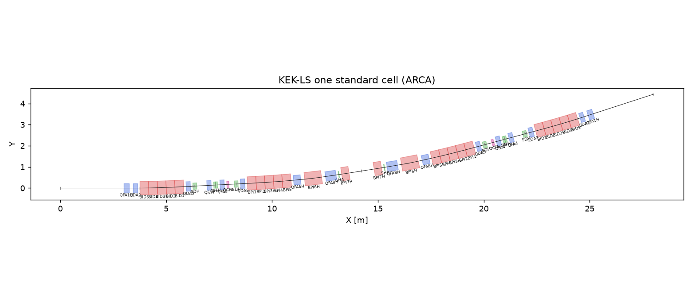
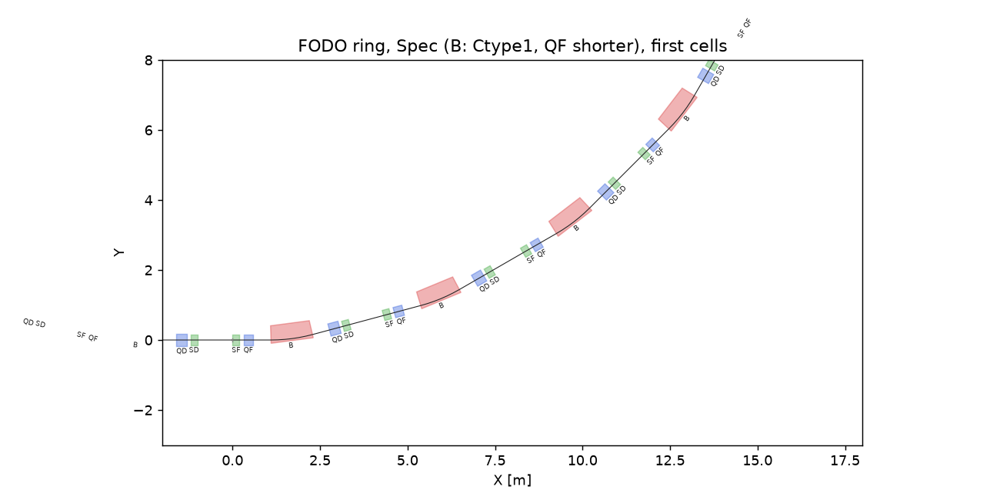

# dxf_lattice: ラティスの平面図を DXF に書き出す (v2.4.1)

ラティスを上から見た図 (平面図) を、CAD で開けるテキストの DXF (ASCII、AutoCAD R12 相当) に書き出す `DrawMagnetsDXF[file, options]` (SADScript。gs でも pysad でも走る) と、同じ出力を作る pysad の Python 関数 `pysad.dxf_lattice.write_dxf` の例です。
SAD の `drawmagvw3d.n` (VectorScript を書き出す `DrawMagnets3D`) の幾何の考え方を参考にした自前版で、立体は作りません (平面図だけ)。解説・限界は [`docs/51_lattice_dxf.md`](../../docs/51_lattice_dxf.md)。

## ファイル

| ファイル | 内容 |
|---|---|
| `DrawMagnetsDXF.n` | 関数の定義 (台本が `Get["DrawMagnetsDXF.n"]` で読む。台本と同じフォルダに置く) |
| `DXF_FODO.sad` | FODO リング (24 セル、3 GeV、周長 105.6 m。`example/00_lattice/FODO_ring.sad` と同じ) の全周、`Spec` で磁石の寸法を与えた版、`Region`・`Scale` (mm) の版 |
| `DXF_SOL.sad` | ソレノイドの領域 (SOL 境界 SA〜SB、BZ = 5 T) を含む FODO の最初の 24 要素 |
| `DXF_ASTRID2.sad` | ASTRID2 (0.58 GeV、周長 45.7 m) の 1 セル (`NCELL`、7.6 m) と全周 |
| `DXF_KEKLS.sad` | KEK-LS v03_68 (3 GeV、周長 570.72 m) の標準セル 1 個 (`ARCA`、28.5 m) と全周 (`RING`、3224 要素) |
| `*.dxf` | 出力 (pysad の台本の出力。gs の出力と全行一致)。**KEK-LS の全周 (0.7 MB) は追跡しない** (台本で作る) |
| `*.png` | DXF を読み戻して matplotlib で描いた図 (目視の確認) |
| `*.gs.txt`・`*.pysad.txt` | 台本の画面表示 (始点と終点の幾何の値、周長) |
| `run_dxf_examples.py` | 台本を作り (`mk`)、gs と pysad で走らせて 3 通り (gs・pysad の台本・Python 関数) の DXF を比べ (`run`)、図を作る (`png`) |
| `plot_dxf.py` | DXF を matplotlib で描く (`pysad.dxf_lattice.read_dxf` で読み戻す。ezdxf は使わない) |

走らせ方 (`PYSAD_SAD_PACKAGES` が必要。gs は WSL):

```
py -3.12 example/dxf_lattice/run_dxf_examples.py          # mk run png
```

## 結果 (2026-11-22)

| DXF | 大きさ | 内容 |
|---|---|---|
| `DXF_FODO_ring.dxf` | 82 KB | 磁石 120 台 (BEND 24・QUAD 48・SEXT 48)、軌道 170 頂点、MARK 1 |
| `DXF_FODO_ring_spec.dxf` | 82 KB | `Spec->{"B"->{Width->.5, PoleWidth->.15, Type->Ctype1}, "QF"->{Width->.3, PhysicalLength->.26}, "QUAD"->{Width->.36}}` (寸法は説明用の値) |
| `DXF_FODO_region_mm.dxf` | 13 KB | `Region->{"QF.1","QF.4"}, Scale->1000, TextHeight->.1` (単位 mm、`$INSUNITS`=4) |
| `DXF_SOL_cells.dxf` | 9 KB | 最初の 24 要素。SA〜SB の矩形 (SOL レイヤー) |
| `DXF_ASTRID2_cell.dxf`・`_ring.dxf` | 8 KB・44 KB | |
| `DXF_KEKLS_cell.dxf`・`_ring.dxf` | 35 KB・701 KB | |

- **gs との一致**: 同じ台本を gs (SAD 1.4.4.2k64) と pysad で走らせ、8 本の DXF が全行 (文字列として) 一致。pysad の Python 関数 `write_dxf` の出力とも全行一致 (`run_dxf_examples.py run` の表で 0 行の違い)。
- **閉じたリング** (始点と終点の GEO の差。台本の画面表示): FODO 1.7e-14 m・chi1 9e-16 rad、KEK-LS 8e-8 m・chi1 1.6e-9 rad。ASTRID2 は 1.9e-5 m・chi1 2.7e-6 rad で、台本の `ANGLE = 0.523599` (12 台の和が 2π より 3e-6 rad 小さい) の丸めによる (描画の誤差ではない)。
- 図: KEK-LS の 1 セル ([`KEKLS_cell.png`](KEKLS_cell.png)。ESRF 型 HMBA の低磁場の偏向磁石 `BID*`・`BPI*` が両側の長直線部の間に並ぶ)、全周 ([`KEKLS_ring.png`](KEKLS_ring.png))。ほかに [`FODO_ring.png`](FODO_ring.png)・[`FODO_cell_spec.png`](FODO_cell_spec.png) (Ctype1 の偏向磁石)・[`FODO_region_mm.png`](FODO_region_mm.png)・[`SOL_cells.png`](SOL_cells.png)・[`ASTRID2_cell.png`](ASTRID2_cell.png)・[`ASTRID2_ring.png`](ASTRID2_ring.png)。





## 未確認・限界

- 磁石の寸法は、`Spec` を与えない限り仮の既定値 (BEND 幅 0.63 m、QUAD 0.45 m、SEXT・OCT 0.30 m ほか)。KEK-LS・ASTRID2・FODO の図の磁石の幅は実機の寸法ではない (配置・長さ・偏向角・端面の角は台本のラティスのとおり)。
- 平面図だけ (立体・コイル・端板は未対応)。CAD ソフトで実際に開いた確認はしていない (自前のパーサと matplotlib の描き直しだけ)。詳細は [`docs/51_lattice_dxf.md`](../../docs/51_lattice_dxf.md) §5。
- 要素名は磁石の脇に出すだけで、重なりは消さない (1 セルの図では重なる)。
