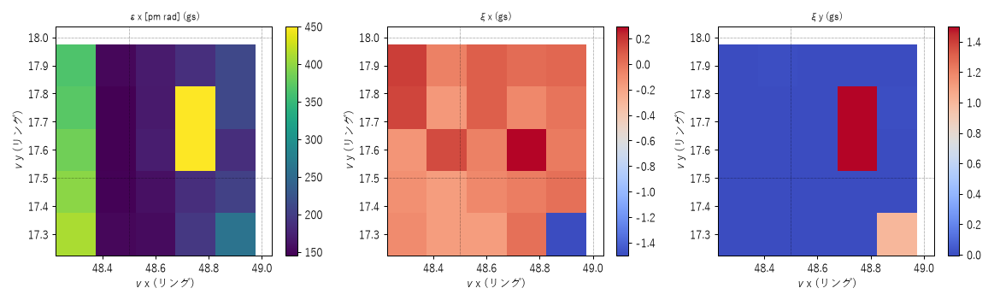
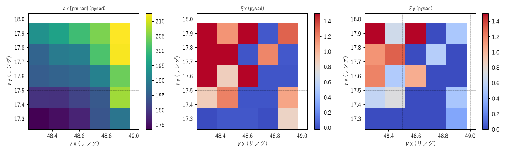

# KEKLS_tune_survey_cell
種別: チューンサーベイ (FFS の `fit`、六極補正)。フォルダ: `design`。元のスクリプト: matching05 (+ modules_tune_sv_v03_68.n)。ユーザーの指定 (matching23_v03_35_mini) は縮小の台本で、チューンサーベイに当たるのはこれ (README の「元のスクリプトとの対応」)。ラティス: `../lattice/kek_ls_v03_68.sad` (3 GeV、周長 570.72 m、標準セル 20 個)。フラグ: `ON RAD FLUC COD RFSW RADCOD`。

## 何を見る例か
リングのチューン (tunex, tuney) の格子の各点で、標準セルの位相進みを (tunex/20, tuney/20) に再マッチし、六極 SDH・SFH でクロマティシティを補正して、リング RINGC のチューン・ξ・εx・六極の強さを表示する。格子は 48.30〜48.90 (0.15 刻み、5 点) × 17.30〜17.90 (5 点) の 25 点で、整数 (49、18) と半整数 (48.5、17.5) の共鳴線のまわりを含む。

## スクリプト
`KEKLS_tune_survey_cell.sad` (先頭に `../lattice/kek_ls_v03_68.sad` を貼った自己完結のファイル。台本の本体は `FFS;` から。説明のコメントは台本の先頭にある)。共通モジュールは `Get["../modules/..."]` で読む (台本のあるフォルダをカレントにして走らせる)。

## 結果の読み方
`POINT` の行に、目標 (νx, νy)、実際のリングのチューン、ξx・ξy、εx [pm rad]、K2(SDH)、K2(SFH)。gs では、εx は νx = 48.45〜48.6 付近で最小 (145〜170 pm rad)、νx = 48.30 では 365〜411 pm rad と大きい。(48.75, 17.60)・(48.75, 17.75) は六極補正が収束せず εx が 1.4e4 pm rad に飛ぶ (図は 450 で頭打ち)。ξ が 0 から大きく外れた点は、六極補正が収束しなかった点。

gs の出力の抜粋 (指定の行だけ。全体は `KEKLS_tune_survey_cell.gs.txt`):
```
POINT   48.3   17.3   48.3000155242   17.3000040418    -.0941477869     .0012654584  410.9005371339  -10.1811037273   11.7933857175
POINT   48.3   17.45   48.3000224764   17.4500061402    -.1160339273     .0012516470  396.6667253180  -10.2081026695   11.8140549964
POINT   48.3   17.6   48.3000313132   17.6000088537    -.1390493868     .0011505121  384.3188277101  -10.2382580589   11.8404180888
POINT   48.3   17.75   48.3000434352   17.7500122977     .1593734635    -.0029917700  370.9429148552  -10.2869345758   11.9099338108
POINT   48.3   17.9   48.3000563647   17.9000163824     .1813289107    -.0031828033  364.5537592029  -10.3277931458   11.9566170835
POINT   48.45   17.3   48.4500714956   17.3000200570    -.1694558732    -.0037890897  150.8445651224  -10.0845273093   11.5626856409
POINT   48.45   17.45   48.4500740638   17.4500219154    -.1742840346    -.0045772965  147.1728323196  -10.1157859428   11.5994788618
POINT   48.45   17.6   48.4500660362   17.6000210460     .1370704371    -.0018844512  145.3612453258  -10.1697223422   11.6825443781
... (計 25 行)
```





## gs と pysad の比較
判定: **△** (比べた行 25、最大の相対差 1.9e+00、k64 モードの pysad)。gs と pysad で、点ごとの εx・ξ・K2 が一致しない (たとえば (48.30, 17.30) の εx は gs 411、pysad 173)。マッチングの解が一意でなく、`KEKLS_match_repeat` で見たように pysad の FIT の経路が gs と違うため。リングのチューンの目標への到達は、gs では全点で 5e-4 以内。

所要時間: gs 10 秒、pysad 160 秒 (この PC。k64 モード)。

## 未確認・限界
- 元の格子は 46.05〜46.55 (0.1 刻み 6 点) × 16.05〜19 (0.1 刻み 30 点) = 180 点で、各点に DA (5000 周) を追加する。例は 25 点・DA なし。所要時間 (gs 10 秒、pysad 約 160 秒) から、元の 180 点は gs で約 1.2 分、pysad で約 19 分 (DA を除く)。DA を足すと 1 点あたり gs で数分、pysad で十数分以上と見込む (DAsv の 5000 周 × 19 運動量 × 2 方向。測定はしていない)。
- 元の matching05 は modules_tune_sv_v03_35.n を読み込む。modules_tune_sv_v03_68.n を読み込む台本は元のフォルダに無い。v03_68 用の目標値・六極の名前に直した (modules/modules_cell_match.n の説明)。
- 元の `tune_survey*` (tune_survey・_linear・_momentum・_disp・_amp_dep_coef・_ncell・_write_QS) は、別のリング (六極 S1L・S2L・S1H… と `hsx_value.csv`、チューン 15.x/5.x) の `modules_tune_sv.n` を使い、v03_68 には適用できない。
