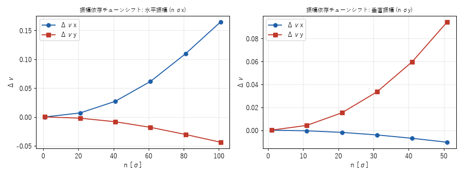

# KEKLS_amp_dep_ts
種別: 振幅依存チューンシフト (ADTS)。フォルダ: `display`。元のスクリプト: amp_dep_ts.sad、amp_dep_ts_x.sad、amp_dep_ts_y.sad (+ modules_amp_dep_ts.n)。ラティス: `../lattice/kek_ls_v03_68.sad` (3 GeV、周長 570.72 m、標準セル 20 個)。フラグ: `ON RAD FLUC COD RFSW RADCOD`。

## 何を見る例か
リングの始点のツイスから、振幅 n σ の位相 θ を 10 点で回し、各点を `ins calc` (1 周) して得たチューンの平均を求める。水平 (n = 1〜101、y = 1σ)、垂直 (n = 1〜51、x = 1σ)。

## スクリプト
`KEKLS_amp_dep_ts.sad` (先頭に `../lattice/kek_ls_v03_68.sad` を貼った自己完結のファイル。台本の本体は `FFS;` から。説明のコメントは台本の先頭にある)。共通モジュールは `Get["../modules/..."]` で読む (台本のあるフォルダをカレントにして走らせる)。

## 結果の読み方
`AX n νx νy`・`AY n νx νy` の行。n = 101σ (水平 2.6 mm) で νx は 0.15 近く増え、νy が減る。垂直 51σ (0.9 mm) で νy が 0.1 以上動く。図: `KEKLS_amp_dep_ts.png`。

gs の出力の抜粋 (指定の行だけ。全体は `KEKLS_amp_dep_ts.gs.txt`):
```
AX: -6.70E-4 BX: 4.781565                            ZX: 6.942E-5  EX:  .024985
design tune   48.5800233525   17.6200785537
AX    1.0   48.5800345307   17.6201074796   amplitude x [mm]     .0253736674
AX   21.0   48.5869573721   17.6178809159   amplitude x [mm]     .5328470145
AX   41.0   48.6071167307   17.6117185769   amplitude x [mm]    1.0403203616
AX   61.0   48.6414636040   17.6020245011   amplitude x [mm]    1.5477937087
AX   81.0   48.6894944917   17.5896795101   amplitude x [mm]    2.0552670559
AX  101.0   48.7448261862   17.5761796686   amplitude x [mm]    2.5627404030
AY    1.0   48.5800345307   17.6201074796   amplitude y [mm]     .0178694833
AY   11.0   48.5795079205   17.6241988840   amplitude y [mm]     .1965643158
AY   21.0   48.5781158423   17.6352184113   amplitude y [mm]     .3752591483
AY   31.0   48.5759018086   17.6535098793   amplitude y [mm]     .5539539809
AY   41.0   48.5729689529   17.6797101788   amplitude y [mm]     .7326488134
AY   51.0   48.5695242414   17.7145509989   amplitude y [mm]     .9113436460
... (計 15 行)
```



## gs と pysad の比較
判定: **○** (比べた行 15、最大の相対差 0.0e+00、k64 モードの pysad)。全桁一致。

所要時間: gs 1 秒、pysad 36 秒 (この PC。k64 モード)。

## 未確認・限界
- 元の y の範囲 (1〜401σ、約 7 mm まで) は、この ring では 100σ 前後から先で `ins calc` が破綻する (gs・pysad とも、NaN や 1.59e199)。例は有効な範囲にした。
- 整理前後の比較: 元の amp_dep_ts.sad (USE RING) の gs の垂直 6 点 (1〜101) が、この例のスクリプトを RING にして走らせた値と 5e-9 以内で一致。
- `ResetInit[]` (初期座標を 0 に戻す) をモジュールに足した。元の台本は、失敗した点の初期座標が次の点に残ることがある。
- 粒子の追跡との照合 (ADTS の基準は追跡) はしていない。`ins calc` の 1 周の転送の結果。
