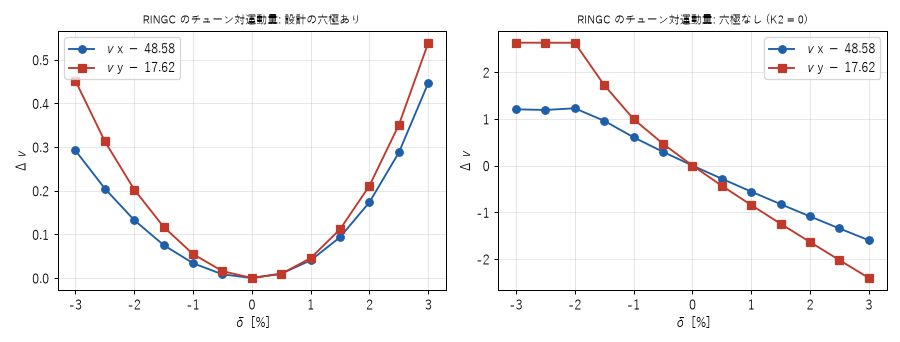

# KEKLS_chromaticity
種別: チューンの運動量依存。フォルダ: `display`。元のスクリプト: chromaticity_plot.sad、amp_dep_ts_dp.sad。ラティス: `../lattice/kek_ls_v03_68.sad` (3 GeV、周長 570.72 m、標準セル 20 個)。フラグ: `ON RAD FLUC COD RFSW RADCOD`。

## 何を見る例か
RINGC のチューンを δ = DP0 = −3%〜+3% (0.5% 刻み) で求める。設計の6 極あり (T1) と6 極なし (T0)。

## スクリプト
`KEKLS_chromaticity.sad` (先頭に `../lattice/kek_ls_v03_68.sad` を貼った自己完結のファイル。台本の本体は `FFS;` から。説明のコメントは台本の先頭にある)。

## 結果の読み方
`T1 δ νx νy`・`T0 δ νx νy` の行。6 極ありは δ ±1% で Δν ≈ ±0.0x の滑らかな曲線、6 極なしは ξ = (−57.6, −89.3) の自然クロマティシティで Δν = ±1.7 (δ = ±3%) に達する。図: `KEKLS_chromaticity.png`。

gs の出力の抜粋 (指定の行だけ。全体は `KEKLS_chromaticity.gs.txt`):
```
T1    -.03   48.8720983625   18.0721211883
T1    -.025   48.7849239581   17.9332627854
T1    -.02   48.7126305662   17.8226695539
T1    -.015   48.6554585020   17.7370473669
T1    -.01   48.6138278934   17.6748364643
T1    -.005   48.5883765069   17.6356676723
... (計 26 行)
```



## gs と pysad の比較
判定: **○** (比べた行 26、最大の相対差 0.0e+00、k64 モードの pysad)。全桁一致 (表の 26 行)。

所要時間: gs 1 秒、pysad 5 秒 (この PC。k64 モード)。

## 未確認・限界
- 元は δ を 0.1% 刻み。整理前後の比較: RING で 0.1% 刻み (61 点) にして元の chromaticity_plot.sad の前半の表と比べ、δ ≤ +2.7% で 2e-6 以内で一致。+2.8〜+3% は共鳴の近くで 0.005〜0.15 違う (元は `DP0 = 0; cell calc` で毎回周期解を求め直す。この例は直前の解から続ける)。
- 6 極なしの表の δ = ±3% は νx が 49 や 18 の整数を越えるので、チューンの値は連続な曲線の一部に見えるだけで、その先の共鳴は無視している。
