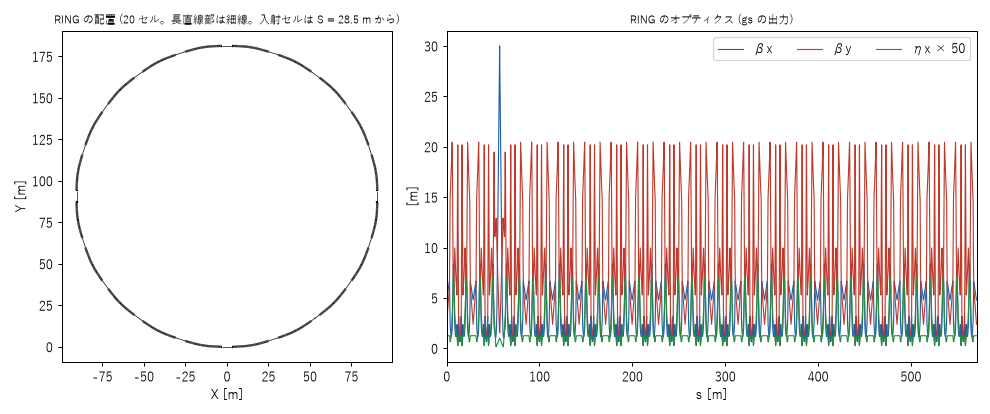

# KEKLS_optics_table
種別: FFS の `disp`、`Twiss[]`、`LINE["GX"]`。フォルダ: `display`。元のスクリプト: disp_optics、disp (`disp $$$`、`disp geo $$$`)、draw_cad.sad の入力。ラティス: `../lattice/kek_ls_v03_68.sad` (3 GeV、周長 570.72 m、標準セル 20 個)。フラグ: `ON RAD FLUC COD RFSW RADCOD`。

## 何を見る例か
リング RING の `disp $$$` (終点)、`disp MKSI` (入射点)、`disp geo $$$` と、要素ごとの S・βx・βy・ηx・位相 (ψx, ψy)・ジオメトリ (GX, GY) の表 (3226 行の数表)。図 `../display/KEKLS_ring_layout_optics.png` の元データ。

## スクリプト
`KEKLS_optics_table.sad` (先頭に `../lattice/kek_ls_v03_68.sad` を貼った自己完結のファイル。台本の本体は `FFS;` から。説明のコメントは台本の先頭にある)。

## 結果の読み方
`E ` で始まる行が要素ごと (名前、S [m]、BX、BY、EX、PSIX、PSIY、GX、GY。値は要素の入口)。図の左は GX–GY の配置 (長直線部は細線)、右は S に対するオプティクス。入射セルは RING の最初の標準セルの次 (S = 28.5 m から) で、入射点 `MKSI` (S ≈ 57 m) の βx = 30 m の山が見える。

gs の出力の抜粋 (指定の行だけ。全体は `KEKLS_optics_table.gs.txt`):
```
tune   48.5800240787   17.6200831582  length  570.7209201079
```



## gs と pysad の比較
判定: **○** (比べた行 3226、最大の相対差 0.0e+00、k64 モードの pysad)。全桁一致 (1e-10 以内)。

所要時間: gs 1 秒、pysad 3 秒 (この PC。k64 モード)。

## 未確認・限界
- `draw_cad.sad` は元の描画モジュール `drawmagvw3d.n` (元のフォルダにも無い) で `ring.vss` を書くもので、この例では扱わない。`draw` コマンドは gs・pysad とも窓か topdrawer の出力で、図は PNG に別に作った。
- `disp geo $$$` は、gs では `$$$` の 1 行だけの表 (要素ごとのジオメトリの表は出ない)。
