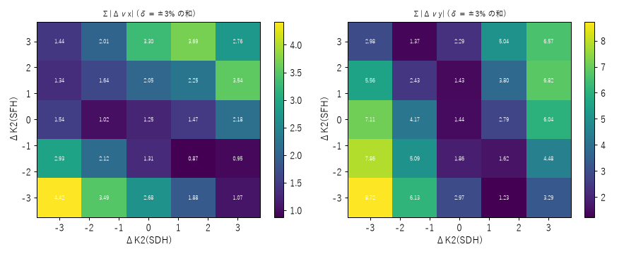

# KEKLS_sextupole_tune_scan
種別: 六極を変えたチューンシフト。フォルダ: `display`。元のスクリプト: dp_sv_sx.sad (dp_sv_sx_dp_n0.03・_res・_v02_42 は同系)。ラティス: `../lattice/kek_ls_v03_68.sad` (3 GeV、周長 570.72 m、標準セル 20 個)。フラグ: `ON RAD FLUC COD RFSW RADCOD`。

## 何を見る例か
六極 SDH・SFH の K2 を設計値から (ΔSD, ΔSF) ずらし (それぞれ −3〜+3、1.5 刻み、5×5 = 25 点)、δ = −3%〜+3% (1% 刻み 7 点) で、チューンの設計値からのずれの絶対値の和 Σ|Δνx|、Σ|Δνy| を求める。

## スクリプト
`KEKLS_sextupole_tune_scan.sad` (先頭に `../lattice/kek_ls_v03_68.sad` を貼った自己完結のファイル。台本の本体は `FFS;` から。説明のコメントは台本の先頭にある)。

## 結果の読み方
`S dsd dsf dtux dtuy` の行。設計値 (0, 0) の周りで Σ|Δν| は x が 1.25、y が 1.44。図: 25 点の地図 (`KEKLS_sextupole_tune_scan.png`)。SD・SF とも + 方向に動かすと (3, 3) 付近で大きく悪化する。

gs の出力の抜粋 (指定の行だけ。全体は `KEKLS_sextupole_tune_scan.gs.txt`):
```
design tune   48.5800233525   17.6200785537  K2 SDH  -12.3824864079  SFH   15.1343981068
S   -3.0   -3.0    4.4169963083    8.7215270221
S   -3.0   -1.5    2.9310704546    7.8604025862
S   -3.0     .0    1.5363574855    7.1113312605
S   -3.0    1.5    1.3419845707    5.5638632783
S   -3.0    3.0    1.4449420499    2.9780623598
S   -1.5   -3.0    3.4896495462    6.1346819282
S   -1.5   -1.5    2.1222763268    5.0885780311
... (計 26 行)
```



## gs と pysad の比較
判定: **△** (比べた行 26、最大の相対差 4.4e-01、k64 モードの pysad)。25 点中 20 点が 1e-8 以内で一致。残りは ΔK2 が大きい点 (±3) で、δ = ±3% のチューンが整数 (49・18) を越える点の収束が違う。

所要時間: gs 2 秒、pysad 18 秒 (この PC。k64 モード)。

## 未確認・限界
- 元は v02_42 の 6 本の六極 (SDA・SFA・SDC・SDB・SFB・SDD) を (+dsd, +dsf)・(−dsd, −dsf) でずらし、31×31 = 961 点 × δ 13 点。基準値も v02_42 の最適値。v03_68 の六極は SDH・SFH だけなので、基準を設計値にした。元の範囲全部は `ds0 = -3; dds = 0.2; nds = 31; dd = 0.005; nd = 12` (見込み: 25 点 × 7 δ で gs 2 秒・pysad 18 秒から、961 点 × 13 δ で gs 約 2.5 分、pysad 約 1 時間 (外挿))。
- チューンの動きが小さい (Σ|Δν| が小さい) 組が、ダイナミックアパーチャの大きい組とは限らない (DA は含めていない)。
