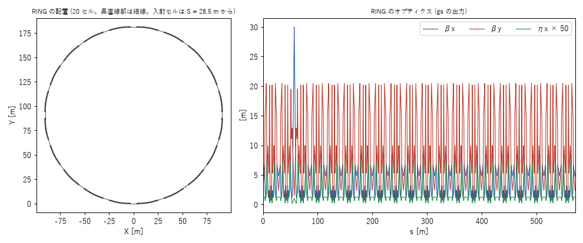

# display: KEK-LS のパラメータ表示

リング・オプティクス・チューンシフトの表示。元の `calc_emit.sad`・`disp*`・`chromaticity_plot.sad`・`calc_H*.sad`・`draw_cad.sad`・`amp_dep_ts*.sad`・`dp_sv*.sad`・`dx_sv*`・`dy_sv*`・`dp_sv_sx*.sad` を整えた。`Plot` 系 (Tk の窓) は使わず、台本の出力 (数表) を gs の出力から `tools/kek_ls_figs.py` が PNG にする (図は gs の出力から作った)。各例は `.sad`・`.gs.txt`・`.pysad.txt`・`.md` の 4 点。

## 一覧 (gs と pysad の一致: ○ 一致、△ 差あり、× 不一致または未対応)

| 例 | 内容 | 元のスクリプト | 出力 | 所要時間 | gs と pysad |
|---|---|---|---|---|---|
| [`KEKLS_ring_params`](KEKLS_ring_params.md) | リングのパラメータ (εx・σδ・減衰・αc・U0・ξ) | calc_emit.sad 前半、disp、chromaticity_plot | emit の表・ξ | gs 1 s / pysad 4 s | ○ |
| [`KEKLS_optics_table`](KEKLS_optics_table.md) | リングのオプティクス・配置の数表と図 | disp_optics、disp、draw_cad の入力 | 要素ごとの表 3226 行、PNG | gs 1 s / pysad 3 s | ○ |
| [`KEKLS_calc_H`](KEKLS_calc_H.md) | H 関数の積分によるエミッタンス | calc_H.sad、calc_emit.sad 後半 | εx (SAD と 2.3% 差) | gs 1 s / pysad 3 s | ○ |
| [`KEKLS_chromaticity`](KEKLS_chromaticity.md) | チューンの運動量依存 | chromaticity_plot.sad | ν(δ)・PNG | gs 1 s / pysad 5 s | ○ |
| [`KEKLS_amp_dep_ts`](KEKLS_amp_dep_ts.md) | 振幅依存チューンシフト | amp_dep_ts*.sad | ν(振幅)・PNG | gs 1 s / pysad 36 s | ○ |
| [`KEKLS_sextupole_tune_scan`](KEKLS_sextupole_tune_scan.md) | 六極を変えたチューンシフト | dp_sv_sx.sad | Σ|Δν| の 5×5 の地図・PNG | gs 2 s / pysad 18 s | △ |
| [`KEKLS_scan_target`](KEKLS_scan_target.md) | マッチングの目標値の振り (δ 依存・ADTS) | dp_sv.sad、dx_sv*.sad、dy_sv*.sad | ξ・ν(δ)・ADTS | gs 5 s / pysad 119 s | △ |

図: [`KEKLS_ring_layout_optics.png`](KEKLS_ring_layout_optics.png) (リングの配置とオプティクス)、[`KEKLS_chromaticity.png`](KEKLS_chromaticity.png)、[`KEKLS_amp_dep_ts.png`](KEKLS_amp_dep_ts.png)、[`KEKLS_sextupole_tune_scan.png`](KEKLS_sextupole_tune_scan.png)。

## 元の設定と例の設定

| 台本 | 元の設定 | 例の設定 | 完全な設定にするには | 見込みの所要時間 (完全) |
|---|---|---|---|---|
| `KEKLS_amp_dep_ts` | y の振幅 1〜401σ (20 刻み、21 点)、θ 10 点、NPARA 64 | x 1〜101σ (6 点)、y 1〜51σ (6 点) | `{nn,1,401,20}` (ただし 100σ 前後から先は NaN) | gs 数秒、pysad 約 2 分 |
| `KEKLS_chromaticity` | δ −3%〜+3% を 0.1% 刻み | 0.5% 刻み (13 点) | `dd = 0.001; nd = 60;` | gs 数秒、pysad 約 25 秒 |
| `KEKLS_sextupole_tune_scan` | dsf・dsd −3〜3 (0.2 刻み 31×31 = 961 点)、δ 13 点 | −3〜3 (1.5 刻み 5×5 = 25 点)、δ 7 点 | `ds0 = -3; dds = 0.2; nds = 31; dd = 0.005; nd = 12;` | gs 約 2.5 分、pysad 約 1 時間 (外挿) |
| `KEKLS_scan_target` | AY 1.08〜1.29 (0.01 刻み)、BY 3〜7 (0.1 刻み)、EX など。各点で ADTS 11 点 (x 1〜202σ、y 1〜401σ) | 3 つの目標 × −10%・0・+10% = 9 点、ADTS 61σ・31σ | `facs` を細かく | 1 点で gs 約 0.6 秒、pysad 約 13 秒。元の全部 (約 200 点) は pysad で約 45 分 (外挿) |

## 元のスクリプトのうち取り込んでいないもの

- `tune_survey_amp_dep_coef*`・`tune_survey_momentum`・`tune_survey_disp`・`tune_survey_linear*`: 別のリング用の `modules_tune_sv.n`・`modules_amp_dep_ts.n` の `MatchingWholeRing[]`・`ChromCorrect[]`・`LinearAmpDepTSCorrect[]` (v03_68 には無い) と、六極 S1L・S2L… を使うため v03_68 には適用できない。ADTS・運動量依存の表示は、この例集の `KEKLS_amp_dep_ts`・`KEKLS_scan_target` で扱う。
- `draw_cad.sad`: 元の描画モジュール `drawmagvw3d.n` (元のフォルダに無い) が必要。
- `disp2`・`disp_arc_optics`・`disp_emit`・`disp_matching_tune`・`disp_matrix`: ID 入りラティス用の `modules_matching_noID.n`・`modules_write_correctdata.n` を使う (v03_68 に ID は無い)。
- `disp_b`・`disp_bunchlength`・`disp_eta`・`disp_NPARA_*`・`calc_H_2`・`dp_sv_R`・`dp_sv_2`・`dp_sv_v2_11`・`dx_sv_R`・`dx_sv_v2_11`・`dy_sv_R`・`dy_sv_v2_11`・`amp_dep_ts_{x,y,dp}`: 上の台本の版違い・断片 (別のラティスの名前や `stop;` で止まるもの)。
