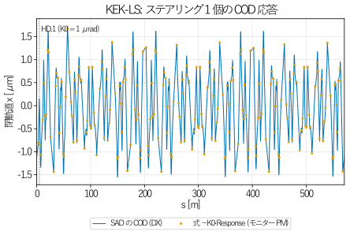

# KEKLS_cod_response
種別: COD 応答行列。フォルダ: `errors`。元のスクリプト: write_cod_response.sad。ラティス: `../lattice/kek_ls_v03_68.sad` (3 GeV、周長 570.72 m、標準セル 20 個)。フラグ: `ON RAD FLUC COD RFSW RADCOD`。

## 何を見る例か
ステアリング (水平 HD*.*、垂直 VD*.*) の K0 → モニター PM.* の COD の応答行列を、`Response[j,i] = 0.5 sqrt(βm βc) cos(πν − |Δμ|) / sin(πν)` でリング RING の Twiss から作り、水平ステアリング 3 個に K0 = 1e-6 を与えた SAD の COD と比べる。

## スクリプト
`KEKLS_cod_response.sad` (先頭に `../lattice/kek_ls_v03_68.sad` を貼った自己完結のファイル。台本の本体は `FFS;` から。説明のコメントは台本の先頭にある)。

## 結果の読み方
`horizontal steerings 161 vertical steerings 121 monitors 201`、`Responsex[...]`・`Responsey[...]` の代表値、`steering HD.n ...` の行 (最大の |COD| と、SAD の COD + K0 × Response の最大の差)。SAD の COD は −K0 × Response と 1e-4 μm (最大振幅 1.7〜3.0 μm の 5e-5) 以内で一致。

gs の出力の抜粋 (指定の行だけ。全体は `KEKLS_cod_response.gs.txt`):
```
horizontal steerings  161.0  vertical steerings  121.0  monitors  201.0
Responsex[1,1], [1,2], [2,1] =     .8079366010     .8552579906     .3704166388
Responsey[1,1], [1,2], [2,1] =   -1.1805968520    -.8319093110    -.1128648426
steering HD.1 at s =    4.7925000000: max |COD| [um]    1.6736454285   max |SAD + K0*Response| [um]  9.988898824E-5
steering HD.2 at s =    9.8725000000: max |COD| [um]    2.9767005451   max |SAD + K0*Response| [um]  2.318443914E-4
steering HD.3 at s =   11.9530000000: max |COD| [um]     .8126798368   max |SAD + K0*Response| [um]  9.691929474E-5
```



横軸はリングに沿った距離 s [m] (周長 570.72 m)、縦軸は水平ステアリング HD.1 (s = 4.79 m、点線) に K0 = 1 μrad を与えたときの閉軌道 x [μm]。青い線が SAD の COD、橙の点が応答行列の式 −K0 × Response のモニター位置 (PM、201 個) の値で、両者は 1e-4 μm 以内で重なる。軌道の最大は 1.67 μm (本文の `max |COD|`) で、ベータトロン振動がリング全周に広がる (チューン 48.58 なので 48 周ほど振動する)。

## gs と pysad の比較
判定: **○** (比べた行 6、最大の相対差 0.0e+00、k64 モードの pysad)。最大の COD は 1e-8、解析式との差 (1e-4 μm) の違いは 1e-7 μm 以内で一致。

所要時間: gs 1 秒、pysad 9 秒 (この PC。k64 モード)。

## 未確認・限界
- 元の WriteCODResponce[] はモニターを `BPM.*` で探し (v03_68 の BPM は `PM`) 行列が空になり、結果を fort.92 に書く。`PM.*` に直し、書き出しは省いて、代表値と SAD の COD の照合に変えた。
- 補正磁石 HD・VD は同じ要素名の繰り返しなので、既定の `cell calc` は K0 を全部同じ値に揃える (HD.1 に与えると全 161 個が同じ値になり、COD が 5 倍以上大きくなる)。`USE RING NOEXPAND` と `cell calc noexpand` で 1 個だけに効く (docs/29 A56)。
- SAD の K0 の符号は COD = −K0 × Response (PF の例 `pf/optics/calc_respx_PF` と同じ)。
