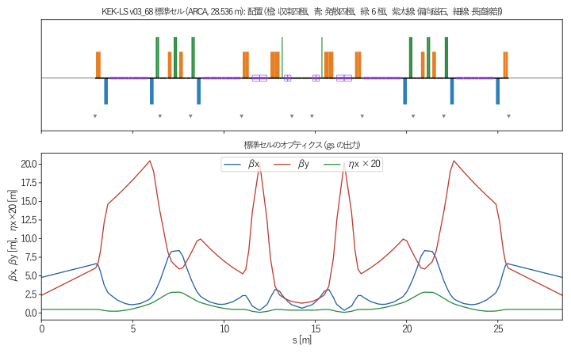

# KEKLS_cell_optics
種別: FFS の `cell calc`、`Twiss[]`、`LINE[]`。フォルダ: `lattice`。元のスクリプト: disp_optics (要素ごとの表)。ラティス: `../lattice/kek_ls_v03_68.sad` (3 GeV、周長 570.72 m、標準セル 20 個)。フラグ: `ON RAD FLUC COD RFSW RADCOD`。

## 何を見る例か
標準セル 1 個 (`ARCA`、28.536 m) の要素ごとの種類・位置・長さ・偏向角・K1・K2・βx・βy・ηx の数表。`../lattice/KEKLS_cell_layout_optics.svg` の元データ (`example/tools/kek_ls_figs.py` が gs の出力から描く)。

## スクリプト
`KEKLS_cell_optics.sad` (先頭に `../lattice/kek_ls_v03_68.sad` を貼った自己完結のファイル。台本の本体は `FFS;` から。説明のコメントは台本の先頭にある)。

## 結果の読み方
先頭の数行 (セルの長さ、チューン、×20 の位相進み、`MKS`・`MKC`・`MKSFA1` のツイス) と、`E ` で始まる行 (名前、種類、S、L、ANGLE、K1、K2、βx、βy、ηx。値は要素の入口)。`ARCA` は `cell calc` (周期解、`emit` なし。閉じていないラインでは `emit` は使えない)。

gs の出力の抜粋 (指定の行だけ。全体は `KEKLS_cell_optics.gs.txt`):
```
ARCA length [m]      =   28.536
ARCA tune nx ny      =    2.4290011676     .8810039277
ARCA phase 20 cells  =   48.5800233525   17.6200785537
MKS  (straight centre)  BX BY EX =    4.7933373510    2.3773629980     .0250000513
MKC  (cell end)         BX BY EX =     .6646218612    1.3317011803     .0199999550
MKSFA1 (SF centre)      BX BY EX =    8.3350203379    6.4000469233     .1399999420
```



## gs と pysad の比較
判定: **○** (比べた行 167、最大の相対差 0.0e+00、k64 モードの pysad)。全桁一致 (数表 160 行)。

所要時間: gs 1 秒、pysad 2 秒 (この PC。k64 モード)。

## 未確認・限界
- 図 (PNG) は gs の出力から作った。pysad の出力でも同じ図になる。
