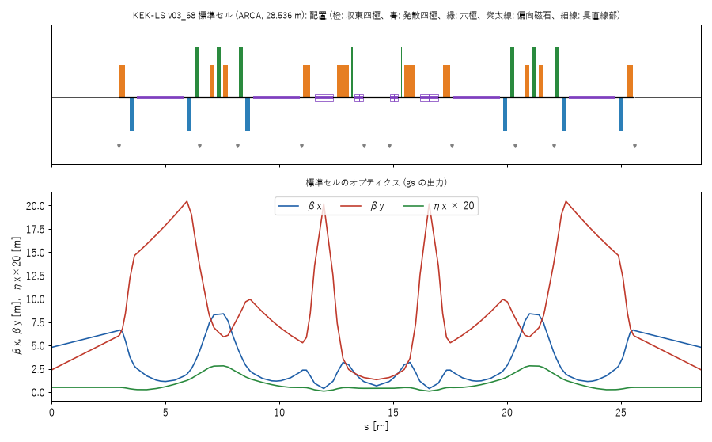

# lattice: KEK-LS v03_68 のラティス

KEK-LS (3 GeV、周長 570.72 m、標準セル 20 個) の設計ラティス `kek_ls_v03_68.sad`。KEK-LS は ESRF 型の HMBA (Hybrid Multi-Bend Achromat) で、ESRF の Pantaleo Raimondi 氏と Simone Liuzzo 氏の協力で設計した。

| ファイル | 内容 |
|---|---|
| `kek_ls_v03_68.sad` | ラティス本体。要素・ラインの定義だけ (`FFS;` の前に置く)。元の設計ファイルのコピーで、先頭のコメントを説明つきのヘッダに替え、改行を LF にした。要素の定義の中身は変えていない |
| `KEKLS_cell_calc_emit` (`.sad`・`.gs.txt`・`.pysad.txt`・`.md`) | RINGC・RING の周期解 (`cell calc emit`)、周長・チューン・εx・σδ・σz |
| `KEKLS_cell_optics` (同 4 点) | 標準セル (ARCA) の要素ごとの配置とオプティクスの数表 (図の元) |
| `KEKLS_cell_layout_optics.png` | 標準セル 1 個の配置図とオプティクス |

台本 (`.sad`) は、このラティスを先頭に貼った自己完結のファイル (`tools/mk_kekls.py` が `tools/kek_ls_src/` の本体と合わせて作る)。

## ラインの構成

| ライン | 内容 |
|---|---|
| `ARCAH` | 標準セルの半分。`ARCAH1` + `ARCAH2`。長直線部の中心のマーク `MKS` から、`MKC` まで |
| `ARCA` | 標準セル 1 個 = `ARCAH -ARCAH` (長直線部の中心 `MKS` から次の `MKS` まで、28.536 m) |
| `RINGC` | `ARCA` 20 個 (RF 空洞 `RFC` が中央)。周長 570.72 m |
| `ARCINJ` | 入射セル = `ARCAH1 ARCAH2 ARCINJH -ARCINJH2 -ARCAH2 -ARCAH1` |
| `RING` | `ARCA` 19 個 + `ARCINJ`。周長 570.7209 m (入射セルの長直線部の長さ `DRID1INJ` = 2.76546 m が標準の `DRID1` = 2.94 m と違うため、`RINGC` より 0.9 mm 長い) |

標準セルの 1 つの半分 (`ARCAH`) の並び:

- `ARCAH1`: 長直線部の半分 (`DRID1` 2.94 m、BPM `PM`) → 四極 `QFA1H` (中央に垂直補正磁石 `VD`)・`QDA2` → 低磁場の偏向磁石 `BID5`・`BID4`・`BID3H`+`HD`+`BID3H`・`BID2`・`BID1` → `QDA3`
- `ARCAH2`: 6 極 `SDH` (`MKSDA1`)・四極 `QFA4` → 6 極 `SFH` (`MKSFA1`、中央に `VD`)・`QFA4`・八極 `OCFA` (K3 = 0) → 6 極 `SDH` (`MKSDC1`)・四極 `QDA5` → 偏向磁石 `BPI1`〜`BPI5` (`BPI3H`+`HD`+`BPI3H`) → 四極 `QFA6H`・勾配つき偏向磁石 `BPI6H` (K1 = −1.010)・四極 `QFA8H`・6 極 `SHA` (K2 = 0)・勾配つき偏向磁石 `BPI7H` → `DRCT` (0.55 m)・`MKC`

HMBA の特徴 (低磁場の偏向磁石 `BID*` が分散を作り、高磁場の偏向磁石 `BPI*` と勾配つき `BPI6H`・`BPI7H` が放射を担う) は、図の紫の太線 (偏向磁石) と、η の形に現れる。

## 構成図 (標準セル 1 個)

配置図の線は、長直線部 (`DRID1`) を細線 (0.55 pt)、その他の基準軌道を 1.8 pt、偏向磁石を 3 pt で描いた。橙は収束四極、青は発散四極、緑は6 極、紫の枠は勾配つき偏向磁石。下はオプティクス (βx・βy・20×ηx、gs の出力)。リング全体の配置とオプティクスは [`../display/KEKLS_ring_layout_optics.png`](../display/KEKLS_ring_layout_optics.png)。

## パラメータ表 (実際に再計算して確認した値)

`KEKLS_cell_calc_emit`・`KEKLS_ring_params` の出力 (`ON RAD FLUC COD RFSW RADCOD`、gs と pysad の k64 モードは全桁一致)。pysad の v2 (既定) モードは、K64 のバグを含まない `Emittance[]` で εx などが数 % の 0.1〜0.5 % 内で違う (括弧内)。

| 量 | RINGC (標準セル 20 個) | RING (入射セル込み) |
|---|---|---|
| エネルギー | 3 GeV | 3 GeV |
| 周長 | 570.7200 m | 570.7209 m |
| チューン (νx, νy) | 48.58002, 17.62008 | 48.58002, 17.62008 |
| εx | 134.32 pm rad (v2: 134.37) | 135.68 pm rad (v2: 135.74) |
| エネルギー拡がり σδ | 6.4052e-4 (v2: 6.4045e-4) | 6.4233e-4 (v2: 6.4226e-4) |
| バンチ長 σz | 2.734 mm | 2.731 mm |
| 運動量コンパクション率 αc | 2.2071e-4 | 2.1893e-4 |
| 1 周のエネルギー損失 U0 | 0.29607 MeV | 0.29843 MeV |
| RF | 2 MV、ハーモニック数 952 (バケット高さ 3.97 %) | 同じ |
| シンクロトロン周波数 | 2466.5 Hz | 2456.4 Hz |
| 減衰時間 (x, y, z) | 29.42, 38.59, 22.85 ms | 29.24, 38.29, 22.64 ms |
| 減衰分配数 (Jx, Jy, Jz) | 1.3116, 0.9998, 1.6886 | 1.3091, 0.9998, 1.6911 |
| ξ (6 極あり) | (+0.119, −0.684) | (−0.346, −0.650) |
| ξ (自然、6 極 K2 = 0) | (−57.56, −89.26) | (−58.07, −89.22) |
| 標準セルの位相進み (νx, νy) | 2.42900, 0.88100 (×20 = 48.580, 17.620) | |
| 標準セルの長さ | 28.536 m | |

- ξ は `DP0 = ±0.0005` のチューンの差分 (刻み 1e-4〜5e-4 で 0.118〜0.119 と変わらない)。作業メモの RINGC の ξ (+0.133, −0.658)・自然ξ (−57.58, −88.96) とは、特に ξy・自然 ξy で 0.03〜0.3 違う。メモの値の出し方 (多項式フィットなど) は確認していない。
- 標準セルの端 `MKC`・長直線部の中心 `MKS` のツイス (設計のマークの値と、`cell calc` の値が一致): `MKS` βx 4.793 m、βy 2.377 m、ηx 0.025 m。`MKC` βx 0.6646 m、βy 1.3317 m、ηx 0.020 m。`MKSFA1` (SF の中心) βx 8.335 m、βy 6.400 m、ηx 0.140 m。

## 旧版 v03_12 との違い

[`pysad/tests/kek-ls_v03_12.lat`](../../../pysad/tests/kek-ls_v03_12.lat) (試験が使う旧版。そのまま残してある) と比べる。

| 量 | v03_12 | v03_68 |
|---|---|---|
| 周長 | 603.12 m | 570.72 m |
| RF | 2 MV、ハーモニック数 952 (バケット高さ 3.97 %) | 同じ |
| シンクロトロン周波数 | 2466.5 Hz | 2456.4 Hz |
| 減衰時間 (x, y, z) | 29.42, 38.59, 22.85 ms | 29.24, 38.29, 22.64 ms |
| 減衰分配数 (Jx, Jy, Jz) | 1.3116, 0.9998, 1.6886 | 1.3091, 0.9998, 1.6911 |
| ξ (6 極あり) | (+0.119, −0.684) | (−0.346, −0.650) |
| ξ (自然、6 極 K2 = 0) | (−57.56, −89.26) | (−58.07, −89.22) |
| 標準セルの位相進み (νx, νy) | 2.42900, 0.88100 (×20 = 48.580, 17.620) | |
| 標準セルの長さ | 28.536 m | |

- ξ は `DP0 = ±0.0005` のチューンの差分 (刻み 1e-4〜5e-4 で 0.118〜0.119 と変わらない)。作業メモの RINGC の ξ (+0.133, −0.658)・自然ξ (−57.58, −88.96) とは、特に ξy・自然 ξy で 0.03〜0.3 違う。メモの値の出し方 (多項式フィットなど) は確認していない。
- 標準セルの端 `MKC`・長直線部の中心 `MKS` のツイス (設計のマークの値と、`cell calc` の値が一致): `MKS` βx 4.793 m、βy 2.377 m、ηx 0.025 m。`MKC` βx 0.6646 m、βy 1.3317 m、ηx 0.020 m。`MKSFA1` (SF の中心) βx 8.335 m、βy 6.400 m、ηx 0.140 m。

## 旧版 v03_12 との違い

[`pysad/tests/kek-ls_v03_12.lat`](../../../pysad/tests/kek-ls_v03_12.lat) (試験が使う旧版。そのまま残してある) と比べる。

| 量 | v03_12 | v03_68 |
|---|---|---|
| 周長 | 603.12 m | 570.72 m |
| 長直線部 (`DRID`/`DRID1`) | 2.9 / 2.85 m | 2.94 m |
| RF | 1.4 MV、ハーモニック数 992 (FREQ 508.8 MHz) | 2 MV、ハーモニック数 952 |
| チューン | (47.58, 17.62) | (48.58, 17.62) |
| εx | 154.9 pm rad | 134.3 pm rad |
| σδ | 6.95e-4 | 6.41e-4 |
| αc | 2.306e-4 | 2.207e-4 |
| U0 | 0.2961 MeV | 0.2961 MeV |
| 6 極・八極 | 6 極 `SDA`・`SFA`・`SDC` (L = 0.045 m)、八極 `OCFA` (K3 = −75) | 6 極 `SDH`・`SFH` の 2 ファミリー (L = 0.09 m)、`OCFA` K3 = 0 |
| 構成 | `ARCAH` を鏡像でつなぐ | `ARCAH1`・`ARCAH2`、勾配つき偏向磁石 `BPI6H`・`BPI7H`、入射セル `ARCINJ` |

(v03_12 の値は同じ手順 `cell calc emit` (pysad k64 モード) で再計算した値。v03_12 に入射セルのライン `ARCINJ` は無い。)

## 入射セル

`ARCINJ` は標準セルの半分 `ARCAH1 ARCAH2` の後に、入射用の長直線部 (`ARCINJH`・`ARCINJH2`) をはさみ、標準セルの鏡像 (`-ARCAH2 -ARCAH1`) で閉じる。`ARCINJH` は `-ARCAHI2` (標準の `ARCAH2` で四極 `QFA4` を `QS5` に替えた鏡像) から始まり、四極 `QS4`・`QS3`・`QS2`・`QS1`・`QS0` (いずれも `QUAD`、K1 は設計値)、低磁場の偏向磁石 `BID1I`〜`BID5I` (標準の `BID*` より短い 0.25 m)、キッカー用の空きスペース `K1`〜`K4` (長さ 0.3 m の BEND、`ANGLE` 0)、入射点のマーク `MKSI` を並べる。入射点 `MKSI` の設計値は βx = 30 m。`ARCINJH2` は `ARCINJH` の最後の `HD DR05 PM DR05` を `VD DR05 DR05` に替えたもの。入射セルの四極 `QS0`〜`QS5` と `DRID1INJ` (長直線部の長さ) は、`design/KEKLS_match_injcell`・`design/KEKLS_match_ring_geo` で再現する。

## 未確認・限界

- 磁場・アパーチャの上限は元のファイルに無く、ここでは確認していない (周長 570.72 m、3 GeV、RF 2 MV が使った条件)。
- 入射セルのキッカー `K1`〜`K4` は、`ANGLE` = 0 の BEND で、入射バンプの計算 (入射軌道) は含めていない。
- RING のチューン・εx は `RINGC` と少し違う (入射セルは標準セルの 2 つ分の光学ではない)。ξ の符号・大きさも違う (6 極は標準セルと同じ値)。
- ラティス本体は、元の設計ファイルと先頭の 1 行 (コメント) 以外が同一であることを照合した (改行は LF)。

## 参考文献

- KEK-LS Conceptual Design Report (CDR)、KEK、2017 年 5 月 22 日。<https://www2.kek.jp/imss/notice/assets/2017/05/22/KEKLS_CDR_170522.pdf>

CDR は設計の概要で、この例集の `v03_68` はその後に更新された版です。ここに書いた値は、すべて `v03_68` を gs・pysad で計算した実測値です。CDR の値との並べた表は、CDR の本文をこの作業では読んでいない (取得していない) ので作っていません (未確認)。値が CDR と違う場合も、違いの理由は推測しません。
