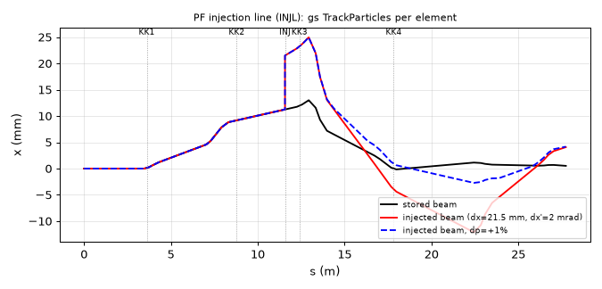

# calc_traj_01_PF (キッカーの入射バンプと入射ビームの軌道)
KEK の SAD チュートリアルの「ラティスのあるグラフと GUI 表示の例」の「計算部分の準備」(`calc_traj_01`) をもとにした例。加速器: PF リング (2.5 GeV、周長 187.0355 m、チューン 9.5975 / 5.2790、εx=34.5 nm)。ラティス: `lattice/v9_16_inj_noSF.sad` (入射バンプ内側の6 極 (2 台のうち 1 台) を外した入射用のラティス)。使う線: `RING` (入射点まわりから 1 周)、`INJL` (入射点まわりから直線部の終わりまで、114 要素、長さ 27.7358 m)。フラグ: すべて OFF (`OFF RAD FLUC COD RFSW RADCOD`、放射や揺らぎを ON にすると計算のたびに乱数が入る)。

## 何を見る例か
入射キッカー (KK1〜KK4) の蹴り角と、入射点での入射ビームの初期位置・傾きを決めたとき、**蓄積ビーム**・**入射ビーム**・**運動量ずれのある入射ビーム**の 3 つの軌道が、入射点の前後 (リングの途中まで) でどう動くかを `TrackParticles` を 1 要素ずつ呼んで追う。蓄積ビーム (初期値すべてゼロ) は、キッカーが作る入射バンプの軌道になる。

## スクリプト
```
USE RING;  KK* 0;  cell calc;  emit;  disp $$$;  SAVE ALL;    (* 周期解。キッカーはゼロ。SAVE ALL で K0 なども保存 *)
USE INJL;  ins calc;                                          (* ここからは INS (初期値からの伝搬) *)
dxinj = 21.5; dxpinj = 2; dpinj = 1;                          (* 入射ビーム: x [mm]、x' [mrad]、δ [%] *)
injposi = LINE["POSITION","INJ"];                             (* 入射点の要素番号 (48) *)
LINE["K0","KK1"] = -1.89/1000; LINE["K0","KK2"] = 0; LINE["K0","KK3"] = -1.4/1000; LINE["K0","KK4"] = -2.8/1000;
FFS["ins calc;"];                                             (* キッカーの値を入れて再計算 *)
res = {1,{a,a,a,a,a,delp,b}};                                 (* 3 粒子 {x,px,y,py,z,δ,生死} の 1 要素目 *)
Do[ res = TrackParticles[res,i]; ... ,{i,2,injposi}];          (* 要素 1 → 2 → ... と 1 つずつ。入射点まで *)
res[2,1,2] = dxinj/1000; res[2,1,3] = dxinj/1000; res[2,2,2] = dxpinj/1000; res[2,2,3] = dxpinj/1000; res[2,6,3] = dpinj/100;
Do[ res = TrackParticles[res,i]; ... ,{i,injposi+1,LINE["LENGTH"]}];   (* 入射点から下流 *)
```
- `Do` の始めを 1 でなく 2 にする (1 → 1 にするとリングを 1 周してしまう)。
- 元のスクリプトとの違いは、窓 (`KBMainFrame`・`OpticsPlot`) を使わず、軌跡を `Print["TRAJ ..."]` で出すこと。グラフは gs の出力から matplotlib で描いた。`Print["OPT ..."]` は解析式の照合用に、キッカーと入射点の β・位相を出す。
- チュートリアルの `NRING` (通常のリング 1 周) は、このラティスに無いので `RING` で代用した。

## 結果の読み方
`INJ at element # 48 s = 11.570` (入射点)、`OPT` の 5 行 (キッカー・入射点での K0・βx・位相 $\psi_x$ [rad]・s)、`TRAJ i 要素名 s x(蓄積) x(入射) x(入射 dp)` の 114 行 (x は mm)。



- 蓄積ビーム (黒): KK1 (s=3.61 m) と KK2 (8.79 m、K0=0 なので何もしない) が入射点 (s=11.57 m) で **11.245 mm** の軌道を作り、KK3・KK4 で戻される。KK2 が故障で使えない想定なので、バンプは閉じず、直線部の終わり (`$$$`) で 0.519 mm 残る (角度 -0.244 mrad)。
- 入射ビーム (赤): 入射点で x=21.5 mm、x'=2 mrad で入る。蓄積ビームから 21.5 - 11.245 = **10.26 mm** 離れている。下流では KK3・KK4 の蹴りと四極で曲がり、s=22.44 m で x=-12.1 mm に達する。
- 運動量ずれ (δ=+1 %、青破線): 分散で赤と違う軌道を通る (s=22.44 m で赤 -12.1 mm、青 -2.7 mm)。

## 物理・解析式
開いた線 (INS、初期の軌道がゼロ) で、薄いキッカー (蹴り角 $\theta_k$) が下流の点 $s$ に作る蓄積ビームの軌道は、Twiss パラメータで書ける:
$$x(s)=-\sum_{k\ {\rm upstream}}\theta_k\sqrt{\beta_k\beta(s)}\,\sin(\psi(s)-\psi_k)$$
(SAD の `K0` の符号は x の向きと逆なので `-` がつく。厚さ 0.3 m のキッカーは中点で近似した。β・ψ は `OPT` の行の値。)

| 量 | 式 | gs | pysad |
|---|---|---|---|
| 入射点 (#48) の蓄積ビーム x [mm]: KK1 のみ (KK2 は 0) | 11.187 | 11.245 | 11.245 |
| 直線部の終わり (`$$$`、#114) の x [mm]: KK1+KK3+KK4 (β=4.629、ψ=9.0605) | 0.513 | 0.519 | 0.519 |

差は 0.5 %、1 % で、厚いキッカー (0.3 m) を中点で近似した分と思われる。式の値は電卓 (Python) で計算した。

## gs と pysad の比較
**v2 の注記 (2026-11-17、v2.0.0 の再実行)**: `.pysad.txt` は既定の v2 モードの出力に作り直した。保存してあった旧い出力は `PYSAD_COMPAT=k64` の出力と同じ (確認済み)。v2 は K64 のバグを直したので (`docs/47_v2_changes.md`。主に `Emittance[]`・EMIT・追跡の Jx の端の項 B75 と `MomentumCompaction` B77)、この例の出力のうち `Emittance[]` の表示 (εx が数 % 大きい、εz・減衰率・α・バケット高さなど) と、それに依る量が gs と違う。以下の「一致」の判定は k64 モードの結果。gs と同じ値が要るときは `PYSAD_COMPAT=k64` を付ける。

○ 一致 (114 行 × 4 個の数値、`OPT` の 5 行が全桁一致)。

## 未確認・限界
- 蹴り角・入射条件の値 (-1.89, 0, -1.4, -2.8 mrad、21.5 mm、2 mrad、1 %) はチュートリアルに書かれた値。実機の値との対応は確かめていない。KK4 の値は「今の PF のキッカーより少し低めに設定 (なんとなく)」とチュートリアルにある。
- 線形光学 (放射・非線形効果) を OFF にして追った軌道。6 極 (SF・SD) は入るが、入射バンプ内側の6 極 1 台が外してある設定のラティス。入射ビームの大きさ・エミッタンスは扱っていない (質点 3 つ)。
- 入射点より前の蓄積ビームの軌道は、KK1 の影響で s=3.6 m から x が動き始める。ライン `INJL` の始点 (`MKNCE2ST`) で初期の軌道をゼロにしている (`ins calc` の初期条件)。
