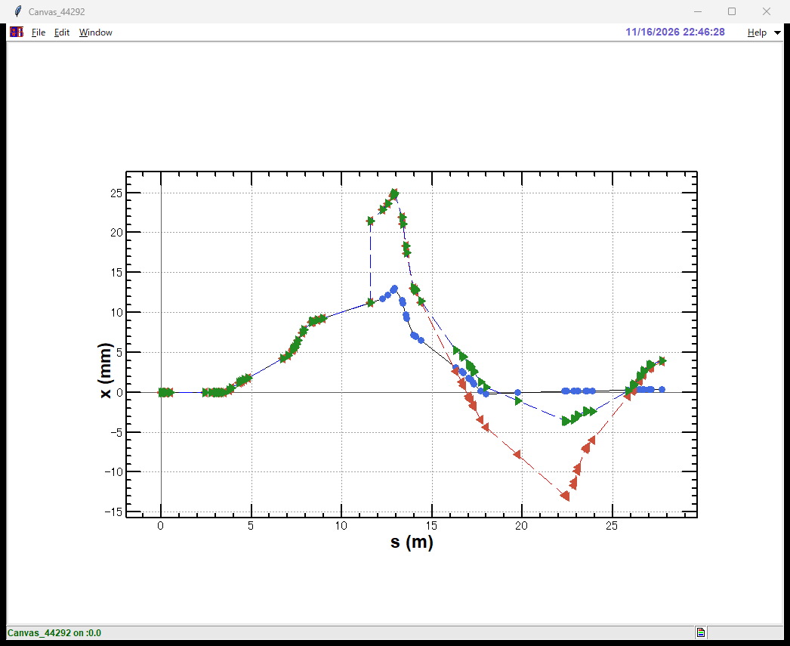

# calc_traj_03b_PF (pysad でも動く ListPlot の窓)
KEK の SAD チュートリアルの「グラフ表示」(`calc_traj_03`) を、pysad でも描ける `ListPlot` + `CanvasDrawer` に置き換えた版。加速器・ラティス・線は `calc_traj_01_PF` と同じ (PF 2.5 GeV、`lattice/v9_16_inj_noSF.sad`、`INJL`)。

## 何を見る例か
`calc_traj_03_PF` (教材の書き方) は pysad でも窓が描ける (そちらの `.md` 参照)。ここでは別に、軌道を `ListPlot[{line1,line2,line3}, PlotJoined->True]` で描く。`$DisplayFunction = CanvasDrawer` だけにして、窓は `CanvasDrawer` が自分で作る (自前の `KBMainFrame` + `Canvas` は作らない)。gs でも pysad でも描けて、Canvas の項目数が一致する。ラティスの絵 (`OpticsPlot` の `Lattice->True`) は付かない。

## スクリプト
```
ss = Table[Twiss["S",i],{i,1,Length[s1]}];                       (* 要素の s [m] *)
line1 = Thread[{ss,x1*1000}]; line2 = ...; line3 = ...;           (* {s, x[mm]} の列 *)
$DisplayFunction = CanvasDrawer;
p2 = ListPlot[{line1,line2,line3}, PlotJoined->True, FrameLabel->{"s (m)","x (mm)"}, PlotColor->{"black","red","blue"}];
TclEval["update"];   ... TclEval["return [llength [$cv find all]]"] で Canvas の項目数
k0k4 = k0k4 + 0.2;  SetKicker[]; CalcSBBump[]; CalcTrajectories[]; MakePlot[];   (* KK4 を弱くして描き直す *)
```
計算部分 (関数 `CalcSBBump`・`DispCSInv`・`GetKicker`・`SetKicker`・`CalcTrajectories`) は `calc_traj_02_PF` と同じ。

## 結果の読み方
`stored end x ...` (基準の計算)、`canvas items = 382` (描いた直後の Canvas の項目数)、`after Weaker` (KK4 を 0.2 mrad 弱くした値)、`canvas items = 384`。


(pysad が開いた窓を `example/tools/gui_shot.py` で切り取った。`Exit;` を外した台本を pysad で走らせて窓を撮る。Windows の Tk の見た目で、窓の題の `Canvas_数字` は実行ごとに変わる。蓄積ビームは青い丸と黒線、入射ビームは赤い左向き三角、δ=+1 % の入射ビームは緑の右向き三角に見える (データの値から判断した)。凡例は付かない。`PlotColor` の指定との対応は確かめていない。)

入射点 (s=11.57 m) で、入射ビームが蓄積ビームから 10.26 mm 離れて始まり、s=22.4 m で赤が -12 mm まで下がる様子が `calc_traj_01_PF_traj.png` と同じに見える。

## 物理・解析式
計算の値は `calc_traj_02_PF` と同じ。窓の項目数は式では出ない。

| 量 | gs | pysad |
|---|---|---|
| 終端の x [mm]、CS 不変量 [nm rad] (基準) | 0.518722、391.460 | 0.518722、391.460 |
| `canvas items` (描いた直後) | 382 | 382 |
| KK4 = -2.6 mrad のあと: 終端の x、CS 不変量 | 0.346732、74.531 | 0.346732、74.531 |
| `canvas items` (描き直し後) | 384 | 384 |

## gs と pysad の比較
**v2 モードと k64 モード**: `.pysad.txt` は既定の v2 モードの出力。v2 は K64 のバグを含まない計算なので (`docs/28_v2_vs_k64.md`。主に `Emittance[]`・EMIT・追跡の Jx の端の項 B75 と `MomentumCompaction` B77)、この例の出力のうち `Emittance[]` の表示 (εx が数 % 大きい、εz・減衰率・α・バケット高さなど) と、それに依る量が gs と違う。以下の「一致」の判定は k64 モードの結果。gs と同じ値が要るときは `PYSAD_COMPAT=k64` を付ける。

○ 一致 (値と Canvas の項目数が両方とも一致)。描き直しで項目が 2 つ増える (382 → 384) のも同じ。窓の見た目 (色・マーカー) は pysad のものしか撮れておらず、gs の見た目との比較はしていない。

## 未確認・限界
- gs の窓 (X11) は撮れていない。項目の数だけを比べた (線・マーカーの座標の一致は未確認)。
- 描き直しで `ListPlot` を 2 回呼ぶと、窓の Canvas が 1 つのまま上書きされるか、重ねて描かれるかは確かめていない (項目数が 382 → 384 と増えているのは、前の図を消さずに追加している可能性がある)。
- `OpticsPlot` のラティスの絵は、データ列と一緒に `calc_traj_03_PF` で描ける。この例ではラティスの絵を付けていない。
- ボタン・入力欄の窓は作っていない (`KBMainFrame` を作ると `CanvasDrawer` の窓と衝突する。gs でも 2 つ目の `KBMainFrame` は作れず、`CanvasDrawer` が自分で作る窓は `KBSubFrame` の名前の綴り (`DefauleCanvas$Frame`) の誤りで失敗した)。
