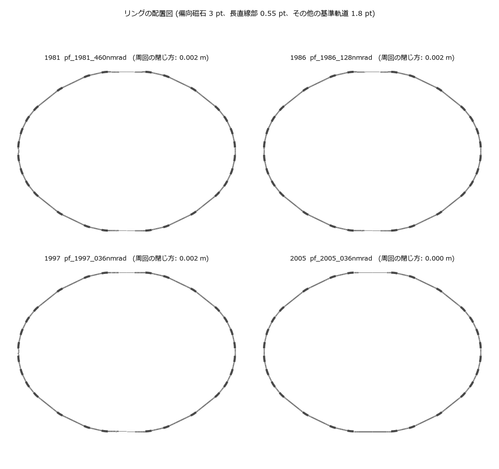
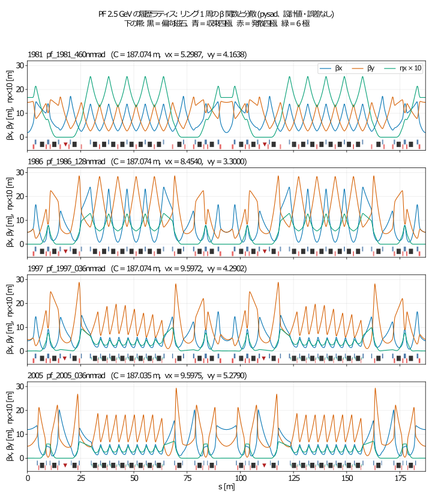
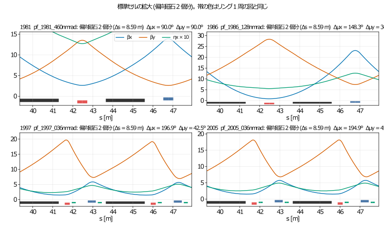

# PF リングの履歴ラティス (1981・1986・1997・2005)

PF リング (2.5 GeV) のラティスの歴史を、SAD の台本 4 本で追えるようにした。建設時のオプティクス (1981 年)、最初の高輝度化 (1986 年)、弧部改造・高輝度化 (1997 年)、直線部増強 (2005 年)。元は PF の履歴フォルダ のファイル。ラティスは設計値 (誤差なし) で、実機の運転値ではない。数値はすべて、このリポジトリの `cell calc emit` を `ON RAD FLUC COD RFSW RADCOD;` のもとで走らせた結果 (エネルギー 2.5 GeV、RF 電圧 850 kV × 2 台)。

| ファイル | 元のファイル名 |
|---|---|
| [`pf_1981_460nmrad.sad`](pf_1981_460nmrad.sad) | `pf_460nmrad` |
| [`pf_1986_128nmrad.sad`](pf_1986_128nmrad.sad) | `pf_128nmrad` (同じフォルダの `pf0` と同一内容) |
| [`pf_1997_036nmrad.sad`](pf_1997_036nmrad.sad) | `pf_036nmrad` |
| [`pf_2005_036nmrad.sad`](pf_2005_036nmrad.sad) | `pf_036nmrad_2005` |

## (a) 一覧 (計算値は pysad の k64 モード = gs と同じ。v2 モードの値は (c) の表)

| | 1981 | 1986 | 1997 | 2005 |
|---|---|---|---|---|
| 何のラティスか | 建設時のオプティクス | 最初の高輝度化 | 弧部改造・高輝度化 | 直線部増強 |
| 名前のエミッタンス [nm rad] | 460 | 128 | 36 | 36 |
| εx 計算値 k64 (gs) [nm rad] | 403.4 | 121.3 | 34.73 | 34.54 |
| εx 計算値 v2 [nm rad] | 460.2 | 128.3 | 35.66 | 35.45 |
| チューン (νx, νy) | 5.2987, 4.1638 | 8.4540, 3.3000 | 9.5972, 4.2902 | 9.5975, 5.2790 |
| 周長 [m] | 187.0741 | 187.0741 | 187.0741 | 187.0355 |
| 偏向磁石 | 28 台、各 0.22440 rad (L = 1.944076 m、2005 は 1.942696 m)、矩形 (E1 = E2 = 0.5)、曲率半径 8.664 m | 同左 | 同左 | L = 1.942696 m |
| 四極 (K1 ≠ 0、L > 0) | 116 | 116 | 74 | 78 |
| 6 極 (L > 0) | 0 (SF・SD は K2 = 0) | 0 (同左) | 32 | 64 (SFH・SDH を 2 個ずつ組にした 32 組) |
| 八極 | 8 (薄肉、K3 = −112.9 / −157.3) | 8 (同左) | 4 (K3 = 0) | 4 (K3 = 0) |
| 空洞 | 2 台、500 MHz | 2 台、500 MHz | 2 台、499.990 MHz | 2 台、499.990 MHz |
| 標準セルの位相進み | 偏向磁石 2 個で 90.0° / 90.0° | 偏向磁石 2 個で 148.3° / 34.1° | 偏向磁石 1 個で 98.7° (93.5〜99.2°) / 21〜27° | 偏向磁石 1 個で 97.4° / 22.5° |
| 直線部の空き長の合計 [m] | 39.2 | 41.9 | 41.6 | 59.3 |

標準セルの位相進みは、標準セルの領域で隣り合う偏向磁石の入口の間の Δμ。`FFS_cell_calc_emit_PF_*.sad` が出す表の値から計算した。

### ヘッダの記述との対応 (合わないものはそのまま書く。理由は調べていない: 要確認)

| ラティス | ヘッダ・名前の記述 | 計算値 | 判定 |
|---|---|---|---|
| 1981 | NUX = 8.454、NUY = 3.300 | 5.2987、4.1638 | 合わない (要確認)。この文面は 1986 のラティスのヘッダと同じ |
| 1981 | 名前の 460 nm rad | k64 403.4 / v2 460.2 | v2 は 0.04% で一致、k64 は −12.3% (要確認) |
| 1986 | NUX = 8.454、NUY = 3.300 | 8.45400、3.30000 | 一致 (小数 5 桁) |
| 1986 | 名前の 128 nm rad | k64 121.3 / v2 128.3 | v2 は +0.26%、k64 は −5.2% (要確認) |
| 1997 | 標準セルの位相進み 105° | 98.7° (93.5〜99.2°) | 合わない (要確認) |
| 1997 | 名前の 36 nm rad | k64 34.73 / v2 35.66 | k64 −3.5%、v2 −0.9% |
| 2005 | 標準セルの位相進み 115° | 97.4° | 合わない (要確認) |
| 2005 | 名前の 36 nm rad | k64 34.54 / v2 35.45 | k64 −4.1%、v2 −1.5% |
| 1981 | `matched optics, 90deg, 90deg cell` (台本のコメント) | 偏向磁石 2 個で 90.0° / 90.0° | 一致 |

名前の値が v2 モードの値に近い、という数値の事実だけを記す。K64 と v2 の違いは Jx (減衰分配) の端の項 (docs/28、docs/30 B75) で、元の履歴フォルダの計算がどちらに近い式だったかは分からない (要確認)。

## (b) 各ラティスの説明

共通の構造: 対称なリングで、半周 (偏向磁石 14 台) が 2 回。1 周に長直線部 2 個 (空き長 5.0 m。2005 は 8.93 m) と中直線部 8 個、弧部 (標準セルが並ぶ部分) 2 個。半周は、長直線部 → 偏向磁石 3 台 (B02・B03・B04。途中に空洞の直線部) → 直線部 → 標準セルの弧 (偏向磁石 8 台) → 直線部 → 偏向磁石 3 台 → 直線部、の並び。配置図は [`PF_history_layout.png`](PF_history_layout.png)。



### 1981 年 `pf_1981_460nmrad` (元は `pf_460nmrad`)
- ヘッダ: 「PF-RING MEDIUM-E LOW-B HIGH NUY OPTICS VERSION、HALF LATTICE」。周回のライン `RING = (IMARK III 2*HALF RMARK)`、`HALF = (HMARK -RQUAD LQUAD)`。`RQUAD` は鏡面対称点 `MMARK` から直線部へ向かう側、`LQUAD` も同じ向きの側。「半周の定義」を `2*HALF` でリング全体にしているので、`USE RING;` だけでよい (台本の中身は変更なし)。
- 標準セル `NCELL = (QFR QDRC QFRC MMARK QFLC QDLC QFL)`: 偏向磁石 6 台 (B06〜B11)。偏向磁石 2 個ごとに、βx が 4.1 m と 9.5 m、βy が 9.5 m と 4.2 m を交互に取り、2 個分で 90° / 90° (台本のコメント「90deg, 90deg cell」と一致)。分散は 1.5〜2.1 m と大きい。
- 直線部: 長直線部の中心 (`IMARK`) で βx = 1.90 m、βy = 14.58 m、ηx = 1.66 m (分散あり)。空洞の直線部 (3.55 m) の中心は ηx ≈ 0。四極は QxH 系 (Q1H〜Q10H、QDH、QFH) の 12 種類。
- 6 極 (SF・SD): 定義はあるが L = 0、K2 = 0 で効かない。このため自然クロマティシティ (ξx, ξy) = (−6.08, −5.19) のまま。八極 OCT1〜OCT4 は薄肉で K3 が入っている。
- 四極の定義が 2 回 (最初の定義と `!matched optics, 90deg, 90deg cell;` の定義)。あとのものが有効。最初の定義だけにすると εx は 420.6 nm rad (k64)、これも 460 ではない (要確認)。

### 1986 年 `pf_1986_128nmrad` (元は `pf_128nmrad`)
- ヘッダは 1981 と同じ文面で、NUX = 8.454、NUY = 3.300 が計算値と一致する。四極は QFH・QDH・Q10H・Q9H・QAH・Q8H・Q6H・Q5H・Q3H・Q4H・Q2H・Q1H。1981 に対し、四極の数が同じ (116) で K1 が違う。
- 弧は、偏向磁石 2 個ごとに βx が 2.75 m と 13.4 m を交互 (βy は 22.0 m と 11.7 m)、分散 0.62 m と 0.96 m。2 個分で 148.3° / 34.1°。直線部は分散ゼロ (長直線部の中心 βx = βy = 5.0 m、ηx = 0)。
- 1981 に対して、弧部の分散が小さくなり (偏向磁石内の ⟨H⟩ が 0.436 m → 0.122 m)、直線部の分散がゼロになった。

### 1997 年 `pf_1997_036nmrad` (元は `pf_036nmrad`)
- ヘッダ: 「Super-Low Emittance Lattice Configuration、Normal Cell Phase Advance 105 deg Version、2000-02-22、Version 3.6.1」。台本に機械研究の値の履歴 (2000-05-29 のチューン nx = 10.4504 / ny = 4.3472 (実測)、2002-11-25 の 10.420 / 4.360 (実測)、`105 deg Present Optics`) が四極・6 極の再定義として残る。最後の `105 deg Present Optics` が有効 (計算チューンは 9.5972 / 4.2902 で、これらのコメントのチューン (10.4 / 4.3) とは整数部が違う。コメントのチューンが何を指すかは要確認)。
- 周回のライン `RING = (RMARK HALFE HALFW EMARK)`。`HALFW = (STRNW NCELW STRSW)`、`HALFE = (STRSE NCELE STRNE)`。`NCELW`・`NCELE` が標準セルの弧 (偏向磁石 B05〜B12、B19〜B26)。
- 標準セル: 偏向磁石 1 台と、その後の QD、その先の QF (QFF・QFD が交互に) と 6 極 (SD、SFF・SFD)。βx ≈ 4.0 m、βy 7〜9 m、ηx ≈ 0.36〜0.40 m。位相進みは 98.7° / 21〜27° (ヘッダの 105° とは合わない: 要確認)。
- 直線部: 長直線部 `U2`・`M16` は βx = 4.37 m、βy = 4.91 m、ηx = 0.012 m。`M26`・`M13` の直線部 (3.55 m) は βy = 1.08 m の小さな値で ηx = 0.84 m。`U5`・`U19` は ηx = 0.80 m。空洞の直線部 4.23 m は ηx ≈ 0.05。
- 6 極 `SFF`・`SFD`・`SD` (L = 0.2 m)、K2 (積分値の定義) = 7.54 / −7.56 / 7.54。設計の6 極でクロマティシティは (+0.20, +1.39)、6 極を 0 にした自然値は (−12.52, −12.83)。

### 2005 年 `pf_2005_036nmrad` (元は `pf_036nmrad_2005`)
- ヘッダ: 「Normal Cell Phase Advance 115 deg Version、Straight Section reinforcement、First edition with PMs & STRs」。既存の `v9_16_asym.sad` はヘッダが「Second edition」で、周長・チューンは全桁同じ (εx も相対差 4e-7)。6 極の K2 が少し違う (本ファイル SFH 3.9242 / SDH −3.9053、v9_16_asym は 3.9606 / −3.9172)。
- 整理した点: 元は `STRNE` が `INJ` を使うのに定義がなく、gs が警告を出していたので、MARK に `INJ` を足した。光学は変わらない。台本中の `NCELL` は未定義の `NW`・`SW` を含み、使えない (使わないので元のまま)。
- 標準セル: 偏向磁石 1 台ごとの位相進みが 97.4° / 22.5° で、弧の B07〜B12 の間隔で ±0.05° 揃っている (1997 は 93.5〜99.2°)。βx ≈ 4.0 m、βy ≈ 8.6 m、ηx = 0.385 m。ヘッダの 115° とは合わない (要確認)。
- 直線部 (空き長): 長直線部 8.93 m (中心 βx = 11.98 m、βy = 5.00 m、ηx ≈ 0)、空洞の直線部 5.41 m (βx = 10.0、βy = 4.98)、`U05`・`U19` の 5.29 m (ηx = 0.59 m)、`INJ`・`U13` の 4.625 m (βy = 1.16 m、ηx = 0.63 m。入射点 `INJ` はここ)、`U14`・`U28` の 5.41 m (ηx ≈ 0)。PM と STR (ステアリング) が入る。
- 6 極 `SFH`・`SDH` は 2 ファミリー (L = 0.1 m を 2 個ずつ)。設計の6 極でクロマティシティは (−0.18, +0.15)、自然値は (−13.30, −17.25)。

## (c) 時代ごとの違い (数値は pysad)

放射積分 (偏向磁石の中で積分。`calc_RadInt_PF` と同じ式) と、k64・v2 の emit の値:

| | 1981 | 1986 | 1997 | 2005 |
|---|---|---|---|---|
| I2 [1/m] | 0.7252 | 0.7252 | 0.7252 | 0.7258 |
| I4 [1/m] | −0.1053 | −0.0450 | −0.0228 | −0.0225 |
| I5 [1/m] | 3.653e-2 | 1.018e-2 | 2.824e-3 | 2.811e-3 |
| 偏向磁石内の ⟨H⟩ [m] | 0.436 | 0.122 | 0.0337 | 0.0335 |
| εx k64 [m rad] | 4.034e-7 | 1.213e-7 | 3.473e-8 | 3.454e-8 |
| εx v2 [m rad] | 4.602e-7 | 1.283e-7 | 3.566e-8 | 3.545e-8 |
| σE k64 / v2 | 7.56e-4 / 7.29e-4 | 7.40e-4 / 7.29e-4 | 7.33e-4 / 7.28e-4 | 7.34e-4 / 7.29e-4 |
| α (運動量コンパクション率) k64 / v2 | 0.03984 / 0.03966 | 0.01562 / 0.01559 | 0.00671 / 0.00670 | 0.00656 / 0.00656 |
| U0 [MV] | 0.3989 | 0.3989 | 0.3989 | 0.3991 |
| ダンピング時間 x/y/z k64 [ms] | 6.83 / 7.83 / 4.22 | 7.36 / 7.83 / 4.04 | 7.58 / 7.83 / 3.97 | 7.58 / 7.82 / 3.97 |
| ダンピング時間 x/y/z v2 [ms] | 7.79 / 7.82 / 3.92 | 7.79 / 7.82 / 3.92 | 7.79 / 7.82 / 3.92 | 7.78 / 7.82 / 3.92 |
| Jx / Jy / Jz k64 | 1.146 / 1.000 / 1.854 | 1.063 / 1.000 / 1.937 | 1.032 / 1.000 / 1.969 | 1.031 / 1.000 / 1.969 |
| Jx / Jy / Jz v2 | 1.005 / 1.000 / 1.995 | 1.005 / 1.000 / 1.995 | 1.005 / 1.000 / 1.995 | 1.005 / 1.000 / 1.995 |
| 有効ハーモニック数 h | 312.006 | 312.006 | 312.000 | 311.936 |
| シンクロトロン周波数 [Hz] | 57949 | 36286 | 23782 | 23522 |
| 自然クロマティシティ (ξx, ξy) | (−6.08, −5.19) | (−13.94, −9.21) | (−12.52, −12.83) | (−13.30, −17.25) |
| 設計の6 極でのクロマティシティ | 6 極なし | 6 極なし | (+0.20, +1.39) | (−0.18, +0.15) |

クロマティシティは運動量 ±0.1% のチューンの差分 (`FFS_cell_calc_emit_PF_*.sad` の `ChromFD[]`)。

数値で確かめられること:
- **εx は 460 → 128 → 36 nm rad と小さくなる。** 放射積分 I5 (偏向磁石内の分散関数 ⟨H⟩ に比例) が 3.65e-2 → 1.02e-2 → 2.8e-3 と下がり、I2 は偏向磁石の同じ数・角度なので変わらない。⟨H⟩ は 0.436 → 0.122 → 0.034 m。εx ≈ Cq γ² I5 / (Jx I2) の式が、v2 の Jx で 0.3% 以内で合う (1997: 3.555e-8 対 3.566e-8)。
- **1981 → 1986**: 分散と β の関数の形が変わった。弧では、偏向磁石 2 個ごとに 90° / 90° (1981) から 148° / 34° (1986) になり、分散が偏向磁石の中で小さくなった (η = 1.5〜2.1 m → 0.6〜1.0 m。偏向磁石の数・角度・位置は同じで、四極の強さと配置が違う)。長直線部の分散が 1.66 m から 0 に。
- **1986 → 1997**: 弧の標準セルが「偏向磁石 2 個で 148° / 34° の交互」から「偏向磁石 1 個で 約 99° / 約 22° の繰り返し」に変わり、分散が 0.4 m 前後で一様になった。四極は 116 個から 74 個に減り、四極が強くなった (|K1| の最大が 1981 で 0.30、1986 で 0.68 [1/m²]、1997 で約 1.9 [1/m²]。長さは 0.25〜1.0 m)、6 極が入り (L = 0 → 0.2 m)、色収差が補正された。⟨H⟩ は 0.122 → 0.034 m。
- **1997 → 2005**: εx はほぼ変わらない (34.73 → 34.54 nm rad、⟨H⟩ 0.0337 → 0.0335 m)。変わったのは直線部: 空き長の合計が 41.6 m から 59.3 m (+17.7 m)。長直線部が 5.0 m から 8.93 m、中直線部が 3.55〜4.23 m から 4.6〜5.4 m。標準セルは位相進みが 98.7° (ばらつきあり) から 97.4° (±0.05°) に揃い、βy の最小の直線部 (βy = 1.08 → 1.16 m) と分散のある直線部 (ηx = 0.84 → 0.63 m、0.80 → 0.59 m) の値が少し変わった。チューンは νy が 4.29 から 5.28 に変わった (νx は 9.597 のまま)。四極は 74 → 78 個。
- 推測 (数値では確かめていない): 1981 → 1986 は「同じ偏向磁石で、四極の配置を変えて分散を下げた」改造と読める。1997 の弧部改造は、偏向磁石 1 台ごとの短いセルにして ⟨H⟩ を一桁下げたものと読める。





## (d) 図

- [`PF_history_optics.svg`](PF_history_optics.svg): 4 つのラティスのリング 1 周の βx、βy、ηx (×10) と磁石の並び。
- [`PF_history_cell.svg`](PF_history_cell.svg): 標準セル (偏向磁石 2 個分、8.59 m) の拡大。
- [`PF_history_layout.png`](PF_history_layout.png): 配置図 (偏向磁石 3 pt、長直線部 0.55 pt、その他の基準軌道 1.8 pt)。
- 作り方: `tools/pf_history/make_figs.py` (pysad の k64 モードの Twiss から)。

## (e) 歴史の背景

ユーザーから聞いた事実: 建設時のオプティクス 1981 年、最初の高輝度化 1986 年、弧部改造・高輝度化 1997 年、直線部増強 2005 年。ラティスのヘッダが述べる内容は各ラティスの説明に書いた。

公開された資料から (検索結果の要約から。本文は精読していない。出典の文章は写していない):
- PF リングは 1982 年から放射光専用光源として運転されている (建設に約 4 年)。出典: <https://epaper.kek.jp/e98/PAPERS/MOP02D.PDF>
- 最初の低エミッタンス化は 1986〜87 年で、エミッタンスは約 460 から約 130 nm rad に下がった (低エミッタンス運転の立ち上げ成功が 1987 年 2 月とする報告と、1986 年の改造とする報告がある)。出典: <https://ibic12.kek.jp/mirror/www.pasj.jp/web_publish/sast2003/FR-05.pdf>
- 1997 年の改造は、130 nm rad から約 27 nm rad (設計。のちの報告では約 29 nm rad に到達) を目指した弧部のラティス変更で、約 9 か月の停止を伴った。出典: <https://epaper.kek.jp/e98/PAPERS/MOP02D.PDF>、<https://journals.iucr.org/s/issues/1998/03/00/km3262/km3262.pdf>
- 2005 年の直線部増強は、公開資料では完成の年を確認できなかった (2003 年の報告は、短直線部の新設と既存の直線部の延長を計画として述べている)。この文書では年をユーザーの説明に従った。出典: 上記の sast2003 FR-05。

これらの出典の数値 (27〜29 nm rad) と、ここの計算値 (35〜36 nm rad、設計の名前の 36) は違う。異なる運転条件 (結合、ID の有無など) のためか、別の版のラティスかは要確認。

## (f) 使い方

`FFS;` の前にラティスを置き、後ろに計算を続ける (gs は要素・ラインの定義を `FFS;` の前に置く必要がある)。ライン名は `RING`。

```
(* ラティス pf_1997_036nmrad.sad を先頭に貼ったあと *)
ON LOG;
ON RAD FLUC COD RFSW RADCOD;
FFS;
USE RING;  cell calc emit;
Print["tune ", Twiss["NX","$$$"]/2/Pi, " ", Twiss["NY","$$$"]/2/Pi, "  EMITX ", EMITX];
Exit;
```

- 例: [`optics/FFS_cell_calc_emit_PF_1981_460nmrad`](../optics/FFS_cell_calc_emit_PF_1981_460nmrad.md)、`..._1986_128nmrad`、`..._1997_036nmrad`、`..._2005_036nmrad` (すべて同じ台本で、ラティスだけ違う)。
- gs: `gs file.sad < /dev/null`。pysad: `PYSAD_COMPAT=k64 py -3.12 -c "from pysad.ffscmd import run_sad_string; run_sad_string(open('file.sad',encoding='utf-8').read())"` (k64 が gs と同じ。省略すると v2)。
- 作り方: `tools/pf_history/mk_lattices.py <履歴フォルダ>` (ラティス)、`build_examples.py` (例)、`ana_pf_history.py` (表)、`cmp_gs_pysad.py` (gs と pysad の比較)。
- 試験: `pysad/tests/script_tests/test_pf_history_lattices.py`。

### 元の履歴フォルダの `matching`・`disp` (台本の用途。ここには置いていない)
- `matching`: `USE RING; cell calc; calc; emit;` のあと、`MKA.1`〜`MKA.3` で `AX`・`AY`・`EPX` を 0、`DMARK` で `EX`・`EPX` を 0 にするフィット (`free Q1*,...,Q9*;` `go;`)。`MKA` と `DMARK` の両方があるのは `pf_460nmrad` (1981) だけなので、1981 のオプティクス (標準セルを 90° / 90° にそろえる、`matched optics` のコメントの四極を出した計算) のためのものと読める。確認はしていない。補助の `modules_general.n`・`modules_matching.n` (`Get[]`) と、`datas.txt` への書き込みを使う。
- `disp`: `USE TEST;` (標準セルの一部だけのライン。`pf_460nmrad` と `pf_036nmrad_2005` にある) で `cell calc emit; disp $$$;`、`WriteGraphs[]`、`TkWait[]` (図を出す)。どちらのラティスに使ったかは要確認。
- `modules_*.n`・`datas.txt` は今回は置かない (ラティスの定義ではないため)。

## (g) 未確認・限界
- 元の履歴フォルダのラティスは設計値で、誤差なし。実機の運転 (エネルギー・結合・ID・実測のオプティクス) との対応は確かめていない。
- ヘッダ・名前と計算値の食い違い (上の表の「要確認」): 1981 の NUX/NUY、各ラティスの名前のエミッタンス (k64 とは 4〜12% 違い、v2 には近い)、1997・2005 の標準セルの位相進み (105°・115° に対し 98.7°・97.4°)。理由は調べていない。
- 1981 の台本は二重の反転 `-RQUAD` (中に `-RQUADM`) を含む。pysad は `pysad/parser.py` で、反転の文脈の中の `-LINE` を正順に戻して展開する (これで k64 で gs と一致する。gs は元から正しい)。K64 側の誤りではなく pysad 側の展開の問題だった。
- pysad で、ユーザー定義の関数名 `At[]` は呼んでも何も起こらず (gs では動く)。この例では `ShowAt[]` と名づけた。原因は調べていない。
- 2005 のラティスは元のまま (`INJ` の MARK を足したのを除く)。`v9_16_asym.sad` との違い (6 極の強さ、ヘッダ) の網羅は確認していない。
- 履歴の背景は公開資料の検索結果の要約によるもので、本文は精読していない。2005 年の年は確認できなかった。
- 計算は `cell calc emit` の設計軌道のみ (誤差・結合・COD なし)。ダイナミックアパーチャーなどの追跡は行っていない。
