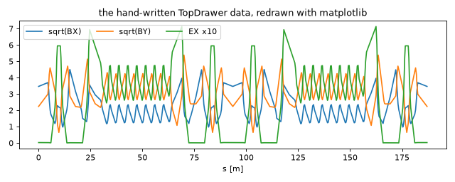

# FFS draw (PF): topdrawer 形式の出力
種別: FFS コマンド `draw` (サンプル集「topdrawer 形式の図の作り方」と、KEK の SAD チュートリアルの話題をもとにした)。加速器: PF 2.5 GeV リング (`lattice/v9_16_asym.sad`、周長 187.035 m、チューン 9.5975 / 5.2790)。フラグ: `ON RAD FLUC COD RFSW RADCOD`。

## 何を見る例か
チュートリアルでは、`FFS["draw bx & by & ex b*",12]` と書くと装置番号 12 (= `fort.12`) に topdrawer 形式の図 (β、分散、ラティスの絵) が書き出され、`td -b -d postscr fort.12` で PostScript にする、とある。
この環境の SAD (K64 版、WSL) では `draw` が topdrawer の出力として動かないので (次の節)、**topdrawer 形式のファイルを台本から手書きで作る**例にした (`Print` の代わりに `Write[12, ...]` で `fort.12` に書ける)。

## スクリプト
```
Print["NEWFRAME;SET CARD 80;SET FONT DUPLEX"];  Print["SET LIMIT X 0 ", smax];  Print["TITLE 7.3 9.3 CENTER SIZE 2.5 '...'"];
Do[ Print[Twiss["S",i], " ", Sqrt[Twiss["BX",i]]], {i,1,ne}];   Print["JOIN 1 TEXT 'sqrt(BX)'"];  Print["NEW PLOT"]; ... (BY、EX も同様)
```
topdrawer の `NEWFRAME`、`SET LIMIT`、`TITLE`、`JOIN 1 TEXT` は topdrawer のコマンド (データ行の `x y` を並べて `JOIN` で折れ線にする)。

## 結果の読み方
- 画面に `TDBEGIN`〜`TDEND` の間に 2277 行が出る。それを取り出したものが `FFS_draw_topdrawer_PF_fort12.td` (`tools/make_figs.py` が `.gs.txt` から作る)。
- 
  (上の `.td` の内容を matplotlib で描き直した図。`td` は入っていないので `.td` の描画は試していない。)

## gs と pysad の比較
**v2 モードと k64 モード**: `.pysad.txt` は既定の v2 モードの出力。v2 は K64 のバグを含まない計算なので (`docs/28_v2_vs_k64.md`。主に `Emittance[]`・EMIT・追跡の Jx の端の項 B75 と `MomentumCompaction` B77)、この例の出力のうち `Emittance[]` の表示 (εx が数 % 大きい、εz・減衰率・α・バケット高さなど) と、それに依る量が gs と違う。以下の「一致」の判定は k64 モードの結果。gs と同じ値が要るときは `PYSAD_COMPAT=k64` を付ける。

- 手書きの出力 (`Print`): ○ 全桁一致。
- チュートリアルの書き方の `draw` コマンド:
  - gs: `draw bx & by & ex b*;` は表示のない環境では何も出さずに通る。`$DisplayFunction = TopDrawer;` を付けると戻らなくなる (25 秒待って止まったまま)。`FFS["draw bx",12];` は `FFSCanvasDraw` の内部エラーで落ちた。この K64 版の `draw` は Tk のキャンバス (`FFSCanvasDraw`) に描く実装に置き換わっていて、topdrawer への出力は `OpticsPlot` などの `TopDrawer` 関数 (`Packages/TopDrawer.n`、`fort.9` に書く) が受け持つと見ている。
  - pysad: `draw` を未対応として無視し (メッセージ `FFS command DRAW は未対応`)、何も出さない。
  - 試した小さい台本は `pf/optics/FFS_draw_OpticsPlot_PF.sad` に `draw bx & by & ex b*;` の 1 行として残してある (走る)。

## 未確認・限界
- 実際の `td`/`tdr` コマンドで描いた図は作っていない (入っていない)。topdrawer の命令 (`SET LIMIT`、`JOIN` など) の意味は SADHelp の `TopDrawer` の節と `Packages/TopDrawer.n` の書き方に合わせたが、`td` で描画できるかは確認していない。
- 図の BX・BY は 756 要素の値の折れ線 (要素の中は直線補間)。
