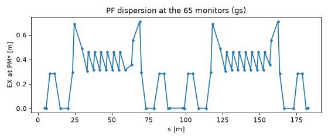

# calc_dispersion (PF): 分散関数
種別: スクリプト (サンプル集 calc_dispersion.sad)。加速器: PF 2.5 GeV リング (`lattice/v9_16_asym.sad`、周長 187.035 m、チューン 9.5975 / 5.2790)。フラグ: `ON RAD FLUC COD RFSW RADCOD`。

## 何を見る例か
モニター `PM*` の位置の分散 `Twiss["EX","PM*"]` と s を印字する。さらに、(1) 分散の定義 $\eta = dx_{\rm co}/d\delta$ を、`DP0 = ±1e-4` の閉軌道の差分で確かめる、(2) 運動量コンパクション率 $\alpha_c = \frac1C\oint\frac{\eta}{\rho}ds$ を偏向磁石の和で確かめる。

## スクリプト
```
pmex = Twiss["EX","PM*"];  pml = Twiss["S","PM*"];  Do[Print[i, " ", pml[i], " ", pmex[i]], {i,1,Length[pml]}];
FFS["OFF RFSW"];  DP0 = 1E-4; FFS["cell calc"]; dxp = Twiss["DX","PM*"];  DP0 = -1E-4; ... dxm = ...;   ! (dxp-dxm)/2e-4 と EX を比べる
Σ ANGLE * (EX(入口) + 4 EX(中央) + EX(出口))/6 / C                                                       ! α_c
```
RF を切る (`OFF RFSW`) のは、RF があると運動量を変えても平衡エネルギーに戻ってしまうため。

## 結果の読み方

- 65 台のモニターの分散は、標準セル部で 0.28〜0.71 m、ID 直線部の近くで 0.001〜0.002 m まで下がる。
- 照合は次の表。

| 量 | 値 |
|---|---|
| max abs((DX(+δ)-DX(-δ))/2δ - EX) (65 台、δ=1e-4) | 2.1e-6 m |
| α_c = (1/C) Σ θ <η> (偏向磁石 28 台、Simpson) | 0.0065622 |
| α (emit の表) | 0.0065627 |

## 物理・解析式
$\eta_x = dx/d\delta$ と $\alpha_c = \frac1C\oint\frac{\eta_x}{\rho}ds = \frac1C\sum_{\rm bends}\theta\langle\eta\rangle$。どちらも数値と合う (差は 1e-5 の差分誤差と Simpson の誤差)。

## gs と pysad の比較
○ 全桁一致 (差分の max は 2.10852e-6 と 2.10848e-6 で、1e-10 の丸め)。pysad の emit の表は α を `.00656` と 3 桁で表示する (値は同じ)。

## 未確認・限界
- 垂直分散 (EY) は設計ラティスでは 0 なので見ていない。
- 周長に対する α の符号・定義 (`dl/L`) の違いは見ていない。
