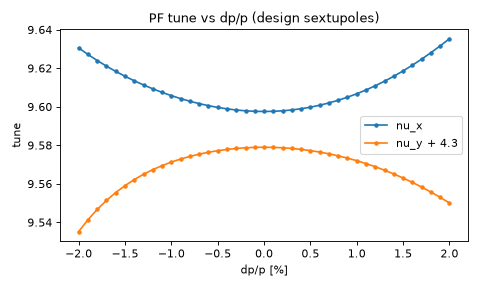

# fn PolynomialFit (PF): チューンの運動量依存を多項式で当てはめる
種別: 関数 + 特殊変数 `DP0` (サンプル集 calc_chromaticity と、KEK の SAD チュートリアルの話題をもとにした)。加速器: PF 2.5 GeV リング (`lattice/v9_16_asym.sad`、周長 187.035 m、チューン 9.5975 / 5.2790)。

## 何を見る例か
`DP0` (設計運動量からのずれ) を -2%〜+2% に 0.1% 刻みで 41 点動かし、チューンを `Table[]` のリストに入れて `PolynomialFit[リスト, 次数]` で当てはめる。
`PolynomialFit` は `{{c0, c1, c2, c3}, {Residual -> r}}` を返す ($\nu = c_0 + c_1\delta + c_2\delta^2 + c_3\delta^3$)。

## スクリプト
```
tunex = Table[{0,0},{41}];
Do[ DP0 = (i-21)*0.001;  FFS["cell calc"];  tunex[i] = {DP0, Twiss["NX","$$$"]/2/Pi}; ...,{i,1,41,1}];
DP0 = 0;   Print[PolynomialFit[tunex,3]];
```
`Do[]` の中でコマンドを使うときは `FFS["cell calc"]` と包む。`DP0 = 0;` に戻し忘れると以後の計算が狂う。

## 結果の読み方

- チューンは δ=0 の近くで極値 (六極補正済みなので ξ≈0)、δ が大きいと高次の依存が見える。
- **対称な範囲 (平均 0) の当てはめでは、最高次以外の係数が壊れる** (SAD の `Packages/Fit.n` の癖。pysad の `docs/04_sadscript.md` にも同じ記述。gs も pysad も同じ値を出す)。
  下の表のように、-2%〜+2% の 3 次当てはめは c3 (νx 257.84、νy 1049.07) だけが numpy と一致し、c0〜c2 は別の値 (c0 = 355.6 は明らかに誤り) になる。平均が 0 でない範囲 (-2%〜+1%、31 点) では全係数が numpy と一致する。

| 当てはめ | 範囲 | c0 | c1 | c2 | c3 |
|---|---|---|---|---|---|
| gs (SAD) νx | -2%〜+2% | 355.600 | 949.82 | 861.66 | 257.84 |
| numpy 3 次 νx | -2%〜+2% | 9.59747 | 0.02658 | 88.136 | 257.84 |
| gs (SAD) νx | -2%〜+1% | 9.597557 | 0.03070 | 85.837 | 129.21 |
| numpy 3 次 νx | -2%〜+1% | 9.597557 | 0.03070 | 85.837 | 129.21 |
| gs (SAD) νy | -2%〜+2% | 966.39 | 2971.4 | 3059.3 | 1049.07 |
| numpy 3 次 νy | -2%〜+2% | 5.27981 | -0.08026 | -87.883 | 1049.07 |
| gs (SAD) νy | -2%〜+1% | 5.278889 | -0.16262 | -67.425 | 2328.9 |
| numpy 3 次 νy | -2%〜+1% | 5.278889 | -0.16262 | -67.425 | 2328.9 |

線形の色収差 ξ は c1 だが、この 3 次の c1 は広い範囲での当てはめで、±1e-4 の差分 (`FFS_FIT_chrom_PF`) の ξ ≈ -4e-4 / -1e-3 とは一致しない (3 次式が広い範囲を平均するため)。この PF は六極で ξ ≈ 0 に補正済み。自然色収差は `pf/optics/calc_chromaticity_PF`。

## 物理・解析式
$\xi = d\nu/d\delta$ ($\delta = \Delta p/p$) は c1。次数が高いほど広い範囲を追えるが、範囲の端で振動する。表の「numpy」は、gs が出した点を `numpy.polyfit` で当てはめた検算。

## gs と pysad の比較
○ 41 点のチューンは全桁一致、係数は 10 桁一致 (壊れる癖も同じ)。

## 未確認・限界
- 癖の原因は `Fit.n` の平均 `xa=0` の分岐 (pysad の説明)。ソースの確認はしていない。チュートリアルの NSLS の例 (c1 = -22) には、この癖は現れていない。
- 次数を上げたときの当てはめの残差は `Residual` の値だけを見た。
