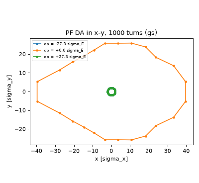

# fn DynamicApertureSurvey (PF): da_xy (X-Y 面のダイナミックアパーチャ)
種別: 関数 (サンプル集 da_xy.sad)。加速器: PF 2.5 GeV リング (`lattice/v9_16_asym.sad`、周長 187.035 m、チューン 9.5975 / 5.2790)。追跡: `OFF RAD FLUC; ON COD RFSW RADCOD`。**24 方向 × 1000 周**、運動量 -2%・0・+2% の 3 点 (サンプル集は 161 方向、5000 周、運動量 ±3%)。

## 何を見る例か
X-Y 平面の原点から、角度 θ の方向に r = 1〜100σ の直線上を `DynamicApertureSurvey` で調べ、θ を 0〜360° で変えて、ダイナミックアパーチャの境界を (x, y) で描く。

## スクリプト
```
nstep = 24;  rmin = 1;  rmax = 100;  zrange = {-dp*2, 0, dp*2};
Do[ ang = (2*Pi)*((i+0.5)/nstep);  xmax = rmax*Cos[ang]; ymax = rmax*Sin[ang]; xmin = rmin*Cos[ang]; ymin = rmin*Sin[ang];
    res = DynamicApertureSurvey[{{xmin,xmax},{ymin,ymax},zrange}, nturn, Output->6];
    score[j] = Append[score[j], {(s-1)/50*xmax, (s-1)/50*ymax}] ... ,{i,0,nstep-1}];
```
- 角度に半ステップ (7.5°) のずらしを入れ、x 軸・y 軸の上の直線 (y=0 や x=0 で運動が平面に閉じる) を避けた。サンプル集は `rmin = 0` で原点を含む (SAD の版により原点を含む計算が止まらなくなる、とサンプル集に注意がある。最初に `rmin = 0`・15° 刻み (x 軸・y 軸上の方向を含む) で試したときは、出力の先頭の運動量の行の境界がすべて 2σ になった。原因の切り分けはしておらず、`rmin = 1` と半ステップのずらしに変えたら普通に出た)。
- サンプル集の「途中で止まると出力が整わない」ので、最後の `Print` で一括して出す形は同じ。

## 結果の読み方

- 運動量 0 (`.pysad.txt`、v2 の出力): 境界は水平側で 39.7σx (7.5° と 352.5° の方向)、垂直側は 82.5° の方向で (4.7σx, 35.7σy)、97.5° の方向で (−3.4σx, 25.8σy)。原点からの距離で 24〜40σ。半径は 2σ 刻みで決まるので、隣り合う方向で数σ 飛ぶことがある (82.5° の 36σ と 97.5° の 26σ、172.5° の 36σ と 157.5° の 30σ など)。左右・上下の対称な方向でも境界が一致しない。
- 運動量 ±2% (±27.3σE) は RF バケット (半高さ 1.18%) の外で、全方向で半径 2σ (最小の格子点 = 全滅)。

## 物理・解析式
式の照合はなし。

## 検証
**v2 モードと k64 モード**: `.pysad.txt` は既定の v2 モードの出力。v2 は K64 のバグを含まない計算なので (`docs/28_v2_vs_k64.md`。主に `Emittance[]`・EMIT・追跡の Jx の端の項 B75 と `MomentumCompaction` B77)、この例の出力のうち `Emittance[]` の表示 (εx が数 % 大きい、εz・減衰率・α・バケット高さなど) と、それに依る量が gs と違う。gs と同じ値が要るときは `PYSAD_COMPAT=k64` を付ける。

検証: 運動量 ±2% の境界 (全滅、半径 2σ) は gs と全方向で一致。運動量 0 の境界は 24 方向のうち 13 方向で gs と一致し、11 方向 (22.5°・52.5°・67.5°・82.5°・172.5°・187.5°・262.5°・277.5°・292.5°・307.5°・337.5°) で半径が 2σ の 1〜数刻み異なる (例: 82.5° で pysad (4.7, 35.7)、gs (3.4, 25.8))。k64 モード (`PYSAD_COMPAT=k64`) での再実行は未確認。

## 未確認・限界
- 24 方向・1000 周に短縮 (gs と pysad を合わせて約 47 秒)。境界の細かい構造 (共鳴のくぼみ) は 15° 刻みでは見えない。
- 放射・量子励起は切ってある。
