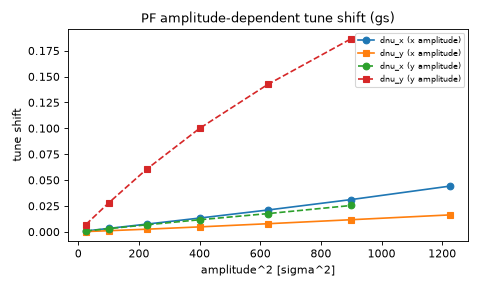

# amp_dep_ts (PF): 振幅依存チューンシフト
種別: スクリプト (サンプル集 amp_dep_ts.sad、アイディアは PF の担当者)。加速器: PF 2.5 GeV リング (`lattice/v9_16_asym.sad`、周長 187.035 m、チューン 9.5975 / 5.2790)。フラグ: `OFF RAD FLUC; ON COD RFSW RADCOD`。

## 何を見る例か
振幅 A σ のクーラン・シュナイダー不変量をもつ点を、x-x' 平面の楕円上に等間隔で置き (サンプル集は 36 点、ここでは **12 点**)、各点を初期条件にして `ins calc` でチューンを求めて平均する。水平方向 (5〜35σ、5σ おき) と垂直方向 (5〜30σ) を見る。

## スクリプト
```
inidx  = nx*Sqrt[w]*Sqrt[betax]*Cos[theta];   inidpx = nx*Sqrt[w]/Sqrt[betax]*(Sin[theta]-alphax*Cos[theta]);   ! w = EMITX、σ = sqrt(w β)
LINE["DX",ininame] = inidx; LINE["DPX",ininame] = inidpx; ...   ! ライン先頭の MARK に初期座標をセット
FFS["ins calc"];  {Twiss["NX","$$$"]/2/Pi, Twiss["NY","$$$"]/2/Pi}
```
- `FFS["cell calc emit fix"]` で始点の α・β を固定して `SetInitialParameters[]` に取る。
- 振幅は始点 (MKSSES、βx 11.98 m、βy 5.00 m) の σ (σx 0.643 mm、σy 0.415 mm)。
- 他の方向は 0.01σ (y = 0 の厳密な平面運動を避けるため)。

## 結果の読み方


| 水平振幅 | Δνx | Δνy | Δνx / A² |
|---|---|---|---|
| 5σ | +0.000819 | +0.000255 | 3.28e-5 |
| 10σ | +0.003285 | +0.001063 | 3.29e-5 |
| 20σ | +0.013301 | +0.004764 | 3.33e-5 |
| 30σ | +0.031169 | +0.011699 | 3.46e-5 |
| 35σ | +0.044158 | +0.016342 | 3.60e-5 |

| 垂直振幅 | Δνx | Δνy | Δνy / A² |
|---|---|---|---|
| 5σ | +0.000764 | +0.007060 | 2.82e-4 |
| 10σ | +0.003046 | +0.027905 | 2.79e-4 |
| 20σ | +0.011666 | +0.09997 | 2.50e-4 |
| 30σ | +0.025465 | +0.18661 | 2.07e-4 |

- Δν は小振幅で A² に比例 (Δνx/A² がほぼ一定 = 3.3e-5/σ²) し、振幅が大きいと高次の項が見える。垂直振幅の Δνy/A² は 5σ で 2.8e-4、30σ で 2.07e-4 に減る。
- 水平 35σ (≈ 22 mm) は、DA (約 42σ、`pf/tracking/fn_DynamicApertureSurvey_PF`) の近くで、チューンが 0.044 動く。垂直振幅のチューンシフトは水平より約 8 倍大きい。
- 試しに 100σ を入れると DA の外で、チューンが gs は 1.6e199、pysad は NaN になった (DA を超えた振幅の `ins calc` は意味がない。この例の最終版には入れていない)。

## 物理・解析式
式の照合は省く (非線形の摂動論の 1 次の式は書いていない)。小振幅の A² 比例は表のとおり。

## gs と pysad の比較
**v2 モードと k64 モード**: `.pysad.txt` は既定の v2 モードの出力。v2 は K64 のバグを含まない計算なので (`docs/28_v2_vs_k64.md`。主に `Emittance[]`・EMIT・追跡の Jx の端の項 B75 と `MomentumCompaction` B77)、この例の出力のうち `Emittance[]` の表示 (εx が数 % 大きい、εz・減衰率・α・バケット高さなど) と、それに依る量が gs と違う。以下の「一致」の判定は k64 モードの結果。gs と同じ値が要るときは `PYSAD_COMPAT=k64` を付ける。

○ 全 13 点 (×2 チューン) が全桁一致。

## 未確認・限界
- 12 点平均 (サンプル集は 36 点)、水平 7 点・垂直 6 点 (サンプル集は 10σ おき 20 点)。
- 初期位相で平均を取る。初期条件は線形の楕円上に置くが、非線形では楕円が変形するので、これは近似である (SAD の `ins calc` の初期条件の仕様)。
- 表の Δν の一部の値 (20σ 垂直など) は丸めてある。
