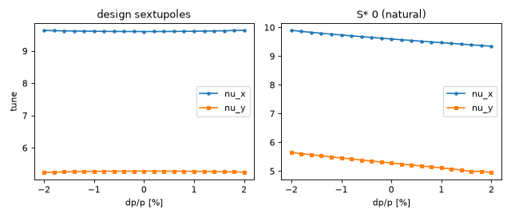

# mom_dep_ts (PF): 運動量依存チューンシフト
種別: スクリプト (サンプル集 mom_dep_ts.sad)。加速器: PF 2.5 GeV リング (`lattice/v9_16_asym.sad`、周長 187.035 m、チューン 9.5975 / 5.2790)。フラグ: `ON RAD FLUC COD RFSW RADCOD`。

## 何を見る例か
`DP0` を -2%〜+2% (0.2% おき、21 点) で動かして、6 極あり (設計値) と6 極なし (`S* 0`) のチューンを出す。チュートリアルは 0.1% おき 41 点で、ここでは 21 点に間引いた。

## スクリプト
```
Do[ DP0 = (i-11)*0.002;  FFS["cell calc"];  Print[DP0, " ", Twiss["NX","$$$"]/2/Pi, " ", Twiss["NY","$$$"]/2/Pi]; ,{i,1,21}];
DP = 0;  S* 0;  (同じループ)
```

## 結果の読み方


| dp/p | νx (6 極あり) | νy (6 極あり) | νx (6 極 0) | νy (6 極 0) |
|---|---|---|---|---|
| -2% | 9.63054 | 5.23520 | 9.89891 | 5.64483 |
| -1% | 9.60575 | 5.27126 | 9.73599 | 5.45487 |
| 0 | 9.59753 | 5.27896 | 9.59753 | 5.27896 |
| +1% | 9.60673 | 5.27197 | 9.46828 | 5.10787 |
| +2% | 9.63531 | 5.25003 | 9.34421 | 4.94688 |

- 6 極ありでは、チューンは δ=0 の近くで極値になる (ξ ≈ 0) 放物線で、±2% でも νx は +0.03〜+0.04、νy は -0.03〜-0.04 の動き。
- 6 極なしでは、ほぼ線形 (自然色収差が負) で、-2% で νx は +0.30、νy は +0.37、+2% で νx は -0.25、νy は -0.33 動く (曲がっている)。±1.6% 付近の νy (4.98 など) は整数 5 の近くで、隣の点と滑らかにつながらない。

## 物理・解析式
中央差分の傾き (±0.2%) は、6 極なしで νx: (9.57110-9.62431)/0.004 = -13.30、νy: (5.24455-5.31357)/0.004 = -17.25。これは ±1e-4 の差分の ξ (-13.2986、-17.2514、`pf/matching/FFS_FIT_chrom_PF`) と 0.03% で一致する。四極と6 極の寄与の和の式は `calc_chromaticity_PF`。

## gs と pysad の比較
**v2 モードと k64 モード**: `.pysad.txt` は既定の v2 モードの出力。v2 は K64 のバグを含まない計算なので (`docs/28_v2_vs_k64.md`。主に `Emittance[]`・EMIT・追跡の Jx の端の項 B75 と `MomentumCompaction` B77)、この例の出力のうち `Emittance[]` の表示 (εx が数 % 大きい、εz・減衰率・α・バケット高さなど) と、それに依る量が gs と違う。以下の「一致」の判定は k64 モードの結果。gs と同じ値が要るときは `PYSAD_COMPAT=k64` を付ける。

○ 全 42 点のチューンが全桁一致 (表示の 10 桁)。

## 未確認・限界
- δ=0 の点で、6 極ありの 1 本目 (9.5975304557) と設計チューン (9.5975304909) に 3.5e-8 の差がある (`disp` と `DP=0` の再設定の順序による収束の違いと見ているが、確認していない)。
- 整数・半整数共鳴の位置は、6 極なしの ±1.6% 付近の νy が 5 に近い以外は確認していない (6 極ありは ν ≈ 9.6、5.27 で整数・半整数に近づかない)。
