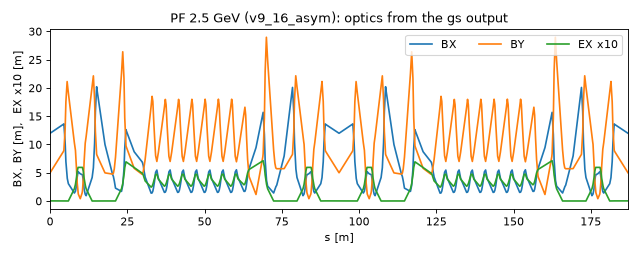

# FFS draw / OpticsPlot (PF): オプティクスの図
種別: FFS コマンド `draw` と関数 `OpticsPlot[]` (入門マニュアル その 4)。加速器: PF 2.5 GeV リング (`lattice/v9_16_asym.sad`、周長 187.035 m、チューン 9.5975 / 5.2790)。

## 何を見る例か
- `draw bx & by & ex b*`: topdrawer 形式でβ・分散とラティスの絵を描くコマンド (`&` は別の枠、末尾の `b*` は絵の中に名前を出す要素)。
- `OpticsPlot[{{"BX","BY"},{"EX"}}]`: Tk のキャンバスに同じ図を描く。窓を出す書き方は
  `w = KBMainFrame["sample", namae, Title->"Optics Plot!"]; c1 = Canvas[namae, Width->640, Height->400]; $DisplayFunction = CanvasDrawer; Canvas$Widget = c1; pl = OpticsPlot[...]; TkWait[];`

## スクリプト
窓の出ない環境 (gs を `< /dev/null`、WSL に表示なし) で走るので、`OpticsPlot[..., DisplayFunction->Identity]` で `Graphics` の式だけ受け取り、図の元の数値 (s, βx, βy, ηx) を全要素について印字する (図は matplotlib で描いた)。

## 結果の読み方

- `OpticsPlot returned: Graphics with 2 parts` (Graphics 式が返る)。
- 756 要素の値の範囲は、βx 0.94〜20.2 m、βy 0.41〜29.0 m、ηx 0〜0.71 m。直線部 (ID 部) で βy が小さく、標準セルでは分散が 0.3〜0.7 m。

## gs と pysad の比較
○ 数値と戻りの式の形は一致。
- `draw` コマンド: gs は表示のない環境では何も出さずに通る。`$DisplayFunction = TopDrawer;` を付けると、この環境では gs が戻らなかった (25 秒待っても止まったまま) ので付けていない。`FFS["draw bx",12]` は K64 版 gs では内部エラー (`FFSCanvasDraw` の中) で落ちた。pysad は `draw` を未対応として無視し、メッセージを出す。
- topdrawer 形式のファイルを手書きで作る例は `T2_samples/FFS_draw_topdrawer_PF`。

## 未確認・限界
- Tk の窓を実際に開くところは確認していない (gs は表示環境なし、pysad の窓の PNG は T5 の担当)。
- 軸ラベルの文字化け (チュートリアルの「既知の問題」) は topdrawer/tdr の話で、ここでは再現できない。
