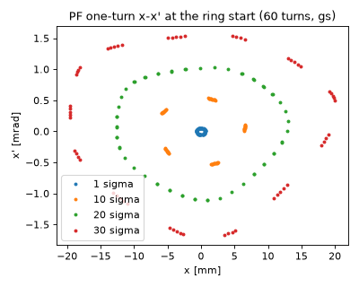

# phase (PF): 位相空間
種別: スクリプト (サンプル集 phase.sad)。加速器: PF 2.5 GeV リング (`lattice/v9_16_asym.sad`、周長 187.035 m、チューン 9.5975 / 5.2790)。追跡: `OFF RAD FLUC; ON COD RFSW RADCOD`。**60 周** (サンプル集は 1000 周)。

## 何を見る例か
リングの始点 (MKSSES) で 1 粒子を、初期振幅 1σ・10σ・20σ・30σ (x のみ、他の座標は 1e-9) で 60 周追跡し、`TrackParticles[res, 1]` (1→1 = リング 1 周) を繰り返して毎周の (x, x') を取る。

## スクリプト
```
res = {1, {x1, {1E-9},{1E-9},{1E-9},{1E-9},{1E-9},{1}}};
Do[ res = TrackParticles[res, 1];  x = res[2,1,1]; px = res[2,2,1]; Print[...] ,{i,1,60}];
```
`res` は `{位置, 座標}` なのでそのまま次の呼び出しに渡せる。クーラン・シュナイダーの不変量 $\gamma x^2 + 2\alpha x x' + \beta x'^2$ を EMITX で割った値も印字する。

## 結果の読み方

- 周回ごとの点が x-x' 平面の楕円の上を回る (1 周の位相進み 0.5975×2π)。振幅が大きいと歪む。

| 初期振幅 | 不変量/EMITX (1 周目) | 60 周目 |
|---|---|---|
| 1σ | 1.0090 | 1.0033 |
| 10σ | 108.56 | 108.51 |
| 20σ | 462.8 | 349.0 |
| 30σ | 1086 | 1052 |

線形なら振幅² (1, 100, 400, 900) で一定になる。1σ ではほぼ 1 (1.0〜1.01 で保存) で、大振幅ほど (20σ 以上で) 値が変わる。1 周目の値が振幅² から外れる (10σ: 108.6) のは、始点の分散・閉軌道 (6 次元) と非線形項 (六極) による。

## 物理・解析式
線形運動では $\gamma x^2 + 2\alpha x x' + \beta x'^2$ は保存 (Courant-Snyder)、点は楕円 $\gamma x^2 + 2\alpha x x'+\beta x'^2 = \epsilon$ の上を回る。1σ でこれが 0.3% で保存されていることが上の表。

## gs と pysad の比較
○ 全 240 点の (x, x', y, z) が 10 桁一致 (z の値だけ最後の桁が 1 違う)。

## 未確認・限界
- 60 周 4 粒子のみ (サンプル集は 1000 周、粒子 8)。y・z 方向の位相空間 (サンプル集の 3 枚の図) は印字だけで、図にしていない。
- 振幅 20σ・30σ の周回ごとの不変量のゆらぎは、非線形共鳴と見ているが、調べていない。
