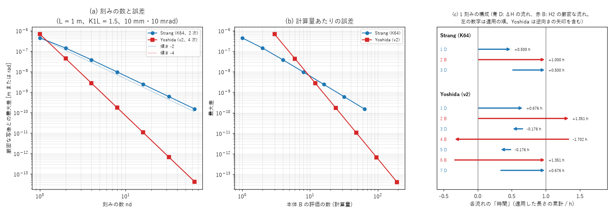

# 04. 四極 (QUAD)

**この章で分かること**: 四極のハミルトニアンから、(1) 厳密に解ける部分と残りへの分割、(2) 追跡の写像 (K64 の Fortran と pysad の Python)、(3) 転送行列 (CALC・Emittance[] 用)、(4) 端部 (フリンジ) までを、途中の式を省かずに追う。ヘルプが書いていない途中を埋める。式番号 $(4.n)$ から、§12 の Fortran の対応表と §13 の pysad の対応表を引ける。

**前提**: [01a_hamiltonian_derivation.md](01a_hamiltonian_derivation.md) (ハミルトニアンと運動方程式の導出。§9.5 が四極) と、[01_variables_and_conventions.md](01_variables_and_conventions.md) の §1〜§2 と §8 (SAD の変数名の注釈の規約) (正準変数 $(x, p_x, y, p_y, z, \delta)$、追跡の内部変数 $q = p_x/(1+\delta)$、$dv$、K1 の約束)。解析力学と加速器の線形光学。SAD の内部は知らなくてよい。

**読む順**: §1 (結論) → §2 (記号) → §3〜§5 (H と、厳密に解ける 2 つの部分) → §6 (分割と刻みの数) → §7 (端部) → §8〜§10 (行列と追跡の関係)。Fortran・Python のコードを読みながら使うときは §12・§13 から入る。放射・ソレノイド内の四極は別の章 (§11、§15)。

## 1. 結論

- **四極の本体のハミルトニアンは 2 つに分かれ、どちらも厳密に解ける**: $H = H_2 + \Delta H$。$H_2$ は $(x, p_x, y, p_y)$ の 2 次式 (線形な運動方程式) で、解は $\cos$・$\sin$ (集束)・$\cosh$・$\sinh$ (発散)。$\Delta H$ は座標を含まず運動量だけの関数で、運動量が一定のまま座標だけが進む「非線形ドリフト」$D$ になる。$H_2$ の流れを $B$ と書く。
- **$B$ と $D$ は交換しない**ので、本体を $n$ 個の刻みに分け、1 刻みを $D(h/2)\,B(h)\,D(h/2)$ ($h = L/n$) の 2 次の Strang 分割 (K64 の動作) で積分する。v2 (既定) は、3 つの Strang をまとめた 4 次の Yoshida 合成 ($B$ の長さ $1.3512\,h$、$-1.7024\,h$、$1.3512\,h$)。どちらも $B$ と $D$ が厳密にシンプレクティックなので、合成も丸め誤差までシンプレクティック。刻みの数を 2 倍にしたときの誤差は、K64 が $1/4$、v2 が $1/16$ ([quad_03_integrator_order.out.txt](outputs/quad_03_integrator_order.out.txt))。
- **刻みの数**は $n = 1 + \lfloor L\cdot K1/\varepsilon \rfloor$ ($K1$ は積分強度、$\varepsilon = \varepsilon_0 \cdot$EPS)。軌道のずれの大きさには**よらない**。$\varepsilon_0$ は追跡で K64 が 0.2、v2 が 0.1、CALC で K64 が 0.1、v2 が 0.05。ヘルプの式 $1 + \lfloor 10|K1\,L|/\text{EPS}\rfloor$ は CALC の K64 の値で、追跡には当てはまらない (§6.3)。
- **端部**: 入口・出口に、(i) Maxwell 方程式から出る非線形フリンジ (磁場の縦成分と 3 次の項が作る、$K x^3/12$ 程度の座標のずれ) と、(ii) 磁場の立ち上がりの形 F1・F2 で決まる線形フリンジを、本体の外側で適用する (§7)。どちらも K の 1 次までの硬い端の近似で、$p_x$ などは正準変換 (点変換と指数写像) で更新する。指数写像 $\exp(:f:)$ の符号の約束は [C_poisson_lie.md](C_poisson_lie.md) に合わせる ($\Delta x = -\partial f/\partial p_x$、$\Delta p_x = +\partial f/\partial x$。§7.2 に再掲)。
- **転送行列 (CALC・Emittance[])** は、追跡と同じ $D$・$B$・フリンジの各段を閉軌道のまわりで微分して掛けたもの。$z$ の行は、シンプレクティック条件から組む (§8)。設計軌道上では、$x$ の行列は $\begin{pmatrix}\cos\varphi & \sin\varphi/w\\ -w\sin\varphi & \cos\varphi\end{pmatrix}$ ($w = \sqrt{K1/L}$、$\varphi = wL$) になる。
- **数字の例** (電子 3 GeV、$L = 0.3$ m、K1 = 0.6 /m、$\gamma_0 = 5870.9$。[quad_01_h2_exact.out.txt](outputs/quad_01_h2_exact.out.txt)): 長さあたりの強さ $K = 2.0$ /m²、$\varphi = 0.4243$ rad (24.3°)。$x$ の行列は $\begin{pmatrix}0.911342 & 0.291081\\ -0.582161 & 0.911342\end{pmatrix}$、$y$ は $\begin{pmatrix}1.091358 & 0.309081\\ 0.618163 & 1.091358\end{pmatrix}$。$x$ の実効的な焦点距離は 1.718 m (薄肉近似の $1/K1 = 1.667$ m より 3% 長い、厚みの効果)。
- **精度の例**: 軌道が 3 mm・2 mrad ずれた四極 ($L = 0.3$ m、K1 = −0.6) の 4×4 ヤコビアンの、変分方程式 (厳密な写像の微分を DOP853 で積分したもの) との差は、K64 が CALC で $1.8 \times 10^{-7}$、追跡で $7.1 \times 10^{-7}$、v2 が CALC で $5.0 \times 10^{-10}$、追跡で $7.9 \times 10^{-9}$ ([quad_04_matrix_vs_map.out.txt](outputs/quad_04_matrix_vs_map.out.txt))。設計軌道上 (COD が 0) では、追跡のヤコビアンと CALC の行列は $10^{-13}$ 台で一致する。
- **使った条件と限界**は §15 に書く。



図 (`quad_integrator_order.png`): 四極 ($L = 1$ m、K1 = 1.5 /m) を、10 mm・10 mrad の粒子が通るときの、厳密な写像との差。(a) 刻みの数 $n$ と誤差 (傾き $-2$ が Strang、$-4$ が Yoshida)。(b) 本体 $B$ の評価の数 (計算量) あたりの誤差。(c) 1 刻みの構成。

## 2. 記号と単位

| 量 | SAD (台本・ヘルプ) | K64 の Fortran | pysad |
|---|---|---|---|
| 積分強度 $K1 = B'L/B\rho$ [1/m]。正が水平収束 | `K1` | `ak` (`tsolqu`・`tsolque`・`tquade`)、`ak0` (`tquad`)。符号は回転で処理し、`tsolqu` に渡す `ak` は常に正 | 台本の K1。要素クラス `Quadrupole.K1` は長さあたり $K1/L$ [1/m²] |
| 長さあたりの強さ $K = K1/L$ [1/m²] ($K = eB'/p_0$、式 (4.1)) | | `akk = ak/al` | `akk` |
| 長さ $L$ [m] | `L` | `al` | `el.L`、`L` |
| 本体の刻みの数 $n$、1 刻みの長さ $h = L/n$ | | `ndiv`、`aln0`・`aln1` | `quadbody.ndiv()`、`aln1` |
| 精度パラメータ EPS | `EPS` (既定 1) | `eps0` | `eps0` |
| 全運動量 $p = 1+\delta$ | | `pr` | `pr` |
| 集束の波数 $w = \sqrt{K/p}$ [1/m]、位相 $\varphi = wL$ (刻みでは $w\,h$) | | `w1`、`phi1` (`tzsetparam0`) | `w1`、`phi1` (`track6._tzsetparam0`) |
| $\cos\varphi - 1$、$\varphi - \sin\varphi$、$\sin\varphi$ | | `dc1`、`xs1`、`s1` | `dc1`、`xs1`、`s1` |
| $\cosh\varphi - 1$、$\varphi - \sinh\varphi$、$\sinh\varphi$ | | `dch2`、`xsh2`、`sh2` | `dch2`、`xsh2`、`sh2` |
| 規格化した運動量 $q = p_x/p$ | | 追跡の `px(i)`、`py(i)`。CALC は `pxi = cod(2)/pr` | `track6` の `c[1]`、`c[3]` |
| 速度の差 $dv = 1 - v/v_0$、その $\delta$ 微分 | | `dv`、`dvdp` (`tgetdv`) | `p.dv`、`_dvz` |
| ずれ・回転 | `DX`、`DY`、`ROTATE` | `dx`、`dy`、`theta2`・`theta1` (K1 < 0 は $\pi/2$ 足す・引く) | `DX`、`DY`、`ROTATION` |
| フリンジ | `FRINGE`、`DISFRIN`、`F1`、`F2` | `mfring`、`fringe` (= DISFRIN が 0)、`f1in`・`f2in`・`f1out`・`f2out` | `FRINGE`、`DISFRIN`、`F1`、`F2`。係数は `track6._tsetfringep` |

$z$ の符号は先頭が正 (01 章)。以下、$p$ は一定の媒介変数として扱う ($H$ が $z$ を含まないので $\delta$ は保存する)。

## 3. ハミルトニアン

### 3.1 磁場とベクトルポテンシャル

理想的な四極の磁場は $B_y = B'x$、$B_x = B'y$ ($B'$ は勾配)。粒子の電荷を含めて強さを

$$
K \equiv \frac{eB'}{p_0}\quad [1/\mathrm{m}^2]
\tag{4.1}
$$

と規格化し、**$K > 0$ が水平収束**になるように符号を決める (SAD の K1 の定義。K1 $= K L$)。ベクトルポテンシャルは $\vec{A} = (0, 0, A_s)$ に取れる。$B_x = \partial_y A_s$、$B_y = -\partial_x A_s$ だから、$a_s = eA_s/p_0$ として

$$
a_s = -\frac{K}{2}\left(x^2 - y^2\right)
\tag{4.2}
$$

**確認** (磁場に戻す): $b_x \equiv eB_x/p_0 = \partial_y a_s = +K y$、$b_y \equiv eB_y/p_0 = -\partial_x a_s = +K x$。これは $B_y = B'x$、$B_x = B'y$ ((4.1) の $K = eB'/p_0$) に一致する。$\nabla\times\vec A$ の $s$ 成分 $\partial_x A_y - \partial_y A_x$ は $A_x = A_y = 0$ で 0 なので、縦成分 $b_s = 0$ (本体の磁場は横成分だけ)。

(水平収束 $p_x' = -Kx$ を与える符号は、次の式 (4.3) から $p_x' = -\partial H/\partial x$ を取って確かめられる: (4.3) の $K(x^2 - y^2)/2$ を $x$ で微分して $Kx$、符号を反転して $-Kx$。) 曲線座標での $A_s$ と磁場の関係 ($B_x = \partial_yA_s/(1 + x/\rho)$ など)、偏向磁石の $A_s$ との対比、(4.2) から運動方程式を出すまでの途中式は、[01a_hamiltonian_derivation.md](01a_hamiltonian_derivation.md) §9.3〜§9.5。ラグランジアンから $H$ とハミルトンの方程式を出す手順 (§5)、$t \to s$ の入れ替え (§8) も、そこに書いてある。

### 3.2 $H$、$H_2$、$\Delta H$

01 章の式 (1.1) で、$1/\rho = 0$、$a_x = a_y = 0$、$a_s$ に (4.2) を入れる (式 (1.1) の $-a_s$ の項が $-a_s = +\tfrac{K}{2}(x^2 - y^2)$ になる)。**本体の磁場は (4.2) で厳密**なので、これが本体の厳密な $H$:

$$
H = -\sqrt{p^2 - p_x^2 - p_y^2} + \frac{K}{2}\left(x^2 - y^2\right) + \frac{E}{p_0 v_0}
\tag{4.3}
$$

根号を $p_x^2 + p_y^2$ の 2 次まで展開し、残りを $\Delta H$ とする:

$$
H_2 = -p + \frac{p_x^2 + p_y^2}{2p} + \frac{K}{2}\left(x^2 - y^2\right) + \frac{E}{p_0 v_0}
\tag{4.4}
$$

$$
\Delta H = H - H_2 = p - \sqrt{p^2 - p_x^2 - p_y^2} - \frac{p_x^2 + p_y^2}{2p}
\tag{4.5}
$$

(ヘルプの 2nd-order-Hamiltonian と QUAD の transformation (body of quad) の式。**原文で確認**: $H_{2n}$・$\Delta H$ とも本章の式と同じ形。QUAD の本体の式は $E/v_0$ のように $p_0$ の規格化を略して書かれている (2nd-order-Hamiltonian は $E/(p_0v_0)$)。) $\Delta H$ は運動量が小さいとき

$$
\Delta H \simeq \frac{(p_x^2 + p_y^2)^2}{8p^3}
\tag{4.6}
$$

で、横方向の運動量の 4 乗の大きさ。

**(4.6) の導出 (展開を 1 段ずつ)**。$Q \equiv p_x^2 + p_y^2$ ($\ll p^2$。条件: 傾き $\sqrt Q/p \ll 1$) とおく。

1. $\sqrt{p^2 - Q} = p\sqrt{1 - Q/p^2}$。$u \equiv Q/p^2$ (2 次の微小量) で $\sqrt{1 - u} = 1 - \dfrac u2 - \dfrac{u^2}{8} - \dfrac{u^3}{16} - \cdots$。
2. したがって $\sqrt{p^2 - Q} = p - \dfrac{Q}{2p} - \dfrac{Q^2}{8p^3} - \dfrac{Q^3}{16p^5} - \cdots$。
3. $\Delta H = p - \sqrt{p^2 - Q} - \dfrac{Q}{2p}$ に入れると、$p$ の項と $Q/(2p)$ の項が相殺して $\Delta H = \dfrac{Q^2}{8p^3} + \dfrac{Q^3}{16p^5} + \cdots$。
4. 最初の項 ($Q$ の 2 乗 = 運動量の 4 乗) を残し、次の $Q^3/(16p^5)$ (6 乗。最初の項との比が $Q/(2p^2)$) を捨てたのが (4.6)。

(sympy の `series` で確認: [ham_06_series.out.txt](outputs/ham_06_series.out.txt) (f)。ただし SAD は、$\Delta H$ を (4.5) のまま**厳密に**使う (§5)。(4.6) は大きさの見積もりだけに使う。)

### 3.3 なぜ分けるか

- $H_2$ は $(x, p_x, y, p_y)$ の 2 次式。運動方程式が線形で、**どんな強さ $KL$ でも厳密に解ける** (§4)。行列は強い四極でも (厚肉のまま) 正しい。ヘルプ (remarks-on-dynamics) の言う「設計軌道のまわりで厳密な線形の変換」はこれ。
- $\Delta H$ は座標 $x, y$ を含まない。運動量 $(p_x, p_y, p)$ が一定で、座標は一定の割合で進む。**厳密に解ける** (§5)。
- $H$ 全体は、$x$ を含む $K(x^2 - y^2)/2$ と、$p_x$ の根号が混ざるので、閉じた式では解けない。
- $\Delta H$ は 4 乗 (式 (4.6))。$H_2$ と $\Delta H$ は交換しない ($H_2$ が $x$ を含み $\Delta H$ が $p_x$ を含む) ので、$H_2$ の流れと $\Delta H$ の流れの積は $H$ の流れと**少し違う**。違いを刻みの数で抑える (§6)。
- どちらの流れも $H$ の形の流れ (正準変換) なので、シンプレクティック性は厳密に保たれる。

## 4. $H_2$ の厳密解

### 4.1 運動方程式と行列

$H_2$ から、$s$ を独立変数とする正準方程式:

$$
x' = \frac{p_x}{p},\quad p_x' = -Kx,\qquad
y' = \frac{p_y}{p},\quad p_y' = +Ky,\qquad
z' = \frac{\partial H_2}{\partial p} = -dv - \frac{p_x^2 + p_y^2}{2p^2},\quad p' = 0
\tag{4.7}
$$

($z'$ の第 1 項は $E/(p_0 v_0)$ の $p$ 微分で、01 章 §4。第 2 項は $\partial[(p_x^2 + p_y^2)/(2p)]/\partial p$。)

**偏微分を 1 項ずつ書く**。(4.4) の $H_2$ の各項を、$T_1 = -p$、$T_2 = (p_x^2 + p_y^2)/(2p)$、$T_3 = K(x^2 - y^2)/2$、$T_4 = E/(p_0v_0)$ として ($s$ が独立変数。ハミルトンの方程式は [01a_hamiltonian_derivation.md](01a_hamiltonian_derivation.md) §8.3 の (1a.51a)):

| 項 | $\partial/\partial p_x$ | $\partial/\partial x$ | $\partial/\partial p_y$ | $\partial/\partial y$ | $\partial/\partial p$ |
|---|---|---|---|---|---|
| $T_1 = -p$ | 0 | 0 | 0 | 0 | $-1$ |
| $T_2 = (p_x^2 + p_y^2)/(2p)$ | $p_x/p$ | 0 | $p_y/p$ | 0 | $-(p_x^2 + p_y^2)/(2p^2)$ |
| $T_3 = K(x^2 - y^2)/2$ | 0 | $Kx$ | 0 | $-Ky$ | 0 |
| $T_4 = E/(p_0v_0)$ | 0 | 0 | 0 | 0 | $\partial[E/(p_0v_0)]/\partial p = v/v_0$ |

表の合計から $x' = \partial H_2/\partial p_x = p_x/p$、$p_x' = -\partial H_2/\partial x = -Kx$、$y' = p_y/p$、$p_y' = -\partial H_2/\partial y = +Ky$、$z' = \partial H_2/\partial p = -1 + v/v_0 - (p_x^2 + p_y^2)/(2p^2)$ ($= -dv - (p_x^2+p_y^2)/(2p^2)$。$dv = 1 - v/v_0$)。$p' = -\partial H_2/\partial z = 0$ ($H_2$ が $z$ を含まない)。これが (4.7)。偏微分の表は sympy でも確認した ([ham_06_series.out.txt](outputs/ham_06_series.out.txt) (d))。 規格化した運動量 $q_x = p_x/p$、$q_y = p_y/p$ と $w \equiv \sqrt{K/p}$ で書くと、$x' = q_x$、$q_x' = p_x'/p = -Kx/p = -w^2x$ ($p$ は定数なので $p_x' = p\,q_x'$)。$y$ も同様に $q_y' = +Ky/p = +w^2y$ なので、

$$
x'' = -w^2 x,\qquad y'' = +w^2 y
\tag{4.8}
$$

調和振動子の解を、1 刻み (長さ $\ell$、$\varphi = w\ell$) の更新の形で書く (K64 の Fortran と同じ形)。**途中の確認**: 水平は初期値 $x(0) = x$、$x'(0) = q_x$ の解が $x(s) = x\cos ws + (q_x/w)\sin ws$ (微分して $x'' = -w^2x$、$s = 0$ で値と傾きが合う)、$q(s) = x'(s) = -xw\sin ws + q_x\cos ws$。$s = \ell$ を代入して $x(\ell) - x$、$q(\ell) - q_x$ を取ると下の $u_1$、$u_2$ (引き算で $\cos\varphi - 1$ の形に集めた)。垂直は $y(s) = y\cosh ws + (q_y/w)\sinh ws$、$q_y(s) = yw\sinh ws + q_y\cosh ws$ で、$y'' = +w^2y$ を満たす。([quad_08_derivations.out.txt](outputs/quad_08_derivations.out.txt) (C) の最初の 4 行で sympy 確認。) **水平 (集束)**:

$$
\begin{aligned}
u_1 &= x\,(\cos\varphi - 1) + \frac{q_x}{w}\sin\varphi, & x &\to x + u_1,\\
u_2 &= -x\,w\sin\varphi + q_x\,(\cos\varphi - 1), & q_x &\to q_x + u_2
\end{aligned}
\tag{4.9}
$$

**垂直 (発散)**:

$$
\begin{aligned}
v_1 &= y\,(\cosh\varphi - 1) + \frac{q_y}{w}\sinh\varphi, & y &\to y + v_1,\\
v_2 &= y\,w\sinh\varphi + q_y\,(\cosh\varphi - 1), & q_y &\to q_y + v_2
\end{aligned}
\tag{4.10}
$$

**Fortran の変数名の注釈** (定義は §16 の表): 式 (4.9)(4.10) の $\cos\varphi - 1$ は `dc1`、$\sin\varphi$ は `s1`、$\cosh\varphi - 1$ は `dch2`、$\sinh\varphi$ は `sh2`、$w = \sqrt{K/p}$ は `w1`、$\varphi = w\ell$ は `phi1`、$u_1, u_2, v_1, v_2$ は `u1`、`u2`、`v1`、`v2` ($x$ の更新量、$q_x$ の更新量、$y$ の更新量、$q_y$ の更新量。`tsolqu.f` のローカル変数)。`dc1`、`dch2` のように「$-1$」を引いた形で持つのは、$\varphi$ が小さいとき $\cos\varphi \approx 1$ で桁落ちする引き算を避けるため。

「$x \to x + u_1$」と差の形で書き、$\cos\varphi - 1$ や $\varphi - \sin\varphi$ を級数で直接計算するのは、小さい $\varphi$ の桁落ちを避けるため (SAD の `xsincos`・`xsincosh`、`tfloor.f:260`・`:330`)。正準運動量 $p_x = p\,q_x$ の行列は、$p_x \to p\,q_x$ を代入して

$$
\begin{pmatrix}x\\ p_x\end{pmatrix}_{\rm out}
= \begin{pmatrix}\cos\varphi & \dfrac{\sin\varphi}{pw}\\[2mm] -pw\sin\varphi & \cos\varphi\end{pmatrix}
\begin{pmatrix}x\\ p_x\end{pmatrix},\qquad
\begin{pmatrix}y\\ p_y\end{pmatrix}_{\rm out}
= \begin{pmatrix}\cosh\varphi & \dfrac{\sinh\varphi}{pw}\\[2mm] pw\sinh\varphi & \cosh\varphi\end{pmatrix}
\begin{pmatrix}y\\ p_y\end{pmatrix}
\tag{4.11}
$$

行列式は 1 ($\cos^2 + \sin^2 = 1$、$\cosh^2 - \sinh^2 = 1$)。行列指数 $\exp(AL)$ ($A = \begin{pmatrix}0 & 1/p\\ \mp K & 0\end{pmatrix}$) との一致は [quad_01_h2_exact.out.txt](outputs/quad_01_h2_exact.out.txt) (a) で $10^{-16}$、pysad の `Quadrupole.transfer_matrix` との一致は (b) で厳密に 0 (同じ式)。

**ヘルプの solution-H2 との関係**: ヘルプはソレノイド ($B_z$) つきの一般の解を書く。記号の定義 ($w_1$、$w_2$、$w_+$、$w_d = b_p/w_+$、$V = w_1^2 + w_2^2$、$U = 1/V$、係数 $a, b, c, d$。$b_p \propto B_z/p$) は [09_solenoid.md](09_solenoid.md) §4.2〜§4.3 にある (ここでは $B_z = 0$ への縮約だけ)。**縮約 (1 行ずつ)**:

1. $B_z = 0$ なので $b_p = 0$。ヘルプの $w_{1,2}$ は $K/p$ だけで決まり、$w_1 = w_2 = w = \sqrt{K/p}$。したがって $w_+ = w_1 + w_2 = 2w$、$w_d = b_p/w_+ = 0$、$V = w_1^2 + w_2^2 = 2w^2 = 2K/p$、$U = 1/V = p/(2K)$。
2. 係数 (09 章 §4.2 の式に $b_p = 0$、$w_d = 0$ を入れる): $a = (w_2w_+x_0 - b_pq_{ym})/V = 2w^2x_0/(2w^2) = x_0$。$bw = (w_+q_{xm} - b_pw_2y_0)/V = 2w\,q_{x0}/(2w^2) = q_{x0}/w$ なので、ヘルプの $b = w_1\,bw = q_{x0}$。$c = (w_1w_dx_0 + q_{ym})/V = q_{y0}/(2w^2) = p\,q_{y0}/(2K) = p_{y0}/(2K)$ ($p_{y0} = p\,q_{y0}$)。$dw = (-w_dq_{xm} + w_1y_0)/V = w\,y_0/(2w^2) = y_0/(2w)$ なので $d = w_2\,dw = y_0/2$。($B_z = 0$ では運動学的運動量と正準運動量が一致するので $q_{xm} = q_{x0}$、$q_{ym} = q_{y0}$。)
3. 更新量 (ヘルプ): $\Delta x = u_1/w_1 = a\,(\cos\varphi - 1) + (b/w)\sin\varphi = x_0(\cos\varphi - 1) + q_{x0}\sin\varphi/w$。$\Delta y = w_+v_2/w_2 = w_+\bigl[c\sinh\varphi + (d/w)(\cosh\varphi - 1)\bigr] = 2w\Bigl[\dfrac{q_{y0}}{2w^2}\sinh\varphi + \dfrac{y_0}{2w}(\cosh\varphi - 1)\Bigr] = y_0(\cosh\varphi - 1) + q_{y0}\sinh\varphi/w$。

これは式 (4.9)(4.10) の更新量と一致する。(**原文の solution-H2 の式を読んで確認**。縮約の代数は sympy でも確認した: [quad_10_gaps.out.txt](outputs/quad_10_gaps.out.txt) (E)。) ソレノイドつきの 4×4 は [09_solenoid.md](09_solenoid.md)。$z$ の式 (複素正規座標) は §14 と付録 A。

### 4.2 $K < 0$ と $K = 0$

- **$K < 0$ (水平発散)**: 運動方程式は $(x, p_x, y, p_y) \to (y, p_y, -x, -p_x)$ の 90 度の回転 (これは正準変換) で $K \to -K$ に写る。**確認**: 新しい座標 $X = y$、$P_X = p_y$、$Y = -x$、$P_Y = -p_x$ で $H_2$ の $K(x^2 - y^2)/2$ を書くと $x^2 = Y^2$、$y^2 = X^2$ なので $K(Y^2 - X^2)/2 = (-K)(X^2 - Y^2)/2$、運動エネルギーの $(p_x^2 + p_y^2)/(2p)$ は不変。ポアソン括弧は $\{X, P_X\} = \{y, p_y\} = 1$、$\{Y, P_Y\} = \{-x, -p_x\} = 1$ で保たれる (正準変換)。したがって、K1 < 0 の四極は「座標を 90 度回し、$|K|$ の集束四極として (4.9)(4.10) を適用し、戻す」。**符号を追う (途中式)**: $w = \sqrt{|K|/p}$、$\varphi = w\ell$、$q = p_x/p$ 等として、(i) 回転: $X = y$、$Q_X = q_y$、$Y = -x$、$Q_Y = -q_x$。(ii) 回転後の系の更新 ($K \to -K$ なので (4.9)(4.10) をそのまま使える。$X$ が集束、$Y$ が発散): $X_f = y\cos\varphi + q_y\sin\varphi/w$、$Q_{Xf} = -y\,w\sin\varphi + q_y\cos\varphi$、$Y_f = Y\cosh\varphi + Q_Y\sinh\varphi/w = -x\cosh\varphi - q_x\sinh\varphi/w$、$Q_{Yf} = Y w\sinh\varphi + Q_Y\cosh\varphi = -x\,w\sinh\varphi - q_x\cosh\varphi$。(iii) 戻す: $x_f = -Y_f$、$q_{xf} = -Q_{Yf}$、$y_f = X_f$、$q_{yf} = Q_{Xf}$。**$Y = -x$ (入力) と $x_f = -Y_f$ (出力) の 2 つの符号が相殺して**
$$x_f = x\cosh\varphi + \frac{q_x}{w}\sinh\varphi,\quad q_{xf} = x\,w\sinh\varphi + q_x\cosh\varphi,\quad y_f = y\cos\varphi + \frac{q_y}{w}\sin\varphi,\quad q_{yf} = -y\,w\sin\varphi + q_y\cos\varphi$$
つまり、$x$ が $\cosh$・$\sinh$、$y$ が $\cos$・$\sin$ になる (K > 0 の (4.9)(4.10) で $x \leftrightarrow y$ を入れ替えた形。sympy で確認: [quad_10_gaps.out.txt](outputs/quad_10_gaps.out.txt) (F))。Fortran は `tquade` の `theta1 = theta - m_pi_2`、`ak1 = -ak` (CALC)、追跡は呼び出し側が `theta2` に $\pi/2$ を足して $|K1|$ を渡す (`tquad.f:37` の `ak = sign(ak0, al)`)。回転の向きは追跡と CALC で逆だが、四極は $(x, y) \to (-x, -y)$ で不変なので、結果は同じ。
- **$K = 0$**: $\sin\varphi/w \to \ell$、$\cos\varphi \to 1$ の極限で、ドリフト $\begin{pmatrix}1 & \ell/p\\ 0 & 1\end{pmatrix}$ になる ($K = 10^{-12}$ で (4.11) は ドリフトと 12 桁一致、[quad_01_h2_exact.out.txt](outputs/quad_01_h2_exact.out.txt))。実装は `ak == 0` を別の枝 (`tdrift`・`tdrife`) にしている。
- **$\delta$ 依存**: $\delta$ は $w = \sqrt{K/(1+\delta)}$ と (4.11) の $p$ にだけ入る。エネルギーの高い粒子ほど集束が弱い、という自然クロマティシティはこれ。

### 4.3 $z$ の更新 (導出)

(4.7) から、本体 1 つぶん (長さ $\ell$) の $z$ の変化は

$$
\Delta z = -dv\,\ell - \frac{1}{2}\int_0^\ell \left(q_x^2 + q_y^2\right) ds
\tag{4.12}
$$

軌道に沿った積分は、保存量を使うと閉じた式になる。**途中の確認** (すべて (4.7)(4.8) だけから):

1. 水平: $C_x \equiv q_x^2 + w^2x^2$ の微分は $dC_x/ds = 2q_xq_x' + 2w^2xx' = 2q_x(-w^2x) + 2w^2xq_x = 0$ で一定。
2. 水平: $d(xq_x)/ds = x'q_x + xq_x' = q_x^2 - w^2x^2$。
3. 2 つの和 $C_x + d(xq_x)/ds = 2q_x^2$ から $q_x^2 = [\,C_x + d(xq_x)/ds\,]/2$。
4. 垂直: $C_y \equiv q_y^2 - w^2y^2$ の微分は $2q_y(+w^2y) - 2w^2yq_y = 0$ で一定。$d(yq_y)/ds = q_y^2 + w^2y^2$。和は $C_y + d(yq_y)/ds = 2q_y^2$ で $q_y^2 = [\,C_y + d(yq_y)/ds\,]/2$。
5. $\int_0^\ell(q_x^2 + q_y^2)\,ds = \tfrac12\bigl[(C_x + C_y)\ell + (xq_x)|_{\rm in}^{\rm out} + (yq_y)|_{\rm in}^{\rm out}\bigr]$ を (4.12) の $-\tfrac12\int$ に入れると、係数は $-\tfrac12 \times \tfrac12 = -\tfrac14$ で、次の (4.13) になる。(1〜5 の恒等式と、積分値と右辺の数値一致 ($3 \times 10^{-16}$) は [quad_08_derivations.out.txt](outputs/quad_08_derivations.out.txt) (C)。)

$$
\Delta z = -dv\,\ell - \frac{1}{4}\Bigl[(C_x + C_y)\,\ell + (x q_x)\big|_{\rm in}^{\rm out} + (y q_y)\big|_{\rm in}^{\rm out}\Bigr]
\tag{4.13}
$$

K64 の Fortran (`tsolqu.f:83-88`) の書き方は、(4.13) の $w^2x^2\ell$ を $w\,x^2\varphi$ に直し、$\varphi$ を $(\varphi - \sin\varphi) + \sin\varphi$ に分けて桁落ちを避けたもの:

$$
\Delta z = -\frac{1}{4}\Bigl[\,w\bigl(x^2\,\mathrm{xs1} - y^2\,\mathrm{xsh2}\bigr) + (q_x^2 + q_y^2)\,\ell + u_1 q_x' + x\,q_x\,\mathrm{dc1} + v_1 q_y' + y\,q_y\,\mathrm{dch2}\Bigr] - dv\,\ell
\tag{4.14}
$$

($\mathrm{xs1} = \varphi - \sin\varphi$、$\mathrm{xsh2} = \varphi - \sinh\varphi$、$\mathrm{dc1} = \cos\varphi - 1$、$\mathrm{dch2} = \cosh\varphi - 1$。$q_x'$ は (4.9) の更新後。) 右辺の括弧が (4.13) の括弧に等しいことの**証明** (水平。入口の値を $x, q_x$、出口を $x_f = x + u_1$、$q_{xf} = q_x + u_2$ とする):

1. (4.13) の水平の括弧は $C_x\ell + x_fq_{xf} - xq_x$。$C_x\ell = q_x^2\ell + w^2x^2\ell$ で、$w^2x^2\ell = w\,x^2\varphi = w\,x^2(\mathrm{xs1} + \sin\varphi)$ ($\varphi = (\varphi - \sin\varphi) + \sin\varphi$)。
2. $x_fq_{xf} - xq_x = (x_f - x)q_{xf} + x(q_{xf} - q_x) = u_1q_{xf} + x\,u_2$。
3. $x\,u_2 = x\bigl(-xw\sin\varphi + q_x\,\mathrm{dc1}\bigr) = -wx^2\sin\varphi + xq_x\,\mathrm{dc1}$ ((4.9) の $u_2$)。
4. 1〜3 を足すと、$wx^2\sin\varphi$ が相殺して $C_x\ell + x_fq_{xf} - xq_x = w\,x^2\,\mathrm{xs1} + q_x^2\ell + u_1q_{xf} + xq_x\,\mathrm{dc1}$。これが (4.14) の水平の項。
5. 垂直: $-w^2y^2\ell = -w\,y^2(\varphi) = -w\,y^2(\mathrm{xsh2} + \sinh\varphi)$ ($\varphi = (\varphi - \sinh\varphi) + \sinh\varphi$)。$y_fq_{yf} - yq_y = v_1q_{yf} + y\,v_2$ で $y\,v_2 = y(yw\sinh\varphi + q_y\,\mathrm{dch2}) = wy^2\sinh\varphi + yq_y\,\mathrm{dch2}$。$wy^2\sinh\varphi$ が相殺して、垂直の括弧は $-w\,y^2\,\mathrm{xsh2} + q_y^2\ell + v_1q_{yf} + yq_y\,\mathrm{dch2}$。(4.14) の $w(x^2\,\mathrm{xs1} - y^2\,\mathrm{xsh2})$ の $y$ 側に一致。

(4 と 5 の恒等式は sympy で $0$、[quad_08_derivations.out.txt](outputs/quad_08_derivations.out.txt) (C)。)(4.13) の積分、(4.14)、`quadbody` の本体 $B$ が、$10^{-18}$ 以下で一致する ([quad_01_h2_exact.out.txt](outputs/quad_01_h2_exact.out.txt) (c)(d))。ヘルプには、この $z$ の更新に当たる式が (複素正規座標の形で) 1 行あるだけで、K64 の実座標の形との対応は書かれていない。

## 5. $\Delta H$ の解 (運動学的ドリフト)

$\Delta H(p_x, p_y, p)$ は $x, y, z$ を含まない。座標の速度は一定:

$$
x' = \frac{\partial\Delta H}{\partial p_x} = p_x\left(\frac{1}{p_z} - \frac{1}{p}\right),\quad
y' = p_y\left(\frac{1}{p_z} - \frac{1}{p}\right),\quad
z' = \frac{\partial\Delta H}{\partial p} = 1 - \frac{p}{p_z} + \frac{p_x^2 + p_y^2}{2p^2}
\tag{4.15}
$$

($p_z = \sqrt{p^2 - p_x^2 - p_y^2}$。**途中**: $\partial p_z/\partial p_x = -p_x/p_z$、$\partial p_z/\partial p = p/p_z$ なので、$\partial\Delta H/\partial p_x = +p_x/p_z - p_x/p = p_x(1/p_z - 1/p)$、$\partial\Delta H/\partial p = 1 - p/p_z + (p_x^2 + p_y^2)/(2p^2)$ ($\partial_p[-(p_x^2 + p_y^2)/(2p)] = +(p_x^2 + p_y^2)/(2p^2)$)。$y$ は $x$ と同じ。複素ステップ微分で作った偏微分と手で導いたこの式は $10^{-16}$ で一致、[quad_02_dh_drift.out.txt](outputs/quad_02_dh_drift.out.txt) (a)。sympy でも 0 ([quad_08_derivations.out.txt](outputs/quad_08_derivations.out.txt) (B)。) 次に、規格化した運動量 $q_x = p_x/p$、$q_y = p_y/p$ と $\zeta \equiv p_z/p = \sqrt{1 - q_x^2 - q_y^2}$ で書き直す。**代入 (1 行ずつ)**: $p_x = p\,q_x$、$p_z = p\,\zeta$ を (4.15) に入れる。(i) $x' = p_x(1/p_z - 1/p) = p\,q_x\bigl(\tfrac{1}{p\zeta} - \tfrac1p\bigr) = q_x\bigl(\tfrac1\zeta - 1\bigr)$ ($p$ を括り出して約分。$y'$ も同じ)。(ii) $z' = 1 - p/p_z + (p_x^2 + p_y^2)/(2p^2) = 1 - \tfrac1\zeta + \tfrac{q_x^2 + q_y^2}{2}$ ($p/p_z = 1/\zeta$、$p_x^2 + p_y^2 = p^2(q_x^2 + q_y^2)$)。(4.15) の右辺は $x, y, z$ を含まず、$s$ の間 $p_x, p_y, p$ は一定なので右辺も一定。したがって長さ $\ell$ ぶんの流れは右辺に $\ell$ をかけたもので、(ii) の $z'$ は下の「整理」で $-(2 + \zeta)(1 - \zeta)^2/(2\zeta)$ になる。まとめて

$$
x \to x + q_x\left(\frac{1}{\zeta} - 1\right)\ell,\quad
y \to y + q_y\left(\frac{1}{\zeta} - 1\right)\ell,\quad
z \to z - \frac{(2 + \zeta)(1 - \zeta)^2}{2\zeta}\,\ell
\tag{4.16}
$$

(最後の式は、(4.15) の $z' = 1 - 1/\zeta + q^2/2$ ($p_z = p\zeta$ で $p/p_z = 1/\zeta$) を $q^2 = 1 - \zeta^2$ で整理したもの。**整理**: $1 - \dfrac1\zeta + \dfrac{1 - \zeta^2}{2} = \dfrac{2\zeta - 2 + \zeta - \zeta^3}{2\zeta} = -\dfrac{\zeta^3 - 3\zeta + 2}{2\zeta}$、$\zeta^3 - 3\zeta + 2 = (\zeta - 1)^2(\zeta + 2)$ (右辺を展開すると $(\zeta^2 - 2\zeta + 1)(\zeta + 2) = \zeta^3 - 3\zeta + 2$)。よって $z' = -(2 + \zeta)(1 - \zeta)^2/(2\zeta)$。$q = 0$ ($\zeta = 1$) で 0。sympy でも差 0。) K64 の Fortran は (4.16) を `dpz = sqrt1(-ap)` ($= \zeta - 1$、`sqrt1(a) = a/(1+\sqrt{1+a})` で桁落ちなし)、`r = -dpz/(1+dpz)*aln` ($= (1/\zeta - 1)\ell$)、`x += px*r`、`z -= (3+dpz)*ap/2/(2+dpz)*r` の 4 行で書く (`tsolqu.f:65-66, 71, 83`)。$z$ の係数は、$(3 + {\rm dpz})/(2(2 + {\rm dpz}))\cdot q^2 r = (2 + \zeta)(1 - \zeta)^2/(2\zeta)\ell$ と一致する。DOP853 で (4.15) を積分した結果との差は $10^{-17}$ ([quad_02_dh_drift.out.txt](outputs/quad_02_dh_drift.out.txt) (b))。

小さい傾き $a = q$ ($q_y = 0$、$\zeta = \sqrt{1 - a^2}$) で、**二項展開を 1 段ずつ**: $\zeta^{-1} = (1 - a^2)^{-1/2} = 1 + \dfrac{a^2}{2} + \dfrac{3a^4}{8} + \dfrac{5a^6}{16} + \cdots$ なので $\dfrac1\zeta - 1 = \dfrac{a^2}{2} + \dfrac{3a^4}{8} + O(a^6)$。$\Delta x/\ell = a(1/\zeta - 1) = \dfrac{a^3}{2} + \dfrac{3a^5}{8} + \cdots$ (最初の項だけ残す。次は 5 次で、最初の項との比は $3a^2/4$)。$z$ は $z'= 1 - 1/\zeta + a^2/2 = 1 - \bigl(1 + \tfrac{a^2}{2} + \tfrac{3a^4}{8}\bigr) + \tfrac{a^2}{2} + O(a^6) = -\dfrac{3a^4}{8} + O(a^6)$ ($a^2/2$ の項が相殺して 4 次から始まる。次の項は $-5a^6/16$)。(sympy `series` で確認、[quad_08_derivations.out.txt](outputs/quad_08_derivations.out.txt) (B)。)

$$
\Delta x \simeq \frac{a^3}{2}\,\ell,\qquad \Delta z \simeq -\frac{3a^4}{8}\,\ell
\tag{4.17}
$$

(1 m で、傾き 1 mrad なら $\Delta x = 5 \times 10^{-10}$ m、10 mrad なら $5 \times 10^{-7}$ m、30 mrad なら $1.35 \times 10^{-5}$ m、$\Delta z$ は 30 mrad で $-3.0 \times 10^{-7}$ m。[quad_02_dh_drift.out.txt](outputs/quad_02_dh_drift.out.txt) (c))。四極の中で $D$ が効くのは、傾きが数 mrad を超える大きな振幅の粒子のとき。

## 6. 本体の分割

### 6.1 Strang 分割 (2 次、K64)

$B(\tau)$ を $H_2$ の長さ $\tau$ の流れ、$D(\tau)$ を $\Delta H$ の流れとする。本体の長さ $L$ を $n$ 個の刻み ($h = L/n$) に分け、1 刻みを

$$
S_2(h) = D\!\left(\tfrac{h}{2}\right) B(h)\, D\!\left(\tfrac{h}{2}\right)
\tag{4.18}
$$

とする。隣り合う刻みの $D$ は 1 つにまとめる ($n$ 刻みで $D(h/2)\,B(h)\,D(h)\,B(h)\cdots B(h)\,D(h/2)$。`tsolqu.f:61-70` の `if(n == 1) r = r*.5` と最後の半分の $D$ がこの構造。$D$ は $n + 1$ 回、$B$ は $n$ 回)。$S_2$ は前後対称なので、$\log S_2(h)$ は $h$ の奇数次だけを含む ($S_2(-h)\,S_2(h) = D(-\tfrac h2)B(-h)D(-\tfrac h2)\,D(\tfrac h2)B(h)D(\tfrac h2) = 1$ なので $S_2(-h) = S_2(h)^{-1}$、$\log S_2(-h) = -\log S_2(h)$):

$$
S_2(h) = \exp\!\Bigl(h\,(\mathcal{B} + \mathcal{D}) + h^3\,C_3 + O(h^5)\Bigr),
\qquad C_3 = -\frac{1}{24}\,[\mathcal{D},[\mathcal{D},\mathcal{B}]] + \frac{1}{12}\,[\mathcal{B},[\mathcal{B},\mathcal{D}]]
\tag{4.19}
$$

($\mathcal{B}, \mathcal{D}$ は $H_2$、$\Delta H$ のリー演算子。)  $h$ の項が厳密な $H$ の流れで、誤りは $h^3$ から。

**(4.19) の係数の導出**。$X = h\mathcal D$、$Y = h\mathcal B$ として $S_2 = e^{X/2}e^{Y}e^{X/2}$。BCH の公式 $\log(e^Pe^Q) = P + Q + \tfrac12[P,Q] + \tfrac1{12}[P,[P,Q]] - \tfrac1{12}[Q,[P,Q]] + \cdots$ を 2 回使う (4 次以上は捨てる)。この BCH の 3 次までの式の導出 ($e^Xe^Y = 1 + u_1 + u_2 + u_3$ を $\log(1 + u)$ に入れて次数ごとに集める) は [C_poisson_lie.md](C_poisson_lie.md) §6.2 (式 (C.14) の下) にある。

1. $Z_1 = \log(e^{X/2}e^{Y}) = \tfrac X2 + Y + \tfrac14[X,Y] + \tfrac1{48}[X,[X,Y]] - \tfrac1{24}[Y,[X,Y]]$ ($P = X/2$、$Q = Y$ を代入: $\tfrac12[P,Q] = \tfrac14[X,Y]$、$\tfrac1{12}[P,[P,Q]] = \tfrac1{48}[X,[X,Y]]$、$-\tfrac1{12}[Q,[P,Q]] = -\tfrac1{24}[Y,[X,Y]]$)。
2. $Z_2 = \log(e^{Z_1}e^{X/2}) = Z_1 + \tfrac X2 + \tfrac12[Z_1,\tfrac X2] + \tfrac1{12}[Z_1,[Z_1,\tfrac X2]] - \tfrac1{12}[\tfrac X2,[Z_1,\tfrac X2]]$。右辺の各項を 3 次まで展開する:
   - $\tfrac12[Z_1,\tfrac X2] = \tfrac14[Z_1,X] = \tfrac14[Y,X] + \tfrac1{16}[[X,Y],X] = -\tfrac14[X,Y] - \tfrac1{16}[X,[X,Y]]$ ($[X/2, X] = 0$ なので $Z_1$ の最初の項は落ちる)。
   - $\tfrac1{12}[Z_1,[Z_1,\tfrac X2]] = \tfrac1{24}[Z_1,[Z_1,X]]$。$[Z_1,X] = [Y,X] + O(3) = -[X,Y]$ なので $[Z_1,[Z_1,X]] = -[\tfrac X2 + Y,[X,Y]] = -\tfrac12[X,[X,Y]] - [Y,[X,Y]]$。よって $-\tfrac1{48}[X,[X,Y]] - \tfrac1{24}[Y,[X,Y]]$。
   - $-\tfrac1{12}[\tfrac X2,[Z_1,\tfrac X2]] = -\tfrac1{48}[X,[Z_1,X]] = +\tfrac1{48}[X,[X,Y]]$。
3. 足し合わせる。1 次: $\tfrac X2 + \tfrac X2 + Y = X + Y$。2 次: $\tfrac14[X,Y] - \tfrac14[X,Y] = 0$ (前後対称で偶数次が消える)。3 次の $[X,[X,Y]]$: $\tfrac1{48} - \tfrac1{16} - \tfrac1{48} + \tfrac1{48} = -\tfrac1{24}$。3 次の $[Y,[X,Y]] = -[Y,[Y,X]]$: Z₁ から $-\tfrac1{24}$、第 2 項から $-\tfrac1{24}$ で合計 $-\tfrac1{12}$、つまり $[Y,[Y,X]]$ の係数は $+\tfrac1{12}$。$X = h\mathcal D$、$Y = h\mathcal B$ を戻して (4.19)。

数値確認 (ランダムな 4×4 行列 $B$、$D$ で $\log(e^{hD/2}e^{hB}e^{hD/2})$ の $h^3$ の係数を最小二乗で当てる): $[D,[D,B]]$ の係数 $-0.041667 = -1/24$、$[B,[B,D]]$ の係数 $0.083333 = 1/12$、残差 $1.7 \times 10^{-9}$ ([quad_08_derivations.out.txt](outputs/quad_08_derivations.out.txt) (A))。(この積は前後対称なので、リー演算子としての積の順序 (流れを掛ける順序が演算子の積と逆になること。C_poisson_lie.md §6) を逆にしても同じ形になり、(4.19) は順序の規約によらない。)1 刻みの誤り $O(h^3)$ が $n$ 回たまって、全体は $O(h^2) \propto n^{-2}$。刻みの数を 2 倍にすると誤りは 1/4 になる ($n$ 刻みの誤りは $n\,(L/n)^3\,\lVert C_3\rVert \propto n^{-2}$ で、$n \to 2n$ で $2^{-2} = 1/4$。[quad_03_integrator_order.out.txt](outputs/quad_03_integrator_order.out.txt) (b): $n \ge 4$ で比 3.8〜4.00)。

### 6.2 Yoshida の 4 次の合成 (v2)

$S_2$ を 3 つ、刻みの長さを $\kappa_1h$、$\kappa_0h$、$\kappa_1h$ にして並べる (波数 $w$ と区別するため、重みは $\kappa$ と書く。Fortran・pysad では `_W1`・`_W0`):

$$
S_4(h) = S_2(\kappa_1 h)\,S_2(\kappa_0 h)\,S_2(\kappa_1 h)
\tag{4.20}
$$

**$\log S_4$ の展開**。$S_2(\kappa h) = \exp\bigl(\kappa h\,\mathcal L + \kappa^3h^3C_3 + O(h^5)\bigr)$ ($\mathcal L = \mathcal B + \mathcal D$、(4.19) の $h \to \kappa h$) を 3 つ掛ける。$h^1$ の項は $(2\kappa_1 + \kappa_0)h\,\mathcal L$、$h^3$ の項は $(2\kappa_1^3 + \kappa_0^3)h^3C_3$。3 つの指数 $e^{X_1}e^{X_0}e^{X_1}$ ($X_i = \kappa_ih\,\mathcal L + \kappa_i^3h^3C_3 + O(h^5)$) の積の BCH は、$X_i$ の和に、$X_i$ どうしの交換子の項を足したものになる。**交換子の次数を式で追う**:

1. 2 つの $X_i, X_j$ の交換子 (括弧の中を展開し、$[\mathcal L,\mathcal L] = 0$、$[C_3,C_3] = 0$ を使う):
$[X_i, X_j] = \kappa_i\kappa_j h^2[\mathcal L,\mathcal L] + \bigl(\kappa_i\kappa_j^3[\mathcal L,C_3] + \kappa_i^3\kappa_j[C_3,\mathcal L]\bigr)h^4 + O(h^6) = \kappa_i\kappa_j(\kappa_j^2 - \kappa_i^2)\,h^4\,[\mathcal L,C_3] + O(h^6)$
($h^2$ の項は $\mathcal L$ 自身との交換子で 0。したがって 2 次の交換子は $h^4$ から始まり、$h^2$、$h^3$ には出ない。)
2. 3 重の交換子 $[X_i,[X_j,X_k]]$ は、1 の結果に $X_i = O(h)$ をさらに括るので $O(h\cdot h^4) = O(h^5)$。BCH の 4 重以上の項はさらに高次。
3. したがって $h^3$ までは $X_i$ の和だけが残る。$h^4$ は 1 の $O(h^4)$ の項だが、次のとおり消える。$S_4$ も前後対称で奇数次だけになる: $S_4(-h) = S_2(-\kappa_1h)S_2(-\kappa_0h)S_2(-\kappa_1h) = S_2(\kappa_1h)^{-1}S_2(\kappa_0h)^{-1}S_2(\kappa_1h)^{-1} = [S_2(\kappa_1h)S_2(\kappa_0h)S_2(\kappa_1h)]^{-1} = S_4(h)^{-1}$ (最後の等号は、3 つの積が回文 (前から読んでも後ろから読んでも同じ並び) なので逆順にしても同じ)。したがって

$$
\log S_4 = (2\kappa_1 + \kappa_0)\,h\,(\mathcal B + \mathcal D) + (2\kappa_1^3 + \kappa_0^3)\,h^3 C_3 + O(h^5)
$$

(数値確認: ランダムな行列で $\log S_4 - h(B + D)$ の大きさが $h = 0.04, 0.02, 0.01$ で $9.8 \times 10^{-8}$、$3.1 \times 10^{-9}$、$9.6 \times 10^{-11}$ と比 32 ($h^5$) で減る。[quad_08_derivations.out.txt](outputs/quad_08_derivations.out.txt) (A)。)  $h(\mathcal B + \mathcal D)$ が正しい係数で、$h^3$ が消える条件は

$$
2\kappa_1 + \kappa_0 = 1,\qquad 2\kappa_1^3 + \kappa_0^3 = 0
\tag{4.21}
$$

**解く**:

1. 第 1 式から $\kappa_0 = 1 - 2\kappa_1$。
2. 第 2 式に入れると $2\kappa_1^3 + (1 - 2\kappa_1)^3 = 0$、つまり $(1 - 2\kappa_1)^3 = -2\kappa_1^3$。
3. 実数の立方根を取ると $1 - 2\kappa_1 = -2^{1/3}\kappa_1$ ($(-2\kappa_1^3)^{1/3} = -2^{1/3}\kappa_1$)。
4. $\kappa_1$ について解く: $1 = (2 - 2^{1/3})\kappa_1$。

$$
\kappa_1 = \frac{1}{2 - 2^{1/3}} = 1.351207\ldots,\qquad \kappa_0 = 1 - 2\kappa_1 = -1.702414\ldots
\tag{4.22}
$$

($2^{1/3} = 1.259921$、$2 - 1.259921 = 0.740079$、$1/0.740079 = 1.351207$。)

$\kappa_0 < 0$ は、1 刻みの途中で**逆向きに**進む部分があること (図の (c) の 4 番の $B$ と 3・5 番の $D$)。それでも $B$ も $D$ も厳密な流れなので、逆向きの流れも厳密 (cosh/sinh の位相が負になるだけ)。**隣り合う $D$ を合わせる**: 各 $S_2(\kappa h) = D(\tfrac{\kappa h}2)B(\kappa h)D(\tfrac{\kappa h}2)$ なので、$S_4$ は $D(\tfrac{\kappa_1h}2)B(\kappa_1h)D(\tfrac{\kappa_1h}2)\,D(\tfrac{\kappa_0h}2)B(\kappa_0h)D(\tfrac{\kappa_0h}2)\,D(\tfrac{\kappa_1h}2)B(\kappa_1h)D(\tfrac{\kappa_1h}2)$。間の $D$ どうしは同じ流れの足し算 ($D(a)D(b) = D(a + b)$、同じ $\Delta H$ の流れ) で $D(\tfrac{(\kappa_1 + \kappa_0)h}2) = D(-0.1756\,h)$ が 2 つ。したがって 1 刻み (最初と最後以外) は $B$ が 3 回 ($1.3512\,h$、$-1.7024\,h$、$1.3512\,h$)、$D$ が 4 回 ($0.6756\,h = \kappa_1h/2$、$-0.1756\,h = (\kappa_1 + \kappa_0)h/2$ ($\kappa_1 + \kappa_0 = 1 - \kappa_1 = -0.3512$)、$-0.1756\,h$、$0.6756\,h$ で、前後の刻みとの境の $D$ は $2 \times 0.6756h = \kappa_1 h$ に合わさる)。係数の確認は [quad_03_integrator_order.out.txt](outputs/quad_03_integrator_order.out.txt) (a) ($2\kappa_1^3 + \kappa_0^3 = -9 \times 10^{-16}$)。刻みの数を 2 倍にしたときの誤りの比は 15.6〜16.0 (4 次。1 刻みの誤り $O(h^5)$ が $n$ 回たまって $n^{-4}$、$2^{-4} = 1/16$)。

**なぜ 4 次か**: 本体 $B$ の評価は 3 倍に増えるが、同じ計算量なら 4 次の方が誤りが小さい (図の (b))。v2 の既定の刻みの数 (K64 の 2 倍の細かさ) では、四極 ($L = 1$ m、K1 = 1.5、10 mm・10 mrad) の 1 台の誤りは、K64 の刻み 8 で $9.7 \times 10^{-9}$、v2 の刻み 16 ($B$ の評価 48 回) で $1.1 \times 10^{-11}$ ([quad_03_integrator_order.out.txt](outputs/quad_03_integrator_order.out.txt) (c))。1 刻みの位相が大きい ($K h^2 = 1.5$ の 1 刻み) と、4 次の方がかえって悪い (中振幅で $6.8\times 10^{-7}$ 対 $4.5\times 10^{-7}$)。既定の刻みの数の式 (§6.3) はそのような 1 刻みにならないが、EPS を大きくして強い四極を 1 刻みにすると起こる。

### 6.3 刻みの数

$$
n = 1 + \left\lfloor \frac{L\cdot K1}{\varepsilon_0\,\mathrm{EPS}} \right\rfloor
\tag{4.23}
$$

$K1$ は積分強度、$L K1 = KL^2 = \varphi^2$ は本体全体の位相の 2 乗、EPS は要素の精度パラメータ (既定 1。0 のときも 1 と同じ)。$n$ は設計軌道の強さだけで決まり、**粒子の振幅によらない**。したがって、振幅が大きい粒子ほど (傾き $q$ が大きく、$\Delta H$ が効くので) 誤りが大きい。

| 経路 | K64 の $\varepsilon_0$ | v2 の $\varepsilon_0$ | 場所 |
|---|---|---|---|
| 追跡 (`tsolqu`) | 0.2 | 0.1 | `tsolqu.f:47`、`quadbody.ndiv()` |
| CALC・Emittance[] (`tsolque`) | 0.1 | 0.05 | `tsolque.f:385`、`quadbody.ndiv_calc()` (CALC と放射つきの追跡は、刻みの数の上限が 1000) |
| ヘルプの式 $1 + \lfloor 10\,\lvert K1\,L\rvert/\mathrm{EPS} \rfloor$ (**原文で確認**: QUAD > transformation の body。「EPS = 0 のときは EPS = 1」も同じ) | CALC の K64 の値と同じ ($\varepsilon_0 = 0.1$ のとき $1/0.1 = 10$) | | |

追跡の K64 は 0.2 (つまり $5\,L K1/\mathrm{EPS}$) で、ヘルプの式より刻みが少ない。同じ四極でも、追跡と CALC の刻みの数が違うので、軌道がずれたときの積分の誤りが違う (§1 の数字: 追跡 $7.1 \times 10^{-7}$、CALC $1.8 \times 10^{-7}$)。v2 はこれを、4 次の合成と刻みの半減で、どちらも $10^{-8}$ 以下にしてある。刻みの数の例 (EPS = 1。[quad_03_integrator_order.out.txt](outputs/quad_03_integrator_order.out.txt) (c)):

| $L$ [m] | K1 [/m] | $L\,K1$ | ヘルプ | 追跡 K64 | 追跡 v2 | CALC K64 | CALC v2 |
|---|---|---|---|---|---|---|---|
| 0.30 | 0.60 | 0.18 | 2 | 1 | 2 | 2 | 4 |
| 0.50 | 1.50 | 0.75 | 8 | 4 | 8 | 8 | 16 |
| 1.00 | 1.50 | 1.50 | 16 | 8 | 16 | 16 | 31 |
| 0.50 | 4.00 | 2.00 | 21 | 11 | 21 | 21 | 41 |
| 2.00 | 3.00 | 6.00 | 61 | 31 | 61 | 61 | 121 |

($n$ の列の計算: 追跡 K64 は $1 + \lfloor L K1/0.2\rfloor$、追跡 v2 は $1 + \lfloor L K1/0.1\rfloor$、CALC K64 は $1 + \lfloor L K1/0.1\rfloor$、CALC v2 は $1 + \lfloor L K1/0.05\rfloor$。たとえば $L = 1$ m、K1 = 1.5 ($LK1 = 1.5$) は、追跡 K64 が $1 + \lfloor 7.5\rfloor = 8$、追跡 v2 が $1 + 15 = 16$、CALC K64 が $1 + 15 = 16$、CALC v2 が $1 + 30 = 31$。) 放射つきの追跡と CALC では、放射の分割数 (`ndivrad`、`itgetqraddiv`) との大きい方になる (§11)。

## 7. 端部 (フリンジ)

### 7.1 順序と選択

四極の入口・出口には、本体の $H$ (4.3) に含まれない効果が 2 つある。本体の磁場は $K\,\Theta(s)$ (階段) を仮定したが、実際の磁場は端で立ち上がる。この立ち上がりの効果を、ヘルプの remarks-on-dynamics が言う「ハミルトニアンの外の、正準変換による近似」で入れる。順序は (K64 の `tquad`、`tquade`、ヘルプの QUAD の transformation):

> [取り付け誤差・ロール] → **非線形フリンジ (入口)** → **線形フリンジ (入口)** → 本体 ($n$ 刻み) → **線形フリンジ (出口)** → **非線形フリンジ (出口)** → [逆の座標変換]

FRINGE と DISFRIN の組合せ (ヘルプの表): 非線形フリンジは DISFRIN = 0 のときだけ、FRINGE = 0 なら入口と出口の両方、1 なら入口、2 なら出口、3 なら両方。線形フリンジ (F1・F2) は FRINGE = 1、2、3 のとき、その入口・出口。実装の判定式は、追跡が `mfring > -4 && mfring /= 2` (入口)、CALC が `mfring >= 0 && mfring /= 2` (入口) で、FRINGE が $-1 \ldots -3$ のときだけ違う (`tquad.f:49`、`tquade.f:43`)。

### 7.2 非線形フリンジ: Maxwell 方程式から

端の磁場は、$K(s)$ が $s$ とともに変わるとき、$\nabla\times\vec{B} = 0$ と $\nabla\cdot\vec{B} = 0$ から決まる。磁気ポテンシャル $V$ ($\vec{B} = \nabla V$、$\nabla^2 V = 0$) を、$x, y$ の 4 次まで展開して取る:

$$
V = K(s)\,xy - \frac{K''(s)}{12}\,xy\,(x^2 + y^2) + \cdots
\tag{4.24}
$$

**ラプラス方程式の確認 (1 項ずつ)**: $\nabla^2 = \partial_x^2 + \partial_y^2 + \partial_s^2$。(i) $\nabla^2[K\,xy] = K\,(\partial_x^2 + \partial_y^2)(xy) + K''xy = 0 + K''xy$ ($xy$ は $x, y$ について調和)。(ii) $(\partial_x^2 + \partial_y^2)[xy(x^2 + y^2)] = (\partial_x^2 + \partial_y^2)(x^3y + xy^3) = 6xy + 6xy = 12xy$ なので、$\nabla^2\bigl[-\tfrac{K''}{12}xy(x^2 + y^2)\bigr] = -K''xy + O(K'''')$。(i) と (ii) が相殺して $\nabla^2V = O(K'''')\,x^5$ (5 次以上)。$s$ 微分が $\partial_s^2$ の項を含む次数を 4 次の項まで取った、ということ。(sympy: [quad_08_derivations.out.txt](outputs/quad_08_derivations.out.txt) (D))。

$\vec{b} = e\vec{B}/p_0 = \nabla V$ から ($b_x = \partial_xV$、$b_y = \partial_yV$、$b_s = \partial_sV$。$K'''$ の項は 5 次なので捨てる):

$$
b_x = Ky - \frac{K''}{12}(3x^2y + y^3),\quad
b_y = Kx - \frac{K''}{12}(x^3 + 3xy^2),\quad
b_s = K'xy
\tag{4.25}
$$

縦成分 $b_s = K'xy$ は、端で $K$ が変わるときにだけ現れる (ヘルプの QUAD の非線形フリンジの出所)。

**運動方程式と階段の端の積分 (1 段ずつ)**。まず力の式の出所と規格化。ローレンツ力は $d\vec p_{\rm phys}/dt = e\,\vec v\times\vec B$ ($\vec p_{\rm phys}$ は運動学的運動量、$\vec v$ は速度、$\vec p_{\rm phys} = \gamma m\vec v$)。独立変数を時間から $s$ に替えるには、両辺に $dt/ds = 1/v_z$ をかける。$\vec v/v_z = \vec p_{\rm phys}/p_{{\rm phys},z}$ ($\vec v$ と $\vec p_{\rm phys}$ は平行) なので $d\vec p_{\rm phys}/ds = e\,(\vec p_{\rm phys}\times\vec B)/p_{{\rm phys},z}$。両辺を $p_0$ で割り ($\vec p = \vec p_{\rm phys}/p_0$、$\vec b = e\vec B/p_0$)、$d\vec p/ds = (\vec p\times\vec b)/p_z$ ($p_z$ は $\vec p$ の $z$ 成分で、$p_z = \sqrt{p^2 - p_x^2 - p_y^2}$)。電荷の符号は $K$ の定義 (4.1) に含めてある。**符号の確認**: 本体の場 $b_y = Kx$、$b_x = Ky$、$b_s = 0$ を、下の成分の式に入れると $dp_x/ds = -b_y = -Kx$、$dp_y/ds = +b_x = +Ky$ となり、(4.7) の $p_x' = -Kx$、$p_y' = +Ky$ と一致する (sympy でも確認: [quad_10_gaps.out.txt](outputs/quad_10_gaps.out.txt) (G))。以下 $p_z \simeq p$ とする (この近似の大きさは下で評価する)。外積の成分は $(\vec p\times\vec b)_x = p_yb_s - p_zb_y$、$(\vec p\times\vec b)_y = p_zb_x - p_xb_s$ なので

$$
\frac{dp_x}{ds} = \frac{p_y}{p_z}\,b_s - b_y,\qquad
\frac{dp_y}{ds} = b_x - \frac{p_x}{p_z}\,b_s
$$

階段 $K(s) = K\,\Theta(s)$ (入口。$s = 0$ が端) では $K' = K\delta(s)$、$K'' = K\delta'(s)$。**K の 1 次**で、端のまわりでは自由な運動 $x(s) = x_0 + x_0' s$、$x_0' = p_x/p$ (以下 $x, y, p_x, p_y$ は端の位置 $s = 0$ の値) として積分する。線形な項 ($Ky$、$Kx$) は $\Theta$ 型で、端そのものでは有限なので運動量の飛びを作らない (本体 $B$ が扱う)。

1. **$K''$ の項からの運動量のキック**。$-b_y \supset +\tfrac{K''}{12}g(s)$、$g \equiv x^3 + 3xy^2$。$\int\delta'(s)\,g(s)\,ds = -g'(0)$ (部分積分) を使うと $\Delta p_x = -\dfrac{K}{12}\,g'(0)$。自由な運動での軌道に沿った微分は $g' = (3x^2 + 3y^2)x' + 6xy\,y'$ なので、$\Delta p_x\bigr|_{K''} = -\dfrac K4(x^2 + y^2)x' - \dfrac K2\,xy\,y'$。
2. **$b_s$ の項**: $\dfrac{p_y}{p_z}b_s = \dfrac{p_y}{p}K\delta(s)\,xy$ を積分して $\Delta p_x\bigr|_{b_s} = K\,xy\,y'$ ($y' = p_y/p$)。
3. 合計。$xy\,y'$ の係数は $-\tfrac K2 + K = +\tfrac K2$:

$$
\Delta p_x = \frac{K}{p}\left[-\frac{1}{4}(x^2 + y^2)p_x + \frac{1}{2}\,xy\,p_y\right]\quad(\text{入口})
\tag{4.26}
$$

($b_s$ の項が、$xy\,p_y$ の係数を $-\tfrac12 \to +\tfrac12$ にする。)

**なぜ K の 1 次までで、$p_z \to p$ でよいか (2 つの近似の大きさ)**。

- **K の 1 次への打ち切り**。上の積分では、端のまわりの軌道を**自由な運動** $x(s) = x_0 + x_0's$ としたが、実際には端の $\delta'(s)$ の力が運動量にスパイク ($p_x \ni \tfrac K{12}\delta(s)\,g$、下の「座標の階段」) を作り、座標が端で $\Delta x = O(K)$ だけ階段状に動く。この $\Delta x$ を $g'(0)$ の中の座標に入れると、$g'$ は座標の 2 次式なので $g'(x_0 + \Delta x) = g'(x_0) + O(\Delta x) = g'(x_0) + O(K)$ となり、$\Delta p_x = -\tfrac K{12}g'(0)$ にかかっている $K$ と合わせて**$O(K^2)$** の補正になる。(線形な項 $Ky$、$Kx$ は、上のとおり端では有限で運動量の飛びを作らないので、この階段の積分には入らない。) つまり (4.26) は「$K$ の 1 次」の結果として閉じていて、$K$ の 2 次は別の項 (下の検証の残りの原因と推定したもの。未確認)。
- **$p_z \to p$**。$p_z = p\zeta$、$\zeta = \sqrt{1 - q^2}$ ($q^2 = q_x^2 + q_y^2$) なので、$1/p_z = (1/p)\,(1 + q^2/2 + 3q^4/8 + \cdots)$ (§5 の二項展開と同じ)。力の式で $p_z$ が出るのは $b_s$ の項 ($p_y b_s/p_z$、$p_xb_s/p_z$) と、自由運動の傾き $x_0' = p_x/p_z$ ($p_x/p$ と置いた) の 2 か所で、どちらも $p_z \to p$ で**相対誤差 $q^2/2$** を生む。大きさ: 傾き 1、10、30 mrad で $q^2/2 = 5\times10^{-7}$、$5\times10^{-5}$、$4.5\times10^{-4}$ (sympy: [quad_10_gaps.out.txt](outputs/quad_10_gaps.out.txt) (G))。この補正は (4.26) に入っておらず、K64 の `ttfrin` も同じ ($p$ を使う)。$K$ の 1 次の中の、傾きの 2 次の相対補正である。

垂直も同様: $b_x \supset -\tfrac{K''}{12}h$、$h \equiv 3x^2y + y^3$ から $\Delta p_y|_{K''} = +\tfrac K{12}h'(0)$、$h' = 6xy\,x' + 3(x^2 + y^2)y'$ で $\tfrac K2xy\,x' + \tfrac K4(x^2 + y^2)y'$。$b_s$ の項は $-\tfrac{p_x}{p}K\,xy$ なので、合計 $\Delta p_y = \dfrac Kp\bigl[\tfrac14(x^2 + y^2)p_y - \tfrac12\,xy\,p_x\bigr]$。

**座標の階段**: $K''$ の力は $\delta'(s)$ なので、運動量は $\delta(s)$ 型の「スパイク」を持つ: $dp_x/ds \supset \tfrac K{12}\delta'(s)g$ を積分して $p_x \supset \tfrac K{12}\delta(s)\,g$ (1 次)。スパイクの幅の間に座標が $dx/ds = p_x/p$ で進むので、座標は端で階段状に動く: $\Delta x = \int\tfrac{p_x}{p}ds = \dfrac K{12p}(x^3 + 3xy^2)$、$\Delta y = -\dfrac K{12p}(3x^2y + y^3)$。

**生成関数 $f$ との対応** ([C_poisson_lie.md](C_poisson_lie.md) の約束。$[f, g] = \sum_i(\partial_{q_i}f\,\partial_{p_i}g - \partial_{p_i}f\,\partial_{q_i}g)$、$\exp(:f:)$ は $x \to x - \partial f/\partial p_x$、$p_x \to p_x + \partial f/\partial x$)。上の $\Delta x$、$\Delta y$、$\Delta p_x$、$\Delta p_y$ を与える $f$ は

$$
f_{\rm in} = -\frac{K}{12p}\left(x^3 p_x + 3xy^2 p_x - 3x^2y\,p_y - y^3 p_y\right),\qquad f_{\rm out} = -f_{\rm in}
\tag{4.27}
$$

**確認 (偏微分を 1 つずつ)**: $-\partial f_{\rm in}/\partial p_x = +\tfrac K{12p}(x^3 + 3xy^2) = \Delta x$、$-\partial f_{\rm in}/\partial p_y = -\tfrac K{12p}(3x^2y + y^3) = \Delta y$ ($f_{\rm in}$ の $p_y$ の係数は $+\tfrac K{12p}(3x^2y + y^3)$)。$+\partial f_{\rm in}/\partial x = -\tfrac K{12p}(3x^2p_x + 3y^2p_x - 6xy\,p_y) = \tfrac Kp[-\tfrac14(x^2 + y^2)p_x + \tfrac12xy\,p_y] = \Delta p_x$ ((4.26) と一致)。$+\partial f_{\rm in}/\partial y = -\tfrac K{12p}(6xy\,p_x - 3x^2p_y - 3y^2p_y) = \tfrac Kp[\tfrac14(x^2 + y^2)p_y - \tfrac12xy\,p_x] = \Delta p_y$。(sympy でも 0。ポアソン括弧から $:f:x = [f, x] = -\partial f/\partial p_x$、$:f:p_x = [f, p_x] = +\partial f/\partial x$ も確認。[quad_08_derivations.out.txt](outputs/quad_08_derivations.out.txt) (D)。)

(出口は $K' \to -K\delta$、$K'' \to -K\delta'$ なので符号が逆。) これが、階段の端の極限 (端の幅が孔径などの長さに比べて十分短い極限) での非線形フリンジ。**符号の規約**: ヘルプの $\exp(:H:)$ は括弧の符号が C_poisson_lie.md と逆で、$H$ を「時間 1 のハミルトニアン」とする流れ ($\Delta x = +\partial H/\partial p_x$、C §8.2)。このガイドの $f$ ($\exp(:f:)$) とは $H = -f$ の関係なので、ヘルプの流儀で書けば $H_{\rm in} = +\tfrac K{12p}(x^3p_x + \cdots)$ になる。ここでの $p_x$ は運動学的運動量で、ゲージ ($b_s$ を出すためのベクトルポテンシャル) と正準運動量の関係、$f = \int H_1\,ds$ からの導出は [06_edge_fringe.md](06_edge_fringe.md) §4。

**検証**: Maxwell 方程式を (4.24)〜(4.25) の 3 次まで満たす場 ($K(s) = K(1 \pm \tanh(s/d))/2$) の中の運動を、ローレンツ力で DOP853 で厳密に積分し、「線形な場だけ ($K'' = K' = 0$)」の積分との差 (= 非線形フリンジの効果) を、K64 の非線形フリンジの効果と比べた ([quad_05_fringe.out.txt](outputs/quad_05_fringe.out.txt) (b))。$K = 3$ /m²、振幅 $r = 1$〜2 mm で、効果は $8 \times 10^{-10}$〜$6 \times 10^{-9}$ m。差 (ODE − モデル) を $\Delta$(モデル) で割った相対差は、端の幅 $d = 0.5, 1, 2, 5$ mm で、$r = 2$ mm でそれぞれ 0.38%、0.25%、1.0%、2.9%、$r = 1$ mm で 0.13%、0.51%、1.1%、2.9% (出力の表)。

- **$d \ge 2$ mm** では、相対差は振幅によらない (1.0〜1.1%、2.9%)。3 次の効果としては合っていて、残りは $d$ に比例して増える (約 $2Kd$: $d = 5$ mm で $2 \times 3 \times 0.005 = 0.03$、$d = 2$ mm で 0.012 が、出力の 2.9%、1.0〜1.1% と合う。この「$2Kd$」の見積りは、下の 3 次成分だけを取り出すと全部の $d$ で合う (3 次成分/$\Delta$(モデル) が $2Kd$ の 0.98〜0.99 倍) が、全体の相対差としては $d \ge 2$ mm でだけ支持される)。
- **$d \le 1$ mm** では、相対差は振幅によって変わる ($d = 1$ mm で $r = 2$ mm が 0.25%、$r = 1$ mm が 0.51%。$d = 0.5$ mm では 0.38% 対 0.13% で、向きも逆)。このふるまいが積分の雑音ではないことを、[quad_09_fringe_noise.py](scripts/quad_09_fringe_noise.py) で確かめた ([quad_09_fringe_noise.out.txt](outputs/quad_09_fringe_noise.out.txt))。(1) ODE の許容誤差 `rtol` を $10^{-12}, 10^{-13}, 10^{-14}$ と変えても、差は $2 \times 10^{-11}$〜$2 \times 10^{-10}$ m の値が 4 桁同じで、許容誤差の違いによる動きは $4 \times 10^{-16}$ m 以下 (差の $3 \times 10^{-5}$ 以下)。差は雑音 (積分誤差) の範囲ではなく、モデルと厳密解の系統的な違い。(2) 差を振幅の線形成分 $\alpha s$、3 次成分 $\beta s^3$、5 次成分 $\gamma s^5$ に分けると ($s$ = 初期座標の倍率。3 つの振幅で解き、4 つ目 ($r = 4$ mm) で検算して $2.2 \times 10^{-3}$ 以下)、線形成分は $2 \times 10^{-15}$ m 以下 (0。線形フリンジの残りは ODE の差とモデルの差の両方に入って打ち消す)、3 次成分は $d$ に比例 ($d = 0.5, 1, 2, 5$ mm で $1.9 \times 10^{-11}$、$3.8 \times 10^{-11}$、$7.6 \times 10^{-11}$、$1.9 \times 10^{-10}$ m。$r = 2$ mm。$\Delta$(モデル) の約 $2Kd$ 倍)、5 次成分は $d$ に反比例 ($4.3 \times 10^{-11}$、$2.2 \times 10^{-11}$、$1.1 \times 10^{-11}$、$4.3 \times 10^{-12}$ m)。したがって $d \le 1$ mm の差は、$d$ に比例する 3 次成分と、$d$ に反比例する 5 次成分 (端の幅が狭いほど $K''$ が大きく、端で動いた座標が幅 $d$ の中の高次の磁場の項に再び効く効果と推定。未確認) の和で、後者のために振幅依存が出る。「相対差が振幅によらない」と言えるのは $d \ge 2$ mm に限る。
- 残りの原因は K の 2 次と推定する (未確認。K を変えての確認はしていない。フリンジの式は K の 1 次までの近似)。出口も同じ精度で一致する (表の下の 2 行。$d = 1$ mm で 0.51%、$d = 2$ mm で 1.1%)。

### 7.3 母関数と実際の写像

(4.27) は K の 1 次の結果である。指数写像 $\exp(:f:)$ を厳密に使うと、$x, y$ の 4 次以上の項が運動量にも及んで、閉じた式にならない。K64 とヘルプは、(4.27) の 1 次を保ち、シンプレクティックで閉じた式になる**母関数による正準変換**にする。入口 (ヘルプの QUAD の transformation。以下は型 2 の母関数で、$\exp(:f:)$ の符号の約束とは無関係):

$$
G(x_1, p_{x2}, y_1, p_{y2}, p) = H_0 + \frac{1}{2}\left(\frac{\partial H_0}{\partial x_1}\frac{\partial H_0}{\partial p_{x2}} + \frac{\partial H_0}{\partial y_1}\frac{\partial H_0}{\partial p_{y2}}\right),\quad
H_0 = p_{x2}\,\Delta x_1 + p_{y2}\,\Delta y_1
\tag{4.28}
$$

($\Delta x_1 = x_1(a/3 + b)$、$\Delta y_1 = -y_1(a + b/3)$、$a = Kx_1^2/(4p)$、$b = Ky_1^2/(4p)$。出口は $a, b$ の符号が逆。ここでの $\Delta x_1$、$\Delta y_1$ は**1 次の変位だけ**で、下の $t$ を含まない。) $c \equiv K/(12p)$ とおくと $\Delta x_1 = c(x_1^3 + 3x_1y_1^2)$、$\Delta y_1 = -c(3x_1^2y_1 + y_1^3)$ ((4.27) の $\Delta x$、$\Delta y$ と同じ)、$a = 3c\,x_1^2$、$b = 3c\,y_1^2$ なので $c(x_1^3 + 3x_1y_1^2) = x_1(a/3 + b)$ が確かめられる。

型 2 の母関数 $F = x_1p_{x2} + y_1p_{y2} + G$ から、$x_2 = \partial F/\partial p_{x2}$、$p_{x1} = \partial F/\partial x_1$ ($\mathbf{p}_1 = (D\Phi)^{\!\top}\mathbf p_2$) を計算する。**途中**:

1. $H_0$ は $p_{x2}$、$p_{y2}$ に線形で、$\partial H_0/\partial p_{x2} = \Delta x_1$、$\partial H_0/\partial p_{y2} = \Delta y_1$。したがって $G = p_{x2}\Delta x_1 + p_{y2}\Delta y_1 + \tfrac12\bigl[(\partial_{x_1}H_0)\Delta x_1 + (\partial_{y_1}H_0)\Delta y_1\bigr]$、$\partial_{x_1}H_0 = p_{x2}\partial_{x_1}\Delta x_1 + p_{y2}\partial_{x_1}\Delta y_1$ なども $p_2$ に線形。つまり $G = \mathbf p_2\cdot(\mathbf V_1 + \mathbf V_2)$、$\mathbf V_1 = (\Delta x_1, \Delta y_1)$、$\mathbf V_2 = \tfrac12(\mathbf V_1\cdot\nabla)\mathbf V_1$ (成分は $V_{2x} = \tfrac12(\Delta x_1\partial_{x_1}\Delta x_1 + \Delta y_1\partial_{y_1}\Delta x_1)$、$V_{2y}$ は $\Delta x_1 \to \Delta y_1$ で同様)。
2. $x_2 = \partial F/\partial p_{x2} = x_1 + V_{1x} + V_{2x}$、$y_2 = y_1 + V_{1y} + V_{2y}$。座標は $\mathbf p_2$ を含まない: **運動量によらない点変換** $\Phi(x_1, y_1) = (x_1, y_1) + \mathbf V_1 + \mathbf V_2$。
3. $\mathbf V_2$ の計算: $\partial_{x_1}\Delta x_1 = 3c(x_1^2 + y_1^2) = a + b$、$\partial_{y_1}\Delta x_1 = 6c\,x_1y_1$、$\partial_{x_1}\Delta y_1 = -6c\,x_1y_1$、$\partial_{y_1}\Delta y_1 = -3c(x_1^2 + y_1^2) = -(a + b)$。$6c\,x_1y_1^2 = 2b\,x_1$、$6c\,x_1^2y_1 = 2a\,y_1$ に注意して
$$V_{2x} = \tfrac12\bigl[(a + b)\,x_1(a/3 + b) + 6c\,x_1y_1\cdot(-y_1)(a + b/3)\bigr] = \tfrac12x_1\bigl[(a + b)(a/3 + b) - 2b(a + b/3)\bigr]$$
括弧の中: $\tfrac{a^2}3 + ab + \tfrac{ab}3 + b^2 - 2ab - \tfrac{2b^2}3 = \tfrac{a^2}3 - \tfrac{2ab}3 + \tfrac{b^2}3 = \tfrac{(a - b)^2}3$。よって $V_{2x} = \dfrac{(a - b)^2}6\,x_1 = t\,x_1$。$V_{2y} = \tfrac12\bigl[(-6c\,x_1y_1)\,x_1(a/3 + b) + (-(a + b))(-y_1)(a + b/3)\bigr] = \tfrac12y_1[-2a(a/3 + b) + (a + b)(a + b/3)]$ で、括弧の中は同じ $\tfrac{(a - b)^2}3$ なので $V_{2y} = t\,y_1$。

$$
x_2 = x_1\left(1 + \frac{a}{3} + b + t\right),\quad
y_2 = y_1\left(1 - a - \frac{b}{3} + t\right),\qquad t = \frac{(a - b)^2}{6}
\tag{4.29}
$$

($t$ は、(4.28) の 2 項目の寄与 $\mathbf V_2$。) 運動量: $G$ が $\mathbf p_2$ に線形なので $F = \mathbf p_2\cdot\Phi(x_1, y_1)$ ($F = x_1p_{x2} + y_1p_{y2} + G$ の第 1・2 項と $G$ をまとめた)。$p_{x1} = \partial F/\partial x_1 = \sum_ip_{2i}\,\partial\Phi_i/\partial x_1$、すなわち $\mathbf p_1 = J^{\top}\mathbf p_2$ ($J_{ij} = \partial\Phi_i/\partial x_{1j}$)。逆に解いて $\mathbf p_2 = J^{-\top}\mathbf p_1$。$J = \begin{pmatrix}J_{xx} & J_{xy}\\ -J_{xy} & J_{yy}\end{pmatrix}$ の成分を (4.29) から出す。以下、$\Sigma \equiv a + b$、$\sigma \equiv a - b$、$\det J \equiv J_{xx}J_{yy} + J_{xy}^2$ と書く。これらは Fortran (`ttfrin`、`tquad.f:325-370`) では順に `d`、`ab`、`f`、$J_{xx}$ が `xx`、$J_{yy}$ が `yy`、$J_{xy}$ が `h` という名前の変数で、数学の標準の記号ではない。本文で別の記号にしたのは、`d` が §7.2・§7.4 の端の幅 $d$、`ab` が積 $a\times b$、`f` が §7.2 の生成関数 $f$、`h` が §6 の刻みの長さ $h$ と読まれるのを避けるため (定義は §16 の表。06 章 §15 にも同じ名前の注釈がある)。なお、この節の $a = Kx_1^2/(4p)$、$b = Ky_1^2/(4p)$ は、§7.4 の線形フリンジの係数 $a, b$ とは**別のもの**。$a - b = \tfrac K{4p}(x_1^2 - y_1^2)$ なので $x_1\partial_{x_1}(a - b) = 2a$、$y_1\partial_{y_1}(a - b) = -2b$、$\partial_{x_1}t = \tfrac13(a - b)\partial_{x_1}(a - b)$ などから:

- $J_{xx} = \partial_{x_1}[x_1(1 + a/3 + b + t)]$: $\partial_{x_1}[x_1\cdot a/3] = a$ ($a \propto x_1^2$ なので $x_1\cdot(a/3)$ は $\propto x_1^3$ で微分すると $3\times$)、$\partial_{x_1}[x_1b] = b$。すなわち $1 + a + b + t + x_1\partial_{x_1}t$、$x_1\partial_{x_1}t = \tfrac13(a - b)\,x_1\partial_{x_1}(a - b) = \tfrac23a(a - b)$。$t + \tfrac23a(a - b) = \tfrac{(a - b)}6\,[(a - b) + 4a] = \tfrac{\sigma}6(5a - b)$。
- $J_{yy} = \partial_{y_1}[y_1(1 - a - b/3 + t)] = 1 - a - b + t + y_1\partial_{y_1}t$、$y_1\partial_{y_1}t = \tfrac13(a - b)(-2b)$ なので $t - \tfrac23b(a - b) = \tfrac{\sigma}6(a - 5b)$。
- $J_{xy} = \partial_{y_1}x_2 = 6c\,x_1y_1 + x_1\partial_{y_1}t = \tfrac K{2p}x_1y_1 - \tfrac13(a - b)\tfrac K{2p}x_1y_1 = \tfrac K{2p}x_1y_1\bigl(1 - \tfrac{\sigma}3\bigr)$。$\partial_{x_1}y_2 = -6c\,x_1y_1 + y_1\partial_{x_1}t = -J_{xy}$ (符号だけが逆)。

$$
\begin{pmatrix}p_{x}\\ p_{y}\end{pmatrix}_{\rm out} = \frac{1}{\det J}\begin{pmatrix}J_{yy} & J_{xy}\\ -J_{xy} & J_{xx}\end{pmatrix}\begin{pmatrix}p_{x}\\ p_{y}\end{pmatrix}_{\rm in},\quad
\begin{aligned}
J_{xx} &= 1 + \Sigma + \tfrac{1}{6}\,\sigma\,(5a - b),\quad J_{yy} = 1 - \Sigma + \tfrac{1}{6}\,\sigma\,(a - 5b),\\
J_{xy} &= \frac{K}{2p}\,x_1y_1\left(1 - \tfrac{\sigma}{3}\right),\quad \det J = J_{xx}J_{yy} + J_{xy}^2
\end{aligned}
\tag{4.30}
$$

($J^\top = \begin{pmatrix}J_{xx} & -J_{xy}\\ J_{xy} & J_{yy}\end{pmatrix}$ の逆行列は $\tfrac1{\det J}\begin{pmatrix}J_{yy} & J_{xy}\\ -J_{xy} & J_{xx}\end{pmatrix}$ ($2\times2$ 行列 $\begin{pmatrix}\alpha&\beta\\ \gamma&\epsilon\end{pmatrix}$ の逆は $\tfrac1{\alpha\epsilon - \beta\gamma}\begin{pmatrix}\epsilon&-\beta\\ -\gamma&\alpha\end{pmatrix}$ で、$\alpha = J_{xx}$、$\beta = -J_{xy}$、$\gamma = J_{xy}$、$\epsilon = J_{yy}$)、$\det J = J_{xx}J_{yy} - (-J_{xy})(J_{xy}) = J_{xx}J_{yy} + J_{xy}^2$。点変換 (4.29) の偏微分: $J_{xx} = \partial x_2/\partial x_1$、$J_{xy} = \partial x_2/\partial y_1 = -\partial y_2/\partial x_1$、$J_{yy} = \partial y_2/\partial y_1$。以上の恒等式はすべて sympy で 0、[quad_08_derivations.out.txt](outputs/quad_08_derivations.out.txt) (D)。) $z$ は $z_2 = z_1 + \partial G/\partial p$ (新しい運動量 $p_{x2}, p_{y2}$ を固定して微分)。$\mathbf V_1 \propto 1/p$ (1 次。$a, b, c$ が $1/p$)、$\mathbf V_2 \propto 1/p^2$ ($\mathbf V_2 = \tfrac12(\mathbf V_1\cdot\nabla)\mathbf V_1$ は $\mathbf V_1$ の 2 次) なので $\partial_p\mathbf V_1 = -\mathbf V_1/p$、$\partial_p\mathbf V_2 = -2\mathbf V_2/p$。よって

$$
z_2 = z_1 - \frac{1}{p}\Bigl[p_{x2}\,(\Delta x_1 + 2t\,x_1) + p_{y2}\,(\Delta y_1 + 2t\,y_1)\Bigr]
$$

($\Delta x_1 + 2t\,x_1 = (x_2 - x_1) + t\,x_1$。$x_2 - x_1 = \Delta x_1 + t\,x_1$ は (4.29) の変位全体で、$t$ をもう 1 回足す。K64 の `dz1 = dx1 + t*xi` の `dx1` は変位全体 $x_2 - x_1$ に当たる。sympy で $\partial G/\partial p$ との差 0。[edge_02_generating_function.out.txt](outputs/edge_02_generating_function.out.txt) (c))。つまり**非線形フリンジは $(x, y)$ の点変換で、運動量は逆転置、$z$ はその $p$ 依存の補正**。点変換から作る写像なので、シンプレクティック性は構成から厳密に成り立つ。

[quad_05_fringe.out.txt](outputs/quad_05_fringe.out.txt) の (a): 母関数 (4.28) を複素ステップ微分で処理して作った写像と、K64 の式 (`ttfrin`、nord = 4、`tqfrie`) は、$x, p_x, y, p_y, z$ のすべてで $3 \times 10^{-18}$ の差で一致。1 次の項は (4.27) の流れ ($\Delta x$ は $7.300012 \times 10^{-7}$ に対し $7.300000 \times 10^{-7}$。差 $1.2 \times 10^{-12}$ は $t\,x$) 。(d): 6×6 ヤコビアンの $|M^\top J M - J| = 1.4 \times 10^{-12}$ (中心差分の精度)。

### 7.4 線形フリンジ: F1・F2

端で $K(s) = K_0\,g(s)$ が $0 \to 1$ に立ち上がるとき、硬い端 ($K_0\,\Theta(s - s_0)$) からのずれを $\delta K = K_0\,[g(s) - \Theta(s - s_0)]$ とし、その**モーメント**を定義する:

$$
I_n = \int (s - s_0)^n\,\bigl[g(s) - \Theta(s - s_0)\bigr]\,ds
\tag{4.31}
$$

(ヘルプの $I_n = \int_{-\infty}^{\infty}(s - s_0)^n K_1(s)/K_{10}\,ds$ は、$K_1(s)$ そのものでは積分が発散する。硬い端との差の積分、と読む。) $s_0$ は、有効な長さを決める端の位置で、$I_0 = 0$ になるように選ぶ (下で、$I_0 \ne 0$ の扱いも導く)。

**K の 1 次の摂動 (導出)**: 水平の線形な運動 $x'' = -K(s)x/p$ は、$(x, q_x)$ について $\begin{pmatrix}x\\ q_x\end{pmatrix}' = \begin{pmatrix}0 & 1\\ -K(s)/p & 0\end{pmatrix}\begin{pmatrix}x\\ q_x\end{pmatrix}$。$K$ の 1 次では、$K = 0$ (ドリフト $D(\ell) = \begin{pmatrix}1 & \ell\\ 0 & 1\end{pmatrix}$) のまわりの摂動 $\delta A(u) = \begin{pmatrix}0 & 0\\ -\delta K/p & 0\end{pmatrix}$ の 1 次を取ればよい (ダイソン級数の最初の項。端の前後の距離 $A$ 前、$B$ 後。$u = s - s_0$ で、入口は $u = -A$、出口は $u = B$)。硬い端からのずれの行列は

$$
\delta M = \int D(B - u)\,\delta A(u)\,D(u + A)\,du = -\frac{K_0}{p}\int \delta g(u)\,D(B - u)\,N\,D(u + A)\,du,\quad N = \begin{pmatrix}0 & 0\\ 1 & 0\end{pmatrix},\ \delta g = g - \Theta
$$

**行列の積を成分で**: $N\,D(u + A) = \begin{pmatrix}0 & 0\\ 1 & u + A\end{pmatrix}$、これに左から $D(B - u)$ をかけて $\begin{pmatrix}1 & B - u\\ 0 & 1\end{pmatrix}\begin{pmatrix}0 & 0\\ 1 & u + A\end{pmatrix} = \begin{pmatrix}B - u & (B - u)(u + A)\\ 1 & u + A\end{pmatrix}$。$(B - u)(u + A) = AB + (B - A)u - u^2$ なので、$\delta g$ のモーメント $\int u^n\delta g\,du = I_n$ ((4.31)) に置き換えて

$$
\delta M = -\frac{K_0}{p}\begin{pmatrix}B\,I_0 - I_1 & AB\,I_0 + (B - A)I_1 - I_2\\ I_0 & A\,I_0 + I_1\end{pmatrix}
\tag{4.32a}
$$

**$I_0 = 0$ のとき** (有効な端を $I_0 = 0$ に取る):

$$
\delta M = \frac{K_0}{p}\begin{pmatrix}I_1 & -(B - A)I_1 + I_2\\ 0 & -I_1\end{pmatrix}
$$

これは、端に挿入した $F = \begin{pmatrix}1 + a & b\\ 0 & 1 - a\end{pmatrix}$ を、$D(B)(F - 1)D(A)$ として前後のドリフトで挟んだもの (積: $\begin{pmatrix}1 & B\\ 0 & 1\end{pmatrix}\begin{pmatrix}a & b\\ 0 & -a\end{pmatrix} = \begin{pmatrix}a & b - aB\\ 0 & -a\end{pmatrix}$、右から $D(A)$ をかけて $\begin{pmatrix}a & b - a(B - A)\\ 0 & -a\end{pmatrix}$) と成分ごとに比べて、(1,1) 成分から $a = K_0I_1/p$、(1,2) 成分から $b - a(B - A) = -(B - A)K_0I_1/p + K_0I_2/p$ に $a$ を入れて $b = K_0I_2/p$。(2,1) は 0 = 0、(2,2) は $-a = -K_0I_1/p$ で一致。したがって

$$
a = \frac{K_0 I_1}{p},\qquad b = \frac{K_0 I_2}{p}
\tag{4.32}
$$

(sympy で $\delta M$ の全成分を確認、[quad_08_derivations.out.txt](outputs/quad_08_derivations.out.txt) (E)。)

**$I_0 \ne 0$ の場合 (導出)**。(4.32a) から $I_0$ の項だけを取り出すと、$-\dfrac{K_0I_0}p\begin{pmatrix}B & AB\\ 1 & A\end{pmatrix} = -\dfrac{K_0I_0}p\,D(B)\,N\,D(A)$ (成分: $D(B)N = \begin{pmatrix}B & 0\\ 1 & 0\end{pmatrix}$、右から $D(A)$ で $\begin{pmatrix}B & AB\\ 1 & A\end{pmatrix}$)。つまり端に強さ $K_0I_0/p$ の**薄肉レンズ**を挿入したことに当たる (長さ $I_0$ の四極が余分にある、という意味。$F$ の形 ($(2,1)$ 成分が 0) では表せない)。硬い端の位置を $\Delta$ だけずらす ($\Theta(u) \to \Theta(u - \Delta)$、$u' = u - \Delta$) と、$g - \Theta(u - \Delta) = [g - \Theta(u)] + [\Theta(u) - \Theta(u - \Delta)]$ で、後ろの括弧は $0 \le u \le \Delta$ で 1 (その外で 0) なので

$$I_0' = I_0 + \Delta,\quad I_1' = \int(u - \Delta)[\ldots] = I_1 - \Delta I_0 - \tfrac{\Delta^2}2,\quad I_2' = I_2 - 2\Delta I_1 + \Delta^2I_0 + \tfrac{\Delta^3}3$$

($\int_0^\Delta(u - \Delta)du = -\Delta^2/2$、$\int_0^\Delta(u - \Delta)^2du = \Delta^3/3$)。$I_0' = 0$ になる $\Delta = -I_0$ を入れると

$$I_1' = I_1 + \tfrac12I_0^2,\qquad I_2' = I_2 + 2I_0I_1 + \tfrac23I_0^3$$

したがって、$s_0$ を $I_0 \ne 0$ の位置に取った場合も、$F$ の $a, b$ は (4.32) に $I_1'$、$I_2'$ を入れたもの ($a = K_0(I_1 + I_0^2/2)/p$、$b = K_0(I_2 + 2I_0I_1 + 2I_0^3/3)/p$) で、本体の硬い端の位置は $s_0 - I_0$ ずれる。これらは、$s_0$ を動かしても (数値例 $K(s) = K_0(s/\ell)^2$ で $I_0 = \pm 0.01$ m に取っても) 同じ値 ($-24(I_1 + I_0^2/2) = 6.666667 \times 10^{-3}$、$I_2 + 2I_0I_1 + 2I_0^3/3 = 2.469136 \times 10^{-6}$) で、確かめた (出力 (E))。

**ヘルプの一般形との関係 (未確認)**: ヘルプの定義 $\alpha = 24(I_0^2/2 - I_1)$、$\mathrm{F2} = I_2 - I_0^3/3$ は、上の定義 ((4.31): 硬い端との差) で $I_0 \ne 0$ のとき**一致しない** (同じ数値例で、ヘルプの形は $I_0 = \pm 0.01$ m で $24(I_0^2/2 - I_1) = 9.07 \times 10^{-3}$、$I_2 - I_0^3/3 = 8.0 \times 10^{-6}$ ($I_0 = +0.01$)・$-3.1 \times 10^{-6}$ ($I_0 = -0.01$) で、$I_0 = 0$ の値 $6.67 \times 10^{-3}$、$2.47 \times 10^{-6}$ にならない)。$I_0 = 0$ では両者は同じ。ヘルプの $I_n$ の定義 (全域の積分で、発散する) と $s_0$ の取り方が違う可能性があり、$I_0 \ne 0$ の一般式を導く元の式をヘルプから特定できなかった。F1・F2 を台本に直接与える使い方 (通常) には影響しない。$I_0 \ne 0$ のヘルプの式は、導けていないので使わない。

SAD の F1・F2 は、$I_0 = 0$ の $I_1$、$I_2$ を長さの次元に直したもの。ヘルプの定義 $\mathrm{F1} = \mathrm{sgn}(\alpha)\sqrt{|\alpha|}$、$\alpha = 24(I_0^2/2 - I_1)$、$\mathrm{F2} = I_2 - I_0^3/3$ で、$I_0 = 0$ なら $a = -K_0\,\mathrm{F1}\,|\mathrm{F1}|/(24p)$ ($\mathrm{F1}|\mathrm{F1}| = \alpha = -24I_1$ から $I_1 = -\mathrm{F1}|\mathrm{F1}|/24$)、$b = K_0\,\mathrm{F2}/p$ ($K_0 = K1/L$) で、これが (4.32) と同じ。**直線で立ち上がる (長さ $\ell$) 端は F1 = $\ell$、F2 = 0**、$\tanh(s/d)$ の端は F1 = $\pi d$、F2 = 0 ($I_1 = -\pi^2d^2/24$)。積分を実行した行を下に全部書く (sympy・mpmath で確認: [quad_10_gaps.out.txt](outputs/quad_10_gaps.out.txt) (A))。

**(i) 直線の立ち上がり** $g(s) = s/\ell$ ($0 \le s \le \ell$、$s < 0$ で 0、$s > \ell$ で 1)。硬い端を $s_0$ ($0 < s_0 < \ell$) に置くと、$\delta g = g - \Theta(s - s_0)$ は $0 < s < s_0$ で $s/\ell$、$s_0 < s < \ell$ で $s/\ell - 1$、その外で 0。(4.31) の積分を 2 つの区間に分けて:

1. $I_0 = \int_0^\ell\dfrac s\ell\,ds - \int_{s_0}^{\ell}ds = \dfrac\ell2 - (\ell - s_0) = s_0 - \dfrac\ell2$。$I_0 = 0$ から $s_0 = \ell/2$。
2. $I_1 = \int_0^\ell(s - s_0)\dfrac s\ell\,ds - \int_{s_0}^\ell(s - s_0)\,ds = \Bigl[\dfrac{\ell^2}3 - \dfrac{s_0\ell}2\Bigr] - \dfrac{(\ell - s_0)^2}2$。($\int_0^\ell s^2/\ell\,ds = \ell^2/3$、$\int_0^\ell s_0s/\ell\,ds = s_0\ell/2$。) $s_0 = \ell/2$ を入れて $\bigl[\tfrac{\ell^2}3 - \tfrac{\ell^2}4\bigr] - \tfrac{\ell^2}8 = \dfrac{8 - 6 - 3}{24}\ell^2 = -\dfrac{\ell^2}{24}$。
3. $I_2 = \int_0^\ell(s - s_0)^2\dfrac s\ell\,ds - \int_{s_0}^\ell(s - s_0)^2\,ds$。第 1 項は $(s^2 - 2s_0s + s_0^2)s/\ell$ を積分して $\dfrac{\ell^3}4 - \dfrac{2s_0\ell^2}3 + \dfrac{s_0^2\ell}2$ で、$s_0 = \ell/2$ で $\ell^3\bigl(\tfrac14 - \tfrac13 + \tfrac18\bigr) = \dfrac{\ell^3}{24}$。第 2 項は $\dfrac{(\ell - s_0)^3}3 = \dfrac{\ell^3}{24}$。差 $I_2 = 0$。
4. $\alpha = -24I_1 = \ell^2$ なので F1 $= \mathrm{sgn}(\alpha)\sqrt{|\alpha|} = \ell$、F2 $= I_2 = 0$。

**(ii) $\tanh$ の端** $g(u) = \tfrac12\bigl(1 + \tanh(u/d)\bigr)$、$s_0 = 0$ ($u = s$)。

1. $u > 0$: $\delta g = \tfrac12(1 + \tanh x) - 1 = \tfrac12(\tanh x - 1)$ ($x = u/d$)。$\tanh x - 1 = \dfrac{e^x - e^{-x}}{e^x + e^{-x}} - 1 = \dfrac{-2e^{-x}}{e^x + e^{-x}} = \dfrac{-2}{e^{2x} + 1}$ なので $\delta g(u) = -\dfrac1{e^{2u/d} + 1}$。
2. $u < 0$: $\delta g = \tfrac12(1 + \tanh x) = \dfrac{e^x}{e^x + e^{-x}} = \dfrac1{e^{-2x} + 1}$ なので $\delta g(u) = \dfrac1{e^{2|u|/d} + 1}$。
3. 1・2 から $\delta g(-u) = -\delta g(u)$ (**奇関数**)。したがって $I_0 = \int\delta g\,du = 0$ ($s_0 = 0$ で $I_0 = 0$ が成り立つ)、$I_2 = \int u^2\delta g\,du = 0$ (偶関数 $\times$ 奇関数)。F2 $= I_2 - I_0^3/3 = 0$。
4. $I_1 = \int u\,\delta g\,du$ は被積分関数が偶関数なので $= 2\int_0^\infty u\,\delta g\,du = -2\int_0^\infty\dfrac{u}{e^{2u/d} + 1}\,du$。$t = 2u/d$ ($u = dt/2$、$du = d\,dt/2$) と置いて $= -2\cdot\dfrac{d^2}{4}\int_0^\infty\dfrac t{e^t + 1}\,dt = -\dfrac{d^2}2\int_0^\infty\dfrac t{e^t + 1}\,dt$。
5. $\dfrac1{e^t + 1} = \sum_{k\ge1}(-1)^{k-1}e^{-kt}$ ($t > 0$)、$\int_0^\infty t\,e^{-kt}dt = 1/k^2$ なので $\int_0^\infty\dfrac t{e^t + 1}dt = \sum_{k\ge1}\dfrac{(-1)^{k-1}}{k^2} = \Bigl(1 - \dfrac1{2}\Bigr)\zeta(2) = \dfrac12\cdot\dfrac{\pi^2}6 = \dfrac{\pi^2}{12}$ ($\sum(-1)^{k-1}/k^2 = \zeta(2) - 2\sum_{k\ \rm even}1/k^2 = \zeta(2) - \tfrac12\zeta(2)$)。mpmath の数値積分も $0.822467033\ldots = \pi^2/12$。
6. よって $I_1 = -\dfrac{d^2}2\cdot\dfrac{\pi^2}{12} = -\dfrac{\pi^2d^2}{24}$、$\alpha = -24I_1 = \pi^2d^2$、F1 $= \pi d$。($d = 0.5$、$2$ で mpmath の直接積分が $I_1 = -0.1028083792$、$-1.6449340668$ で一致。)

**線形フリンジの写像** (入口。運動量は規格化した $q$ で書く):

$$
\begin{aligned}
x_2 &= e^{a}x_1 + b\,q_{x1}, & q_{x2} &= e^{-a}q_{x1},\\
y_2 &= e^{-a}y_1 - b\,q_{y1}, & q_{y2} &= e^{a}q_{y1},\\
z_2 &= z_1 - \bigl(a x_1 + b(1 + \tfrac{a}{2})\,q_{x2}\bigr)q_{x1} + \bigl(a y_1 + b(1 - \tfrac{a}{2})\,q_{y2}\bigr)q_{y1}
\end{aligned}
\tag{4.33}
$$

(出口は $a \to -a$、$b$ はそのまま、$z_2 = z_1 + (a x_1 - b(1 - a/2)q_{x2})q_{x1} - (a y_1 - b(1 + a/2)q_{y2})q_{y1}$。導出は下の「出口の符号」。) 行列式は $e^{a}e^{-a} = 1$ で、1 次の (4.32) を指数に直して、厳密にシンプレクティックにしてある。**$z$ の導出**: $x$ 平面の母関数 (型 2) を $F_2 = e^{a}x_1p_{x2} + \tfrac12b'e^{a}p_{x2}^2$ ($b' = b/p$ は正準運動量での係数) とおく。$x_2 = \partial F_2/\partial p_{x2} = e^ax_1 + b'e^{a}p_{x2}$ ($p_{x1} = e^ap_{x2}$ を使って $= e^ax_1 + b'p_{x1} = e^ax_1 + b\,q_{x1}$)、$p_{x1} = \partial F_2/\partial x_1 = e^{a}p_{x2}$ (すなわち $q_{x2} = e^{-a}q_{x1}$)。$z_2 - z_1 = \partial F_2/\partial p$ ($p_{x2}$、$x_1$ を固定。$a \propto 1/p$ から $\partial_pa = -a/p$、$b' \propto 1/p^2$ から $\partial_pb' = -2b'/p$) を項ごとに計算する:

1. $\partial_p[e^ax_1p_{x2}] = e^a(-a/p)x_1p_{x2} = -a\,e^a\,x_1q_{x2}$ ($p_{x2} = p\,q_{x2}$)。
2. $\tfrac12p_{x2}^2\,\partial_p[b'e^a] = \tfrac12p_{x2}^2\bigl[(-2b'/p)e^a + b'e^a(-a/p)\bigr] = -b'e^a\tfrac{p_{x2}^2}p\,(1 + \tfrac a2) = -b\,e^a(1 + \tfrac a2)q_{x2}^2$ ($b'p_{x2}^2/p = (b/p)(p^2q_{x2}^2)/p = b\,q_{x2}^2$)。
3. 足して $z_2 - z_1 = -e^a q_{x2}\bigl[a\,x_1 + b(1 + \tfrac a2)q_{x2}\bigr] = -q_{x1}\bigl[a\,x_1 + b(1 + \tfrac a2)q_{x2}\bigr]$ ($e^aq_{x2} = q_{x1}$)。これが (4.33) の $z$ の $x$ の部分。$y$ 平面は $a \to -a$、$b \to -b$ ($y_2 = e^{-a}y_1 - bq_{y1}$) で同じ手順 (符号が $+(ay_1 + b(1 - a/2)q_{y2})q_{y1}$)。

(sympy: $x_2$、$p_{x1}$、$z$ の差 0。[quad_08_derivations.out.txt](outputs/quad_08_derivations.out.txt) (E)。)

**出口の符号 ($a \to -a$、$b \to b$) の導出**。出口は、入口の立ち上がりを $s$ の向きに反転した立ち下がりである: 端の位置 $s_0$ からの距離 $u = s - s_0$ で、出口の磁場の形は $g_{\rm out}(u) = g_{\rm in}(-u)$、硬い端 (K0 が $u < 0$ 側にある階段) は $\Theta(-u)$。1 行ずつ:

1. 硬い端からのずれ: $\delta g_{\rm out}(u) = g_{\rm out}(u) - \Theta(-u) = g_{\rm in}(-u) - \Theta(-u) = \delta g_{\rm in}(-u)$。
2. (4.31) のモーメント: $I_n^{\rm out} = \int u^n\,\delta g_{\rm in}(-u)\,du$。$v = -u$ と置くと $u^n = (-1)^nv^n$、$du \to dv$ (積分の範囲も反転して符号が戻る) で $I_n^{\rm out} = (-1)^n\int v^n\,\delta g_{\rm in}(v)\,dv = (-1)^nI_n^{\rm in}$。つまり $I_0^{\rm out} = I_0^{\rm in}$ (0 のまま)、$\boldsymbol{I_1^{\rm out} = -I_1^{\rm in}}$、$I_2^{\rm out} = +I_2^{\rm in}$。
3. (4.32a)・(4.32) の導出は、$s$ に沿った任意の $\delta g(u)$ についてで、入口か出口かを使っていない。したがって出口の線形フリンジは $F_{\rm out} = \begin{pmatrix}1 + a_{\rm out} & b_{\rm out}\\ 0 & 1 - a_{\rm out}\end{pmatrix}$、$a_{\rm out} = K_0I_1^{\rm out}/p = -K_0I_1^{\rm in}/p = -a$、$b_{\rm out} = K_0I_2^{\rm out}/p = +b$。指数の形にして $x_2 = e^{-a}x_1 + b\,q_{x1}$、$q_{x2} = e^{a}q_{x1}$ ($q_{x2}$ の式から $q_{x1} = e^{-a}q_{x2}$)。$y$ は $K \to -K$ ($a_y = -a_{\rm out} = +a$、$b_y = -b$): $y_2 = e^{a}y_1 - b\,q_{y1}$、$q_{y2} = e^{-a}q_{y1}$。
4. $z$: 上の入口の導出 (1〜3) の手順に、$x$ 平面で $a \to -a$ を代入する。母関数は $F_2 = e^{-a}x_1p_{x2} + \tfrac12b'e^{-a}p_{x2}^2$ で、$\partial_p a = -a/p$ から $\partial_p e^{-a} = +(a/p)e^{-a}$、$\partial_p b' = -2b'/p$。(i) $\partial_p[e^{-a}x_1p_{x2}] = +a\,e^{-a}x_1q_{x2}$。(ii) $\tfrac12p_{x2}^2\,\partial_p[b'e^{-a}] = \tfrac12p_{x2}^2\bigl[-\tfrac{2b'}pe^{-a} + b'e^{-a}\tfrac ap\bigr] = -b\,e^{-a}(1 - \tfrac a2)q_{x2}^2$。(iii) 足して $z_2 - z_1 = e^{-a}q_{x2}\bigl[a\,x_1 - b(1 - \tfrac a2)q_{x2}\bigr] = q_{x1}\bigl[a\,x_1 - b(1 - \tfrac a2)q_{x2}\bigr]$ ($e^{-a}q_{x2} = q_{x1}$)。$y$ 平面は $a \to a_y = +a$、$b \to b_y = -b$ を入口の式 $-q_{y1}[a_yy_1 + b_y(1 + a_y/2)q_{y2}]$ に代入して $-q_{y1}[a\,y_1 - b(1 + a/2)q_{y2}]$。これが上の出口の $z_2$ (sympy: [quad_10_gaps.out.txt](outputs/quad_10_gaps.out.txt) (A) の最後の 2 行)。
5. 数値の確認: $K_0(s/\ell)^2$ の立ち上がりを反転した立ち下がり ($\ell = 0.1$ m、$K_0 = 10^{-4}$ /m²、$p = 1.2$) で、$I_n^{\rm out} = (0,\ +2.777778\times10^{-4},\ 2.469136\times10^{-6})$ と入口の $(0,\ -2.777778\times10^{-4},\ 2.469136\times10^{-6})$ の符号関係が成り立ち、数値積分した $2\times2$ 行列との差は、フリンジなしで $2.3\times10^{-8}$、上の $F_{\rm out}$ を入れて $2.5\times10^{-14}$ ([quad_10_gaps.out.txt](outputs/quad_10_gaps.out.txt) (A))。

K64 の `tquad` の入口・出口の式と `tqlfre.f` は、(4.33) をそのまま ($q$ または正準運動量に直して) 書いたもの。`tquad.f:501` の `tqlfri` は同じ式に $B_z$ の項を足したサブルーチンだが、K64 のソースでは呼ばれていない。なお `tquad` の `f1in`・`f2in` は、`tsetfringep` が作った**係数** ($a$ の分子 $f_1 = -K\,\mathrm{F1}\,\lvert\mathrm{F1}\rvert/24$ と $f_2$。長さの次元ではない) だが、放射を入れるときは `tradk` の長さの引数にそのまま渡される (K64 の癖。`tradk` の説明は §16)。k64 では $f_1 = -\lvert K\,\mathrm{F1}^2\rvert/24 \le 0$ なので長さのように使えて動く。v2 は F1 の符号を残すので $f_1 > 0$ もありうるため、`tradk` へは $-\lvert f_1\rvert$ を渡す (長さの引数に係数を渡す癖そのものは、k64・v2 とも同じ)。

[quad_05_fringe.out.txt](outputs/quad_05_fringe.out.txt) (c): $K(s) = K_0 (s/\ell)^2$ ($0 \le s \le \ell$、$\ell = 0.1$ m) の立ち上がりは、$s_0 = 2\ell/3$ で $I_0 = 0$、$I_1 = -\ell^2/36$、$I_2 = \ell^3/405$、F1 $= 0.08165$、F2 $= 2.469 \times 10^{-6}$ (数値積分でも一致)。**手計算 (積分を 1 行ずつ。$\delta g = g - \Theta(s - s_0)$ で、$0 < s < s_0$ では $g = s^2/\ell^2$、$s_0 < s < \ell$ では $g - 1$ なので、全区間の $\int g\ldots$ から $\int_{s_0}^\ell\ldots$ を引く。sympy: [quad_10_gaps.out.txt](outputs/quad_10_gaps.out.txt) (A))**:

1. $I_0 = \int_0^\ell\dfrac{s^2}{\ell^2}ds - (\ell - s_0) = \dfrac\ell3 - (\ell - s_0) = 0$ から $s_0 = \dfrac{2\ell}3$。
2. $I_1 = \int_0^\ell(s - s_0)\dfrac{s^2}{\ell^2}ds - \int_{s_0}^\ell(s - s_0)ds = \Bigl[\dfrac{\ell^2}4 - \dfrac{s_0\ell}3\Bigr] - \dfrac{(\ell - s_0)^2}2$。$s_0 = 2\ell/3$ を入れて $\Bigl[\dfrac14 - \dfrac29\Bigr]\ell^2 - \dfrac1{18}\ell^2 = \dfrac{9 - 8 - 2}{36}\ell^2 = -\dfrac{\ell^2}{36}$ ($\ell - s_0 = \ell/3$、$(\ell/3)^2/2 = \ell^2/18$)。
3. $I_2 = \int_0^\ell(s - s_0)^2\dfrac{s^2}{\ell^2}ds - \int_{s_0}^\ell(s - s_0)^2ds$。第 1 項は $(s^2 - 2s_0s + s_0^2)\,s^2/\ell^2$ を積分して $\dfrac{\ell^3}5 - \dfrac{s_0\ell^2}2 + \dfrac{s_0^2\ell}3 = \ell^3\Bigl(\dfrac15 - \dfrac13 + \dfrac4{27}\Bigr) = \dfrac{27 - 45 + 20}{135}\ell^3 = \dfrac{2\ell^3}{135}$。第 2 項は $\dfrac{(\ell - s_0)^3}3 = \dfrac{\ell^3}{81}$。差 $I_2 = \ell^3\Bigl(\dfrac2{135} - \dfrac1{81}\Bigr) = \dfrac{6 - 5}{405}\ell^3 = \dfrac{\ell^3}{405}$ (通分: $405 = 135\times3 = 81\times5$)。
4. $\alpha = -24I_1 = \ell^2/1.5 = 2\ell^2/3$、F1 $= \ell\sqrt{2/3} = 0.08165$ ($\ell = 0.1$ m)。F2 $= I_2 = 10^{-3}/405 = 2.469\times10^{-6}$ m³ (長さの 3 乗の次元)。この端を通る線形の運動を数値積分した 2×2 行列と、硬い端 + (4.32)(4.33) の差は、$K_0 = 10^{-3}$ /m² で $3.5 \times 10^{-12}$ (フリンジなしの差は $2.8 \times 10^{-7}$)、$K_0$ を 2 倍にすると 4 倍 (K の 2 次)。**線形フリンジの式は K の 1 次まで正しい**。Maxwell の場の端での線形部分 (tanh、$d = 1$ mm、$r = 1$ mm) の残りは $2.8 \times 10^{-12}$ (F1 なしでは $1.2 \times 10^{-9}$。[quad_05_fringe.out.txt](outputs/quad_05_fringe.out.txt) (b))。

## 8. 転送行列 (CALC・Emittance[])

CALC・Emittance[] の行列は、追跡と**同じ** $D$・$B$・フリンジの各段を、閉軌道 (COD) のまわりで微分して掛け合わせたもの。K64 の `tquade` は、COD $\xi$ (正準運動量の 6 成分) と行列 `trans` (6×12 の配列で、先頭 6 列が $T$) を同時に更新する (`trans`・`trans1`・`trans2`・`tmultr5` の注釈は §16 の表): 段 $k$ の写像 $\Phi_k$ と、その COD での微分 $M_k = \partial\Phi_k/\partial\xi\,|_{\xi_{k-1}}$ について

$$
\xi_k = \Phi_k(\xi_{k-1}),\qquad T = M_n M_{n-1}\cdots M_1
\tag{4.34}
$$

(`tmultr5(trans, trans1, irad)` が $T \leftarrow M_k T$)。$\Phi_k$ は上の各節の式そのもの (追跡の写像)。したがって、**設計軌道の近く (COD が 0 のとき) の行列は 4.1 節の行列 (4.11)**、COD が動くと、非線形ドリフト $D$ とフリンジの微分が加わる。各段:

**$D$ (`tqente`)**: 正準運動量 $p_x, p_y$ と $p$ で、$x \to x + r\,p_x$、$r = \ell\,(1/p_z - 1/p)$。偏微分は

$$
\frac{\partial x}{\partial p_x} = r + \frac{\ell\,p_x^2}{p_z^3},\quad
\frac{\partial x}{\partial p_y} = \frac{\ell\,p_xp_y}{p_z^3},\quad
\frac{\partial x}{\partial \delta} = p_x\,\frac{\partial r}{\partial p},\quad
\frac{\partial r}{\partial p} = \ell\left(-\frac{p}{p_z^3} + \frac{1}{p^2}\right)
\tag{4.35}
$$

**導出**: $r = \ell(1/p_z - 1/p)$、$p_z = \sqrt{p^2 - p_x^2 - p_y^2}$ で $\partial p_z/\partial p_x = -p_x/p_z$、$\partial p_z/\partial p_y = -p_y/p_z$、$\partial p_z/\partial p = p/p_z$。したがって $\partial(1/p_z)/\partial p_x = +p_x/p_z^3$、$\partial(1/p_z)/\partial p = -p/p_z^3$。積 $x = x_0 + r\,p_x$ の微分: $\partial x/\partial p_x = r + p_x\,\partial r/\partial p_x = r + \ell p_x^2/p_z^3$、$\partial x/\partial p_y = p_x\,\ell p_y/p_z^3$、$\partial x/\partial p = p_x\,\partial r/\partial p$、$\partial r/\partial p = \ell(-p/p_z^3 + 1/p^2)$ ($-1/p$ の微分が $+1/p^2$)。($y$ は $x \leftrightarrow y$。sympy で差 0、[quad_08_derivations.out.txt](outputs/quad_08_derivations.out.txt) (F)。) $z$ の行も、次のように解析的に持つ (`tqente.f:32-40`)。$D$ の段の $z$ の変化は、(4.15) の $z'$ に $\ell$ をかけた $\Delta z = \ell\bigl[1 - p/p_z + (p_x^2 + p_y^2)/(2p^2)\bigr]$ (4.16 の $z$ と同じ。$p_x, p_y$ は正準運動量)。その偏微分を 1 行ずつ: (i) $\partial\Delta z/\partial p_x = \ell\bigl[-p\cdot p_x/p_z^3 + p_x/p^2\bigr] = p_x\ell\bigl(1/p^2 - p/p_z^3\bigr) = p_x\,\partial r/\partial p$ ($\partial(1/p_z)/\partial p_x = +p_x/p_z^3$、$-p/p_z$ の微分は $-p\cdot(+p_x/p_z^3)$)。右辺は上の $\partial x/\partial\delta$ ((4.35) の第 3 式) に等しい。同様に (ii) $\partial\Delta z/\partial p_y = p_y\,\partial r/\partial p$。(iii) $\partial\Delta z/\partial p = \ell\bigl[-1/p_z + p^2/p_z^3 - (p_x^2 + p_y^2)/p^3\bigr] = \ell\,a\,(1/p_z^3 - 1/p^3)$ ($a \equiv p_x^2 + p_y^2$、$p^2 - p_z^2 = a$ を使った)。これが Fortran の `trans2(5,2) = trans2(1,6)`、`trans2(5,4) = trans2(3,6)`、`trans2(5,6) = -a*g/pr*f` (`g = dpz*(1+rpz+rpz**2)`、`f = al/pz**3` から $gf = \ell(p_z^3 - p^3)/(p^2p_z^3)$ で、$-a\,gf/p = \ell a(1/p_z^3 - 1/p^3)$ に一致)。$\partial z/\partial p_x \sim O(p^3)$ は、小さい傾きで $1/p^2 - p/p_z^3 \simeq -3q^2/(2p^2)$ なので $\partial\Delta z/\partial p_x \simeq -\tfrac32 p_x\,q^2\ell/p^2$ ($p_x$ の 3 次)。**(4.38) との一致**: $D$ の段の行列は $T_{22} = 1$、$T_{26} = 0$ ($D$ は運動量を変えない)、$T_{12} = \partial x/\partial p_x$ など。(4.38) の $j = 2$ は $T_{52} = -T_{12}T_{26} + T_{22}T_{16} - T_{32}T_{46} + T_{42}T_{36} = T_{16}$ (他の項は $T_{26} = T_{46} = 0$ と $T_{42} = 0$ で消える)。$T_{16} = \partial x/\partial\delta = p_x\,\partial r/\partial p$ なので (i) と同じ。$j = 1, 3$ は $T_{51} = T_{53} = 0$ で、$z$ は $x, y$ に依存しない (ii の $j = 4$ も同様に $T_{54} = T_{36} = p_y\,\partial r/\partial p$)。sympy で 4 成分とも直接微分と一致 ([quad_10_gaps.out.txt](outputs/quad_10_gaps.out.txt) (D))。

**$B$ (`tsolque` の本体)**: (4.9)(4.10) を、規格化した運動量 $(x, q_x, y, q_y)$ について微分し、$\delta$ の列は $w = \sqrt{K/p}$ の $\delta$ 依存だけ ($\partial w/\partial\delta = -w/(2p)$):

$$
\frac{\partial(x_f, q_{xf})}{\partial(x, q_x)} = \begin{pmatrix}\cos\varphi & \sin\varphi/w\\ -w\sin\varphi & \cos\varphi\end{pmatrix},\qquad
\frac{\partial x_f}{\partial\delta} = \left(-\ell\,x\sin\varphi + q_x\,\frac{\varphi\cos\varphi - \sin\varphi}{w^2}\right)\frac{\partial w}{\partial\delta}\ \ \text{(他の成分は下に 1 つずつ)}
\tag{4.36}
$$

**$\delta$ 微分の導出 (全成分を 1 行ずつ)**。$q_x, q_y$ は独立変数として固定し、$p = 1 + \delta$ への依存は (4.9)(4.10) の中の $w = \sqrt{K/p}$ だけ ($\varphi = w\ell$ も $w$ を通る) なので、連鎖律で $\partial F/\partial\delta|_q = (\partial F/\partial w)\,w_\delta$、$w_\delta \equiv \partial w/\partial\delta = \partial w/\partial p = -\tfrac12\sqrt K\,p^{-3/2} = -w/(2p)$ (Fortran の `w1p`)、$\partial\varphi/\partial w = \ell$。以下 $\mathrm{s1} = \sin\varphi$ などは §2 の表の記号。

1. **$x_f$**: $x_f = x\cos\varphi + q_x\sin\varphi/w$。$\partial_w[x\cos(w\ell)] = -x\,\ell\sin\varphi$。$\partial_w[q_x\sin(w\ell)/w] = q_x\bigl[\ell\cos\varphi\cdot w - \sin\varphi\bigr]/w^2 = q_x(\varphi\cos\varphi - \sin\varphi)/w^2$ (商の微分、$w\ell = \varphi$)。ここで $\varphi\cos\varphi - \sin\varphi = \varphi(\cos\varphi - 1) + (\varphi - \sin\varphi) = \varphi\,\mathrm{dc1} + \mathrm{xs1}$ (小さい $\varphi$ の桁落ちを避ける形)。よって
   $\partial_w x_f = -\ell\,x\,\mathrm{s1} + q_x(\varphi\,\mathrm{dc1} + \mathrm{xs1})/w^2$ ($\to$ `trans1(1,6)`、`tsolque.f:428`)。
2. **$q_{xf}$**: $q_{xf} = -x\,w\sin\varphi + q_x\cos\varphi$。$\partial_w[-x\,w\sin(w\ell)] = -x\sin\varphi - x\,w\,\ell\cos\varphi = -x(\sin\varphi + \varphi\cos\varphi)$ (積の微分)、$\partial_w[q_x\cos(w\ell)] = -q_x\ell\sin\varphi$。よって
   $\partial_w q_{xf} = -x(\varphi\,\mathrm{c1} + \mathrm{s1}) - \ell\,q_x\,\mathrm{s1}$ ($\to$ `trans1(2,6)`、`:431`)。
3. **$y_f$**: $y_f = y\cosh\varphi + q_y\sinh\varphi/w$。$\partial_w[y\cosh(w\ell)] = +y\,\ell\sinh\varphi$、$\partial_w[q_y\sinh(w\ell)/w] = q_y(\varphi\cosh\varphi - \sinh\varphi)/w^2$ で、$\varphi\cosh\varphi - \sinh\varphi = \varphi(\cosh\varphi - 1) + (\varphi - \sinh\varphi) = \varphi\,\mathrm{dch2} + \mathrm{xsh2}$。よって
   $\partial_w y_f = \ell\,y\,\mathrm{sh2} + q_y(\varphi\,\mathrm{dch2} + \mathrm{xsh2})/w^2$ ($\to$ `trans1(3,6)`、`:434`)。
4. **$q_{yf}$**: $q_{yf} = y\,w\sinh\varphi + q_y\cosh\varphi$。$\partial_w[y\,w\sinh(w\ell)] = y(\sinh\varphi + \varphi\cosh\varphi)$、$\partial_w[q_y\cosh(w\ell)] = \ell\,q_y\sinh\varphi$。よって
   $\partial_w q_{yf} = y(\varphi\,\mathrm{ch2} + \mathrm{sh2}) + \ell\,q_y\,\mathrm{sh2}$ ($\to$ `trans1(4,6)`、`:437`)。
5. **$z$ ($T_{56}$ の本体)**: (4.14) の各項を $w$ で微分する ($(q_x^2 + q_y^2)\ell$ は $w$ を含まない)。(a) $\partial_w[w\,x^2\,\mathrm{xs1}] = x^2\,\mathrm{xs1} + w\,x^2\ell(1 - \cos\varphi) = x^2(\mathrm{xs1} - \varphi\,\mathrm{dc1})$ ($d(\varphi - \sin\varphi)/d\varphi = 1 - \cos\varphi = -\mathrm{dc1}$、$\partial_w\varphi = \ell$、$w\ell = \varphi$)。(b) $\partial_w[-w\,y^2\,\mathrm{xsh2}] = -y^2\,\mathrm{xsh2} - w\,y^2\ell(1 - \cosh\varphi) = -y^2(\mathrm{xsh2} - \varphi\,\mathrm{dch2})$。(c) $\partial_w[u_1q_{xf}] = (\partial_wx_f)\,q_{xf} + u_1\,\partial_wq_{xf}$ ($u_1 = x_f - x$ で $x$ は固定なので $\partial_wu_1 = \partial_wx_f$)。(d) $\partial_w[x\,q_x\,\mathrm{dc1}] = -\ell\,x\,q_x\,\mathrm{s1}$。(e) $\partial_w[v_1q_{yf}] = (\partial_wy_f)\,q_{yf} + v_1\,\partial_wq_{yf}$。(f) $\partial_w[y\,q_y\,\mathrm{dch2}] = +\ell\,y\,q_y\,\mathrm{sh2}$。さらに $-dv\,\ell$ の $\delta$ 微分は $-(\partial dv/\partial\delta)\ell = +\mathrm{dvdp}\,\ell$ ($\mathrm{dvdp} \equiv -\partial dv/\partial\delta$、§16)。まとめて、$w_\delta$ を掛け、(c)(e) の $\partial_wx_f$ 等に (1〜4) を $w_\delta$ つきで入れて:

$$
\frac{\partial z}{\partial\delta}\bigg|_q = -\frac14\Bigl\{w_\delta\Bigl[x^2(\mathrm{xs1} - \varphi\,\mathrm{dc1}) - y^2(\mathrm{xsh2} - \varphi\,\mathrm{dch2}) + \ell\bigl(-x\,q_x\,\mathrm{s1} + y\,q_y\,\mathrm{sh2}\bigr)\Bigr] + \frac{\partial x_f}{\partial\delta}\,q_{xf} + u_1\frac{\partial q_{xf}}{\partial\delta} + \frac{\partial y_f}{\partial\delta}\,q_{yf} + v_1\frac{\partial q_{yf}}{\partial\delta}\Bigr\} + \mathrm{dvdp}\,\ell
\tag{4.36a}
$$

($\partial x_f/\partial\delta = w_\delta\,\partial_wx_f$ など。これは Fortran の `trans1(5,6)` の式 (`tsolque.f:438-443`) そのもの。$q_{xf} = q_x + u_2$ が `u2+pxi`。) 別の道として (4.13) を直接微分すると、$C_x, C_y$ の $w$ 依存から $\partial_w[(C_x + C_y)\ell] = 2w(x^2 - y^2)\ell$、$\partial_w[x_fq_{xf} + y_fq_{yf}]$ は (1〜4) と積の微分で、$\partial_wz = -\tfrac14\{2w\ell(x^2 - y^2) + (\partial_wx_f)q_{xf} + x_f\partial_wq_{xf} + (\partial_wy_f)q_{yf} + y_f\partial_wq_{yf}\}$。この 2 つの道は同じ値になる (sympy で差 $3.5\times10^{-17}$ 以下、[quad_10_gaps.out.txt](outputs/quad_10_gaps.out.txt) (B))。(1〜4 の 4 つの偏微分、(a)〜(f) と (4.36a) もすべて (B) で sympy の微分と差 0。)

**正準運動量に直す**: 追跡の内部変数 $q = p_x/p$ で作った微分 $M_n$ から、正準運動量の行列 $M$ に直す (K64 の `trans1(1:4,2)/pr`、`trans1(1:4,6)-...`、`trans1(2,1:6)*pr`、`tsolque.f:444-449, 575`):

$$
\frac{\partial F}{\partial p_x} = \frac{1}{p}\frac{\partial F}{\partial q_x},\qquad
\frac{\partial F}{\partial\delta}\bigg|_{p_x} = \frac{\partial F}{\partial\delta}\bigg|_{q_x} - \frac{q_x}{p}\frac{\partial F}{\partial q_x} - \frac{q_y}{p}\frac{\partial F}{\partial q_y}\qquad (F = x_f, y_f, \ldots)
\tag{4.37}
$$

**(4.37) の導出**: 追跡の変数 $q_x = p_x/p$ ($p = 1 + \delta$) の関数 $F(x, q_x, y, q_y, \delta)$ を、正準運動量 $(x, p_x, y, p_y, \delta)$ の関数 $\tilde F = F(x, p_x/p, y, p_y/p, \delta)$ とみなして微分する。連鎖律: $\partial\tilde F/\partial p_x = (1/p)\,\partial F/\partial q_x$。$\delta$ 微分は $p_x$ を固定して、$\partial q_x/\partial\delta = -p_x/p^2 = -q_x/p$ (同じく $q_y$) から $\partial\tilde F/\partial\delta = \partial F/\partial\delta - (q_x/p)\,\partial F/\partial q_x - (q_y/p)\,\partial F/\partial q_y$。これが (4.37)。

**出力の運動量の行 (4.37 との合成)**。$p_{xf} = p\,q_{xf}(x, q_x, q_y, \delta)$ ($p = 1 + \delta$、$q = p_{\rm in}/p$ は入口の規格化運動量) を、正準運動量 $(x, p_x, y, p_y, \delta)$ で微分する。積の微分と連鎖律を 1 列ずつ:

- $x$ の列: $\dfrac{\partial p_{xf}}{\partial x} = p\,\dfrac{\partial q_{xf}}{\partial x}$ ($p$ は $x$ によらない)。
- $p_x$、$p_y$ の列: $\dfrac{\partial p_{xf}}{\partial p_x} = p\cdot\dfrac1p\dfrac{\partial q_{xf}}{\partial q_x} = \dfrac{\partial q_{xf}}{\partial q_x}$、$\dfrac{\partial p_{xf}}{\partial p_y} = \dfrac{\partial q_{xf}}{\partial q_y}$ ((4.37) の第 1 式)。
- $\delta$ の列 ($p_x, p_y, x, y$ を固定): 積の微分 $\dfrac{\partial p}{\partial\delta}q_{xf} + p\,\dfrac{\partial q_{xf}}{\partial\delta}\Big|_{p_x}$ に $\partial p/\partial\delta = 1$ と (4.37) の第 2 式を入れて
$$
\frac{\partial p_{xf}}{\partial\delta}\bigg|_{p_x} = q_{xf} + p\left[\frac{\partial q_{xf}}{\partial\delta}\bigg|_q - \frac{q_x}{p}\frac{\partial q_{xf}}{\partial q_x} - \frac{q_y}{p}\frac{\partial q_{xf}}{\partial q_y}\right]
\tag{4.37a}
$$
($p_{yf}$ も同じ形)。`trans1(2,6) = trans1(2,6) + pxf` (`tsolque.f:575`、$p_{yf}$ は `:576`) が最後の $+q_{xf}$ の項に当たる。

**$B$ の段で明示する** ($\partial q_{xf}/\partial q_x = \cos\varphi$、$\partial q_{xf}/\partial q_y = 0$、$q_{xf} - q_x\cos\varphi = -x\,w\sin\varphi$、$p\,w_\delta = -w/2$)。(4.37a) は $-x\,w\sin\varphi + p\,w_\delta\bigl[-x(\sin\varphi + \varphi\cos\varphi) - \ell q_x\sin\varphi\bigr]$ となり、$w_\delta$ に $-w/(2p)$ を入れて整理すると、4 成分の $\delta$ の列 (正準運動量、$p_x, p_y$ を固定) の閉じた形が出る:

$$
\begin{aligned}
\frac{\partial x_f}{\partial\delta} &= \frac1{2p}\Bigl[\varphi\,x\sin\varphi - \frac{q_x}{w}(\varphi\cos\varphi + \sin\varphi)\Bigr],\qquad
\frac{\partial p_{xf}}{\partial\delta} = \frac w2\Bigl[x(\varphi\cos\varphi - \sin\varphi) + \ell\,q_x\sin\varphi\Bigr],\\
\frac{\partial y_f}{\partial\delta} &= -\frac1{2p}\Bigl[\varphi\,y\sinh\varphi + \frac{q_y}{w}(\varphi\cosh\varphi + \sinh\varphi)\Bigr],\qquad
\frac{\partial p_{yf}}{\partial\delta} = \frac w2\Bigl[y(\sinh\varphi - \varphi\cosh\varphi) - \ell\,q_y\sinh\varphi\Bigr]
\end{aligned}
\tag{4.37b}
$$

(導出の 1 例: $\partial x_f/\partial\delta|_{p_x} = w_\delta\,\partial_wx_f - (q_x/p)\sin\varphi/w = -\dfrac{w}{2p}\Bigl[-\ell x\sin\varphi + \dfrac{q_x(\varphi\cos\varphi - \sin\varphi)}{w^2}\Bigr] - \dfrac{q_x\sin\varphi}{p\,w}$、$w\ell = \varphi$ で整理して上の第 1 式。$p_{xf}$ は上のとおり。$y$ の側も同様。4 式とも、$w = \sqrt{K/p}$ を $\delta$ で直接微分した値と mpmath で差 $10^{-19}$ 以下、[quad_10_gaps.out.txt](outputs/quad_10_gaps.out.txt) (C)(C2)。)

**$z$ の行: シンプレクティック条件で組む**: $z$ に $H$ が依存しないので、$z$ の行は $x, p_x, y, p_y$ の行・$\delta$ の列から決まる。**導出**: 座標の順を $(x, p_x, y, p_y, z, \delta)$ とし、$J$ は $J_{12} = J_{34} = J_{56} = +1$、$J_{21} = J_{43} = J_{65} = -1$、他は 0。$M^\top J M = J$ の $(i, j)$ 成分は $\sum_{a,b}M_{ai}J_{ab}M_{bj} = J_{ij}$ で、3 つの組について

$$
(M_{1i}M_{2j} - M_{2i}M_{1j}) + (M_{3i}M_{4j} - M_{4i}M_{3j}) + (M_{5i}M_{6j} - M_{6i}M_{5j}) = J_{ij}
$$

$j = 6$ ($\delta$ の列)、$i = 1, \ldots, 4$ を取ると、$J_{i6} = 0$。$\delta$ は保存する ($p' = 0$) ので $M_{6i} = 0$ ($i \le 4$、$i = 5$ も)、$M_{66} = 1$。第 3 項は $M_{5i}\cdot 1 - 0 = M_{5i}$。よって $M_{1i}M_{26} - M_{2i}M_{16} + M_{3i}M_{46} - M_{4i}M_{36} + M_{5i} = 0$、すなわち

$$
T_{5j} = -T_{1j}T_{26} + T_{2j}T_{16} - T_{3j}T_{46} + T_{4j}T_{36},\qquad j = 1, 2, 3, 4
\tag{4.38}
$$

(sympy で一般の $M$ について 4 成分とも確認、[quad_08_derivations.out.txt](outputs/quad_08_derivations.out.txt) (F)。Fortran: `tsolque.f:577`、`tqfrie.f:93`。$T_{66} = 1$、$T_{6j} = 0$ を使う。)  $T_{56}$ ($\partial z/\partial\delta$) は、$B$ の段では (4.36a) ($q$ を固定した値。(4.14) の $w$ 依存の微分と $dv$ の微分 `dvdp*aln`) を、(4.37) と同じ変数変換で正準運動量に直したもの: $T_{56} = \partial z/\partial\delta|_q - q_xT_{52} - q_yT_{54}$ ($T_{52} = (1/p)\,\partial z/\partial q_x$ なので、(4.37) の第 2 式の $F = z$ の場合そのもの。Fortran: `trans1(5,6) = trans1(5,6) - (pxi*trans1(5,2) + pyi*trans1(5,4))`、`tsolque.f:582-583`)。ここで $T_{52}$、$T_{54}$ は (4.38) で組んだもの。$D$ の段では上の (iii)。(4.38) が追跡の数値微分と一致することは、[quad_04_matrix_vs_map.out.txt](outputs/quad_04_matrix_vs_map.out.txt) で、$1.3 \times 10^{-12}$ 以下 (中心差分の精度)。

pysad の v2 は、`emit6d._jac_tsolque_body` が (4.14) を $x, p_x, y, p_y$ で直接微分し、(4.38) と $10^{-19}$ で一致する ([quad_04_matrix_vs_map.out.txt](outputs/quad_04_matrix_vs_map.out.txt) (e))。

## 9. 追跡の写像 (`tquad` の流れ)

K64 の追跡は、座標の入口で $q = p_x/(1+\delta)$、$dv$ を作ってから (01 章 §5)、要素の写像を順に適用する。四極 (`tquad`) の流れは:

1. $L = 0$ なら薄肉 (`tthin`)。K1 = 0 ならドリフト (`tdrift_free`)。
2. K1 < 0 は、`ak = |K1L|` と回転角 `theta2`($\pi/2$ を足す) に直す (§4.2)。
3. `tsolrot`: 磁石のずれ (DX, DY) を引き、ROTATE の回転をかける。
4. 非線形フリンジ (入口): `ttfrin(…, 4, ak, al, bz)`。(4.28)〜(4.30)。条件: DISFRIN = 0 かつ `mfring > -4` かつ `mfring /= 2`。
5. 線形フリンジ (入口): `mfring = 1, 3` のとき (4.33)。
6. 本体: `tsolqu` (放射なし) か `tsolqur` (放射あり)。$n$ 刻みの $D$ と $B$ (§6)。
7. 線形フリンジ (出口): `mfring = 2, 3`。
8. 非線形フリンジ (出口): `ttfrin(…, -ak, …)`。
9. `tsolrot` で逆の座標変換。

追跡では、粒子ごとに $dv$、$w$、$\varphi$ などを 1 回計算して (`tzsetparam0`)、$n$ 刻みの中で使い回す。numba 版の追跡 (`track6n.k_quad`) と python 版 (`track6._tquad_ens`) は同じ式 (別実装。丸めが違う)。

## 10. 行列と追跡の関係

| 項目 | 追跡 (`tquad`) | CALC・Emittance[] (`tquade`) |
|---|---|---|
| 変数 | 規格化した運動量 $q = p_x/(1+\delta)$ | 正準運動量 (COD と行列) |
| 本体の分割 | $D\,B\,D$ (Strang)、v2 は Yoshida。`quadbody.group()` を共有 | 同じ (構造が共通) |
| 刻みの数 $\varepsilon_0$ | 0.2 (v2 0.1) | 0.1 (v2 0.05) |
| 本体の式 | (4.9)(4.10)(4.14) | 同じ式を微分 (4.36)〜(4.38) |
| 非線形フリンジ | `ttfrin` (nord = 4)。(4.28)〜(4.30) | `tqfrie`。同じ式の微分。判定は `mfring >= 0` |
| 線形フリンジ | (4.33)。係数は `tsetfringep`。K64: `f1 = -\lvert K\,\mathrm{F1}^2\rvert/24` (F1 の符号を捨てる)、v2: $f_1 = -\lvert K\rvert\,\mathrm{F1}\,\lvert\mathrm{F1}\rvert/24$ (符号を残す) | (4.33) の微分 (`tqlfre`。$\mathrm{F1}\,\lvert\mathrm{F1}\rvert$) |
| $z$ の更新 | 非線形の写像 | $z$ の行は (4.38) |
| 放射 | `tradk` を各刻みの $B$ のあと | `tradke`。COD が 0 なら寄与 0 |

- **同じ $H$ の同じ分割を、追跡は写像として、CALC は微分として使う**。したがって、設計軌道の近くでは追跡のヤコビアンと CALC の行列は一致する ($1.8 \times 10^{-13}$、[quad_04_matrix_vs_map.out.txt](outputs/quad_04_matrix_vs_map.out.txt))。軌道がずれると、刻みの数の違い ($\varepsilon_0$) による積分の誤りの違いだけ食い違う (K64 で $5.3 \times 10^{-7}$、v2 で $7.4 \times 10^{-9}$)。
- 次元の違いに注意: 追跡の `ttfrin` は $q$ で書いてあるが、CALC は正準運動量なので $p$ の因子が入る (たとえば `tqlfre.f` の `bp = b/p`)。
- 違う点: (1) 線形フリンジの係数で、追跡は $\mathrm{F1}$ の符号を捨てる ($f_1 = -\lvert K\,\mathrm{F1}^2\rvert/24$。`tffs.f:969`)。CALC は $-K\,\mathrm{F1}\,\lvert\mathrm{F1}\rvert/24$ で符号が残る (`tqlfre.f:12`)。F1 < 0 は、ヘルプの定義 $\mathrm{F1} = \mathrm{sgn}(a)\sqrt{a}$ (原文のまま。$a < 0$ では $\sqrt{|a|}$ と読む) では起こりうるが、F1 = −0.1 の四極 (K1 = 0.6、$L = 0.3$ m) では、追跡と CALC の 4×4 が $2.1 \times 10^{-3}$ 食い違う (F1 = +0.1 では $1.8 \times 10^{-13}$。[quad_04_matrix_vs_map.out.txt](outputs/quad_04_matrix_vs_map.out.txt) (f))。この違いは K64 のもの (k64 は K64 のまま)。**v2 は直してあり** ($f_1 = -\lvert K\rvert\,\mathrm{F1}\,\lvert\mathrm{F1}\rvert/24$、F1 の符号を残す。CALC の `tqlfre` と同じ)、F1 = −0.1 でも追跡と CALC の 4×4 は $1.7 \times 10^{-13}$ で一致する (同じ出力の (f)。k64・v2 の両方を、同じスクリプトの中で動作モードを切り替えて走らせた。§14 の注記)。(2) フリンジの判定式 (§7.1)。

## 11. 放射 (概要)

放射を入れるとき、K64 の追跡 (`tsolqur`) は、刻みの数を $\max(n, n_{\rm rad})$ ($n_{\rm rad}$ は `ndivrad` で、1 刻みの光子数が $O(1)$ 以下になる数) にし、各刻みの $B$ のあとで放射のキック (`tradk`。§16) を入れる (Strang の刻みは、$D(h/2)\,B(h)$ のあとで次の刻みの $D$ が続く)。四極の入口・出口の端も、`f1in`・`f1out` を長さの引数として `tradk` を呼ぶ (`tquad.f:74`、`:110`)。CALC の `tquade` は、COD から求めた分割数 (`itgetqraddiv`) で刻み、各刻みのあとに `tradke` (励起・減衰の行列。§16) を入れる。臨界エネルギー・光子数・分散の式と、行列への入り方は [13_radiation.md](13_radiation.md) に書く。この章では、放射がない場合の分割と行列だけを扱う。

## 12. Fortran の対応表

行番号は参照した K64 のソースのもの。

| 式・内容 | ファイル:行 | サブルーチン | 変数・メモ |
|---|---|---|---|
| 追跡の全体 (順序) | `tquad.f:1-116` | `tquad` | `ak = sign(ak0, al)` (37)、`tsolrot` (38、112)、`ttfrin` (50、104)、線形入口 (52-)、`tsolqu`・`tsolqur` (79、83)、線形出口 (86-) |
| 本体の刻み $n$ (4.23) | `tsolqu.f:42-52` | `tsolqu` | `eps = 0.2*eps0` (43-45)、`ndiv = 1+int(abs(al*hypot(ak,bz)/eps))` (47)、`akk = ak/al` (52) |
| $w$、$\varphi$、`s1`・`xs1`・`dc1` 等 | `tsolque.f:217-239` | `tzsetparam0` | `akkp = akk/pr`、`w1 = sqrt(akkp)`、`phi1 = min(phimax, max(-phimax, aln*w1))`、`xsincos`・`xsincosh` |
| $D$ (4.16) | `tsolqu.f:64-72` (刻みの先頭)、`:90-95` (最後) | `tsolqu` | `dpz = sqrt1(-ap)` (65)、`r = -dpz/(1+dpz)*aln0` (66。最初だけ半分、67-69)、`x += px*r` (71)、`z -= (3+dpz)*ap/2/(2+dpz)*r` (83) |
| $B$ の $x, q_x, y, q_y$ (4.9)(4.10) | `tsolqu.f:75-82` | `tsolqu` | `u1, u2, v1, v2` |
| $B$ の $z$ (4.14) | `tsolqu.f:83-88` | `tsolqu` | `-0.25*(w1*(xi**2*xs1-yi**2*xsh2) + ap*aln0 + u1*px + xi*pxi*dc1 + ...) - dv*aln0` |
| 最後の半分の $D$ | `tsolqu.f:90-95` | `tsolqu` | |
| 非線形フリンジ (4.28)〜(4.30) | `tquad.f:325-370` | `ttfrin` (`nord == 4`) | `akk = ak/al/4`、`a, b, ab, t, dx1, dy1, xx, yy, h, f` (注釈は §16。数学の標準の記号ではない)、`px1 = (px*yy+py*h)/f`、`z -= px1*(dx1+t*xi)+py1*(dy1+t*yi)` (366) |
| 線形フリンジ (4.33) | `tquad.f:52-66` (入口)、`:86-100` (出口)、`:501-` (`tqlfri`。呼ばれていない) | `tquad` | `a = f1in/p`、`b = f2in/p`、`ea = exp(a)` |
| 線形フリンジの係数 | `tffs.f:952-980` | `tsetfringep` | k64: `-abs(akk*f1in*f1in)/24`。v2 は F1 の符号を残す (§10)。`f2 = abs(akk)*f2in` (どちらも同じ) |
| CALC の全体 | `tquade.f:1-82` | `tquade` | K1 < 0: `theta1 = theta - m_pi_2`、`ak1 = -ak` (30-35)。`tqfrie` (44、74)、`tqlfre` (47、71)、`tsolque` ($n$ 回、66-68) |
| CALC の本体 | `tsolque.f:313-596` | `tsolque` | `eps = 0.1*eps0` (381)、`ndiv` (385)、`tzsetparam` (395)、`tgetdv` (398)、`tqente` (401、593)、$B$ (407-438)、$\delta$ 列の補正 (444-448)、$z$ 行 (577)、`tmultr5` (584) |
| CALC の $D$ (4.35) | `tqente.f:1-40` | `tqente` | `r = -dpz/pz/pr*al` (20)、`trans2(1,2) = r + pxi*fx` (32)、`cod(5)` (24) |
| CALC の非線形フリンジ | `tqfrie.f:1-129` | `tqfrie` | `akk = ak/al/4` (15)、`dz1` (54)、`trans1(5,1)` (93) |
| CALC の線形フリンジ | `tqlfre.f:1-155` | `tqlfre` | `af1 = -ak/al*f1*abs(f1)/24` (12)、`af2 = ak/al*f2` (13) |
| $q = p_x/p$ と $dv$ | `tconvm.f:1-20` | `tconvm` | `px = px/pr` (14)、`dv = -g*(1+pr)/h1/(h1+pr*h0) + dvfs` (18) |
| $dv$ と $\partial dv/\partial\delta$ (CALC) | `tturne.f:869-882` | `tgetdv` | `dv`、`dvdp = h0/h1**3` |
| `xsincos`・`xsincosh`・`sqrt1`・`p2h` | `tfloor.f:260`・`:330`・`:505`・`:463` | | 桁落ち対策 |

## 13. pysad の対応表

| 内容 | pysad の関数 (ファイル:行) | 対応する Fortran | 注意 (添字・符号・単位・規格化) |
|---|---|---|---|
| 刻みの構造 ($D$・$B$ の並びと長さ) | `quadbody.group` (`quadbody.py:76`)、`ndiv`・`ndiv_calc` (`:59`・`:65`)、`QB_BW` (`:40`) | `tsolqu` の `n` のループ、`ndiv` | 追跡・CALC・numba 版が共有。方式は `scheme()`: k64 は 0 (Strang)、v2 は 1 (Yoshida)。`set_scheme(0/1/None)` で固定 |
| 追跡の $D$・$B$ (python と numba が同じ式) | `quadbody.make_track` (`:108`)。`drift`、`body`、`nonrad` | `tsolqu` | 規格化した運動量、スカラー。`sqrt1`・`tzsetparam0` は呼び出し側 (`track6._sqrt1`・`_tzsetparam0`、`track6n.sqrt1`・`tzsetparam0`) |
| 四極全体の追跡 (python) | `track6._tquad_ens` (`track6.py:668`)、`_tquad` (`:738`)、`_tsolqu` (`:461`)、`_tsolqur_ens` (`:563`) | `tquad`、`tsolqu`、`tsolqur` | 外から入る座標は正準運動量。`_Particle` が $p_x/(1+\delta)$ に直す。K1 < 0 は `th2 = ROTATION + π/2` |
| 四極全体の追跡 (numba) | `track6n.k_quad` (`track6n.py:499`)、`tsolqu1` (`:460`)、`ttfrin4_1` (`:334`)、`tqlfr1` (`:361`) | 同上 | `scheme` は `rs[4]` で渡す (`make_rs`) |
| 非線形フリンジ (追跡) | `track6._ttfrin4` (`:421`) | `ttfrin` (`nord == 4`) | `ak = abs(K1L)`、`al = L`。`c[1]`、`c[3]` は規格化した運動量 |
| 線形フリンジ (追跡) | `track6._tqlfr` (`:638`)、係数 `track6._tsetfringep` (`:621`) | 同上 | k64: `f1 = -abs(akk*F1^2)/24` (F1 の符号を捨てる)。v2: `-copysign(abs(akk*F1^2), F1)/24` (符号を残す)。`f2 = abs(akk)*F2` (§10) |
| CALC の COD の更新 | `lattice._tquade_cod` (`lattice.py:1656`)、`_tsolque_cod` (`:1080`)、`_tsolque_body_cod` (`:1045`)、`_tqente_cod` (`:1021`)、`_tqfrie_cod` (`:1595`)、`_tqlfre_cod` (`:1631`) | `tquade`、`tsolque`、`tqente`、`tqfrie`、`tqlfre` | 正準運動量。K1 < 0 は −90° 回転 (`(x,px,y,py)→(y,py,-x,-px)`)。`el.K1` も `_tquade_cod` の `K1` 引数も長さあたり (積分強度 `ak1 = abs(K1)*L` を内部で作る)。`_tsolque_cod`・`_tqfrie_cod` の `ak` は積分強度 |
| CALC の解析ヤコビアン (numpy) | `emit6d._jac_tqente` (`emit6d.py:505`)、`_jac_tqfrie` (`:539`)、`_jac_tsolque_body` (`:629`)、`_jac_tqlfre` (`:699`)、`_jac_quad_full` (`:748`)、`_tquade` (`:892`) | `tqente`、`tqfrie`、`tsolque`、`tqlfre` | $z$ の行: `_jac_tsolque_body` は v2 で $x, p_x, y, p_y$ での微分を持つ。`_jac_tqente` は $z$ の行の (5,2)・(5,4) を持たない (K64 の `trans2(5,2) = trans2(1,6)` に当たる $O(p^3)$) |
| CALC の解析ヤコビアン (numba) | `elkern._tqente` (`elkern.py:1093`)、`_jac_tqente` (`:1115`)、`_tsolque_body` (`:1147`)、`_jac_tsolque_body` (`:1182`)、`_tqfrie` (`:1236`)、`_jac_tqfrie` (`:1270`)、`_tqlfre` (`:1367`)、`_jac_tqlfre` (`:1389`)、`k_quad` (`:1569`) | 同上 | numba 版と numpy 版は丸めが違う (v2 で $10^{-12}$ 以内) |
| 1 要素の COD 更新と行列 | `lattice._el_cod_step` (`lattice.py:2616`) | `tquade` | 設計軌道上 (`cod = 0`、$\delta = 0$) は `el.transfer_matrix(0)` の行列 (`elements.Quadrupole.transfer_matrix`、`elements.py:133`)。4×4 と $T_{56}$ だけ。$z$ の行 (5,1..4) は持たない |
| 設計軌道の線形行列 | `elements.Quadrupole.transfer_matrix` | | 長さあたり K1、$\delta$ は `K1/(1+delta)` と px の係数 $1/pr$・$pr$ で入る (4.11)。フリンジなし。別系統 |

## 14. 確認スクリプトと出力

すべて、リポジトリのルートから `py -3.12 physics_guide/scripts/quad_xxx.py` で動く (数十秒以内)。出力は標準出力と `physics_guide/outputs/quad_xxx.out.txt` に出る。`physics_guide/scripts/_common.py` が共通部 (リポジトリのルートを `sys.path` に足す、出力の保存、日本語フォント)。

| スクリプト | 確認すること | 出力 |
|---|---|---|
| `quad_01_h2_exact.py` | (a) $H_2$ の行列指数と (4.11) の一致 ($10^{-16}$)、$K \to 0$ の極限。(b) `Quadrupole.transfer_matrix` との一致。(c) $z$ の積分と (4.14) の一致。(d) `quadbody` の本体 $B$ との一致 ($10^{-18}$)。(e) 数値例 | [quad_01_h2_exact.out.txt](outputs/quad_01_h2_exact.out.txt) |
| `quad_02_dh_drift.py` | $\Delta H$ の偏微分 (4.15)、DOP853 との一致 ($10^{-17}$)、$\Delta H$ の大きさ (4.17) | [quad_02_dh_drift.out.txt](outputs/quad_02_dh_drift.out.txt) |
| `quad_03_integrator_order.py` | Yoshida の係数 (4.21)(4.22)。刻みの数 $n$ と誤差 (比 4 と 16)。計算量あたりの誤差。刻みの数の表。図 | [quad_03_integrator_order.out.txt](outputs/quad_03_integrator_order.out.txt)、[図](figures/quad_integrator_order.png) |
| `quad_04_matrix_vs_map.py` | CALC の行列と追跡の写像の微分の一致。変分方程式との比較。$z$ の行 (4.38)。シンプレクティック性。K64 の動作と v2 の両方 | [quad_04_matrix_vs_map.out.txt](outputs/quad_04_matrix_vs_map.out.txt) |
| `quad_05_fringe.py` | (a) 母関数 (4.28) と K64 の式の一致 ($3 \times 10^{-18}$)。(b) Maxwell の場の端の積分との比較。(c) 線形フリンジ F1・F2。(d) シンプレクティック性 | [quad_05_fringe.out.txt](outputs/quad_05_fringe.out.txt) |
| `quad_06_invariants.py` | $B$ だけの $H_2$ の保存、分割した写像の $H$ の変化 ($n^{-2}$ と $n^{-4}$)、ヤコビアンのシンプレクティック性 | [quad_06_invariants.out.txt](outputs/quad_06_invariants.out.txt) |
| `quad_07_help_checks.py` | ヘルプ原文の確認: (a) 線形フリンジの $b$ の $1/p$ ($p \neq 1$ の数値積分)、(b) solution-H2 の $z$ の式 ($B_z = 0$)、(c) F1 の $\mathrm{sgn}\sqrt{\ }$ | [quad_07_help_checks.out.txt](outputs/quad_07_help_checks.out.txt) |
| `quad_08_derivations.py` | 本文の途中式の sympy・数値確認: (A) BCH の係数 (4.19)、Yoshida (4.20)〜(4.22)。(B) ΔH の偏微分・(4.16)(4.17) の展開。(C) $H_2$ の解・$z$ の恒等式 (4.13)(4.14)・(4.36)。(D) 非線形フリンジ: (4.24)〜(4.27) の力の積分と $f$ の符号、(4.28)〜(4.30)・$z$。(E) 線形フリンジ: (4.32a)・$I_0 \ne 0$・(4.33) の $z$。(F) (4.35)〜(4.38) | [quad_08_derivations.out.txt](outputs/quad_08_derivations.out.txt) |
| `quad_09_fringe_noise.py` | §7.2 の検証: Maxwell の場の端との差が、許容誤差を変えても動かないこと、振幅の 1・3・5 次への分解 | [quad_09_fringe_noise.out.txt](outputs/quad_09_fringe_noise.out.txt) |
| `quad_10_gaps.py` | 本文の途中式 (§4.1・§4.2・§5・§6.2・§7.2・§7.4・§8) の追加分の sympy・mpmath 確認: (A) §7.4 の出口の符号、直線・tanh・$K_0(s/\ell)^2$ の $I_n$ と出口の $z$、数値積分との比較。(B) §8 (4.36)(4.36a) の $w$ 微分の全成分。(C) (4.37)(4.37a)(4.37b)。(D) $D$ の段の $z$ の行と (4.38)。(E) solution-H2 の $B_z = 0$ への縮約。(F) $K < 0$ の回転。(G) $p_z \to p$ の相対誤差と力の式。(H) §6.2 の交換子の次数 | [quad_10_gaps.out.txt](outputs/quad_10_gaps.out.txt) |

主な出力 (抜粋)。四極 ($L = 1$ m、K1 = 1.5 /m) を、10 mm・10 mrad の粒子が通ったときの、厳密な写像 (DOP853) との最大の差 ($quad\_03$):

```
    nd    Strang 誤差    比      Yoshida 誤差   比
     1   4.483e-07        -   6.828e-07        -
     2   1.431e-07     3.13   4.370e-08    15.63
     4   3.806e-08     3.76   2.765e-09    15.80
     8   9.667e-09     3.94   1.735e-10    15.94
    16   2.426e-09     3.98   1.085e-11    15.98
    32   6.072e-10     4.00   6.786e-13    15.99
    64   1.518e-10     4.00   4.247e-14    15.98
```

CALC の行列と追跡のヤコビアン ($quad\_04$。K1 = −0.6、$L = 0.3$ m、3 GeV):

```
K64 (Strang):   設計軌道          CALC 4x4 と J_track の差 1.8e-13
                3 mm・2 mrad       CALC 4x4 と J_track の差 5.3e-07、CALC と変分方程式 1.8e-07、J_track と変分方程式 7.1e-07
v2 (Yoshida):   設計軌道          CALC 4x4 と J_track の差 1.7e-13
                3 mm・2 mrad       CALC 4x4 と J_track の差 7.4e-09、CALC と変分方程式 5.0e-10、J_track と変分方程式 7.9e-09
z の行 (4.38):  追跡の数値微分とシンプレクティック条件で組んだ値の差 5.3e-13 (K64)、1.3e-12 (v2)
```

線形フリンジの F1 の符号 ($quad\_04$ (f)。K1 = 0.6、$L = 0.3$ m、FRINGE = 3、DISFRIN = 1)。追跡のヤコビアンと CALC の 4×4 の差:

| | F1 = +0.1 | F1 = −0.1 |
|---|---|---|
| k64 | $1.8 \times 10^{-13}$ | $2.1 \times 10^{-3}$ |
| v2 | $1.7 \times 10^{-13}$ | $1.7 \times 10^{-13}$ |

**実行環境の注記**: (f) は、同じスクリプトの中で動作モード (k64、v2) を切り替えて、同じ四極を両方で走らせた結果。線形フリンジの係数で F1 の符号を k64 は捨て、v2 は残す (§10) ので、F1 = −0.1 の追跡と CALC の差は k64 だけが $2.1 \times 10^{-3}$ になる。ほかの節 (a)〜(e) も、k64 と v2 の両方の値を出力に並べてある。

非線形フリンジと Maxwell の場の端 ($quad\_05$ (b)、$K = 3$ /m²、振幅 $r$ = 1、2 mm): 非線形フリンジの効果 $\Delta$ (ODE と K64 の式) の相対差は、端の幅 $d = 0.5, 1, 2, 5$ mm で 0.13〜0.38%、0.25〜0.51%、1.0〜1.1%、2.9%。振幅によらないのは $d \ge 2$ mm だけ ($d \le 1$ mm は $r$ の 5 次で $1/d$ に比例する成分が混ざり、$r = 1$ と 2 mm で比が違う。積分の雑音ではない。§7.2、$quad\_09$)。

## 15. 未確認・限界・使った条件

**使った条件**: 数値例は電子 3 GeV ($\gamma_0 = 5870.9$)、設計軌道とその近く (数 mm・数 mrad)。四極は理想的で、本体は $a_s = -K(x^2 - y^2)/2$ (多極成分なし)。ソレノイド ($B_z$)、加速、放射は含まない。行列の数値は線形・COD 0 (設計軌道) の値。

**この章の範囲外 (別の章)**:
- ソレノイドつきの四極 (`bz ≠ 0`、`tsolqu` の別の枝・`tsolque` の別の枝) と、ヘルプの solution-H2・solution-dH の記号の対応: [09_solenoid.md](09_solenoid.md)。
- 放射の式 (臨界エネルギー・光子数・励起): [13_radiation.md](13_radiation.md)。
- MULT の本体 (K0・K2 以上の成分を持つ多極)・薄肉 (`L = 0`): [07_thin_multipole.md](07_thin_multipole.md)・[08_mult.md](08_mult.md)。
- 偏向磁石の複合機能 (K1 ≠ 0 の BEND)・端部の一般論 (ゲージ・生成関数): [05_bend.md](05_bend.md)・[06_edge_fringe.md](06_edge_fringe.md)。
- 取り付け誤差の座標変換の導出: [11_misalignment_and_coord.md](11_misalignment_and_coord.md)。

**未確認・限界**:
- **非線形フリンジ**: K の 1 次の硬い端の近似。入れていない効果は 2 つ: (i) K の 2 次 (端で座標が $\Delta x = O(K)$ だけ階段状に動く効果の反作用。§7.2)、(ii) $p_z \to p$ の相対補正 $q^2/2$ (傾き 10 mrad で $5\times10^{-5}$、30 mrad で $4.5\times10^{-4}$)。(i)(ii) とも大きさの見積りだけで、それぞれを入れた式との数値比較はしていない (未確認)。Maxwell の場 (3 次まで) の端との相対差は、幅 $d = 1$ mm で 0.25〜0.5% ($r = 1, 2$ mm)、$d = 5$ mm で約 3% (§7.2)。$d \le 1$ mm の差の振幅依存は雑音ではなく、$r^5/d$ に比例する成分によるもの (§7.2、`quad_09`)。残りが K の 2 次の項かは未確認 (K を変えていない)。端の磁場の展開は 3 次までで、実際の端 ($d$ が孔径程度) では高次の項 ($K''''x^5$ など) が効く。
- **線形フリンジ**: K の 1 次まで。式 (4.31) の $I_n$ のとり方 (硬い端との差のモーメント) は、ヘルプの記述 (原文: $\int_{-\infty}^{\infty}(s - s_0)^nK_1(s)/K_{10}\,ds$、全域の積分) の読み替え。ヘルプの $b = K1\,F2/L$ には $1/p_1$ が無い (付録 A。ヘルプの $p_x$ を $q$ の単位と読んだ場合の指摘)。F1 < 0 では、k64 だけ追跡と CALC が食い違う (v2 は直してあり一致。§10)。
- **ヘルプの $z$ の更新** (solution-H2。複素正規座標 $u, p_u, v, p_v$ を使う式): 原文を読み、$B_z = 0$ で厳密な $z' = -q^2/2 - dv$ の積分と比べた ([quad_07_help_checks.out.txt](outputs/quad_07_help_checks.out.txt) (b))。結果は付録 A (一致しない。正規座標への変換の $p$ 依存の項が未検討で、ヘルプの式が誤りとは断定できない)。ここでの $z$ の導出は (4.7) の $\partial H_2/\partial p$ から直接行った。
- **刻みの数**: 4 次の方が悪くなる 1 刻みの強い四極 (§6.2)。v2 の追跡と CALC の刻みの基準 (0.1 と 0.05) の違いが残る。
- **CALC の $z$ の行**: pysad の `_el_cod_step` (4D の CALC 用) は $z$ の行 (5,1..4) を持たず、6 次元 (放射つき平衡エミッタンス) の `emit6d` が持つ。`emit6d._jac_tqente` の $z$ の行は (5,2)・(5,4) が欠けている (傾きの 3 乗の大きさ。$|J^\top J_0 J - J_0| = 2 \times 10^{-9}$。軌道が (3 mm, 2 mrad, 1 mm, −1 mrad、$\delta = 0.003$) の例)。
- **sympy**: 導出の代数は、本文に手で書いたものを sympy・数値 (行列指数・数値積分・複素ステップ微分・DOP853) でも確認した ([quad_08_derivations.out.txt](outputs/quad_08_derivations.out.txt))。確認した項目は、(4.19) の係数、(追加分: §7.4 の出口の符号・$I_n$ の積分・出口の $z$、§8 の (4.36)(4.36a)(4.37a)(4.37b) と $D$ の段の $z$ の行、§4.1 の縮約、§4.2 の回転は [quad_10_gaps.out.txt](outputs/quad_10_gaps.out.txt))、(4.22) の解、(4.13)(4.14) の恒等式、(4.15)〜(4.17) の展開、(4.24)〜(4.27)、(4.28)〜(4.30) と $z$、(4.32)〜(4.33)、(4.35)〜(4.38)。
- **$I_0 \ne 0$ のヘルプの式**: (4.31) の定義 (硬い端との差) では、$I_0 \ne 0$ の一般形は (4.32a) と端をずらす変換から導いた ($a \propto I_1 + I_0^2/2$、$b \propto I_2 + 2I_0I_1 + 2I_0^3/3$)。ヘルプの $\alpha = 24(I_0^2/2 - I_1)$、$\mathrm{F2} = I_2 - I_0^3/3$ はこれと一致しない (§7.4)。ヘルプの $I_n$ の定義 ($\int_{-\infty}^{\infty}$ で発散する形) からの導出ができていないので、$I_0 \ne 0$ の式の正否は未確認。
- ヘルプの誤植は [01_variables_and_conventions.md](01_variables_and_conventions.md) の付録 A。この章に関わる分は次の付録 A。

## 16. この章で使う Fortran の変数名

SAD の変数名の注釈の規約は [01_variables_and_conventions.md](01_variables_and_conventions.md) §8。この表の定義は、実際のコード (Fortran: `SAD-master/src`、pysad: `pysad/`) で確認した。この表には、§7.3・§8・§11 で出る `ttfrin` の変数 (`a`、`b`、`ab`、`d`、`t`、`dx1`、`dy1`、`xx`、`yy`、`h`、`f`)、CALC の配列 (`trans`、`trans1`、`trans2`) とサブルーチン (`tmultr5`、`tradk`、`tradke`) も入れた。これらの名前は数学の標準の記号ではなく、同じ文字が本文の別の量 (端の幅 $d$、刻みの長さ $h$、生成関数 $f$、積 $ab$) と衝突するので、本文の式では別の記号に書き換えてある。以下、「小さい $\varphi$ の桁落ち」とは、$\cos\varphi - 1$、$\varphi - \sin\varphi$ のような、近い数の差が、$\varphi \to 0$ で有効数字を失うこと。`xsincos`・`xsincosh` は、小さい $|\varphi|$ ではこれらを直接テイラー級数で計算して防ぐ。

| Fortran の名前 | 式 | 定義の場所 (Fortran) | pysad での名前 |
|---|---|---|---|
| `w1` | $w = \sqrt{K/p} = $ `sqrt(akkp)`、`akkp = akk/pr` ($p$ = `pr` $= 1 + \delta$、`akk` $= K1/L$) | `tsolque.f:217` `tzsetparam0` | `track6n.py:446` `tzsetparam0` の `w1` |
| `phi1` | $\varphi = w L$ (本体では刻みの長さ `aln0`)。`min(phimax, max(-phimax, aln*w1))` で $\pm$`phimax` に切る (`phimax = 100.d0`、`tsolque.f:2`。極端に強い四極で $\cosh$ がオーバーフローしないため。この理由は推定) | `tsolque.f:234` の `tzsetparam0` | `phi1` (同じ関数。100 で切る) |
| `s1` | $\sin\varphi$ | `xsincos(x,s,xs,c,dc)` の `s` (`tfloor.f:260`) | `geo.py:84` `xsincos` の戻り値 1 つ目 |
| `xs1` | $\varphi - \sin\varphi$ | 同 `xs` | 戻り値 2 つ目 |
| `c1` | $\cos\varphi$ | 同 `c` | (`tzsetparam0` は返さない) |
| `dc1` | $\cos\varphi - 1$ (小さい $\varphi$ では $-\varphi^2/2 + \varphi^4/24 - \cdots$ の級数。大きい $\varphi$ では $-\sin^2\varphi/(1 + \cos\varphi)$) | 同 `dc` | 戻り値 4 つ目 |
| `sh2` | $\sinh\varphi$ | `xsincosh(x,sh,xsh,ch,dch)` の `sh` (`tfloor.f:330`) | `xsincosh` の戻り値 1 つ目 |
| `xsh2` | $\varphi - \sinh\varphi$ (負の値。小さい $\varphi$ では $-\varphi^3/6 - \cdots$) | 同 `xsh` | 戻り値 2 つ目 |
| `ch2` | $\cosh\varphi$ | 同 `ch` | (返さない) |
| `dch2` | $\cosh\varphi - 1$ (大きい $\varphi$ では $\sinh^2\varphi/(1 + \cosh\varphi)$) | 同 `dch` | 戻り値 4 つ目 |
| `u1`、`u2`、`v1`、`v2` | 式 (4.9)(4.10) の $u_1 = x\,\mathrm{dc1} + q_x\,\mathrm{s1}/w$ など | `tsolqu.f` の本体ループ | `quadbody.py:133-150` `body` |
| `pxi`、`pyi`、`ap` | 刻みの入口の $q_x$、$q_y$ (規格化した運動量)、`ap` $= q_x^2 + q_y^2$ | `tsolqu.f` | 同 |
| `dpz`、`r` | `dpz = sqrt1(-ap)` ($= \sqrt{1 - q_x^2 - q_y^2} - 1$)、`r = -dpz/(1+dpz)*aln0` (ΔH の運動学的ドリフトの長さ。最初と最後の刻みは半分) | `tsolqu.f`、`sqrt1` は `tfloor.f:505` ($\sqrt{1+x} - 1$ を桁落ちなく) | `_qb_drift` |
| `dv` | $dv = 1 - v/v_0$ (01 章 §8) | `tgetdv`、`tconvm.f` | `dv` |
| `ndiv`、`aln0` | 刻みの数、1 刻みの長さ (§6.3) | `tsolqu.f` | `quadbody.ndiv()`、`aln1` |
| `akk`、`aki` (非線形フリンジ) | `akk` $= \mathrm{ak}/\mathrm{al}/4 = K/4$、`aki` $= \mathrm{akk}/(1 + \delta) = K/(4p)$。$a = $ `aki`$\cdot x^2$ が (4.28) の $a = Kx^2/(4p)$ | `tquad.f:325-370` (`ttfrin` の nord = 4) | `track6._ttfrin4` |
| `a`、`b` (`ttfrin`) | $a = Kx_1^2/(4p)$、$b = Ky_1^2/(4p)$ (4.28)。**§7.4 の線形フリンジの $a = K_0I_1/p$、$b = K_0I_2/p$ とは別のもの** (Fortran の `tquad` の `a = f1in/p`、`b = f2in/p` が §7.4 の方) | `tquad.f:325-370` | 同 |
| `ab` | $a - b$ ($= \tfrac K{4p}(x_1^2 - y_1^2)$)。**積 $a\times b$ ではなく、1 つの変数名**。本文では $\sigma$。(コードには、コメントアウトされた別の書き方 `aki*(xi-yi)*(xi+yi)` が残っている。値は同じ) | 同 | 同 |
| `d` | $a + b$。本文では $\Sigma$ (§7.2・§7.4 の端の幅 $d$ とは無関係)。$J_{xx} = 1 + \Sigma + \ldots$、$J_{yy} = 1 - \Sigma + \ldots$ に入る | 同 | 同 |
| `t` | $t = \mathrm{ab}^2/6 = \sigma^2/6$ (4.29)。点変換の 2 次の項 $\mathbf V_2 = \tfrac12(\mathbf V_1\cdot\nabla)\mathbf V_1$ の係数 ($\mathbf V_2 = t\,(x_1, y_1)$、§7.3 の途中式 3) | 同 | 同 |
| `dx1`、`dy1` | $x_2 - x_1 = x_1(a/3 + b + t)$、$y_2 - y_1 = -y_1(a + b/3 - t)$ (4.29)。**$t$ を含む変位全体**で、(4.28) の 1 次の $\Delta x_1$、$\Delta y_1$ ($t$ を含まない) とは違う。$z$ の更新は `z -= px1*(dx1+t*xi)+py1*(dy1+t*yi)` で、$t$ が 2 回入る ($\partial_p\mathbf V_2 = -2\mathbf V_2/p$ のため。§7.3) | 同 | 同 |
| `xx`、`yy`、`h`、`f` | $J_{xx} = \partial x_2/\partial x_1$、$J_{yy} = \partial y_2/\partial y_1$、$J_{xy} = \partial x_2/\partial y_1 = $ `h` $= 2\,\mathrm{aki}\,x_1y_1(1 - \mathrm{ab}/3)$ ($= \tfrac K{2p}x_1y_1(1 - \sigma/3)$)、`f` $= J_{xx}J_{yy} + J_{xy}^2 = \det J$ (4.30)。出力の運動量 `px1 = (px*yy + py*h)/f`、`py1 = (py*xx - px*h)/f` (点変換の逆転置 $J^{-\top}$)。**`h` は刻みの長さ $h$ ではなく、`f` は生成関数 $f$ ではない** | 同 | 同 |
| `trans` | CALC の 6×12 の配列。先頭 6 列が転送行列 $T$ ((4.34)。行は $x, p_x, y, p_y, z, \delta$ の順で、運動量は正準運動量)。後ろの 6 列は放射を入れるとき ($\mathrm{irad} > 6$) だけ使う (この章では扱わない) | `tquade`・`tsolque` など | `lattice`・`emit6d` の 6×6 行列 |
| `trans1` | 1 つの段 (本体 $B$ の 1 刻み) の $6\times6$ ヤコビアン $M_k = \partial\Phi_k/\partial\xi$ ((4.34))。`tsolque.f` では、まず $q$ の変数で (4.36) の成分を入れ、(4.37) で正準運動量に直してから、$z$ の行 (4.38) を組む | `tsolque.f:393-583` | `emit6d._jac_tsolque_body` |
| `trans2` | $D$ の段 (`tqente`) のヤコビアンのうち、単位行列と違う成分 ($x, y, z$ の行 $\times$ $p_x, p_y, \delta$ の列)。(4.35) と §8 の $z$ の行 (5,2)・(5,4)・(5,6)。`tqente` の `r`、`g`、`f`、`fx`、`fy` は、`r` $= \ell(1/p_z - 1/p)$ (4.16)、`g` $= (p_z - p)(1 + p_z/p + p_z^2/p^2) = (p_z^3 - p^3)/p^2$、`f` $= \ell/p_z^3$ ($\partial(1/p_z)/\partial p_x = p_x/p_z^3$ の因子)、`fx` $=$ `f`$\cdot p_x$ ($\partial x/\partial p_x = r + p_x\,\mathtt{fx}$)。**`f` は `ttfrin` の `f` ($\det J$) とは別の変数** | `tqente.f:1-40` | `emit6d._jac_tqente` |
| `tmultr5(trans, trans1, n)` | $T \leftarrow M_k T$ (4.34)。`trans` の先頭 $n$ 列 ($n = $ `irad`) に、$6\times6$ の `trans1` を左から掛ける。$z$ の行は $z_{\rm new} = \sum_{j\ne5}M_{5j}\,v_j + z_{\rm old}$ ($M_{55} = 1$、$\delta$ の行は変わらない) | `tmultr.f:11` | 行列積 (numpy・numba) |
| `w1p`、`pxf`、`pyf`、`dvdp` (`tsolque`) | `w1p` $= \partial w/\partial\delta = -w/(2p)$ (§8 の $w_\delta$)。`pxf`、`pyf` は出口の $q_{xf} = q_x + u_2$、$q_{yf} = q_y + v_2$。`dvdp` は 01 章 §8 (符号に注意: $-\partial dv/\partial\delta$) | `tsolque.f:405-446` | `elkern._tsolque_body`・`emit6d._jac_tsolque_body` |
| `tradk` | **追跡**の放射のキック。各粒子 (`np` 個) に、長さ `al` の区間で放出する放射のエネルギー損失 (量子的な揺らぎ `rfluct` を入れるときは光子の確率的な放出) を適用し、$p_x, p_y, z, \delta$ を更新する。四極では、本体の各刻みの後 (`al` = 刻みの長さ) と、端で `al` $= f_1$ (`f1in`・`f1out`。係数を長さの引数に渡す癖、§7.4) で呼ぶ。式と光子数は [13_radiation.md](13_radiation.md) | `trad.f:75`、`photons.f:1267` | (13 章) |
| `tradke` | **CALC** (転送行列) の放射の更新。`tradk` と同じ位置で、閉軌道 `cod`、行列 `trans`、ビーム行列 `beam` (励起・減衰) を更新する。COD が 0 なら寄与は 0 (§10) | `photons.f:1362` | `emit6d` (13 章) |

(`ttfrin` の変数 `a`、`b`、`ab`、`d`、`t`、`dx1`、`dy1`、`xx`、`yy`、`h`、`f` は、06 章 §15 の表にも同じ名前の注釈がある。この章では式 (4.28)〜(4.30) と一対一に対応させるため、数学の式の側で $\sigma$、$\Sigma$、$J_{xx}$、$J_{yy}$、$J_{xy}$、$\det J$ と書き換えた。)

未確認: `dpz`・`r` の式と §5 の式 (4.15)〜(4.17) との対応の行ごとの確認 (§12 の表にある範囲を超えるもの)。

## 付録 A. ヘルプの記述・K64 との違い (四極)

| 箇所 | 内容 |
|---|---|
| 符号の約束 ($\exp(:f:)$) | ヘルプの $\exp(:H:)$ は、C_poisson_lie.md §8.2 の約束と括弧の符号が逆で、$H$ を時間 1 のハミルトニアンとする流れ。この章の $f$ とは $H = -f$ の関係 (§7.2)。ヘルプの QUAD の transformation は母関数 $G$ (型 2) で書かれているので、この符号の違いは (4.27) の $f$ にだけ現れる |
| ヘルプ dynamics (Lagrangean・Hamiltonian) | **原文で確認**: 根号内の符号、母関数の $t_0$ の項などの誤植 ([01 章付録 A](01_variables_and_conventions.md#付録-a-ヘルプの記述との違い-この章に関わる分)) |
| ヘルプ QUAD > transformation の刻みの数 | (**原文で確認**) $1 + \lfloor 10\lvert K1\,L\rvert/\mathrm{EPS}\rfloor$ は CALC の値 ($\varepsilon_0 = 0.1$)。追跡は 0.2 で、半分の刻み (§6.3) |
| ヘルプ QUAD > F1 の $I_n$ | $\int_{-\infty}^{\infty}$ は発散する。硬い端との差の積分と読む (§7.4)。$\mathrm{F1} = \mathrm{sgn}(a)\sqrt{a}$ (原文のまま、$a \equiv 24(I_0^2/2 - I_1)$) の根号は $\sqrt{\lvert\alpha\rvert}$ |
| ヘルプ QUAD > transformation の $H_{2n}$・$\Delta H$ | **原文で確認**。$E/v_0$ は $E/(p_0v_0)$ ($p_0$ の規格化を略した書き方)。符号は $+E/v_0$ で正しい (DRIFT の $H$ は逆で誤植。02 章付録 A) |
| ヘルプ QUAD > 線形フリンジの $b$ | **食い違い (ヘルプの $p_x$ を $q = p_x/p$ の単位と読んだ場合に確定)**: 原文は $a = -K1\,F1|F1|/(24p_1L)$ (1/$p_1$ あり) に対し $b = K1\,F2/L$ ($1/p_1$ なし)。ヘルプの $z_2$ の式に全体の $1/p$ が無いこと、(4.33) の母関数 (§7.4) からの導出が $q$ の単位で原文の写像と同形になることから、ヘルプの $p_x$ は $q$ の単位と読むのが整合的。もし正準運動量と読むなら、正しい係数は $b/p^2$ (さらに $z$ に全体の $1/p$) で、どちらの読みでも「$b$ に $p$ 依存が要る」ことは変わらない。$q$ の単位の運動は $x'' = -(K(s)/p)\,x$ で、$K \to K/p$ の置き換えだけなので、$a$ にも $b$ にも $1/p$ が要る。$K(s) = K_0(s/\ell)^2$ の立ち上がりの数値積分との差は、$p = 1.2$ で $b = K_0F2/p$ なら $2.5 \times 10^{-12}$、ヘルプの $b$ なら $4.1 \times 10^{-10}$ ($p = 0.8$ で $5.5 \times 10^{-12}$ と $6.2 \times 10^{-10}$。$p = 1$ では同じ)。K64 (`_tqlfr`) は $b/p$ を使う ([quad_07_help_checks.out.txt](outputs/quad_07_help_checks.out.txt) (a))。 |
| ヘルプ QUAD > 非線形フリンジの $G$ | **原文で確認**: $G = H_0 + \tfrac12(\partial_{x_1}H_0\,\partial_{p_{x2}}H_0 + \partial_{y_1}H_0\,\partial_{p_{y2}}H_0)$、$H_0 = p_{x2}\Delta x_1 + p_{y2}\Delta y_1$、$\Delta x_1 = x_1(a/3 + b)$、$\Delta y_1 = -y_1(a + b/3)$、入口 $a = K1\,x_1^2/(4p_1)$、$b = K1\,y_1^2/(4p_1)$、出口は符号が逆。式 (4.28) と一致。 |
| ヘルプ QUAD > 線形フリンジの写像 | **原文で確認**: 入口の $p_{x2} = e^{-a}p_{x1}$、$x_2 = e^ax_1 + bp_{x1}$、$z_2 = z_1 - (ax_1 + b(1 + a/2)p_{x2})p_{x1} + (ay_1 + b(1 - a/2)p_{y2})p_{y1}$、出口は $a \to -a$ に当たる形 ($x_2 = e^{-a}x_1 + bp_{x1}$ など)。式 (4.33) (q の単位) と一致。 |
| ヘルプ solution-H2 の $z$ (複素正規座標) | **原文で確認。この章の確認では一致しない (原因は未特定で、誤りとは断定しない)**。(i) $B_z = 0$ で 4×4 の行列を作ると、4 行 3 列の $-\tfrac{ip}{4}(w_1 + w_2)^2$ の $i$ を除いた形でだけ正準 ($\lvert R^\top JR - J\rvert = 10^{-16}$。原文のままでは 0.71)。$i$ は誤植とみられる。(ii) $B_z \ne 0$ の行列は、原文のままでも、1〜2 項の $i$・符号を変えた形でも正準にならなかった (原因は未特定。$x, p_x, y, p_y$ の式そのものは 09 章で行列指数と $10^{-18}$ で一致)。(iii) $z = z_0 + (-iup_u\,\partial w_1/\partial p - vp_v\,\partial w_2/\partial p + \Delta v)\ell$ ($\Delta v$ は定義が無く、$-dv$ と読む) の 2 次の部分は、$B_z = 0$ の厳密な $-\int q^2/2\,ds$ ($K = 0.9$、$p = 1.01$、$\ell = 0.4$ で $-6.0 \times 10^{-8}$) と一致しない (原文の式は $+1.2 \times 10^{-7}$、比はほぼ $-2$)。この比較は、正規座標 $(u, p_u, v, p_v)$ を固定して $p$ で微分した $z$ の変化と、元の座標での $z$ の変化を比べたもので、正規座標への変換行列が $p$ に依存するため、2 つの $z$ は変換の母関数の $\partial/\partial p$ の項 (始点と終点の値の差で、振動する) だけ違いうる。この項は未検討で、ヘルプの式が誤りとも、変換の $p$ 依存を省いた近似とも、この章の検証だけでは決められない。(iv) 2 行目 $(U/p)(\ldots + \Delta v)\ell$ は $\Delta v$ まで $U/p$ がかかる書き方で、括弧の位置が意図と違う可能性がある (未確認) ([quad_07_help_checks.out.txt](outputs/quad_07_help_checks.out.txt) (b))。本章・09 章は $z' = \partial H_2/\partial p = -q^2/2 - dv$ の積分で組んであり、ヘルプのこの式は使っていない。 |
| ヘルプに無いもの | (1) $H_2$ の解の導出 (ソレノイドつきの式だけ。$B_z = 0$ への縮約は §4.1)。(2) $\Delta H$ の流れ。(3) 分割の構成 ($D\,B\,D$ の順序、Yoshida、BCH の係数 (4.19))。(4) 非線形フリンジの Maxwell 方程式からの導出と、母関数から点変換への書き換え (§7.2〜§7.3)。(5) 線形フリンジの $a, b$ の導出 ($I_0 \ne 0$ を含む。§7.4)。(6) 行列と追跡の関係。(7) $z$ の更新 (4.14) |
| K64 の実装の癖 | 追跡の線形フリンジが F1 の符号を捨てる (§10。v2 は修正済み)。追跡と CALC で $\varepsilon_0$ が違う (§6.3) |
